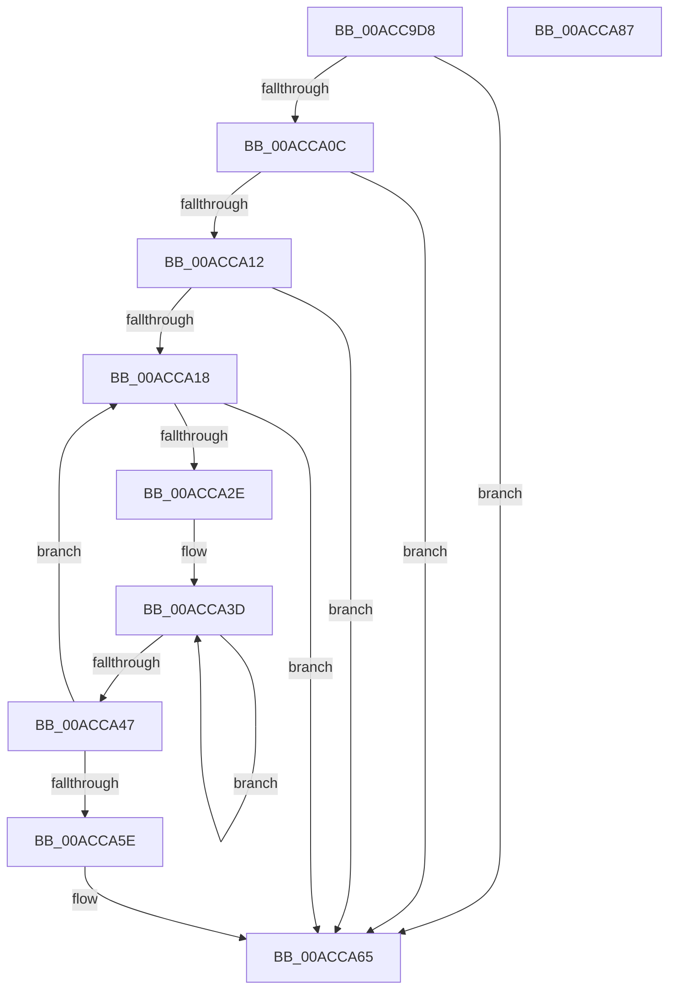

# CmFindFilterListInflectionPoint

- RVA: `0x00ACC9D8`–`0x00ACCA88` (길이 `176` bytes)
- VA: `0x0000000140ACC9D8`
- 실행 섹션: `PAGE`
- PDB 이름 있음: `예`; PDB Function 태그: `아니요`
- unwind 정보 RVA: `0x0005FEF8`
- 디코드: `55`개 명령, `176/176` bytes 표시
- 미해석 바이트: `0` (있으면 어셈블리에 `.byte`로 보존)

> 이 문서는 커널 이미지의 기계어와 PDB 기호를 분석해 생성했습니다. 4번과 5번은 함수 원형과 자료형을 바이너리 사용 방식에서 추정한 C 해석이며 원본 소스 복구 결과는 아닙니다.

## 1. Dependencies

- 직접 호출 지점: **2**; 고유 호출 대상: **2**
- 직접 호출자로 확인된 함수: **1**
- RIP 상대 이미지 참조: **0**

### Outgoing calls
- `0x00ACCA21` → [PnpMultiSzFind](../83/PnpMultiSzFind_function_0083243C.md) (function, `0x0083243C`)
- `0x00ACCA34` → [wcsicmp](../../text/50/wcsicmp_function_00500080.md) (function, `0x00500080`)

### Direct callers
- [CmMergeFilterLists](../AF/CmMergeFilterLists_function_00AFA2CC.md) at `0x00AFA348`

### Static image references
- 디코드된 RIP-relative 메모리 참조가 없습니다.

## 2. Other-region calls and transfers

- 다른 실행 섹션으로 향하는 call: **1**
  - `0x00ACCA34` → [wcsicmp](../../text/50/wcsicmp_function_00500080.md) (`PAGE` → `.text`)
- 별도 외부 분기/꼬리 이동을 확인하지 못했습니다.

## 3. Assembly (complete function range)

```asm
00ACC9D8  48 8B C4                        mov rax, rsp
00ACC9DB  48 89 58 08                     mov qword ptr [rax + 8], rbx
00ACC9DF  48 89 68 10                     mov qword ptr [rax + 0x10], rbp
00ACC9E3  48 89 70 18                     mov qword ptr [rax + 0x18], rsi
00ACC9E7  48 89 78 20                     mov qword ptr [rax + 0x20], rdi
00ACC9EB  41 54                           push r12
00ACC9ED  41 56                           push r14
00ACC9EF  41 57                           push r15
00ACC9F1  48 83 EC 20                     sub rsp, 0x20
00ACC9F5  45 33 E4                        xor r12d, r12d
00ACC9F8  4D 8B F8                        mov r15, r8
00ACC9FB  48 8B EA                        mov rbp, rdx
00ACC9FE  48 8B F9                        mov rdi, rcx
00ACCA01  41 8B DC                        mov ebx, r12d
00ACCA04  41 8B F4                        mov esi, r12d
00ACCA07  48 85 D2                        test rdx, rdx
00ACCA0A  74 59                           je 0x140acca65
00ACCA0C  66 44 39 22                     cmp word ptr [rdx], r12w
00ACCA10  74 53                           je 0x140acca65
00ACCA12  66 44 39 21                     cmp word ptr [rcx], r12w
00ACCA16  74 4D                           je 0x140acca65
00ACCA18  48 8B D7                        mov rdx, rdi
00ACCA1B  48 8B CD                        mov rcx, rbp
00ACCA1E  4C 8B F7                        mov r14, rdi
00ACCA21  E8 16 5A D6 FF                  call 0x14083243c
00ACCA26  48 8B D8                        mov rbx, rax
00ACCA29  48 85 C0                        test rax, rax
00ACCA2C  75 37                           jne 0x140acca65
00ACCA2E  49 8B D7                        mov rdx, r15
00ACCA31  48 8B CF                        mov rcx, rdi
00ACCA34  E8 47 36 A3 FF                  call 0x140500080
00ACCA39  48 83 C9 FF                     or rcx, 0xffffffffffffffff
00ACCA3D  48 FF C1                        inc rcx
00ACCA40  66 44 39 24 4F                  cmp word ptr [rdi + rcx*2], r12w
00ACCA45  75 F6                           jne 0x140acca3d
00ACCA47  48 8D 3C 4F                     lea rdi, [rdi + rcx*2]
00ACCA4B  48 83 C7 02                     add rdi, 2
00ACCA4F  85 C0                           test eax, eax
00ACCA51  4C 0F 45 F6                     cmovne r14, rsi
00ACCA55  49 8B F6                        mov rsi, r14
00ACCA58  66 44 39 27                     cmp word ptr [rdi], r12w
00ACCA5C  75 BA                           jne 0x140acca18
00ACCA5E  4D 85 F6                        test r14, r14
00ACCA61  49 0F 45 DE                     cmovne rbx, r14
00ACCA65  48 8B 6C 24 48                  mov rbp, qword ptr [rsp + 0x48]
00ACCA6A  48 8B C3                        mov rax, rbx
00ACCA6D  48 8B 5C 24 40                  mov rbx, qword ptr [rsp + 0x40]
00ACCA72  48 8B 74 24 50                  mov rsi, qword ptr [rsp + 0x50]
00ACCA77  48 8B 7C 24 58                  mov rdi, qword ptr [rsp + 0x58]
00ACCA7C  48 83 C4 20                     add rsp, 0x20
00ACCA80  41 5F                           pop r15
00ACCA82  41 5E                           pop r14
00ACCA84  41 5C                           pop r12
00ACCA86  C3                              ret
00ACCA87  CC                              int3
```

## 4. C-style interpretation (structured pseudocode)

```c
__int64 __fastcall CmFindFilterListInflectionPoint(__int64 a1, __int64 a2, __int64 a3)
{
    __int64 result;
    __int64 v_r12;
    __int64 v_rbx;
    __int64 v_rdi;
    __int64 v_rsp;
    unsigned __int64 v_stack_p10;
    unsigned __int64 v_stack_p18;
    unsigned __int64 v_stack_p20;
    unsigned __int64 v_stack_p8;

    *(unsigned __int64 *)(v_rsp + 8) = v_rbx;
    *(unsigned __int64 *)(v_rsp + 16) = v_rbp;
    *(unsigned __int64 *)(v_rsp + 24) = v_rsi;
    *(unsigned __int64 *)(v_rsp + 32) = v_rdi;
    v_rsp = (v_rsp) - (32);
    v_r12 = 0;
    if (a2 == 0) goto loc_00ACCA65;
    if ((*(unsigned __int16 *)(a2)) == 0) goto loc_00ACCA65;
    if ((*(unsigned __int16 *)(a1)) == 0) goto loc_00ACCA65;
loc_00ACCA18:
    result = PnpMultiSzFind(a2, a1, a3, a4);
    if (result != 0) goto loc_00ACCA65;
    result = wcsicmp(a1, a3, a3, a4);
    a1 = (a1) | (-1);
loc_00ACCA3D:
    a1 = (a1) + 1;
    if ((*(unsigned __int16 *)(a1 + a1 * 2)) != 0) goto loc_00ACCA3D;
    v_rdi = (a1 + a1 * 2) + (2);
    if ((unsigned int)(result) != 0) { a1 = 0; }
    if ((*(unsigned __int16 *)(v_rdi)) != 0) goto loc_00ACCA18;
    v_rbx = result;
    if (a1 != 0) { v_rbx = a1; }
loc_00ACCA65:
    v_rsp = (v_rsp) + (32);
    return v_rbx;
}
```

## 5. (Beta) C Style

```c
int64_t CmFindFilterListInflectionPoint(void *Arg1, int64_t Arg2, int64_t Arg3)
{
    uint8_t *arg1 = (uint8_t *)Arg1;

    int64_t result;
    int64_t local_r12;
    int64_t local_rbx;
    int64_t local_rdi;
    int64_t local_rsp;
    uint64_t v_stack_p10;
    uint64_t v_stack_p18;
    uint64_t v_stack_p20;
    uint64_t v_stack_p8;

    *(uint64_t *)(local_rsp + 0x8) = local_rbx;
    *(uint64_t *)(local_rsp + 0x10) = local_rbp;
    *(uint64_t *)(local_rsp + 0x18) = local_rsi;
    *(uint64_t *)(local_rsp + 0x20) = local_rdi;
    local_rsp = (local_rsp) - (32);
    local_r12 = 0;
    if (Arg2 == 0) goto loc_00ACCA65;
    if ((*(uint16_t *)(Arg2)) == 0) goto loc_00ACCA65;
    if ((*(uint16_t *)(arg1)) == 0) goto loc_00ACCA65;
loc_00ACCA18:
    result = PnpMultiSzFind(Arg2, Arg1, Arg3, a4);
    if (result != 0) goto loc_00ACCA65;
    result = wcsicmp(Arg1, Arg3, Arg3, a4);
    Arg1 = (Arg1) | (-1);
loc_00ACCA3D:
    Arg1 = (Arg1) + 1;
    if ((*(uint16_t *)(arg1 + arg1 * 2)) != 0) goto loc_00ACCA3D;
    local_rdi = (Arg1 + Arg1 * 2) + (2);
    if ((uint32_t)(result) != 0) { Arg1 = 0; }
    if ((*(uint16_t *)(local_rdi)) != 0) goto loc_00ACCA18;
    local_rbx = result;
    if (Arg1 != NULL) { local_rbx = Arg1; }
loc_00ACCA65:
    local_rsp = (local_rsp) + (32);
    return local_rbx;
}
```

### 관측된 메모리 오프셋

구조체 형식이 확인되지 않은 접근은 인자 기준의 오프셋으로만 기록했습니다.

| 기준 인자 | 오프셋 표현 | 폭 (bit) | 접근 |
|---|---:|---:|---|
| `Arg1` | `+ 0x0` | `16` | `R` |
| `Arg1` | `+ 0x0 + rcx*2` | `16` | `R` |
| `Arg1` | `+ 0x0 + rcx*2` | `64` | `R` |

## 6. Execution-region graph

[열기: 2D/3D 그래프와 함수 탐색 컨트롤 패널](../../../control-panel.html?section=page&rva=0x00ACC9D8&view=graph)

- 2D 그래프는 위에서 아래로 흐르고, 3D 그래프는 빈 공간을 드래그해 회전합니다. Shift+드래그는 이동, 휠은 확대·축소, 함수 노드 선택은 대상 보고서 이동입니다.

### Static fallback


