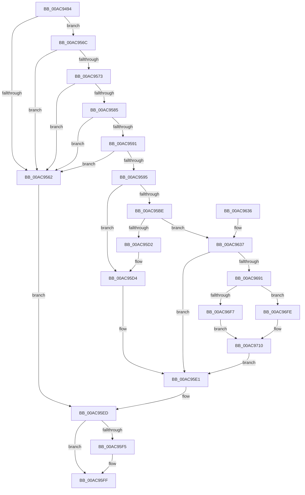

# CmKeyBodyRemapToVirtual

- RVA: `0x00AC9494`–`0x00AC9721` (길이 `653` bytes)
- VA: `0x0000000140AC9494`
- 실행 섹션: `PAGE`
- PDB 이름 있음: `예`; PDB Function 태그: `아니요`
- unwind 정보 RVA: `0x000BE24C`
- 디코드: `162`개 명령, `653/653` bytes 표시
- 미해석 바이트: `0` (있으면 어셈블리에 `.byte`로 보존)

> 이 문서는 커널 이미지의 기계어와 PDB 기호를 분석해 생성했습니다. 4번과 5번은 함수 원형과 자료형을 바이너리 사용 방식에서 추정한 C 해석이며 원본 소스 복구 결과는 아닙니다.

## 1. Dependencies

- 직접 호출 지점: **23**; 고유 호출 대상: **19**
- 직접 호출자로 확인된 함수: **2**
- RIP 상대 이미지 참조: **2**

### Outgoing calls
- `0x00AC94E4` → [memset](../../text/6C/memset_function_006C6C40.md) (function, `0x006C6C40`)
- `0x00AC9500` → [memset](../../text/6C/memset_function_006C6C40.md) (function, `0x006C6C40`)
- `0x00AC9514` → [memset](../../text/6C/memset_function_006C6C40.md) (function, `0x006C6C40`)
- `0x00AC952A` → [RtlInitUnicodeString](../../text/42/RtlInitUnicodeString_function_0042A780.md) (function, `0x0042A780`)
- `0x00AC954B` → [CmpInitializeParseContext](../87/CmpInitializeParseContext_function_008767F0.md) (function, `0x008767F0`)
- `0x00AC957C` → [KCBNeedsVirtualImage](../../text/42/KCBNeedsVirtualImage_function_0042E9FC.md) (function, `0x0042E9FC`)
- `0x00AC959C` → [CmpAttachToRegistryProcess](../../pagecmrc/BC/CmpAttachToRegistryProcess_function_00BC98E0.md) (function, `0x00BC98E0`)
- `0x00AC95A1` → [CmpLockRegistry](../../pagecmrc/BC/CmpLockRegistry_function_00BC9B34.md) (function, `0x00BC9B34`)
- `0x00AC95A9` → [CmpLockKcbShared](../../pagecmrc/BC/CmpLockKcbShared_function_00BC9A1C.md) (function, `0x00BC9A1C`)
- `0x00AC95B3` → [CmpPerformKeyBodyDeletionCheck](../../pagecmrc/BC/CmpPerformKeyBodyDeletionCheck_function_00BC97D0.md) (function, `0x00BC97D0`)
- `0x00AC95C9` → [CmpReparseToVirtualPath](../7E/CmpReparseToVirtualPath_function_007EBA48.md) (function, `0x007EBA48`)
- `0x00AC95D7` → [CmpUnlockKcb](../../pagecmrc/BC/CmpUnlockKcb_function_00BC92C0.md) (function, `0x00BC92C0`)
- `0x00AC95DC` → [CmpUnlockRegistry](../../pagecmrc/BC/CmpUnlockRegistry_function_00BC9A84.md) (function, `0x00BC9A84`)
- `0x00AC95E8` → [CmpDetachFromRegistryProcess](../../pagecmrc/BC/CmpDetachFromRegistryProcess_function_00BC9920.md) (function, `0x00BC9920`)
- `0x00AC95FA` → [RtlFreeAnsiString](../9C/RtlFreeAnsiString_function_009C0800.md) (function, `0x009C0800`)
- `0x00AC9605` → [CmpCleanupParseContext](../87/CmpCleanupParseContext_function_00876910.md) (function, `0x00876910`)
- `0x00AC9616` → [_security_check_cookie](../../text/6A/_security_check_cookie_function_006AC640.md) (function, `0x006AC640`)
- `0x00AC963E` → [CmpUnlockKcb](../../pagecmrc/BC/CmpUnlockKcb_function_00BC92C0.md) (function, `0x00BC92C0`)
- `0x00AC9643` → [CmpUnlockRegistry](../../pagecmrc/BC/CmpUnlockRegistry_function_00BC9A84.md) (function, `0x00BC9A84`)
- `0x00AC9682` → [SeCreateAccessStateFromSubjectContext](../A8/SeCreateAccessStateFromSubjectContext_function_00A8B12C.md) (function, `0x00A8B12C`)
- `0x00AC96EE` → [CmObReferenceObjectByName](../../pagecmrc/BC/CmObReferenceObjectByName_function_00BC9E94.md) (function, `0x00BC9E94`)
- `0x00AC9709` → [ObfDereferenceObject](../../text/2F/ObfDereferenceObject_function_002F9350.md) (function, `0x002F9350`)
- `0x00AC9717` → [SeDeleteAccessState](../8C/SeDeleteAccessState_function_008C5F70.md) (function, `0x008C5F70`)

### Direct callers
- [NtDeleteValueKey](../84/NtDeleteValueKey_function_00848770.md) at `0x00848D6D`
- [sub_00B1664A](../B1/Unknown_function_00B1664A.md) at `0x00B166C9`

### Static image references
- `0x00AC94B3` → RVA `0x00E0A740` (`.data`; read)
- `0x00AC9672` → RVA `0x00FC6AC0` (`ALMOSTRO`; read)

## 2. Other-region calls and transfers

- 다른 실행 섹션으로 향하는 call: **17**
  - `0x00AC94E4` → [memset](../../text/6C/memset_function_006C6C40.md) (`PAGE` → `.text`)
  - `0x00AC9500` → [memset](../../text/6C/memset_function_006C6C40.md) (`PAGE` → `.text`)
  - `0x00AC9514` → [memset](../../text/6C/memset_function_006C6C40.md) (`PAGE` → `.text`)
  - `0x00AC952A` → [RtlInitUnicodeString](../../text/42/RtlInitUnicodeString_function_0042A780.md) (`PAGE` → `.text`)
  - `0x00AC957C` → [KCBNeedsVirtualImage](../../text/42/KCBNeedsVirtualImage_function_0042E9FC.md) (`PAGE` → `.text`)
  - `0x00AC959C` → [CmpAttachToRegistryProcess](../../pagecmrc/BC/CmpAttachToRegistryProcess_function_00BC98E0.md) (`PAGE` → `PAGECMRC`)
  - `0x00AC95A1` → [CmpLockRegistry](../../pagecmrc/BC/CmpLockRegistry_function_00BC9B34.md) (`PAGE` → `PAGECMRC`)
  - `0x00AC95A9` → [CmpLockKcbShared](../../pagecmrc/BC/CmpLockKcbShared_function_00BC9A1C.md) (`PAGE` → `PAGECMRC`)
  - `0x00AC95B3` → [CmpPerformKeyBodyDeletionCheck](../../pagecmrc/BC/CmpPerformKeyBodyDeletionCheck_function_00BC97D0.md) (`PAGE` → `PAGECMRC`)
  - `0x00AC95D7` → [CmpUnlockKcb](../../pagecmrc/BC/CmpUnlockKcb_function_00BC92C0.md) (`PAGE` → `PAGECMRC`)
  - `0x00AC95DC` → [CmpUnlockRegistry](../../pagecmrc/BC/CmpUnlockRegistry_function_00BC9A84.md) (`PAGE` → `PAGECMRC`)
  - `0x00AC95E8` → [CmpDetachFromRegistryProcess](../../pagecmrc/BC/CmpDetachFromRegistryProcess_function_00BC9920.md) (`PAGE` → `PAGECMRC`)
  - `0x00AC9616` → [_security_check_cookie](../../text/6A/_security_check_cookie_function_006AC640.md) (`PAGE` → `.text`)
  - `0x00AC963E` → [CmpUnlockKcb](../../pagecmrc/BC/CmpUnlockKcb_function_00BC92C0.md) (`PAGE` → `PAGECMRC`)
  - `0x00AC9643` → [CmpUnlockRegistry](../../pagecmrc/BC/CmpUnlockRegistry_function_00BC9A84.md) (`PAGE` → `PAGECMRC`)
  - `0x00AC96EE` → [CmObReferenceObjectByName](../../pagecmrc/BC/CmObReferenceObjectByName_function_00BC9E94.md) (`PAGE` → `PAGECMRC`)
  - `0x00AC9709` → [ObfDereferenceObject](../../text/2F/ObfDereferenceObject_function_002F9350.md) (`PAGE` → `.text`)
- 별도 외부 분기/꼬리 이동을 확인하지 못했습니다.

## 3. Assembly (complete function range)

```asm
00AC9494  48 89 5C 24 10                  mov qword ptr [rsp + 0x10], rbx
00AC9499  55                              push rbp
00AC949A  56                              push rsi
00AC949B  57                              push rdi
00AC949C  41 54                           push r12
00AC949E  41 55                           push r13
00AC94A0  41 56                           push r14
00AC94A2  41 57                           push r15
00AC94A4  48 8D AC 24 E0 FC FF FF         lea rbp, [rsp - 0x320]
00AC94AC  48 81 EC 20 04 00 00            sub rsp, 0x420
00AC94B3  48 8B 05 86 12 34 00            mov rax, qword ptr [rip + 0x341286]
00AC94BA  48 33 C4                        xor rax, rsp
00AC94BD  48 89 85 10 03 00 00            mov qword ptr [rbp + 0x310], rax
00AC94C4  4C 8B A5 80 03 00 00            mov r12, qword ptr [rbp + 0x380]
00AC94CB  45 8B E8                        mov r13d, r8d
00AC94CE  88 54 24 40                     mov byte ptr [rsp + 0x40], dl
00AC94D2  4C 8B F9                        mov r15, rcx
00AC94D5  33 D2                           xor edx, edx
00AC94D7  48 8D 4D 90                     lea rcx, [rbp - 0x70]
00AC94DB  41 B8 D0 01 00 00               mov r8d, 0x1d0
00AC94E1  4D 8B F1                        mov r14, r9
00AC94E4  E8 57 D7 BF FF                  call 0x1406c6c40
00AC94E9  0F 57 C0                        xorps xmm0, xmm0
00AC94EC  48 8D 8D 90 01 00 00            lea rcx, [rbp + 0x190]
00AC94F3  33 D2                           xor edx, edx
00AC94F5  41 B8 A0 00 00 00               mov r8d, 0xa0
00AC94FB  0F 11 44 24 50                  movups xmmword ptr [rsp + 0x50], xmm0
00AC9500  E8 3B D7 BF FF                  call 0x1406c6c40
00AC9505  33 D2                           xor edx, edx
00AC9507  48 8D 8D 30 02 00 00            lea rcx, [rbp + 0x230]
00AC950E  41 B8 E0 00 00 00               mov r8d, 0xe0
00AC9514  E8 27 D7 BF FF                  call 0x1406c6c40
00AC9519  33 DB                           xor ebx, ebx
00AC951B  48 8D 4C 24 50                  lea rcx, [rsp + 0x50]
00AC9520  33 D2                           xor edx, edx
00AC9522  89 5C 24 64                     mov dword ptr [rsp + 0x64], ebx
00AC9526  89 5C 24 7C                     mov dword ptr [rsp + 0x7c], ebx
00AC952A  E8 51 12 96 FF                  call 0x14042a780
00AC952F  0F 57 C0                        xorps xmm0, xmm0
00AC9532  48 8D 4D 90                     lea rcx, [rbp - 0x70]
00AC9536  0F 11 85 60 01 00 00            movups xmmword ptr [rbp + 0x160], xmm0
00AC953D  0F 11 85 70 01 00 00            movups xmmword ptr [rbp + 0x170], xmm0
00AC9544  0F 11 85 80 01 00 00            movups xmmword ptr [rbp + 0x180], xmm0
00AC954B  E8 A0 D2 DA FF                  call 0x1408767f0
00AC9550  49 8B 37                        mov rsi, qword ptr [r15]
00AC9553  48 89 5C 24 48                  mov qword ptr [rsp + 0x48], rbx
00AC9558  48 8B 7E 08                     mov rdi, qword ptr [rsi + 8]
00AC955C  66 39 5F 42                     cmp word ptr [rdi + 0x42], bx
00AC9560  74 0A                           je 0x140ac956c
00AC9562  BB 22 00 00 C0                  mov ebx, 0xc0000022
00AC9567  E9 81 00 00 00                  jmp 0x140ac95ed
00AC956C  8B 46 30                        mov eax, dword ptr [rsi + 0x30]
00AC956F  A8 10                           test al, 0x10
00AC9571  75 EF                           jne 0x140ac9562
00AC9573  4D 8B C4                        mov r8, r12
00AC9576  49 8B D6                        mov rdx, r14
00AC9579  48 8B CF                        mov rcx, rdi
00AC957C  E8 7B 54 96 FF                  call 0x14042e9fc
00AC9581  84 C0                           test al, al
00AC9583  74 DD                           je 0x140ac9562
00AC9585  8B 87 B8 00 00 00               mov eax, dword ptr [rdi + 0xb8]
00AC958B  0F BA E0 17                     bt eax, 0x17
00AC958F  73 D1                           jae 0x140ac9562
00AC9591  A8 20                           test al, 0x20
00AC9593  75 CD                           jne 0x140ac9562
00AC9595  48 8D 8D 60 01 00 00            lea rcx, [rbp + 0x160]
00AC959C  E8 3F 03 10 00                  call 0x140bc98e0
00AC95A1  E8 8E 05 10 00                  call 0x140bc9b34
00AC95A6  48 8B CF                        mov rcx, rdi
00AC95A9  E8 6E 04 10 00                  call 0x140bc9a1c
00AC95AE  33 D2                           xor edx, edx
00AC95B0  48 8B CE                        mov rcx, rsi
00AC95B3  E8 18 02 10 00                  call 0x140bc97d0
00AC95B8  8B D8                           mov ebx, eax
00AC95BA  85 C0                           test eax, eax
00AC95BC  78 16                           js 0x140ac95d4
00AC95BE  4C 8D 4C 24 50                  lea r9, [rsp + 0x50]
00AC95C3  4D 8B C6                        mov r8, r14
00AC95C6  48 8B CF                        mov rcx, rdi
00AC95C9  E8 7A 24 D2 FF                  call 0x1407eba48
00AC95CE  84 C0                           test al, al
00AC95D0  75 65                           jne 0x140ac9637
00AC95D2  33 DB                           xor ebx, ebx
00AC95D4  48 8B CF                        mov rcx, rdi
00AC95D7  E8 E4 FC 0F 00                  call 0x140bc92c0
00AC95DC  E8 A3 04 10 00                  call 0x140bc9a84
00AC95E1  48 8D 8D 60 01 00 00            lea rcx, [rbp + 0x160]
00AC95E8  E8 33 03 10 00                  call 0x140bc9920
00AC95ED  48 83 7C 24 58 00               cmp qword ptr [rsp + 0x58], 0
00AC95F3  74 0A                           je 0x140ac95ff
00AC95F5  48 8D 4C 24 50                  lea rcx, [rsp + 0x50]
00AC95FA  E8 01 72 EF FF                  call 0x1409c0800
00AC95FF  33 D2                           xor edx, edx
00AC9601  48 8D 4D 90                     lea rcx, [rbp - 0x70]
00AC9605  E8 06 D3 DA FF                  call 0x140876910
00AC960A  8B C3                           mov eax, ebx
00AC960C  48 8B 8D 10 03 00 00            mov rcx, qword ptr [rbp + 0x310]
00AC9613  48 33 CC                        xor rcx, rsp
00AC9616  E8 25 30 BE FF                  call 0x1406ac640
00AC961B  48 8B 9C 24 68 04 00 00         mov rbx, qword ptr [rsp + 0x468]
00AC9623  48 81 C4 20 04 00 00            add rsp, 0x420
00AC962A  41 5F                           pop r15
00AC962C  41 5E                           pop r14
00AC962E  41 5D                           pop r13
00AC9630  41 5C                           pop r12
00AC9632  5F                              pop rdi
00AC9633  5E                              pop rsi
00AC9634  5D                              pop rbp
00AC9635  C3                              ret
00AC9636  CC                              int3
00AC9637  49 8B 0F                        mov rcx, qword ptr [r15]
00AC963A  48 8B 49 08                     mov rcx, qword ptr [rcx + 8]
00AC963E  E8 7D FC 0F 00                  call 0x140bc92c0
00AC9643  E8 3C 04 10 00                  call 0x140bc9a84
00AC9648  41 8B 04 24                     mov eax, dword ptr [r12]
00AC964C  4C 8D 85 30 02 00 00            lea r8, [rbp + 0x230]
00AC9653  89 45 A0                        mov dword ptr [rbp - 0x60], eax
00AC9656  48 8D 95 90 01 00 00            lea rdx, [rbp + 0x190]
00AC965D  C7 45 90 08 00 00 00            mov dword ptr [rbp - 0x70], 8
00AC9664  45 8B CD                        mov r9d, r13d
00AC9667  48 8B 46 38                     mov rax, qword ptr [rsi + 0x38]
00AC966B  49 8B CE                        mov rcx, r14
00AC966E  48 89 45 D8                     mov qword ptr [rbp - 0x28], rax
00AC9672  48 8B 05 47 D4 4F 00            mov rax, qword ptr [rip + 0x4fd447]
00AC9679  48 83 C0 4C                     add rax, 0x4c
00AC967D  48 89 44 24 20                  mov qword ptr [rsp + 0x20], rax
00AC9682  E8 A5 1A FC FF                  call 0x140a8b12c
00AC9687  8B D8                           mov ebx, eax
00AC9689  85 C0                           test eax, eax
00AC968B  0F 88 50 FF FF FF               js 0x140ac95e1
00AC9691  48 83 64 24 68 00               and qword ptr [rsp + 0x68], 0
00AC9697  48 8D 95 90 01 00 00            lea rdx, [rbp + 0x190]
00AC969E  80 7C 24 40 01                  cmp byte ptr [rsp + 0x40], 1
00AC96A3  B8 40 06 00 00                  mov eax, 0x640
00AC96A8  B9 40 02 00 00                  mov ecx, 0x240
00AC96AD  C7 44 24 60 30 00 00 00         mov dword ptr [rsp + 0x60], 0x30
00AC96B5  0F 45 C1                        cmovne eax, ecx
00AC96B8  0F 57 C0                        xorps xmm0, xmm0
00AC96BB  89 44 24 78                     mov dword ptr [rsp + 0x78], eax
00AC96BF  48 8D 4C 24 60                  lea rcx, [rsp + 0x60]
00AC96C4  48 8D 44 24 50                  lea rax, [rsp + 0x50]
00AC96C9  45 8B C5                        mov r8d, r13d
00AC96CC  48 89 44 24 70                  mov qword ptr [rsp + 0x70], rax
00AC96D1  48 8D 44 24 48                  lea rax, [rsp + 0x48]
00AC96D6  48 89 44 24 30                  mov qword ptr [rsp + 0x30], rax
00AC96DB  48 8D 45 90                     lea rax, [rbp - 0x70]
00AC96DF  48 89 44 24 28                  mov qword ptr [rsp + 0x28], rax
00AC96E4  C6 44 24 20 00                  mov byte ptr [rsp + 0x20], 0
00AC96E9  F3 0F 7F 45 80                  movdqu xmmword ptr [rbp - 0x80], xmm0
00AC96EE  E8 A1 07 10 00                  call 0x140bc9e94
00AC96F3  85 C0                           test eax, eax
00AC96F5  79 07                           jns 0x140ac96fe
00AC96F7  BB 22 00 00 C0                  mov ebx, 0xc0000022
00AC96FC  EB 12                           jmp 0x140ac9710
00AC96FE  48 8B 44 24 48                  mov rax, qword ptr [rsp + 0x48]
00AC9703  48 8B CE                        mov rcx, rsi
00AC9706  49 89 07                        mov qword ptr [r15], rax
00AC9709  E8 42 FC 82 FF                  call 0x1402f9350
00AC970E  33 DB                           xor ebx, ebx
00AC9710  48 8D 8D 90 01 00 00            lea rcx, [rbp + 0x190]
00AC9717  E8 54 C8 DF FF                  call 0x1408c5f70
00AC971C  E9 C0 FE FF FF                  jmp 0x140ac95e1
```

## 4. C-style interpretation (structured pseudocode)

```c
__int64 __fastcall CmKeyBodyRemapToVirtual(__int64 a1, int a2, int a3, __int64 a4, __int64 a5)
{
    __int64 result;
    __int64 v_rbx;
    __int64 v_rsp;
    unsigned __int64 v_stack_m128;
    unsigned __int64 v_stack_m1C8;
    unsigned __int64 v_stack_m1D8;
    unsigned __int64 v_stack_m1E8;
    unsigned __int64 v_stack_m1F8;
    unsigned __int64 v_stack_m358;
    unsigned __int64 v_stack_m380;
    unsigned int v_stack_m3B8;
    unsigned __int64 v_stack_m3C8;
    unsigned __int64 v_stack_m3D8;
    unsigned int v_stack_m3DC;
    unsigned int v_stack_m3F4;
    unsigned __int64 v_stack_m400;
    unsigned __int64 v_stack_m408;
    unsigned __int64 v_stack_m410;
    unsigned __int8 v_stack_m418;
    unsigned __int64 v_stack_m48;
    unsigned __int64 v_stack_p10;
    unsigned __int64 v_stack_p20;
    unsigned __int64 v_stack_p28;
    unsigned __int64 v_stack_p30;
    unsigned __int8 v_stack_p40;
    unsigned __int64 v_stack_p48;
    unsigned __int64 v_stack_p50;
    unsigned int v_stack_p60;
    unsigned __int64 v_stack_p68;
    unsigned __int64 v_stack_p70;
    unsigned int v_stack_p78;

    v_stack_p10 = v_rbx;
    v_rsp = (v_rsp) - (0x420ULL);
    result = (*(unsigned __int64 *)(v_rip + 3412614)) ^ (v_rsp);
    v_stack_m48 = result;
    v_stack_m418 = (unsigned __int8)(a2);
    a2 = 0;
    result = memset(v_stack_m3C8, a2, 464, a4);
    a2 = 0;
    v_stack_m408 = v_xmm0;
    result = memset(v_stack_m1C8, a2, 160, a4);
    a2 = 0;
    result = memset(v_stack_m128, a2, 224, a4);
    v_rbx = 0;
    a2 = 0;
    v_stack_m3F4 = 0;
    v_stack_m3DC = 0;
    result = RtlInitUnicodeString(v_stack_m408, a2, 224, a4);
    v_stack_m1F8 = v_xmm0;
    v_stack_m1E8 = v_xmm0;
    v_stack_m1D8 = v_xmm0;
    result = CmpInitializeParseContext(v_stack_m3C8, a2, 224, a4);
    v_stack_m410 = 0;
    if ((*(unsigned __int16 *)(*(unsigned __int64 *)(*(unsigned __int64 *)(a1) + 8) + 66)) == 0) goto loc_00AC956C;
loc_00AC9562:
    goto loc_00AC95ED;
loc_00AC956C:
    if ((((unsigned __int8)((unsigned int)(*(unsigned int *)(*(unsigned __int64 *)(a1) + 48)))) & (16)) != 0) goto loc_00AC9562;
    result = KCBNeedsVirtualImage(*(unsigned __int64 *)(*(unsigned __int64 *)(a1) + 8), a4, a5, a4);
    if ((unsigned __int8)(result) == 0) goto loc_00AC9562;
    if (condition_is_above_or_equal) goto loc_00AC9562;
    if ((((unsigned __int8)((unsigned int)(*(unsigned int *)(*(unsigned __int64 *)(*(unsigned __int64 *)(a1) + 8) + 184)))) & (32)) != 0) goto loc_00AC9562;
    result = CmpAttachToRegistryProcess(v_stack_m1F8, a4, a5, a4);
    result = CmpLockRegistry(v_stack_m1F8, a4, a5, a4);
    result = CmpLockKcbShared(*(unsigned __int64 *)(*(unsigned __int64 *)(a1) + 8), a4, a5, a4);
    a2 = 0;
    result = CmpPerformKeyBodyDeletionCheck(*(unsigned __int64 *)(a1), a2, a5, a4);
    if (sign_flag) goto loc_00AC95D4;
    result = CmpReparseToVirtualPath(*(unsigned __int64 *)(*(unsigned __int64 *)(a1) + 8), a2, a4, v_stack_m408);
    if ((unsigned __int8)(result) != 0) goto loc_00AC9637;
    v_rbx = 0;
loc_00AC95D4:
    result = CmpUnlockKcb(*(unsigned __int64 *)(*(unsigned __int64 *)(a1) + 8), a2, a4, v_stack_m408);
    result = CmpUnlockRegistry(*(unsigned __int64 *)(*(unsigned __int64 *)(a1) + 8), a2, a4, v_stack_m408);
loc_00AC95E1:
    result = CmpDetachFromRegistryProcess(v_stack_m1F8, a2, a4, v_stack_m408);
loc_00AC95ED:
    if (v_stack_m400 != 0) {
        a1 = v_stack_m408;
        result = RtlFreeAnsiString(a1, a2, a4, v_stack_m408);
    }
    a2 = 0;
    result = CmpCleanupParseContext(v_stack_m3C8, a2, a4, v_stack_m408);
    a1 = (v_stack_m48) ^ (v_rsp);
    result = _security_check_cookie(a1, a2, a4, v_stack_m408);
    v_rsp = (v_rsp) + (0x420ULL);
    return result;
loc_00AC9637:
    result = CmpUnlockKcb(*(unsigned __int64 *)(*(unsigned __int64 *)(a1) + 8), a2, a4, v_stack_m408);
    result = CmpUnlockRegistry(*(unsigned __int64 *)(*(unsigned __int64 *)(a1) + 8), a2, a4, v_stack_m408);
    v_stack_m3B8 = (unsigned int)((unsigned int)(*(unsigned int *)(a5)));
    v_stack_m3C8 = 8;
    v_stack_m380 = *(unsigned __int64 *)(*(unsigned __int64 *)(a1) + 56);
    result = (*(unsigned __int64 *)(v_rip + 5231687)) + (76);
    v_stack_p20 = result;
    result = SeCreateAccessStateFromSubjectContext(a4, v_stack_m1C8, v_stack_m128, (unsigned int)((unsigned int)((unsigned int)(a3))));
    if (sign_flag) goto loc_00AC95E1;
    v_stack_p60 = 48;
    result = (unsigned int)(0x640ULL);
    if (v_stack_p40 != 1) { result = 576; }
    v_stack_p78 = (unsigned int)(result);
    v_stack_p70 = v_stack_p50;
    v_stack_p30 = v_stack_p48;
    v_stack_p28 = v_stack_m3C8;
    v_stack_p20 = 0;
    v_stack_m3D8 = v_xmm0;
    result = CmObReferenceObjectByName(v_stack_p60, v_stack_m1C8, (unsigned int)((unsigned int)((unsigned int)(a3))), (unsigned int)((unsigned int)((unsigned int)(a3))));
    if (!sign_flag) goto loc_00AC96FE;
    goto loc_00AC9710;
loc_00AC96FE:
    *(unsigned __int64 *)(a1) = v_stack_p48;
    result = ObfDereferenceObject(*(unsigned __int64 *)(a1), v_stack_m1C8, (unsigned int)((unsigned int)((unsigned int)(a3))), (unsigned int)((unsigned int)((unsigned int)(a3))));
    v_rbx = 0;
loc_00AC9710:
    result = SeDeleteAccessState(v_stack_m1C8, v_stack_m1C8, (unsigned int)((unsigned int)((unsigned int)(a3))), (unsigned int)((unsigned int)((unsigned int)(a3))));
    goto loc_00AC95E1;
}
```

## 5. (Beta) C Style

```c
int64_t CmKeyBodyRemapToVirtual(void *Arg1, int32_t Arg2, int32_t Arg3, int64_t Arg4, void *Arg5)
{
    uint8_t *arg1 = (uint8_t *)Arg1;
    uint8_t *arg5 = (uint8_t *)Arg5;

    int64_t result;
    int64_t local_rbx;
    int64_t local_rsp;
    uint64_t v_stack_m128;
    uint64_t v_stack_m1C8;
    uint64_t v_stack_m1D8;
    uint64_t v_stack_m1E8;
    uint64_t v_stack_m1F8;
    uint64_t v_stack_m358;
    uint64_t v_stack_m380;
    uint32_t v_stack_m3B8;
    uint64_t v_stack_m3C8;
    uint64_t v_stack_m3D8;
    uint32_t v_stack_m3DC;
    uint32_t v_stack_m3F4;
    uint64_t v_stack_m400;
    uint64_t v_stack_m408;
    uint64_t v_stack_m410;
    uint8_t v_stack_m418;
    uint64_t v_stack_m48;
    uint64_t v_stack_p10;
    uint64_t v_stack_p20;
    uint64_t v_stack_p28;
    uint64_t v_stack_p30;
    uint8_t v_stack_p40;
    uint64_t v_stack_p48;
    uint64_t v_stack_p50;
    uint32_t v_stack_p60;
    uint64_t v_stack_p68;
    uint64_t v_stack_p70;
    uint32_t v_stack_p78;

    v_stack_p10 = local_rbx;
    local_rsp = (local_rsp) - (0x420ULL);
    result = (*(uint64_t *)(v_rip + 0x341286)) ^ (local_rsp);
    v_stack_m48 = result;
    v_stack_m418 = (uint8_t)(Arg2);
    Arg2 = 0;
    result = memset(v_stack_m3C8, Arg2, 464, Arg4);
    Arg2 = 0;
    v_stack_m408 = v_xmm0;
    result = memset(v_stack_m1C8, Arg2, 160, Arg4);
    Arg2 = 0;
    result = memset(v_stack_m128, Arg2, 224, Arg4);
    local_rbx = 0;
    Arg2 = 0;
    v_stack_m3F4 = 0;
    v_stack_m3DC = 0;
    result = RtlInitUnicodeString(v_stack_m408, Arg2, 224, Arg4);
    v_stack_m1F8 = v_xmm0;
    v_stack_m1E8 = v_xmm0;
    v_stack_m1D8 = v_xmm0;
    result = CmpInitializeParseContext(v_stack_m3C8, Arg2, 224, Arg4);
    v_stack_m410 = 0;
    if ((*(uint16_t *)(*(uint64_t *)(*(uint64_t *)(arg1) + 0x8) + 0x42)) == 0) goto loc_00AC956C;
loc_00AC9562:
    goto loc_00AC95ED;
loc_00AC956C:
    if ((((uint8_t)((uint32_t)(*(uint32_t *)(*(uint64_t *)(arg1) + 0x30)))) & (16)) != 0) goto loc_00AC9562;
    result = KCBNeedsVirtualImage(*(uint64_t *)(*(uint64_t *)(arg1) + 0x8), Arg4, Arg5, Arg4);
    if ((uint8_t)(result) == 0) goto loc_00AC9562;
    if (condition_is_above_or_equal) goto loc_00AC9562;
    if ((((uint8_t)((uint32_t)(*(uint32_t *)(*(uint64_t *)(*(uint64_t *)(arg1) + 0x8) + 0xB8)))) & (32)) != 0) goto loc_00AC9562;
    result = CmpAttachToRegistryProcess(v_stack_m1F8, Arg4, Arg5, Arg4);
    result = CmpLockRegistry(v_stack_m1F8, Arg4, Arg5, Arg4);
    result = CmpLockKcbShared(*(uint64_t *)(*(uint64_t *)(arg1) + 0x8), Arg4, Arg5, Arg4);
    Arg2 = 0;
    result = CmpPerformKeyBodyDeletionCheck(*(uint64_t *)(arg1), Arg2, Arg5, Arg4);
    if (sign_flag) goto loc_00AC95D4;
    result = CmpReparseToVirtualPath(*(uint64_t *)(*(uint64_t *)(arg1) + 0x8), Arg2, Arg4, v_stack_m408);
    if ((uint8_t)(result) != 0) goto loc_00AC9637;
    local_rbx = 0;
loc_00AC95D4:
    result = CmpUnlockKcb(*(uint64_t *)(*(uint64_t *)(arg1) + 0x8), Arg2, Arg4, v_stack_m408);
    result = CmpUnlockRegistry(*(uint64_t *)(*(uint64_t *)(arg1) + 0x8), Arg2, Arg4, v_stack_m408);
loc_00AC95E1:
    result = CmpDetachFromRegistryProcess(v_stack_m1F8, Arg2, Arg4, v_stack_m408);
loc_00AC95ED:
    if (v_stack_m400 != 0) {
        Arg1 = v_stack_m408;
        result = RtlFreeAnsiString(Arg1, Arg2, Arg4, v_stack_m408);
    }
    Arg2 = 0;
    result = CmpCleanupParseContext(v_stack_m3C8, Arg2, Arg4, v_stack_m408);
    Arg1 = (v_stack_m48) ^ (local_rsp);
    result = _security_check_cookie(Arg1, Arg2, Arg4, v_stack_m408);
    local_rsp = (local_rsp) + (0x420ULL);
    return result;
loc_00AC9637:
    result = CmpUnlockKcb(*(uint64_t *)(*(uint64_t *)(arg1) + 0x8), Arg2, Arg4, v_stack_m408);
    result = CmpUnlockRegistry(*(uint64_t *)(*(uint64_t *)(arg1) + 0x8), Arg2, Arg4, v_stack_m408);
    v_stack_m3B8 = (uint32_t)((uint32_t)(*(uint32_t *)(arg5)));
    v_stack_m3C8 = 8;
    v_stack_m380 = *(uint64_t *)(*(uint64_t *)(arg1) + 0x38);
    result = (*(uint64_t *)(v_rip + 0x4FD447)) + (76);
    v_stack_p20 = result;
    result = SeCreateAccessStateFromSubjectContext(Arg4, v_stack_m1C8, v_stack_m128, (uint32_t)((uint32_t)((uint32_t)(Arg3))));
    if (sign_flag) goto loc_00AC95E1;
    v_stack_p60 = 48;
    result = (uint32_t)(0x640ULL);
    if (v_stack_p40 != 1) { result = 576; }
    v_stack_p78 = (uint32_t)(result);
    v_stack_p70 = v_stack_p50;
    v_stack_p30 = v_stack_p48;
    v_stack_p28 = v_stack_m3C8;
    v_stack_p20 = 0;
    v_stack_m3D8 = v_xmm0;
    result = CmObReferenceObjectByName(v_stack_p60, v_stack_m1C8, (uint32_t)((uint32_t)((uint32_t)(Arg3))), (uint32_t)((uint32_t)((uint32_t)(Arg3))));
    if (!sign_flag) goto loc_00AC96FE;
    goto loc_00AC9710;
loc_00AC96FE:
    *(uint64_t *)(arg1) = v_stack_p48;
    result = ObfDereferenceObject(*(uint64_t *)(arg1), v_stack_m1C8, (uint32_t)((uint32_t)((uint32_t)(Arg3))), (uint32_t)((uint32_t)((uint32_t)(Arg3))));
    local_rbx = 0;
loc_00AC9710:
    result = SeDeleteAccessState(v_stack_m1C8, v_stack_m1C8, (uint32_t)((uint32_t)((uint32_t)(Arg3))), (uint32_t)((uint32_t)((uint32_t)(Arg3))));
    goto loc_00AC95E1;
}
```

### 관측된 메모리 오프셋

구조체 형식이 확인되지 않은 접근은 인자 기준의 오프셋으로만 기록했습니다.

| 기준 인자 | 오프셋 표현 | 폭 (bit) | 접근 |
|---|---:|---:|---|
| `Arg1` | `+ 0x0` | `64` | `R` |
| `Arg1` | `+ 0x0` | `64` | `W` |
| `Arg5` | `+ 0x0` | `32` | `R` |

## 6. Execution-region graph

[열기: 2D/3D 그래프와 함수 탐색 컨트롤 패널](../../../control-panel.html?section=page&rva=0x00AC9494&view=graph)

- 2D 그래프는 위에서 아래로 흐르고, 3D 그래프는 빈 공간을 드래그해 회전합니다. Shift+드래그는 이동, 휠은 확대·축소, 함수 노드 선택은 대상 보고서 이동입니다.

### Static fallback


