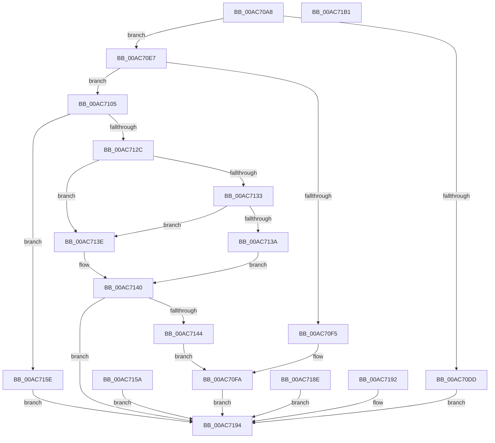

# CmQuerySingleFeatureConfiguration

- RVA: `0x00AC70A8`–`0x00AC71B2` (길이 `266` bytes)
- VA: `0x0000000140AC70A8`
- 실행 섹션: `PAGE`
- PDB 이름 있음: `예`; PDB Function 태그: `아니요`
- unwind 정보 RVA: `0x000BDFF0`
- 디코드: `75`개 명령, `266/266` bytes 표시
- 미해석 바이트: `0` (있으면 어셈블리에 `.byte`로 보존)

> 이 문서는 커널 이미지의 기계어와 PDB 기호를 분석해 생성했습니다. 4번과 5번은 함수 원형과 자료형을 바이너리 사용 방식에서 추정한 C 해석이며 원본 소스 복구 결과는 아닙니다.

## 1. Dependencies

- 직접 호출 지점: **2**; 고유 호출 대상: **2**
- 직접 호출자로 확인된 함수: **1**
- RIP 상대 이미지 참조: **1**

### Outgoing calls
- `0x00AC7121` → [RtlQueryFeatureConfiguration](../../text/4B/RtlQueryFeatureConfiguration_function_004BDD10.md) (function, `0x004BDD10`)
- `0x00AC719E` → [_security_check_cookie](../../text/6A/_security_check_cookie_function_006AC640.md) (function, `0x006AC640`)

### Direct callers
- [ExpQuerySystemInformation](../A5/ExpQuerySystemInformation_function_00A57858.md) at `0x00A5B024`

### Static image references
- `0x00AC70B2` → RVA `0x00E0A740` (`.data`; read)

## 2. Other-region calls and transfers

- 다른 실행 섹션으로 향하는 call: **2**
  - `0x00AC7121` → [RtlQueryFeatureConfiguration](../../text/4B/RtlQueryFeatureConfiguration_function_004BDD10.md) (`PAGE` → `.text`)
  - `0x00AC719E` → [_security_check_cookie](../../text/6A/_security_check_cookie_function_006AC640.md) (`PAGE` → `.text`)
- 별도 외부 분기/꼬리 이동을 확인하지 못했습니다.

## 3. Assembly (complete function range)

```asm
00AC70A8  48 89 5C 24 10                  mov qword ptr [rsp + 0x10], rbx
00AC70AD  57                              push rdi
00AC70AE  48 83 EC 70                     sub rsp, 0x70
00AC70B2  48 8B 05 87 36 34 00            mov rax, qword ptr [rip + 0x343687]
00AC70B9  48 33 C4                        xor rax, rsp
00AC70BC  48 89 44 24 60                  mov qword ptr [rsp + 0x60], rax
00AC70C1  49 8B D8                        mov rbx, r8
00AC70C4  48 8B BC 24 A0 00 00 00         mov rdi, qword ptr [rsp + 0xa0]
00AC70CC  48 83 64 24 30 00               and qword ptr [rsp + 0x30], 0
00AC70D2  48 83 64 24 28 00               and qword ptr [rsp + 0x28], 0
00AC70D8  83 FA 08                        cmp edx, 8
00AC70DB  74 0A                           je 0x140ac70e7
00AC70DD  B9 04 00 00 C0                  mov ecx, 0xc0000004
00AC70E2  E9 AD 00 00 00                  jmp 0x140ac7194
00AC70E7  48 8B 11                        mov rdx, qword ptr [rcx]
00AC70EA  48 89 54 24 30                  mov qword ptr [rsp + 0x30], rdx
00AC70EF  41 83 F9 18                     cmp r9d, 0x18
00AC70F3  74 10                           je 0x140ac7105
00AC70F5  B9 04 00 00 C0                  mov ecx, 0xc0000004
00AC70FA  C7 07 18 00 00 00               mov dword ptr [rdi], 0x18
00AC7100  E9 8F 00 00 00                  jmp 0x140ac7194
00AC7105  33 C0                           xor eax, eax
00AC7107  48 89 44 24 50                  mov qword ptr [rsp + 0x50], rax
00AC710C  89 44 24 58                     mov dword ptr [rsp + 0x58], eax
00AC7110  48 8B CA                        mov rcx, rdx
00AC7113  48 C1 E9 20                     shr rcx, 0x20
00AC7117  4C 8D 4C 24 50                  lea r9, [rsp + 0x50]
00AC711C  4C 8D 44 24 28                  lea r8, [rsp + 0x28]
00AC7121  E8 EA 6B 9F FF                  call 0x1404bdd10
00AC7126  8B C8                           mov ecx, eax
00AC7128  85 C0                           test eax, eax
00AC712A  79 32                           jns 0x140ac715e
00AC712C  3D 25 02 00 C0                  cmp eax, 0xc0000225
00AC7131  74 0B                           je 0x140ac713e
00AC7133  3D 22 00 00 80                  cmp eax, 0x80000022
00AC7138  74 04                           je 0x140ac713e
00AC713A  32 C0                           xor al, al
00AC713C  EB 02                           jmp 0x140ac7140
00AC713E  B0 01                           mov al, 1
00AC7140  84 C0                           test al, al
00AC7142  74 50                           je 0x140ac7194
00AC7144  0F 57 C0                        xorps xmm0, xmm0
00AC7147  33 C0                           xor eax, eax
00AC7149  0F 11 03                        movups xmmword ptr [rbx], xmm0
00AC714C  48 89 43 10                     mov qword ptr [rbx + 0x10], rax
00AC7150  48 8B 44 24 28                  mov rax, qword ptr [rsp + 0x28]
00AC7155  48 89 03                        mov qword ptr [rbx], rax
00AC7158  EB A0                           jmp 0x140ac70fa
00AC715A  8B C8                           mov ecx, eax
00AC715C  EB 36                           jmp 0x140ac7194
00AC715E  0F 57 C0                        xorps xmm0, xmm0
00AC7161  33 C0                           xor eax, eax
00AC7163  0F 11 03                        movups xmmword ptr [rbx], xmm0
00AC7166  48 89 43 10                     mov qword ptr [rbx + 0x10], rax
00AC716A  48 8B 44 24 28                  mov rax, qword ptr [rsp + 0x28]
00AC716F  48 89 03                        mov qword ptr [rbx], rax
00AC7172  F2 0F 10 44 24 50               movsd xmm0, qword ptr [rsp + 0x50]
00AC7178  F2 0F 11 43 08                  movsd qword ptr [rbx + 8], xmm0
00AC717D  8B 44 24 58                     mov eax, dword ptr [rsp + 0x58]
00AC7181  89 43 10                        mov dword ptr [rbx + 0x10], eax
00AC7184  C7 07 18 00 00 00               mov dword ptr [rdi], 0x18
00AC718A  33 C9                           xor ecx, ecx
00AC718C  EB 06                           jmp 0x140ac7194
00AC718E  8B C8                           mov ecx, eax
00AC7190  EB 02                           jmp 0x140ac7194
00AC7192  8B C8                           mov ecx, eax
00AC7194  8B C1                           mov eax, ecx
00AC7196  48 8B 4C 24 60                  mov rcx, qword ptr [rsp + 0x60]
00AC719B  48 33 CC                        xor rcx, rsp
00AC719E  E8 9D 54 BE FF                  call 0x1406ac640
00AC71A3  48 8B 9C 24 88 00 00 00         mov rbx, qword ptr [rsp + 0x88]
00AC71AB  48 83 C4 70                     add rsp, 0x70
00AC71AF  5F                              pop rdi
00AC71B0  C3                              ret
00AC71B1  CC                              int3
```

## 4. C-style interpretation (structured pseudocode)

```c
__int64 __fastcall CmQuerySingleFeatureConfiguration(__int64 a1, int a2, __int64 a3, int a4, __int64 a5)
{
    __int64 result;
    __int64 v_rsp;
    unsigned __int64 v_stack_m18;
    unsigned int v_stack_m20;
    unsigned __int64 v_stack_m28;
    unsigned __int64 v_stack_m48;
    unsigned __int64 v_stack_m50;
    unsigned __int64 v_stack_p10;

    v_stack_p10 = v_rbx;
    v_rsp = (v_rsp) - (112);
    result = (*(unsigned __int64 *)(v_rip + 3421831)) ^ (v_rsp);
    v_stack_m18 = result;
    if (a2 == 8) goto loc_00AC70E7;
    goto loc_00AC7194;
loc_00AC70E7:
    v_stack_m48 = *(unsigned __int64 *)((unsigned int)(0xC0000004ULL));
    if (a4 == 24) goto loc_00AC7105;
loc_00AC70FA:
    *(unsigned int *)(a5) = 24;
    goto loc_00AC7194;
loc_00AC7105:
    result = 0;
    v_stack_m28 = 0;
    v_stack_m20 = 0;
    a1 = (*(unsigned __int64 *)((unsigned int)(0xC0000004ULL))) >> (32);
    result = RtlQueryFeatureConfiguration(a1, *(unsigned __int64 *)((unsigned int)(0xC0000004ULL)), v_stack_m50, v_stack_m28);
    if (!sign_flag) goto loc_00AC715E;
    if (((unsigned int)(result)) == 0xC0000225ULL) goto loc_00AC713E;
    if (((unsigned int)(result)) == 0x80000022ULL) goto loc_00AC713E;
    result = 0;
    goto loc_00AC7140;
loc_00AC713E:
loc_00AC7140:
    if (1 == 0) goto loc_00AC7194;
    result = 0;
    *(unsigned __int64 *)(a3) = v_xmm0;
    *(unsigned __int64 *)(a3 + 16) = 0;
    *(unsigned __int64 *)(a3) = v_stack_m50;
    goto loc_00AC70FA;
loc_00AC715E:
    result = 0;
    *(unsigned __int64 *)(a3) = v_xmm0;
    *(unsigned __int64 *)(a3 + 16) = 0;
    *(unsigned __int64 *)(a3) = v_stack_m50;
    *(unsigned __int64 *)(a3 + 8) = v_xmm0;
    *(unsigned int *)(a3 + 16) = (unsigned int)((unsigned int)(v_stack_m20));
    *(unsigned int *)(a5) = 24;
    a1 = 0;
    goto loc_00AC7194;
loc_00AC7194:
    a1 = (v_stack_m18) ^ (v_rsp);
    result = _security_check_cookie(a1, *(unsigned __int64 *)((unsigned int)(0xC0000004ULL)), v_stack_m50, v_stack_m28);
    v_rsp = (v_rsp) + (112);
    return result;
}
```

## 5. (Beta) C Style

```c
int64_t CmQuerySingleFeatureConfiguration(void *Arg1, int32_t Arg2, void *Arg3, int32_t Arg4, void *Arg5)
{
    uint8_t *arg1 = (uint8_t *)Arg1;
    uint8_t *arg3 = (uint8_t *)Arg3;
    uint8_t *arg5 = (uint8_t *)Arg5;

    int64_t result;
    int64_t local_rsp;
    uint64_t v_stack_m18;
    uint32_t v_stack_m20;
    uint64_t v_stack_m28;
    uint64_t v_stack_m48;
    uint64_t v_stack_m50;
    uint64_t v_stack_p10;

    v_stack_p10 = local_rbx;
    local_rsp = (local_rsp) - (112);
    result = (*(uint64_t *)(v_rip + 0x343687)) ^ (local_rsp);
    v_stack_m18 = result;
    if (Arg2 == 8) goto loc_00AC70E7;
    goto loc_00AC7194;
loc_00AC70E7:
    v_stack_m48 = *(uint64_t *)((uint32_t)(0xC0000004ULL));
    if (Arg4 == 24) goto loc_00AC7105;
loc_00AC70FA:
    *(uint32_t *)(arg5) = 24;
    goto loc_00AC7194;
loc_00AC7105:
    result = 0;
    v_stack_m28 = 0;
    v_stack_m20 = 0;
    Arg1 = (*(uint64_t *)((uint32_t)(0xC0000004ULL))) >> (32);
    result = RtlQueryFeatureConfiguration(Arg1, *(uint64_t *)((uint32_t)(0xC0000004ULL)), v_stack_m50, v_stack_m28);
    if (!sign_flag) goto loc_00AC715E;
    if (((uint32_t)(result)) == 0xC0000225ULL) goto loc_00AC713E;
    if (((uint32_t)(result)) == 0x80000022ULL) goto loc_00AC713E;
    result = 0;
    goto loc_00AC7140;
loc_00AC713E:
loc_00AC7140:
    if (1 == 0) goto loc_00AC7194;
    result = 0;
    *(uint64_t *)(arg3) = v_xmm0;
    *(uint64_t *)(arg3 + 0x10) = 0;
    *(uint64_t *)(arg3) = v_stack_m50;
    goto loc_00AC70FA;
loc_00AC715E:
    result = 0;
    *(uint64_t *)(arg3) = v_xmm0;
    *(uint64_t *)(arg3 + 0x10) = 0;
    *(uint64_t *)(arg3) = v_stack_m50;
    *(uint64_t *)(arg3 + 0x8) = v_xmm0;
    *(uint32_t *)(arg3 + 0x10) = (uint32_t)((uint32_t)(v_stack_m20));
    *(uint32_t *)(arg5) = 24;
    Arg1 = 0;
    goto loc_00AC7194;
loc_00AC7194:
    Arg1 = (v_stack_m18) ^ (local_rsp);
    result = _security_check_cookie(Arg1, *(uint64_t *)((uint32_t)(0xC0000004ULL)), v_stack_m50, v_stack_m28);
    local_rsp = (local_rsp) + (112);
    return result;
}
```

### 관측된 메모리 오프셋

구조체 형식이 확인되지 않은 접근은 인자 기준의 오프셋으로만 기록했습니다.

| 기준 인자 | 오프셋 표현 | 폭 (bit) | 접근 |
|---|---:|---:|---|
| `Arg1` | `+ 0x0` | `64` | `R` |
| `Arg3` | `+ 0x0` | `64` | `W` |
| `Arg3` | `+ 0x0` | `128` | `R` |
| `Arg3` | `+ 0x8` | `64` | `W` |
| `Arg3` | `+ 0x10` | `32` | `W` |
| `Arg3` | `+ 0x10` | `64` | `W` |
| `Arg5` | `+ 0x0` | `32` | `W` |

## 6. Execution-region graph

[열기: 2D/3D 그래프와 함수 탐색 컨트롤 패널](../../../control-panel.html?section=page&rva=0x00AC70A8&view=graph)

- 2D 그래프는 위에서 아래로 흐르고, 3D 그래프는 빈 공간을 드래그해 회전합니다. Shift+드래그는 이동, 휠은 확대·축소, 함수 노드 선택은 대상 보고서 이동입니다.

### Static fallback


