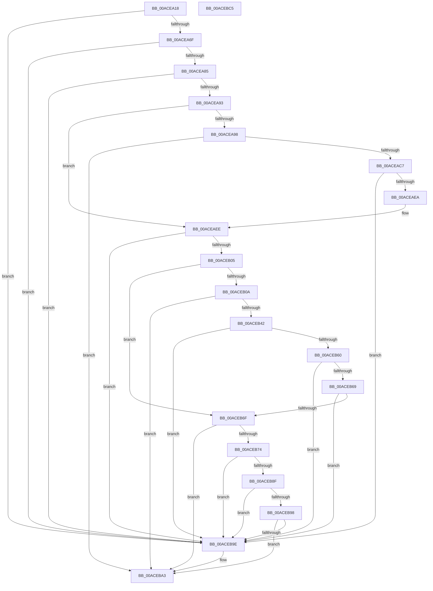

# CmSplitDevicePanelId

- RVA: `0x00ACEA18`–`0x00ACEBC6` (길이 `430` bytes)
- VA: `0x0000000140ACEA18`
- 실행 섹션: `PAGE`
- PDB 이름 있음: `예`; PDB Function 태그: `아니요`
- unwind 정보 RVA: `0x000A9E74`
- 디코드: `122`개 명령, `430/430` bytes 표시
- 미해석 바이트: `0` (있으면 어셈블리에 `.byte`로 보존)

> 이 문서는 커널 이미지의 기계어와 PDB 기호를 분석해 생성했습니다. 4번과 5번은 함수 원형과 자료형을 바이너리 사용 방식에서 추정한 C 해석이며 원본 소스 복구 결과는 아닙니다.

## 1. Dependencies

- 직접 호출 지점: **9**; 고유 호출 대상: **7**
- 직접 호출자로 확인된 함수: **3**
- RIP 상대 이미지 참조: **1**

### Outgoing calls
- `0x00ACEA60` → [RtlInitUnicodeStringEx](../../text/46/RtlInitUnicodeStringEx_function_00463960.md) (function, `0x00463960`)
- `0x00ACEAB8` → [RtlStringCchCopyNExW](../../text/43/RtlStringCchCopyNExW_function_00437CB0.md) (function, `0x00437CB0`)
- `0x00ACEACF` → [RtlInitUnicodeString](../../text/42/RtlInitUnicodeString_function_0042A780.md) (function, `0x0042A780`)
- `0x00ACEADB` → [RtlGUIDFromString](../8F/RtlGUIDFromString_function_008F1EF0.md) (function, `0x008F1EF0`)
- `0x00ACEAF4` → [wcschr](../../text/50/wcschr_function_00501A60.md) (function, `0x00501A60`)
- `0x00ACEB37` → [RtlStringCchCopyNExW](../../text/43/RtlStringCchCopyNExW_function_00437CB0.md) (function, `0x00437CB0`)
- `0x00ACEB50` → [wcstoul](../../text/50/wcstoul_function_005024A0.md) (function, `0x005024A0`)
- `0x00ACEB82` → [wcstoul](../../text/50/wcstoul_function_005024A0.md) (function, `0x005024A0`)
- `0x00ACEBAC` → [_security_check_cookie](../../text/6A/_security_check_cookie_function_006AC640.md) (function, `0x006AC640`)

### Direct callers
- [CmGetDevicePanelMappedProperty](../82/CmGetDevicePanelMappedProperty_function_0082ECD0.md) at `0x0082EDDC`
- [CmValidateDevicePanelName](../82/CmValidateDevicePanelName_function_0082F65C.md) at `0x0082F693`
- [sub_00B1EBE0](../B1/Unknown_function_00B1EBE0.md) at `0x00B1EC4D`

### Static image references
- `0x00ACEA31` → RVA `0x00E0A740` (`.data`; read)

## 2. Other-region calls and transfers

- 다른 실행 섹션으로 향하는 call: **8**
  - `0x00ACEA60` → [RtlInitUnicodeStringEx](../../text/46/RtlInitUnicodeStringEx_function_00463960.md) (`PAGE` → `.text`)
  - `0x00ACEAB8` → [RtlStringCchCopyNExW](../../text/43/RtlStringCchCopyNExW_function_00437CB0.md) (`PAGE` → `.text`)
  - `0x00ACEACF` → [RtlInitUnicodeString](../../text/42/RtlInitUnicodeString_function_0042A780.md) (`PAGE` → `.text`)
  - `0x00ACEAF4` → [wcschr](../../text/50/wcschr_function_00501A60.md) (`PAGE` → `.text`)
  - `0x00ACEB37` → [RtlStringCchCopyNExW](../../text/43/RtlStringCchCopyNExW_function_00437CB0.md) (`PAGE` → `.text`)
  - `0x00ACEB50` → [wcstoul](../../text/50/wcstoul_function_005024A0.md) (`PAGE` → `.text`)
  - `0x00ACEB82` → [wcstoul](../../text/50/wcstoul_function_005024A0.md) (`PAGE` → `.text`)
  - `0x00ACEBAC` → [_security_check_cookie](../../text/6A/_security_check_cookie_function_006AC640.md) (`PAGE` → `.text`)
- 별도 외부 분기/꼬리 이동을 확인하지 못했습니다.

## 3. Assembly (complete function range)

```asm
00ACEA18  40 55                           push rbp
00ACEA1A  53                              push rbx
00ACEA1B  56                              push rsi
00ACEA1C  57                              push rdi
00ACEA1D  41 54                           push r12
00ACEA1F  41 55                           push r13
00ACEA21  41 56                           push r14
00ACEA23  41 57                           push r15
00ACEA25  48 8D 6C 24 E1                  lea rbp, [rsp - 0x1f]
00ACEA2A  48 81 EC D8 00 00 00            sub rsp, 0xd8
00ACEA31  48 8B 05 08 BD 33 00            mov rax, qword ptr [rip + 0x33bd08]
00ACEA38  48 33 C4                        xor rax, rsp
00ACEA3B  48 89 45 07                     mov qword ptr [rbp + 7], rax
00ACEA3F  48 8B FA                        mov rdi, rdx
00ACEA42  48 8B F1                        mov rsi, rcx
00ACEA45  48 8B D1                        mov rdx, rcx
00ACEA48  0F 57 C0                        xorps xmm0, xmm0
00ACEA4B  45 33 ED                        xor r13d, r13d
00ACEA4E  48 8D 4D 8F                     lea rcx, [rbp - 0x71]
00ACEA52  4D 8B F9                        mov r15, r9
00ACEA55  4C 89 6D 87                     mov qword ptr [rbp - 0x79], r13
00ACEA59  4D 8B E0                        mov r12, r8
00ACEA5C  0F 11 45 8F                     movups xmmword ptr [rbp - 0x71], xmm0
00ACEA60  E8 FB 4E 99 FF                  call 0x140463960
00ACEA65  8B D8                           mov ebx, eax
00ACEA67  85 C0                           test eax, eax
00ACEA69  0F 88 2F 01 00 00               js 0x140aceb9e
00ACEA6F  0F B7 45 91                     movzx eax, word ptr [rbp - 0x6f]
00ACEA73  B9 FE FF 00 00                  mov ecx, 0xfffe
00ACEA78  66 23 C1                        and ax, cx
00ACEA7B  66 83 F8 52                     cmp ax, 0x52
00ACEA7F  0F 82 19 01 00 00               jb 0x140aceb9e
00ACEA85  41 8D 45 5C                     lea eax, [r13 + 0x5c]
00ACEA89  66 39 46 4C                     cmp word ptr [rsi + 0x4c], ax
00ACEA8D  0F 85 0B 01 00 00               jne 0x140aceb9e
00ACEA93  48 85 FF                        test rdi, rdi
00ACEA96  74 56                           je 0x140aceaee
00ACEA98  C7 44 24 30 00 08 00 00         mov dword ptr [rsp + 0x30], 0x800
00ACEAA0  45 8D 4D 26                     lea r9d, [r13 + 0x26]
00ACEAA4  4C 89 6C 24 28                  mov qword ptr [rsp + 0x28], r13
00ACEAA9  8D 50 CB                        lea edx, [rax - 0x35]
00ACEAAC  4C 8B C6                        mov r8, rsi
00ACEAAF  4C 89 6C 24 20                  mov qword ptr [rsp + 0x20], r13
00ACEAB4  48 8D 4D B7                     lea rcx, [rbp - 0x49]
00ACEAB8  E8 F3 91 96 FF                  call 0x140437cb0
00ACEABD  8B D8                           mov ebx, eax
00ACEABF  85 C0                           test eax, eax
00ACEAC1  0F 88 DC 00 00 00               js 0x140aceba3
00ACEAC7  48 8D 55 B7                     lea rdx, [rbp - 0x49]
00ACEACB  48 8D 4D 8F                     lea rcx, [rbp - 0x71]
00ACEACF  E8 AC BC 95 FF                  call 0x14042a780
00ACEAD4  48 8B D7                        mov rdx, rdi
00ACEAD7  48 8D 4D 8F                     lea rcx, [rbp - 0x71]
00ACEADB  E8 10 34 E2 FF                  call 0x1408f1ef0
00ACEAE0  8B D8                           mov ebx, eax
00ACEAE2  85 C0                           test eax, eax
00ACEAE4  0F 88 B4 00 00 00               js 0x140aceb9e
00ACEAEA  41 8D 45 5C                     lea eax, [r13 + 0x5c]
00ACEAEE  8B D0                           mov edx, eax
00ACEAF0  48 8D 4E 4E                     lea rcx, [rsi + 0x4e]
00ACEAF4  E8 67 2F A3 FF                  call 0x140501a60
00ACEAF9  48 8B F8                        mov rdi, rax
00ACEAFC  48 85 C0                        test rax, rax
00ACEAFF  0F 84 99 00 00 00               je 0x140aceb9e
00ACEB05  4D 85 E4                        test r12, r12
00ACEB08  74 65                           je 0x140aceb6f
00ACEB0A  4C 8D 48 02                     lea r9, [rax + 2]
00ACEB0E  C7 44 24 30 00 08 00 00         mov dword ptr [rsp + 0x30], 0x800
00ACEB16  4C 2B CE                        sub r9, rsi
00ACEB19  4C 89 6C 24 28                  mov qword ptr [rsp + 0x28], r13
00ACEB1E  49 83 E9 50                     sub r9, 0x50
00ACEB22  4C 89 6C 24 20                  mov qword ptr [rsp + 0x20], r13
00ACEB27  49 D1 F9                        sar r9, 1
00ACEB2A  4C 8D 46 4E                     lea r8, [rsi + 0x4e]
00ACEB2E  BA 09 00 00 00                  mov edx, 9
00ACEB33  48 8D 4D 9F                     lea rcx, [rbp - 0x61]
00ACEB37  E8 74 91 96 FF                  call 0x140437cb0
00ACEB3C  8B D8                           mov ebx, eax
00ACEB3E  85 C0                           test eax, eax
00ACEB40  78 61                           js 0x140aceba3
00ACEB42  41 B8 10 00 00 00               mov r8d, 0x10
00ACEB48  48 8D 55 87                     lea rdx, [rbp - 0x79]
00ACEB4C  48 8D 4D 9F                     lea rcx, [rbp - 0x61]
00ACEB50  E8 4B 39 A3 FF                  call 0x1405024a0
00ACEB55  41 89 04 24                     mov dword ptr [r12], eax
00ACEB59  3D FF FF 00 00                  cmp eax, 0xffff
00ACEB5E  77 3E                           ja 0x140aceb9e
00ACEB60  48 8B 45 87                     mov rax, qword ptr [rbp - 0x79]
00ACEB64  48 85 C0                        test rax, rax
00ACEB67  74 35                           je 0x140aceb9e
00ACEB69  66 44 39 28                     cmp word ptr [rax], r13w
00ACEB6D  75 2F                           jne 0x140aceb9e
00ACEB6F  4D 85 FF                        test r15, r15
00ACEB72  74 2F                           je 0x140aceba3
00ACEB74  41 B8 10 00 00 00               mov r8d, 0x10
00ACEB7A  48 8D 55 87                     lea rdx, [rbp - 0x79]
00ACEB7E  48 8D 4F 02                     lea rcx, [rdi + 2]
00ACEB82  E8 19 39 A3 FF                  call 0x1405024a0
00ACEB87  41 89 07                        mov dword ptr [r15], eax
00ACEB8A  83 F8 07                        cmp eax, 7
00ACEB8D  77 0F                           ja 0x140aceb9e
00ACEB8F  48 8B 45 87                     mov rax, qword ptr [rbp - 0x79]
00ACEB93  48 85 C0                        test rax, rax
00ACEB96  74 06                           je 0x140aceb9e
00ACEB98  66 44 39 28                     cmp word ptr [rax], r13w
00ACEB9C  74 05                           je 0x140aceba3
00ACEB9E  BB 33 00 00 C0                  mov ebx, 0xc0000033
00ACEBA3  8B C3                           mov eax, ebx
00ACEBA5  48 8B 4D 07                     mov rcx, qword ptr [rbp + 7]
00ACEBA9  48 33 CC                        xor rcx, rsp
00ACEBAC  E8 8F DA BD FF                  call 0x1406ac640
00ACEBB1  48 81 C4 D8 00 00 00            add rsp, 0xd8
00ACEBB8  41 5F                           pop r15
00ACEBBA  41 5E                           pop r14
00ACEBBC  41 5D                           pop r13
00ACEBBE  41 5C                           pop r12
00ACEBC0  5F                              pop rdi
00ACEBC1  5E                              pop rsi
00ACEBC2  5B                              pop rbx
00ACEBC3  5D                              pop rbp
00ACEBC4  C3                              ret
00ACEBC5  CC                              int3
```

## 4. C-style interpretation (structured pseudocode)

```c
__int64 __fastcall CmSplitDevicePanelId(__int64 a1, __int64 a2, __int64 a3, __int64 a4)
{
    __int64 result;
    __int64 v_r13;
    __int64 v_rbx;
    __int64 v_rsp;
    unsigned __int64 v_stack_m58;
    unsigned __int64 v_stack_m5F;
    unsigned __int64 v_stack_mA8;
    unsigned __int64 v_stack_mC0;
    unsigned __int16 v_stack_mCE;
    unsigned __int64 v_stack_mD0;
    unsigned __int64 v_stack_mD8;
    unsigned int v_stack_mE8;
    unsigned __int64 v_stack_mF0;
    unsigned __int64 v_stack_mF8;

    v_rsp = (v_rsp) - (216);
    result = (*(unsigned __int64 *)(v_rip + 3390728)) ^ (v_rsp);
    v_stack_m58 = result;
    v_r13 = 0;
    v_stack_mD8 = 0;
    v_stack_mD0 = v_xmm0;
    result = RtlInitUnicodeStringEx(v_stack_mD0, a1, a3, a4);
    if (sign_flag) goto loc_00ACEB9E;
    result = (unsigned __int16)((v_stack_mCE) & ((unsigned __int16)((unsigned int)(0xFFFEULL))));
    if (((unsigned __int16)(result)) < 82) goto loc_00ACEB9E;
    if ((*(unsigned __int16 *)(a1 + 76)) != ((unsigned __int16)(v_r13 + 92))) goto loc_00ACEB9E;
    if (a2 == 0) goto loc_00ACEAEE;
    v_stack_mE8 = 0x800ULL;
    v_stack_mF0 = 0;
    v_stack_mF8 = 0;
    result = RtlStringCchCopyNExW(v_stack_mA8, v_r13 + 92 - 53, a1, v_r13 + 38);
    if (sign_flag) goto loc_00ACEBA3;
    result = RtlInitUnicodeString(v_stack_mD0, v_stack_mA8, a1, v_r13 + 38);
    result = RtlGUIDFromString(v_stack_mD0, a2, a1, v_r13 + 38);
    if (sign_flag) goto loc_00ACEB9E;
loc_00ACEAEE:
    result = wcschr(a1 + 78, (unsigned int)((unsigned int)(v_r13 + 92)), a1, v_r13 + 38);
    if (result == 0) goto loc_00ACEB9E;
    if (a3 == 0) goto loc_00ACEB6F;
    v_stack_mE8 = 0x800ULL;
    a4 = (result + 2) - (a1);
    v_stack_mF0 = 0;
    a4 = (a4) - (80);
    v_stack_mF8 = 0;
    a4 = (a4) >> (1);
    result = RtlStringCchCopyNExW(v_stack_mC0, 9, a1 + 78, a4);
    if (sign_flag) goto loc_00ACEBA3;
    result = wcstoul(v_stack_mC0, v_stack_mD8, 16, a4);
    *(unsigned int *)(a3) = (unsigned int)(result);
    if (((unsigned int)(result)) > 0xFFFFULL) goto loc_00ACEB9E;
    if (v_stack_mD8 == 0) goto loc_00ACEB9E;
    if ((*(unsigned __int16 *)(v_stack_mD8)) != 0) goto loc_00ACEB9E;
loc_00ACEB6F:
    if (a4 == 0) goto loc_00ACEBA3;
    result = wcstoul(result + 2, v_stack_mD8, 16, a4);
    *(unsigned int *)(a4) = (unsigned int)(result);
    if (((unsigned int)(result)) > 7) goto loc_00ACEB9E;
    if (v_stack_mD8 == 0) goto loc_00ACEB9E;
    v_rbx = (unsigned int)((unsigned int)(result));
    if ((*(unsigned __int16 *)(v_stack_mD8)) != 0) {
        v_rbx = 0xC0000033ULL;
    }
    a1 = (v_stack_m58) ^ (v_rsp);
    result = _security_check_cookie(a1, v_stack_mD8, 16, a4);
    v_rsp = (v_rsp) + (216);
    return result;
}
```

## 5. (Beta) C Style

```c
int64_t CmSplitDevicePanelId(void *Arg1, int64_t Arg2, int64_t Arg3, int64_t Arg4)
{
    uint8_t *arg1 = (uint8_t *)Arg1;

    int64_t result;
    int64_t local_r13;
    int64_t local_rbx;
    int64_t local_rsp;
    uint64_t v_stack_m58;
    uint64_t v_stack_m5F;
    uint64_t v_stack_mA8;
    uint64_t v_stack_mC0;
    uint16_t v_stack_mCE;
    uint64_t v_stack_mD0;
    uint64_t v_stack_mD8;
    uint32_t v_stack_mE8;
    uint64_t v_stack_mF0;
    uint64_t v_stack_mF8;

    local_rsp = (local_rsp) - (216);
    result = (*(uint64_t *)(v_rip + 0x33BD08)) ^ (local_rsp);
    v_stack_m58 = result;
    local_r13 = 0;
    v_stack_mD8 = 0;
    v_stack_mD0 = v_xmm0;
    result = RtlInitUnicodeStringEx(v_stack_mD0, Arg1, Arg3, Arg4);
    if (sign_flag) goto loc_00ACEB9E;
    result = (uint16_t)((v_stack_mCE) & ((uint16_t)((uint32_t)(0xFFFEULL))));
    if (((uint16_t)(result)) < 82) goto loc_00ACEB9E;
    if ((*(uint16_t *)(arg1 + 0x4C)) != ((uint16_t)(local_r13 + 92))) goto loc_00ACEB9E;
    if (Arg2 == 0) goto loc_00ACEAEE;
    v_stack_mE8 = 0x800ULL;
    v_stack_mF0 = 0;
    v_stack_mF8 = 0;
    result = RtlStringCchCopyNExW(v_stack_mA8, local_r13 + 92 - 53, Arg1, local_r13 + 38);
    if (sign_flag) goto loc_00ACEBA3;
    result = RtlInitUnicodeString(v_stack_mD0, v_stack_mA8, Arg1, local_r13 + 38);
    result = RtlGUIDFromString(v_stack_mD0, Arg2, Arg1, local_r13 + 38);
    if (sign_flag) goto loc_00ACEB9E;
loc_00ACEAEE:
    result = wcschr(Arg1 + 78, (uint32_t)((uint32_t)(local_r13 + 92)), Arg1, local_r13 + 38);
    if (result == 0) goto loc_00ACEB9E;
    if (Arg3 == 0) goto loc_00ACEB6F;
    v_stack_mE8 = 0x800ULL;
    Arg4 = (result + 2) - (Arg1);
    v_stack_mF0 = 0;
    Arg4 = (Arg4) - (80);
    v_stack_mF8 = 0;
    Arg4 = (Arg4) >> (1);
    result = RtlStringCchCopyNExW(v_stack_mC0, 9, Arg1 + 78, Arg4);
    if (sign_flag) goto loc_00ACEBA3;
    result = wcstoul(v_stack_mC0, v_stack_mD8, 16, Arg4);
    *(uint32_t *)(Arg3) = (uint32_t)(result);
    if (((uint32_t)(result)) > 0xFFFFULL) goto loc_00ACEB9E;
    if (v_stack_mD8 == 0) goto loc_00ACEB9E;
    if ((*(uint16_t *)(v_stack_mD8)) != 0) goto loc_00ACEB9E;
loc_00ACEB6F:
    if (Arg4 == 0) goto loc_00ACEBA3;
    result = wcstoul(result + 2, v_stack_mD8, 16, Arg4);
    *(uint32_t *)(Arg4) = (uint32_t)(result);
    if (((uint32_t)(result)) > 7) goto loc_00ACEB9E;
    if (v_stack_mD8 == 0) goto loc_00ACEB9E;
    local_rbx = (uint32_t)((uint32_t)(result));
    if ((*(uint16_t *)(v_stack_mD8)) != 0) {
        local_rbx = 0xC0000033ULL;
    }
    Arg1 = (v_stack_m58) ^ (local_rsp);
    result = _security_check_cookie(Arg1, v_stack_mD8, 16, Arg4);
    local_rsp = (local_rsp) + (216);
    return result;
}
```

### 관측된 메모리 오프셋

구조체 형식이 확인되지 않은 접근은 인자 기준의 오프셋으로만 기록했습니다.

| 기준 인자 | 오프셋 표현 | 폭 (bit) | 접근 |
|---|---:|---:|---|
| `Arg1` | `+ 0x4C` | `16` | `R` |
| `Arg1` | `+ 0x4E` | `64` | `R` |

## 6. Execution-region graph

[열기: 2D/3D 그래프와 함수 탐색 컨트롤 패널](../../../control-panel.html?section=page&rva=0x00ACEA18&view=graph)

- 2D 그래프는 위에서 아래로 흐르고, 3D 그래프는 빈 공간을 드래그해 회전합니다. Shift+드래그는 이동, 휠은 확대·축소, 함수 노드 선택은 대상 보고서 이동입니다.

### Static fallback


