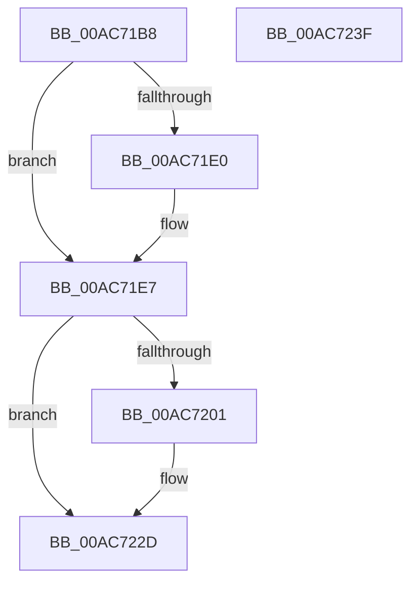

# CmpDelayFreeCmRm

- RVA: `0x00AC71B8`–`0x00AC7240` (길이 `136` bytes)
- VA: `0x0000000140AC71B8`
- 실행 섹션: `PAGE`
- PDB 이름 있음: `예`; PDB Function 태그: `아니요`
- unwind 정보 RVA: `0x00064C80`
- 디코드: `31`개 명령, `136/136` bytes 표시
- 미해석 바이트: `0` (있으면 어셈블리에 `.byte`로 보존)

> 이 문서는 커널 이미지의 기계어와 PDB 기호를 분석해 생성했습니다. 4번과 5번은 함수 원형과 자료형을 바이너리 사용 방식에서 추정한 C 해석이며 원본 소스 복구 결과는 아닙니다.

## 1. Dependencies

- 직접 호출 지점: **3**; 고유 호출 대상: **3**
- 직접 호출자로 확인된 함수: **1**
- RIP 상대 이미지 참조: **8**

### Outgoing calls
- `0x00AC71C8` → [ExAcquireFastMutex](../../text/20/ExAcquireFastMutex_function_0020E5A0.md) (function, `0x0020E5A0`)
- `0x00AC7228` → [KiSetTimerEx](../../text/23/KiSetTimerEx_function_00232CB0.md) (function, `0x00232CB0`)
- `0x00AC7234` → [ExReleaseFastMutex](../../text/25/ExReleaseFastMutex_function_002519C0.md) (function, `0x002519C0`)

### Direct callers
- [CmpRunDownCmRM](../9B/CmpRunDownCmRM_function_009B062C.md) at `0x009B07B5`

### Static image references
- `0x00AC71C1` → RVA `0x00EF56E0` (`.data`; read)
- `0x00AC71CD` → RVA `0x00EF56A8` (`.data`; read)
- `0x00AC71D4` → RVA `0x00EF56A0` (`.data`; read)
- `0x00AC71E7` → RVA `0x00EEFC68` (`.data`; read)
- `0x00AC71F8` → RVA `0x00EF56A8` (`.data`; write)
- `0x00AC7201` → RVA `0x00EF55E0` (`.data`; read)
- `0x00AC7208` → RVA `0x00EEFC68` (`.data`; write)
- `0x00AC721A` → RVA `0x00EF5620` (`.data`; read)

## 2. Other-region calls and transfers

- 다른 실행 섹션으로 향하는 call: **3**
  - `0x00AC71C8` → [ExAcquireFastMutex](../../text/20/ExAcquireFastMutex_function_0020E5A0.md) (`PAGE` → `.text`)
  - `0x00AC7228` → [KiSetTimerEx](../../text/23/KiSetTimerEx_function_00232CB0.md) (`PAGE` → `.text`)
  - `0x00AC7234` → [ExReleaseFastMutex](../../text/25/ExReleaseFastMutex_function_002519C0.md) (`PAGE` → `.text`)
- 별도 외부 분기/꼬리 이동을 확인하지 못했습니다.

## 3. Assembly (complete function range)

```asm
00AC71B8  40 53                           push rbx
00AC71BA  48 83 EC 30                     sub rsp, 0x30
00AC71BE  48 8B D9                        mov rbx, rcx
00AC71C1  48 8D 0D 18 E5 42 00            lea rcx, [rip + 0x42e518]
00AC71C8  E8 D3 73 74 FF                  call 0x14020e5a0
00AC71CD  48 8B 05 D4 E4 42 00            mov rax, qword ptr [rip + 0x42e4d4]
00AC71D4  48 8D 0D C5 E4 42 00            lea rcx, [rip + 0x42e4c5]
00AC71DB  48 39 08                        cmp qword ptr [rax], rcx
00AC71DE  74 07                           je 0x140ac71e7
00AC71E0  B9 03 00 00 00                  mov ecx, 3
00AC71E5  CD 29                           int 0x29
00AC71E7  80 3D 7A 8A 42 00 00            cmp byte ptr [rip + 0x428a7a], 0
00AC71EE  48 89 0B                        mov qword ptr [rbx], rcx
00AC71F1  48 89 43 08                     mov qword ptr [rbx + 8], rax
00AC71F5  48 89 18                        mov qword ptr [rax], rbx
00AC71F8  48 89 1D A9 E4 42 00            mov qword ptr [rip + 0x42e4a9], rbx
00AC71FF  75 2C                           jne 0x140ac722d
00AC7201  48 8D 05 D8 E3 42 00            lea rax, [rip + 0x42e3d8]
00AC7208  C6 05 59 8A 42 00 01            mov byte ptr [rip + 0x428a59], 1
00AC720F  45 33 C9                        xor r9d, r9d
00AC7212  48 89 44 24 20                  mov qword ptr [rsp + 0x20], rax
00AC7217  45 33 C0                        xor r8d, r8d
00AC721A  48 8D 0D FF E3 42 00            lea rcx, [rip + 0x42e3ff]
00AC7221  48 C7 C2 00 5D 1E EE            mov rdx, 0xffffffffee1e5d00
00AC7228  E8 83 BA 76 FF                  call 0x140232cb0
00AC722D  48 8D 0D AC E4 42 00            lea rcx, [rip + 0x42e4ac]
00AC7234  E8 87 A7 78 FF                  call 0x1402519c0
00AC7239  48 83 C4 30                     add rsp, 0x30
00AC723D  5B                              pop rbx
00AC723E  C3                              ret
00AC723F  CC                              int3
```

## 4. C-style interpretation (structured pseudocode)

```c
__int64 __fastcall CmpDelayFreeCmRm(__int64 a1, __int64 a2, int a3, int a4)
{
    __int64 result;
    __int64 v_rsp;
    unsigned __int64 v_stack_m18;

    v_rsp = (v_rsp) - (48);
    result = ExAcquireFastMutex(v_rip + 4384024, a2, a3, a4);
    if ((*(unsigned __int64 *)(*(unsigned __int64 *)(v_rip + 4383956))) != (v_rip + 4383941)) {
        a1 = 3;
    }
    *(unsigned __int64 *)(a1) = a1;
    *(unsigned __int64 *)(a1 + 8) = *(unsigned __int64 *)(v_rip + 4383956);
    *(unsigned __int64 *)(*(unsigned __int64 *)(v_rip + 4383956)) = a1;
    *(unsigned __int64 *)(v_rip + 4383913) = a1;
    result = *(unsigned __int64 *)(v_rip + 4383956);
    if ((*(unsigned __int8 *)(v_rip + 4360826)) == 0) {
        result = v_rip + 4383704;
        *(unsigned __int8 *)(v_rip + 4360793) = 1;
        a4 = 0;
        v_stack_m18 = result;
        a3 = 0;
        a1 = v_rip + 4383743;
        a2 = 0xFFFFFFFFEE1E5D00ULL;
        result = KiSetTimerEx(a1, a2, a3, a4);
    }
    result = ExReleaseFastMutex(v_rip + 4383916, a2, a3, a4);
    v_rsp = (v_rsp) + (48);
    return result;
}
```

## 5. (Beta) C Style

```c
int64_t CmpDelayFreeCmRm(void *Arg1, int64_t Arg2, int32_t Arg3, int32_t Arg4)
{
    uint8_t *arg1 = (uint8_t *)Arg1;

    int64_t result;
    int64_t local_rsp;
    uint64_t v_stack_m18;

    local_rsp = (local_rsp) - (48);
    result = ExAcquireFastMutex(v_rip + 4384024, Arg2, Arg3, Arg4);
    if ((*(uint64_t *)(*(uint64_t *)(v_rip + 0x42E4D4))) != (v_rip + 4383941)) {
        Arg1 = 3;
    }
    *(void **)(arg1) = Arg1;
    *(uint64_t *)(arg1 + 0x8) = *(uint64_t *)(v_rip + 0x42E4D4);
    *(void **)(*(uint64_t *)(v_rip + 0x42E4D4)) = Arg1;
    *(void **)(v_rip + 0x42E4A9) = Arg1;
    result = *(uint64_t *)(v_rip + 0x42E4D4);
    if ((*(uint8_t *)(v_rip + 0x428A7A)) == 0) {
        result = v_rip + 4383704;
        *(uint8_t *)(v_rip + 0x428A59) = 1;
        Arg4 = 0;
        v_stack_m18 = result;
        Arg3 = 0;
        Arg1 = v_rip + 4383743;
        Arg2 = 0xFFFFFFFFEE1E5D00ULL;
        result = KiSetTimerEx(Arg1, Arg2, Arg3, Arg4);
    }
    result = ExReleaseFastMutex(v_rip + 4383916, Arg2, Arg3, Arg4);
    local_rsp = (local_rsp) + (48);
    return result;
}
```

### 관측된 메모리 오프셋

구조체 형식이 확인되지 않은 접근은 인자 기준의 오프셋으로만 기록했습니다.

| 기준 인자 | 오프셋 표현 | 폭 (bit) | 접근 |
|---|---:|---:|---|
| `Arg1` | `+ 0x0` | `64` | `W` |
| `Arg1` | `+ 0x8` | `64` | `W` |

## 6. Execution-region graph

[열기: 2D/3D 그래프와 함수 탐색 컨트롤 패널](../../../control-panel.html?section=page&rva=0x00AC71B8&view=graph)

- 2D 그래프는 위에서 아래로 흐르고, 3D 그래프는 빈 공간을 드래그해 회전합니다. Shift+드래그는 이동, 휠은 확대·축소, 함수 노드 선택은 대상 보고서 이동입니다.

### Static fallback


