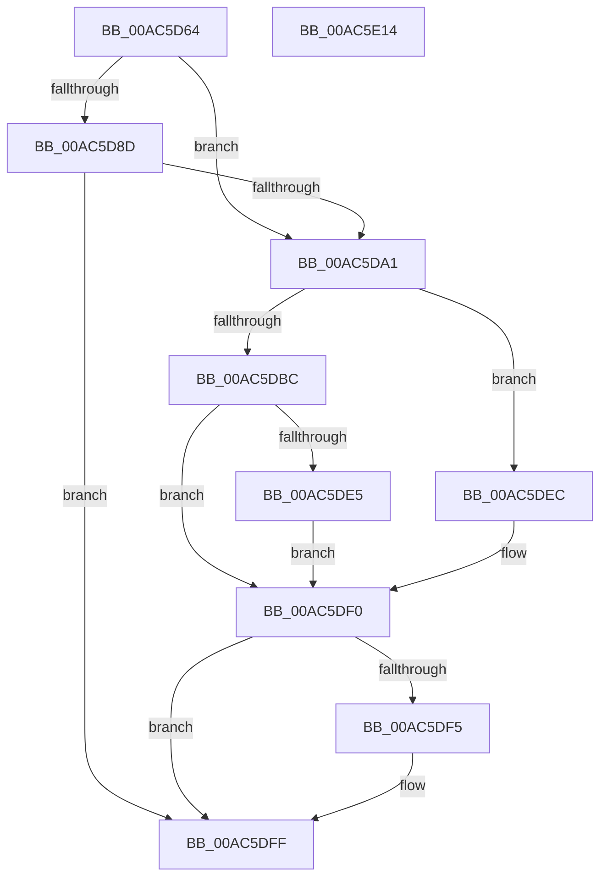

# CmpSetValueKeyTombstone

- RVA: `0x00AC5D64`–`0x00AC5E15` (길이 `177` bytes)
- VA: `0x0000000140AC5D64`
- 실행 섹션: `PAGE`
- PDB 이름 있음: `예`; PDB Function 태그: `아니요`
- unwind 정보 RVA: `0x000B9EA4`
- 디코드: `57`개 명령, `177/177` bytes 표시
- 미해석 바이트: `0` (있으면 어셈블리에 `.byte`로 보존)

> 이 문서는 커널 이미지의 기계어와 PDB 기호를 분석해 생성했습니다. 4번과 5번은 함수 원형과 자료형을 바이너리 사용 방식에서 추정한 C 해석이며 원본 소스 복구 결과는 아닙니다.

## 1. Dependencies

- 직접 호출 지점: **4**; 고유 호출 대상: **4**
- 직접 호출자로 확인된 함수: **1**
- RIP 상대 이미지 참조: **0**

### Outgoing calls
- `0x00AC5D96` → [HvpMarkCellDirty](../85/HvpMarkCellDirty_function_00858080.md) (function, `0x00858080`)
- `0x00AC5DB1` → [CmpAddValueKeyTombstone](../7E/CmpAddValueKeyTombstone_function_007EA488.md) (function, `0x007EA488`)
- `0x00AC5DDA` → [CmpAddValueToListEx](../85/CmpAddValueToListEx_function_0085B460.md) (function, `0x0085B460`)
- `0x00AC5DFA` → [CmpFreeValue](../84/CmpFreeValue_function_0084AF98.md) (function, `0x0084AF98`)

### Direct callers
- [CmDeleteValueKey](../84/CmDeleteValueKey_function_008476E8.md) at `0x00848082`

### Static image references
- 디코드된 RIP-relative 메모리 참조가 없습니다.

## 2. Other-region calls and transfers

- 다른 실행 섹션으로 향하는 call: **0**
- 별도 외부 분기/꼬리 이동을 확인하지 못했습니다.

## 3. Assembly (complete function range)

```asm
00AC5D64  48 89 5C 24 08                  mov qword ptr [rsp + 8], rbx
00AC5D69  48 89 6C 24 18                  mov qword ptr [rsp + 0x18], rbp
00AC5D6E  56                              push rsi
00AC5D6F  57                              push rdi
00AC5D70  41 56                           push r14
00AC5D72  48 83 EC 30                     sub rsp, 0x30
00AC5D76  83 4C 24 58 FF                  or dword ptr [rsp + 0x58], 0xffffffff
00AC5D7B  48 8D 5A 24                     lea rbx, [rdx + 0x24]
00AC5D7F  83 3B 00                        cmp dword ptr [rbx], 0
00AC5D82  45 8B F1                        mov r14d, r9d
00AC5D85  49 8B E8                        mov rbp, r8
00AC5D88  48 8B F1                        mov rsi, rcx
00AC5D8B  74 14                           je 0x140ac5da1
00AC5D8D  8B 52 28                        mov edx, dword ptr [rdx + 0x28]
00AC5D90  45 33 C9                        xor r9d, r9d
00AC5D93  45 33 C0                        xor r8d, r8d
00AC5D96  E8 E5 22 D9 FF                  call 0x140858080
00AC5D9B  8B F8                           mov edi, eax
00AC5D9D  85 C0                           test eax, eax
00AC5D9F  78 5E                           js 0x140ac5dff
00AC5DA1  44 8B 44 24 70                  mov r8d, dword ptr [rsp + 0x70]
00AC5DA6  4C 8D 4C 24 58                  lea r9, [rsp + 0x58]
00AC5DAB  48 8B D5                        mov rdx, rbp
00AC5DAE  48 8B CE                        mov rcx, rsi
00AC5DB1  E8 D2 46 D2 FF                  call 0x1407ea488
00AC5DB6  8B F8                           mov edi, eax
00AC5DB8  85 C0                           test eax, eax
00AC5DBA  78 30                           js 0x140ac5dec
00AC5DBC  44 8B 4C 24 70                  mov r9d, dword ptr [rsp + 0x70]
00AC5DC1  45 8B C6                        mov r8d, r14d
00AC5DC4  C7 44 24 28 01 00 00 00         mov dword ptr [rsp + 0x28], 1
00AC5DCC  48 8B CE                        mov rcx, rsi
00AC5DCF  48 89 5C 24 20                  mov qword ptr [rsp + 0x20], rbx
00AC5DD4  8B 5C 24 58                     mov ebx, dword ptr [rsp + 0x58]
00AC5DD8  8B D3                           mov edx, ebx
00AC5DDA  E8 81 56 D9 FF                  call 0x14085b460
00AC5DDF  8B F8                           mov edi, eax
00AC5DE1  85 C0                           test eax, eax
00AC5DE3  78 0B                           js 0x140ac5df0
00AC5DE5  83 CB FF                        or ebx, 0xffffffff
00AC5DE8  33 FF                           xor edi, edi
00AC5DEA  EB 04                           jmp 0x140ac5df0
00AC5DEC  8B 5C 24 58                     mov ebx, dword ptr [rsp + 0x58]
00AC5DF0  83 FB FF                        cmp ebx, -1
00AC5DF3  74 0A                           je 0x140ac5dff
00AC5DF5  8B D3                           mov edx, ebx
00AC5DF7  48 8B CE                        mov rcx, rsi
00AC5DFA  E8 99 51 D8 FF                  call 0x14084af98
00AC5DFF  48 8B 5C 24 50                  mov rbx, qword ptr [rsp + 0x50]
00AC5E04  8B C7                           mov eax, edi
00AC5E06  48 8B 6C 24 60                  mov rbp, qword ptr [rsp + 0x60]
00AC5E0B  48 83 C4 30                     add rsp, 0x30
00AC5E0F  41 5E                           pop r14
00AC5E11  5F                              pop rdi
00AC5E12  5E                              pop rsi
00AC5E13  C3                              ret
00AC5E14  CC                              int3
```

## 4. C-style interpretation (structured pseudocode)

```c
__int64 __fastcall CmpSetValueKeyTombstone(__int64 a1, __int64 a2, __int64 a3, int a4, unsigned int a5)
{
    __int64 result;
    __int64 v_rbx;
    __int64 v_rdi;
    __int64 v_rsp;
    unsigned int v_stack_m20;
    unsigned __int64 v_stack_m28;
    unsigned int v_stack_p10;
    unsigned __int64 v_stack_p18;
    unsigned __int64 v_stack_p8;

    v_stack_p8 = v_rbx;
    v_stack_p18 = v_rbp;
    v_rsp = (v_rsp) - (48);
    if ((*(unsigned int *)(a2 + 36)) == 0) goto loc_00AC5DA1;
    a4 = 0;
    a3 = 0;
    result = HvpMarkCellDirty(a1, (unsigned int)(*(unsigned int *)(a2 + 40)), a3, a4);
    if (sign_flag) goto loc_00AC5DFF;
loc_00AC5DA1:
    result = CmpAddValueKeyTombstone(a1, 0, (unsigned int)(a5), v_stack_p10);
    if (sign_flag) goto loc_00AC5DEC;
    v_stack_m20 = 1;
    v_stack_m28 = a2 + 36;
    result = CmpAddValueToListEx(a1, (unsigned int)((unsigned int)((unsigned int)(v_stack_p10))), (unsigned int)((unsigned int)((unsigned int)(a4))), (unsigned int)(a5));
    if (sign_flag) goto loc_00AC5DF0;
    v_rbx = (unsigned int)(((unsigned int)(v_stack_p10)) | (0xFFFFFFFFULL));
    v_rdi = 0;
    goto loc_00AC5DF0;
loc_00AC5DEC:
loc_00AC5DF0:
    if (((unsigned int)((unsigned int)(v_stack_p10))) != -1) {
        a2 = (unsigned int)((unsigned int)(v_stack_p10));
        a1 = a1;
        result = CmpFreeValue(a1, a2, (unsigned int)((unsigned int)((unsigned int)(a4))), (unsigned int)(a5));
    }
    v_rsp = (v_rsp) + (48);
    return 0;
}
```

## 5. (Beta) C Style

```c
int64_t CmpSetValueKeyTombstone(int64_t Arg1, void *Arg2, int64_t Arg3, int32_t Arg4, uint32_t Arg5)
{
    uint8_t *arg2 = (uint8_t *)Arg2;

    int64_t result;
    int64_t local_rbx;
    int64_t local_rdi;
    int64_t local_rsp;
    uint32_t v_stack_m20;
    uint64_t v_stack_m28;
    uint32_t v_stack_p10;
    uint64_t v_stack_p18;
    uint64_t v_stack_p8;

    v_stack_p8 = local_rbx;
    v_stack_p18 = local_rbp;
    local_rsp = (local_rsp) - (48);
    if ((*(uint32_t *)(arg2 + 0x24)) == 0) goto loc_00AC5DA1;
    Arg4 = 0;
    Arg3 = 0;
    result = HvpMarkCellDirty(Arg1, (uint32_t)(*(uint32_t *)(arg2 + 0x28)), Arg3, Arg4);
    if (sign_flag) goto loc_00AC5DFF;
loc_00AC5DA1:
    result = CmpAddValueKeyTombstone(Arg1, 0, (uint32_t)(Arg5), v_stack_p10);
    if (sign_flag) goto loc_00AC5DEC;
    v_stack_m20 = 1;
    v_stack_m28 = Arg2 + 36;
    result = CmpAddValueToListEx(Arg1, (uint32_t)((uint32_t)((uint32_t)(v_stack_p10))), (uint32_t)((uint32_t)((uint32_t)(Arg4))), (uint32_t)(Arg5));
    if (sign_flag) goto loc_00AC5DF0;
    local_rbx = (uint32_t)(((uint32_t)(v_stack_p10)) | (0xFFFFFFFFULL));
    local_rdi = 0;
    goto loc_00AC5DF0;
loc_00AC5DEC:
loc_00AC5DF0:
    if (((uint32_t)((uint32_t)(v_stack_p10))) != -1) {
        Arg2 = (uint32_t)((uint32_t)(v_stack_p10));
        Arg1 = Arg1;
        result = CmpFreeValue(Arg1, Arg2, (uint32_t)((uint32_t)((uint32_t)(Arg4))), (uint32_t)(Arg5));
    }
    local_rsp = (local_rsp) + (48);
    return 0;
}
```

### 관측된 메모리 오프셋

구조체 형식이 확인되지 않은 접근은 인자 기준의 오프셋으로만 기록했습니다.

| 기준 인자 | 오프셋 표현 | 폭 (bit) | 접근 |
|---|---:|---:|---|
| `Arg2` | `+ 0x0` | `32` | `R` |
| `Arg2` | `+ 0x24` | `64` | `R` |
| `Arg2` | `+ 0x28` | `32` | `R` |

## 6. Execution-region graph

[열기: 2D/3D 그래프와 함수 탐색 컨트롤 패널](../../../control-panel.html?section=page&rva=0x00AC5D64&view=graph)

- 2D 그래프는 위에서 아래로 흐르고, 3D 그래프는 빈 공간을 드래그해 회전합니다. Shift+드래그는 이동, 휠은 확대·축소, 함수 노드 선택은 대상 보고서 이동입니다.

### Static fallback


