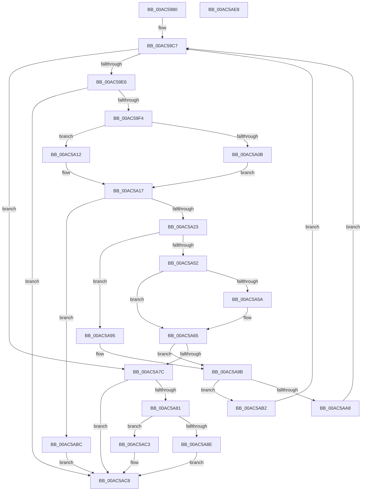

# CmpSyncSubKeysAfterDelete

- RVA: `0x00AC5980`–`0x00AC5AE9` (길이 `361` bytes)
- VA: `0x0000000140AC5980`
- 실행 섹션: `PAGE`
- PDB 이름 있음: `예`; PDB Function 태그: `아니요`
- unwind 정보 RVA: `0x000BDEF8`
- 디코드: `107`개 명령, `361/361` bytes 표시
- 미해석 바이트: `0` (있으면 어셈블리에 `.byte`로 보존)

> 이 문서는 커널 이미지의 기계어와 PDB 기호를 분석해 생성했습니다. 4번과 5번은 함수 원형과 자료형을 바이너리 사용 방식에서 추정한 C 해석이며 원본 소스 복구 결과는 아닙니다.

## 1. Dependencies

- 직접 호출 지점: **11**; 고유 호출 대상: **9**
- 직접 호출자로 확인된 함수: **1**
- RIP 상대 이미지 참조: **0**

### Outgoing calls
- `0x00AC59D4` → [CmpFindSubKeyByNumber](../85/CmpFindSubKeyByNumber_function_0085C930.md) (function, `0x0085C930`)
- `0x00AC5A0B` → [HvpGetCellFlat](../85/HvpGetCellFlat_function_00854C60.md) (function, `0x00854C60`)
- `0x00AC5A12` → [HvpGetCellPaged](../85/HvpGetCellPaged_function_00854CB0.md) (function, `0x00854CB0`)
- `0x00AC5A2E` → [CmpInitializeKeyNameString](../A8/CmpInitializeKeyNameString_function_00A8B734.md) (function, `0x00A8B734`)
- `0x00AC5A47` → [CmpFindSubKeyByNameWithStatus](../85/CmpFindSubKeyByNameWithStatus_function_00852770.md) (function, `0x00852770`)
- `0x00AC5A60` → [CmpDeleteTree](../7F/CmpDeleteTree_function_007F3E44.md) (function, `0x007F3E44`)
- `0x00AC5A6E` → [CmpFreeKeyByCell](../84/CmpFreeKeyByCell_function_0084AD70.md) (function, `0x0084AD70`)
- `0x00AC5A8E` → [HvpReleaseCellFlat](../85/HvpReleaseCellFlat_function_0085CC20.md) (function, `0x0085CC20`)
- `0x00AC5AA8` → [HvpReleaseCellFlat](../85/HvpReleaseCellFlat_function_0085CC20.md) (function, `0x0085CC20`)
- `0x00AC5AB2` → [HvpReleaseCellPaged](../85/HvpReleaseCellPaged_function_00855F40.md) (function, `0x00855F40`)
- `0x00AC5AC3` → [HvpReleaseCellPaged](../85/HvpReleaseCellPaged_function_00855F40.md) (function, `0x00855F40`)

### Direct callers
- [CmpCopySyncTree2](../85/CmpCopySyncTree2_function_0085BF78.md) at `0x0085C647`

### Static image references
- 디코드된 RIP-relative 메모리 참조가 없습니다.

## 2. Other-region calls and transfers

- 다른 실행 섹션으로 향하는 call: **0**
- 별도 외부 분기/꼬리 이동을 확인하지 못했습니다.

## 3. Assembly (complete function range)

```asm
00AC5980  48 89 5C 24 18                  mov qword ptr [rsp + 0x18], rbx
00AC5985  48 89 54 24 10                  mov qword ptr [rsp + 0x10], rdx
00AC598A  48 89 4C 24 08                  mov qword ptr [rsp + 8], rcx
00AC598F  55                              push rbp
00AC5990  56                              push rsi
00AC5991  57                              push rdi
00AC5992  41 54                           push r12
00AC5994  41 55                           push r13
00AC5996  41 56                           push r14
00AC5998  41 57                           push r15
00AC599A  48 8B EC                        mov rbp, rsp
00AC599D  48 83 EC 40                     sub rsp, 0x40
00AC59A1  45 33 F6                        xor r14d, r14d
00AC59A4  4D 8D B8 8C 00 00 00            lea r15, [r8 + 0x8c]
00AC59AB  83 4D E8 FF                     or dword ptr [rbp - 0x18], 0xffffffff
00AC59AF  0F 57 C0                        xorps xmm0, xmm0
00AC59B2  44 89 75 E0                     mov dword ptr [rbp - 0x20], r14d
00AC59B6  45 8B E6                        mov r12d, r14d
00AC59B9  44 89 75 EC                     mov dword ptr [rbp - 0x14], r14d
00AC59BD  4D 8B E9                        mov r13, r9
00AC59C0  0F 11 45 F0                     movups xmmword ptr [rbp - 0x10], xmm0
00AC59C4  49 8B F8                        mov rdi, r8
00AC59C7  4C 8D 4D E0                     lea r9, [rbp - 0x20]
00AC59CB  45 8B C4                        mov r8d, r12d
00AC59CE  49 8B D5                        mov rdx, r13
00AC59D1  48 8B CF                        mov rcx, rdi
00AC59D4  E8 57 6F D9 FF                  call 0x14085c930
00AC59D9  8B D8                           mov ebx, eax
00AC59DB  49 8B F6                        mov rsi, r14
00AC59DE  85 C0                           test eax, eax
00AC59E0  0F 88 96 00 00 00               js 0x140ac5a7c
00AC59E6  44 8B 75 E0                     mov r14d, dword ptr [rbp - 0x20]
00AC59EA  41 83 FE FF                     cmp r14d, -1
00AC59EE  0F 84 D4 00 00 00               je 0x140ac5ac8
00AC59F4  4C 8D BF 8C 00 00 00            lea r15, [rdi + 0x8c]
00AC59FB  41 8B D6                        mov edx, r14d
00AC59FE  41 F6 07 01                     test byte ptr [r15], 1
00AC5A02  4C 8D 45 E8                     lea r8, [rbp - 0x18]
00AC5A06  48 8B CF                        mov rcx, rdi
00AC5A09  74 07                           je 0x140ac5a12
00AC5A0B  E8 50 F2 D8 FF                  call 0x140854c60
00AC5A10  EB 05                           jmp 0x140ac5a17
00AC5A12  E8 99 F2 D8 FF                  call 0x140854cb0
00AC5A17  48 8B F0                        mov rsi, rax
00AC5A1A  48 85 C0                        test rax, rax
00AC5A1D  0F 84 99 00 00 00               je 0x140ac5abc
00AC5A23  4C 8B 45 60                     mov r8, qword ptr [rbp + 0x60]
00AC5A27  48 8D 55 F0                     lea rdx, [rbp - 0x10]
00AC5A2B  48 8B C8                        mov rcx, rax
00AC5A2E  E8 01 5D FC FF                  call 0x140a8b734
00AC5A33  48 8B 55 48                     mov rdx, qword ptr [rbp + 0x48]
00AC5A37  4C 8D 4D E4                     lea r9, [rbp - 0x1c]
00AC5A3B  48 8B 4D 40                     mov rcx, qword ptr [rbp + 0x40]
00AC5A3F  4C 8D 45 F0                     lea r8, [rbp - 0x10]
00AC5A43  83 65 E4 00                     and dword ptr [rbp - 0x1c], 0
00AC5A47  E8 24 CD D8 FF                  call 0x140852770
00AC5A4C  83 7D E4 FF                     cmp dword ptr [rbp - 0x1c], -1
00AC5A50  75 43                           jne 0x140ac5a95
00AC5A52  8B 46 18                        mov eax, dword ptr [rsi + 0x18]
00AC5A55  03 46 14                        add eax, dword ptr [rsi + 0x14]
00AC5A58  74 0B                           je 0x140ac5a65
00AC5A5A  41 8B D6                        mov edx, r14d
00AC5A5D  48 8B CF                        mov rcx, rdi
00AC5A60  E8 DF E3 D2 FF                  call 0x1407f3e44
00AC5A65  41 B0 01                        mov r8b, 1
00AC5A68  41 8B D6                        mov edx, r14d
00AC5A6B  48 8B CF                        mov rcx, rdi
00AC5A6E  E8 FD 52 D8 FF                  call 0x14084ad70
00AC5A73  45 33 F6                        xor r14d, r14d
00AC5A76  8B D8                           mov ebx, eax
00AC5A78  85 C0                           test eax, eax
00AC5A7A  79 1F                           jns 0x140ac5a9b
00AC5A7C  48 85 F6                        test rsi, rsi
00AC5A7F  74 47                           je 0x140ac5ac8
00AC5A81  41 F6 07 01                     test byte ptr [r15], 1
00AC5A85  48 8D 55 E8                     lea rdx, [rbp - 0x18]
00AC5A89  48 8B CF                        mov rcx, rdi
00AC5A8C  74 35                           je 0x140ac5ac3
00AC5A8E  E8 8D 71 D9 FF                  call 0x14085cc20
00AC5A93  EB 33                           jmp 0x140ac5ac8
00AC5A95  41 FF C4                        inc r12d
00AC5A98  45 33 F6                        xor r14d, r14d
00AC5A9B  41 F6 07 01                     test byte ptr [r15], 1
00AC5A9F  48 8D 55 E8                     lea rdx, [rbp - 0x18]
00AC5AA3  48 8B CF                        mov rcx, rdi
00AC5AA6  74 0A                           je 0x140ac5ab2
00AC5AA8  E8 73 71 D9 FF                  call 0x14085cc20
00AC5AAD  E9 15 FF FF FF                  jmp 0x140ac59c7
00AC5AB2  E8 89 04 D9 FF                  call 0x140855f40
00AC5AB7  E9 0B FF FF FF                  jmp 0x140ac59c7
00AC5ABC  BB 9A 00 00 C0                  mov ebx, 0xc000009a
00AC5AC1  EB 05                           jmp 0x140ac5ac8
00AC5AC3  E8 78 04 D9 FF                  call 0x140855f40
00AC5AC8  C1 EB 1F                        shr ebx, 0x1f
00AC5ACB  80 F3 01                        xor bl, 1
00AC5ACE  8A C3                           mov al, bl
00AC5AD0  48 8B 9C 24 90 00 00 00         mov rbx, qword ptr [rsp + 0x90]
00AC5AD8  48 83 C4 40                     add rsp, 0x40
00AC5ADC  41 5F                           pop r15
00AC5ADE  41 5E                           pop r14
00AC5AE0  41 5D                           pop r13
00AC5AE2  41 5C                           pop r12
00AC5AE4  5F                              pop rdi
00AC5AE5  5E                              pop rsi
00AC5AE6  5D                              pop rbp
00AC5AE7  C3                              ret
00AC5AE8  CC                              int3
```

## 4. C-style interpretation (structured pseudocode)

```c
__int64 __fastcall CmpSyncSubKeysAfterDelete(__int64 a1, __int64 a2, __int64 a3, __int64 a4, __int64 a5)
{
    __int64 result;
    __int64 v_r12;
    __int64 v_r14;
    __int64 v_rbx;
    __int64 v_rsp;
    unsigned __int64 v_stack_m48;
    unsigned int v_stack_m4C;
    unsigned int v_stack_m50;
    unsigned __int64 v_stack_m54;
    unsigned int v_stack_m58;
    unsigned __int64 v_stack_p10;
    unsigned __int64 v_stack_p18;
    unsigned __int64 v_stack_p8;

    v_stack_p18 = v_rbx;
    v_stack_p10 = a2;
    v_stack_p8 = a1;
    v_rsp = (v_rsp) - (64);
    v_r14 = 0;
    v_stack_m58 = 0;
    v_stack_m4C = 0;
    v_stack_m48 = v_xmm0;
loc_00AC59C7:
    result = CmpFindSubKeyByNumber(a3, a4, 0, v_stack_m58);
    if (sign_flag) goto loc_00AC5A7C;
    if (((unsigned int)((unsigned int)(v_stack_m58))) == -1) goto loc_00AC5AC8;
    if (((*(unsigned __int8 *)(a3 + 140)) & (1)) == 0) goto loc_00AC5A12;
    result = HvpGetCellFlat(a3, (unsigned int)((unsigned int)((unsigned int)(v_stack_m58))), v_stack_m50, v_stack_m58);
    goto loc_00AC5A17;
loc_00AC5A12:
    result = HvpGetCellPaged(a3, (unsigned int)((unsigned int)((unsigned int)(v_stack_m58))), v_stack_m50, v_stack_m58);
loc_00AC5A17:
    if (result == 0) goto loc_00AC5ABC;
    result = CmpInitializeKeyNameString(result, v_stack_m48, a5, v_stack_m58);
    result = CmpFindSubKeyByNameWithStatus(v_stack_p8, v_stack_p10, v_stack_m48, v_stack_m54);
    if (v_stack_m54 != -1) goto loc_00AC5A95;
    result = (unsigned int)(((unsigned int)(*(unsigned int *)(result + 24))) + (*(unsigned int *)(result + 20)));
    if (!(condition_is_equal)) {
        a2 = (unsigned int)((unsigned int)(v_stack_m58));
        a1 = a3;
        result = CmpDeleteTree(a1, a2, v_stack_m48, v_stack_m54);
    }
    result = CmpFreeKeyByCell(a3, (unsigned int)((unsigned int)((unsigned int)(v_stack_m58))), 1, v_stack_m54);
    v_r14 = 0;
    if (!sign_flag) goto loc_00AC5A9B;
loc_00AC5A7C:
    if (result == 0) goto loc_00AC5AC8;
    if (((*(unsigned __int8 *)(a3 + 140)) & (1)) == 0) goto loc_00AC5AC3;
    result = HvpReleaseCellFlat(a3, v_stack_m50, 1, v_stack_m54);
    goto loc_00AC5AC8;
loc_00AC5A95:
    v_r12 = (unsigned int)((0) + 1);
    v_r14 = 0;
loc_00AC5A9B:
    if (((*(unsigned __int8 *)(a3 + 140)) & (1)) == 0) goto loc_00AC5AB2;
    result = HvpReleaseCellFlat(a3, v_stack_m50, 1, v_stack_m54);
    goto loc_00AC59C7;
loc_00AC5AB2:
    result = HvpReleaseCellPaged(a3, v_stack_m50, 1, v_stack_m54);
    goto loc_00AC59C7;
loc_00AC5ABC:
    goto loc_00AC5AC8;
loc_00AC5AC3:
    result = HvpReleaseCellPaged(a3, v_stack_m50, 1, v_stack_m54);
loc_00AC5AC8:
    v_rbx = (unsigned int)(((unsigned int)(0xC000009AULL)) >> (31));
    v_rbx = (unsigned __int8)((v_rbx) ^ (1));
    v_rsp = (v_rsp) + (64);
    return (unsigned __int8)(v_rbx);
}
```

## 5. (Beta) C Style

```c
int64_t CmpSyncSubKeysAfterDelete(int64_t Arg1, int64_t Arg2, void *Arg3, int64_t Arg4, int64_t Arg5)
{
    uint8_t *arg3 = (uint8_t *)Arg3;

    int64_t result;
    int64_t local_r12;
    int64_t local_r14;
    int64_t local_rbx;
    int64_t local_rsp;
    uint64_t v_stack_m48;
    uint32_t v_stack_m4C;
    uint32_t v_stack_m50;
    uint64_t v_stack_m54;
    uint32_t v_stack_m58;
    uint64_t v_stack_p10;
    uint64_t v_stack_p18;
    uint64_t v_stack_p8;

    v_stack_p18 = local_rbx;
    v_stack_p10 = Arg2;
    v_stack_p8 = Arg1;
    local_rsp = (local_rsp) - (64);
    local_r14 = 0;
    v_stack_m58 = 0;
    v_stack_m4C = 0;
    v_stack_m48 = v_xmm0;
loc_00AC59C7:
    result = CmpFindSubKeyByNumber(Arg3, Arg4, 0, v_stack_m58);
    if (sign_flag) goto loc_00AC5A7C;
    if (((uint32_t)((uint32_t)(v_stack_m58))) == -1) goto loc_00AC5AC8;
    if (((*(uint8_t *)(arg3 + 0x8C)) & (1)) == 0) goto loc_00AC5A12;
    result = HvpGetCellFlat(Arg3, (uint32_t)((uint32_t)((uint32_t)(v_stack_m58))), v_stack_m50, v_stack_m58);
    goto loc_00AC5A17;
loc_00AC5A12:
    result = HvpGetCellPaged(Arg3, (uint32_t)((uint32_t)((uint32_t)(v_stack_m58))), v_stack_m50, v_stack_m58);
loc_00AC5A17:
    if (result == 0) goto loc_00AC5ABC;
    result = CmpInitializeKeyNameString(result, v_stack_m48, Arg5, v_stack_m58);
    result = CmpFindSubKeyByNameWithStatus(v_stack_p8, v_stack_p10, v_stack_m48, v_stack_m54);
    if (v_stack_m54 != -1) goto loc_00AC5A95;
    result = (uint32_t)(((uint32_t)(*(uint32_t *)(result + 0x18))) + (*(uint32_t *)(result + 0x14)));
    if (!(condition_is_equal)) {
        Arg2 = (uint32_t)((uint32_t)(v_stack_m58));
        Arg1 = Arg3;
        result = CmpDeleteTree(Arg1, Arg2, v_stack_m48, v_stack_m54);
    }
    result = CmpFreeKeyByCell(Arg3, (uint32_t)((uint32_t)((uint32_t)(v_stack_m58))), 1, v_stack_m54);
    local_r14 = 0;
    if (!sign_flag) goto loc_00AC5A9B;
loc_00AC5A7C:
    if (result == 0) goto loc_00AC5AC8;
    if (((*(uint8_t *)(arg3 + 0x8C)) & (1)) == 0) goto loc_00AC5AC3;
    result = HvpReleaseCellFlat(Arg3, v_stack_m50, 1, v_stack_m54);
    goto loc_00AC5AC8;
loc_00AC5A95:
    local_r12 = (uint32_t)((0) + 1);
    local_r14 = 0;
loc_00AC5A9B:
    if (((*(uint8_t *)(arg3 + 0x8C)) & (1)) == 0) goto loc_00AC5AB2;
    result = HvpReleaseCellFlat(Arg3, v_stack_m50, 1, v_stack_m54);
    goto loc_00AC59C7;
loc_00AC5AB2:
    result = HvpReleaseCellPaged(Arg3, v_stack_m50, 1, v_stack_m54);
    goto loc_00AC59C7;
loc_00AC5ABC:
    goto loc_00AC5AC8;
loc_00AC5AC3:
    result = HvpReleaseCellPaged(Arg3, v_stack_m50, 1, v_stack_m54);
loc_00AC5AC8:
    local_rbx = (uint32_t)(((uint32_t)(0xC000009AULL)) >> (31));
    local_rbx = (uint8_t)((local_rbx) ^ (1));
    local_rsp = (local_rsp) + (64);
    return (uint8_t)(local_rbx);
}
```

### 관측된 메모리 오프셋

구조체 형식이 확인되지 않은 접근은 인자 기준의 오프셋으로만 기록했습니다.

| 기준 인자 | 오프셋 표현 | 폭 (bit) | 접근 |
|---|---:|---:|---|
| `Arg3` | `+ 0x0` | `8` | `R` |
| `Arg3` | `+ 0x8C` | `64` | `R` |

## 6. Execution-region graph

[열기: 2D/3D 그래프와 함수 탐색 컨트롤 패널](../../../control-panel.html?section=page&rva=0x00AC5980&view=graph)

- 2D 그래프는 위에서 아래로 흐르고, 3D 그래프는 빈 공간을 드래그해 회전합니다. Shift+드래그는 이동, 휠은 확대·축소, 함수 노드 선택은 대상 보고서 이동입니다.

### Static fallback


