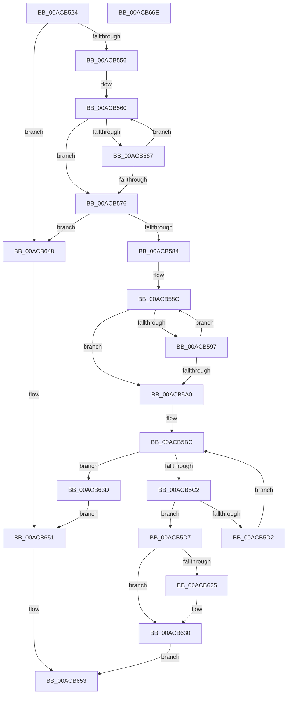

# CmpWaitForHiveMount

- RVA: `0x00ACB524`–`0x00ACB66F` (길이 `331` bytes)
- VA: `0x0000000140ACB524`
- 실행 섹션: `PAGE`
- PDB 이름 있음: `예`; PDB Function 태그: `아니요`
- unwind 정보 RVA: `0x0005D7BC`
- 디코드: `79`개 명령, `331/331` bytes 표시
- 미해석 바이트: `0` (있으면 어셈블리에 `.byte`로 보존)

> 이 문서는 커널 이미지의 기계어와 PDB 기호를 분석해 생성했습니다. 4번과 5번은 함수 원형과 자료형을 바이너리 사용 방식에서 추정한 C 해석이며 원본 소스 복구 결과는 아닙니다.

## 1. Dependencies

- 직접 호출 지점: **2**; 고유 호출 대상: **2**
- 직접 호출자로 확인된 함수: **3**
- RIP 상대 이미지 참조: **3**

### Outgoing calls
- `0x00ACB5AD` → [CmpHashUnicodeComponent](../84/CmpHashUnicodeComponent_function_0084AC24.md) (function, `0x0084AC24`)
- `0x00ACB609` → [KeSetEvent](../../text/33/KeSetEvent_function_0033F310.md) (function, `0x0033F310`)

### Direct callers
- [CmpPerformCompleteKcbCacheLookup](../84/CmpPerformCompleteKcbCacheLookup_function_0084FD20.md) at `0x00850C17`
- [CmpDoParseKey](../85/CmpDoParseKey_function_0085F750.md) at `0x00860281`
- [CmpDoParseKey](../85/CmpDoParseKey_function_0085F750.md) at `0x008602BA`
- [CmpDoParseKey](../85/CmpDoParseKey_function_0085F750.md) at `0x00861169`
- [sub_00B16F66](../B1/Unknown_function_00B16F66.md) at `0x00B16FBE`
- [sub_00B16F66](../B1/Unknown_function_00B16F66.md) at `0x00B1704E`

### Static image references
- `0x00ACB5B5` → RVA `0x00000000` (`image boundary/outside`; read)
- `0x00ACB5FD` → RVA `0x00E098E0` (`.data`; read)
- `0x00ACB63D` → RVA `0x00E09E70` (`.data`; read/write)

## 2. Other-region calls and transfers

- 다른 실행 섹션으로 향하는 call: **1**
  - `0x00ACB609` → [KeSetEvent](../../text/33/KeSetEvent_function_0033F310.md) (`PAGE` → `.text`)
- 별도 외부 분기/꼬리 이동을 확인하지 못했습니다.

## 3. Assembly (complete function range)

```asm
00ACB524  48 8B C4                        mov rax, rsp
00ACB527  48 89 58 08                     mov qword ptr [rax + 8], rbx
00ACB52B  48 89 68 10                     mov qword ptr [rax + 0x10], rbp
00ACB52F  48 89 70 18                     mov qword ptr [rax + 0x18], rsi
00ACB533  48 89 78 20                     mov qword ptr [rax + 0x20], rdi
00ACB537  41 56                           push r14
00ACB539  48 83 EC 30                     sub rsp, 0x30
00ACB53D  0F 10 01                        movups xmm0, xmmword ptr [rcx]
00ACB540  33 DB                           xor ebx, ebx
00ACB542  4D 8B F1                        mov r14, r9
00ACB545  66 0F 7E C1                     movd ecx, xmm0
00ACB549  0F 11 40 E8                     movups xmmword ptr [rax - 0x18], xmm0
00ACB54D  66 85 C9                        test cx, cx
00ACB550  0F 84 F2 00 00 00               je 0x140acb648
00ACB556  4C 8B 40 F0                     mov r8, qword ptr [rax - 0x10]
00ACB55A  41 B9 FE FF 00 00               mov r9d, 0xfffe
00ACB560  66 41 83 38 5C                  cmp word ptr [r8], 0x5c
00ACB565  75 0F                           jne 0x140acb576
00ACB567  49 83 C0 02                     add r8, 2
00ACB56B  66 41 03 C9                     add cx, r9w
00ACB56F  66 89 4C 24 20                  mov word ptr [rsp + 0x20], cx
00ACB574  75 EA                           jne 0x140acb560
00ACB576  4C 89 44 24 28                  mov qword ptr [rsp + 0x28], r8
00ACB57B  66 85 C9                        test cx, cx
00ACB57E  0F 84 C4 00 00 00               je 0x140acb648
00ACB584  0F B7 D3                        movzx edx, bx
00ACB587  BF 01 00 00 00                  mov edi, 1
00ACB58C  0F B7 C2                        movzx eax, dx
00ACB58F  66 41 83 3C 40 5C               cmp word ptr [r8 + rax*2], 0x5c
00ACB595  74 09                           je 0x140acb5a0
00ACB597  66 03 D7                        add dx, di
00ACB59A  66 41 03 C9                     add cx, r9w
00ACB59E  75 EC                           jne 0x140acb58c
00ACB5A0  66 03 D2                        add dx, dx
00ACB5A3  48 8D 4C 24 20                  lea rcx, [rsp + 0x20]
00ACB5A8  66 89 54 24 20                  mov word ptr [rsp + 0x20], dx
00ACB5AD  E8 72 F6 D7 FF                  call 0x14084ac24
00ACB5B2  0F B7 D3                        movzx edx, bx
00ACB5B5  48 8D 2D 44 4A 53 FF            lea rbp, [rip - 0xacb5bc]
00ACB5BC  66 83 FA 08                     cmp dx, 8
00ACB5C0  73 7B                           jae 0x140acb63d
00ACB5C2  0F B7 CA                        movzx ecx, dx
00ACB5C5  48 8D 34 49                     lea rsi, [rcx + rcx*2]
00ACB5C9  39 84 F5 6C 9E E0 00            cmp dword ptr [rbp + rsi*8 + 0xe09e6c], eax
00ACB5D0  74 05                           je 0x140acb5d7
00ACB5D2  66 03 D7                        add dx, di
00ACB5D5  EB E5                           jmp 0x140acb5bc
00ACB5D7  0F AE E8                        lfence
00ACB5DA  F0 0F BA AC F5 70 9E E0 00 03   lock bts dword ptr [rbp + rsi*8 + 0xe09e70], 3
00ACB5E4  F0 01 BC F5 74 9E E0 00         lock add dword ptr [rbp + rsi*8 + 0xe09e74], edi
00ACB5EC  8B 84 F5 68 9E E0 00            mov eax, dword ptr [rbp + rsi*8 + 0xe09e68]
00ACB5F3  45 33 C0                        xor r8d, r8d
00ACB5F6  48 69 C8 B8 00 00 00            imul rcx, rax, 0xb8
00ACB5FD  48 8D 05 DC E2 33 00            lea rax, [rip + 0x33e2dc]
00ACB604  33 D2                           xor edx, edx
00ACB606  48 03 C8                        add rcx, rax
00ACB609  E8 02 3D 87 FF                  call 0x14033f310
00ACB60E  8B 8C F5 68 9E E0 00            mov ecx, dword ptr [rbp + rsi*8 + 0xe09e68]
00ACB615  48 69 C1 B8 00 00 00            imul rax, rcx, 0xb8
00ACB61C  39 9C 28 14 99 E0 00            cmp dword ptr [rax + rbp + 0xe09914], ebx
00ACB623  75 0B                           jne 0x140acb630
00ACB625  40 8A DF                        mov bl, dil
00ACB628  41 89 0E                        mov dword ptr [r14], ecx
00ACB62B  BF 05 00 00 00                  mov edi, 5
00ACB630  F0 0F AB BC F5 70 9E E0 00      lock bts dword ptr [rbp + rsi*8 + 0xe09e70], edi
00ACB639  8A C3                           mov al, bl
00ACB63B  EB 16                           jmp 0x140acb653
00ACB63D  F0 0F BA 2D 2A E8 33 00 02      lock bts dword ptr [rip + 0x33e82a], 2
00ACB646  EB 09                           jmp 0x140acb651
00ACB648  F0 0F BA 2D 1F E8 33 00 00      lock bts dword ptr [rip + 0x33e81f], 0
00ACB651  32 C0                           xor al, al
00ACB653  48 8B 5C 24 40                  mov rbx, qword ptr [rsp + 0x40]
00ACB658  48 8B 6C 24 48                  mov rbp, qword ptr [rsp + 0x48]
00ACB65D  48 8B 74 24 50                  mov rsi, qword ptr [rsp + 0x50]
00ACB662  48 8B 7C 24 58                  mov rdi, qword ptr [rsp + 0x58]
00ACB667  48 83 C4 30                     add rsp, 0x30
00ACB66B  41 5E                           pop r14
00ACB66D  C3                              ret
00ACB66E  CC                              int3
```

## 4. C-style interpretation (structured pseudocode)

```c
__int64 __fastcall CmpWaitForHiveMount(__int64 a1, __int64 a2, __int64 a3, __int64 a4)
{
    __int64 result;
    __int64 v_rbx;
    __int64 v_rdi;
    __int64 v_rsp;
    unsigned __int64 v_stack_m10;
    unsigned __int16 v_stack_m18;
    unsigned __int64 v_stack_p10;
    unsigned __int64 v_stack_p18;
    unsigned __int64 v_stack_p20;
    unsigned __int64 v_stack_p8;

    *(unsigned __int64 *)(v_rsp + 8) = v_rbx;
    *(unsigned __int64 *)(v_rsp + 16) = v_rbp;
    *(unsigned __int64 *)(v_rsp + 24) = v_rsi;
    *(unsigned __int64 *)(v_rsp + 32) = v_rdi;
    v_rsp = (v_rsp) - (48);
    v_rbx = 0;
    *(unsigned __int64 *)(v_rsp - 24) = v_xmm0;
    if ((unsigned __int16)(a1) == 0) goto loc_00ACB648;
loc_00ACB560:
    if ((*(unsigned __int16 *)(*(unsigned __int64 *)(v_rsp - 16))) != 92) goto loc_00ACB576;
    a3 = (*(unsigned __int64 *)(v_rsp - 16)) + (2);
    a1 = (unsigned __int16)((a1) + ((unsigned __int16)((unsigned int)(0xFFFEULL))));
    v_stack_m18 = (unsigned __int16)(a1);
    if (condition_is_not_equal) goto loc_00ACB560;
loc_00ACB576:
    v_stack_m10 = a3;
    if ((unsigned __int16)(a1) == 0) goto loc_00ACB648;
loc_00ACB58C:
    if ((*(unsigned __int16 *)(a3 + 0 * 2)) == 92) goto loc_00ACB5A0;
    a2 = (unsigned __int16)((0) + (1));
    a1 = (unsigned __int16)((a1) + ((unsigned __int16)((unsigned int)(0xFFFEULL))));
    if (condition_is_not_equal) goto loc_00ACB58C;
loc_00ACB5A0:
    a2 = (unsigned __int16)((a2) + ((unsigned __int16)(a2)));
    v_stack_m18 = (unsigned __int16)(a2);
    result = CmpHashUnicodeComponent(v_stack_m18, a2, a3, (unsigned int)(0xFFFEULL));
loc_00ACB5BC:
    if (0 >= 8) goto loc_00ACB63D;
    if ((*(unsigned int *)(v_rip - 11318716 + 0 + 0 * 2 * 8 + 14720620)) == ((unsigned int)(result))) goto loc_00ACB5D7;
    a2 = (unsigned __int16)((0) + (1));
    goto loc_00ACB5BC;
loc_00ACB5D7:
    a3 = 0;
    a1 = (0) * ((unsigned int)(*(unsigned int *)(v_rip - 11318716 + 0 + 0 * 2 * 8 + 14720616)));
    a2 = 0;
    a1 = (a1) + (v_rip + 3400412);
    result = KeSetEvent(a1, a2, a3, (unsigned int)(0xFFFEULL));
    result = (result) * ((unsigned int)(*(unsigned int *)(v_rip - 11318716 + 0 + 0 * 2 * 8 + 14720616)));
    v_rdi = 1;
    if ((*(unsigned int *)(result + v_rip - 11318716 * 1 + 14719252)) == 0) {
        v_rbx = 1;
        *(unsigned int *)(a4) = (unsigned int)((unsigned int)(*(unsigned int *)(v_rip - 11318716 + 0 + 0 * 2 * 8 + 14720616)));
        v_rdi = 5;
    }
    goto loc_00ACB653;
loc_00ACB63D:
    goto loc_00ACB651;
loc_00ACB648:
loc_00ACB651:
    result = 0;
loc_00ACB653:
    v_rsp = (v_rsp) + (48);
    return result;
}
```

## 5. (Beta) C Style

```c
int64_t CmpWaitForHiveMount(void *Arg1, int64_t Arg2, int64_t Arg3, void *Arg4)
{
    uint8_t *arg1 = (uint8_t *)Arg1;
    uint8_t *arg4 = (uint8_t *)Arg4;

    int64_t result;
    int64_t local_rbx;
    int64_t local_rdi;
    int64_t local_rsp;
    uint64_t v_stack_m10;
    uint16_t v_stack_m18;
    uint64_t v_stack_p10;
    uint64_t v_stack_p18;
    uint64_t v_stack_p20;
    uint64_t v_stack_p8;

    *(uint64_t *)(local_rsp + 0x8) = local_rbx;
    *(uint64_t *)(local_rsp + 0x10) = local_rbp;
    *(uint64_t *)(local_rsp + 0x18) = local_rsi;
    *(uint64_t *)(local_rsp + 0x20) = local_rdi;
    local_rsp = (local_rsp) - (48);
    local_rbx = 0;
    *(uint64_t *)(local_rsp - 0x18) = v_xmm0;
    if ((uint16_t)(Arg1) == 0) goto loc_00ACB648;
loc_00ACB560:
    if ((*(uint16_t *)(*(uint64_t *)(local_rsp - 0x10))) != 92) goto loc_00ACB576;
    Arg3 = (*(uint64_t *)(local_rsp - 0x10)) + (2);
    Arg1 = (uint16_t)((Arg1) + ((uint16_t)((uint32_t)(0xFFFEULL))));
    v_stack_m18 = (uint16_t)(Arg1);
    if (condition_is_not_equal) goto loc_00ACB560;
loc_00ACB576:
    v_stack_m10 = Arg3;
    if ((uint16_t)(Arg1) == 0) goto loc_00ACB648;
loc_00ACB58C:
    if ((*(uint16_t *)(Arg3 + 0x0 * 2)) == 92) goto loc_00ACB5A0;
    Arg2 = (uint16_t)((0) + (1));
    Arg1 = (uint16_t)((Arg1) + ((uint16_t)((uint32_t)(0xFFFEULL))));
    if (condition_is_not_equal) goto loc_00ACB58C;
loc_00ACB5A0:
    Arg2 = (uint16_t)((Arg2) + ((uint16_t)(Arg2)));
    v_stack_m18 = (uint16_t)(Arg2);
    result = CmpHashUnicodeComponent(v_stack_m18, Arg2, Arg3, (uint32_t)(0xFFFEULL));
loc_00ACB5BC:
    if (0 >= 8) goto loc_00ACB63D;
    if ((*(uint32_t *)(v_rip - 0xACB5BC + 0x0 + 0x0 * 2 * 8 + 0xE09E6C)) == ((uint32_t)(result))) goto loc_00ACB5D7;
    Arg2 = (uint16_t)((0) + (1));
    goto loc_00ACB5BC;
loc_00ACB5D7:
    Arg3 = 0;
    Arg1 = (0) * ((uint32_t)(*(uint32_t *)(v_rip - 0xACB5BC + 0x0 + 0x0 * 2 * 8 + 0xE09E68)));
    Arg2 = 0;
    Arg1 = (Arg1) + (v_rip + 3400412);
    result = KeSetEvent(Arg1, Arg2, Arg3, (uint32_t)(0xFFFEULL));
    result = (result) * ((uint32_t)(*(uint32_t *)(v_rip - 0xACB5BC + 0x0 + 0x0 * 2 * 8 + 0xE09E68)));
    local_rdi = 1;
    if ((*(uint32_t *)(result + v_rip - 0xACB5BC * 1 + 0xE09914)) == 0) {
        local_rbx = 1;
        *(uint32_t *)(arg4) = (uint32_t)((uint32_t)(*(uint32_t *)(v_rip - 0xACB5BC + 0x0 + 0x0 * 2 * 8 + 0xE09E68)));
        local_rdi = 5;
    }
    goto loc_00ACB653;
loc_00ACB63D:
    goto loc_00ACB651;
loc_00ACB648:
loc_00ACB651:
    result = 0;
loc_00ACB653:
    local_rsp = (local_rsp) + (48);
    return result;
}
```

### 관측된 메모리 오프셋

구조체 형식이 확인되지 않은 접근은 인자 기준의 오프셋으로만 기록했습니다.

| 기준 인자 | 오프셋 표현 | 폭 (bit) | 접근 |
|---|---:|---:|---|
| `Arg1` | `+ 0x0` | `128` | `R` |
| `Arg4` | `+ 0x0` | `32` | `W` |

## 6. Execution-region graph

[열기: 2D/3D 그래프와 함수 탐색 컨트롤 패널](../../../control-panel.html?section=page&rva=0x00ACB524&view=graph)

- 2D 그래프는 위에서 아래로 흐르고, 3D 그래프는 빈 공간을 드래그해 회전합니다. Shift+드래그는 이동, 휠은 확대·축소, 함수 노드 선택은 대상 보고서 이동입니다.

### Static fallback


