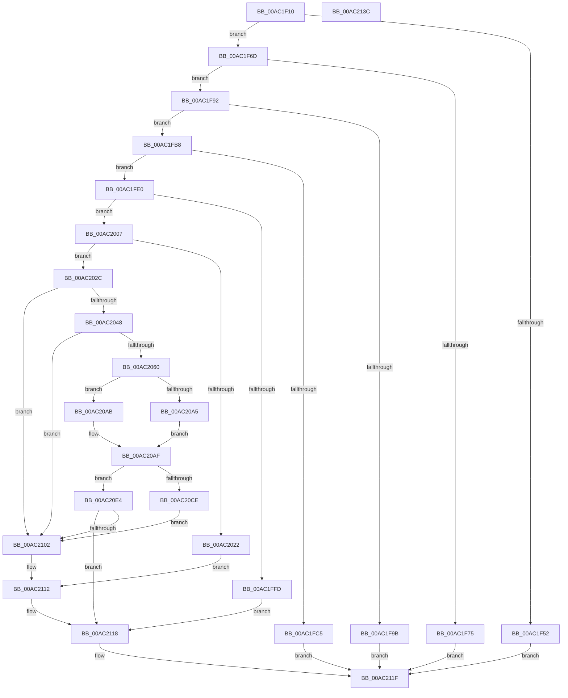

# DbgkWerCaptureLiveKernelDump2

- RVA: `0x00AC1F10`–`0x00AC213D` (길이 `557` bytes)
- VA: `0x0000000140AC1F10`
- 실행 섹션: `PAGE`
- PDB 이름 있음: `예`; PDB Function 태그: `아니요`
- unwind 정보 RVA: `0x0008C20C`
- 디코드: `146`개 명령, `557/557` bytes 표시
- 미해석 바이트: `0` (있으면 어셈블리에 `.byte`로 보존)

> 이 문서는 커널 이미지의 기계어와 PDB 기호를 분석해 생성했습니다. 4번과 5번은 함수 원형과 자료형을 바이너리 사용 방식에서 추정한 C 해석이며 원본 소스 복구 결과는 아닙니다.

## 1. Dependencies

- 직접 호출 지점: **14**; 고유 호출 대상: **10**
- 직접 호출자로 확인된 함수: **3**
- RIP 상대 이미지 참조: **9**

### Outgoing calls
- `0x00AC1F5E` → [DbgPrintEx](../../text/35/DbgPrintEx_function_00359290.md) (function, `0x00359290`)
- `0x00AC1F83` → [DbgPrintEx](../../text/35/DbgPrintEx_function_00359290.md) (function, `0x00359290`)
- `0x00AC1F92` → [DbgkpWerIsFullLiveDumpDisabled](../71/DbgkpWerIsFullLiveDumpDisabled_function_00712470.md) (function, `0x00712470`)
- `0x00AC1FA9` → [DbgPrintEx](../../text/35/DbgPrintEx_function_00359290.md) (function, `0x00359290`)
- `0x00AC1FD1` → [DbgPrintEx](../../text/35/DbgPrintEx_function_00359290.md) (function, `0x00359290`)
- `0x00AC2015` → [ExAllocatePool2](../../poolcode/B8/ExAllocatePool2_function_00B820F0.md) (function, `0x00B820F0`)
- `0x00AC2039` → [RtlStringCchLengthW](../../text/43/RtlStringCchLengthW_function_00435A70.md) (function, `0x00435A70`)
- `0x00AC2051` → [RtlStringCchCopyW](../../text/26/RtlStringCchCopyW_function_0026E9A4.md) (function, `0x0026E9A4`)
- `0x00AC20BC` → `ext-ms-win-ntos-werkernel-l1-1-1.dll!WerLiveKernelCreateReport` (import, 간접 대상; import `ext-ms-win-ntos-werkernel-l1-1-1.dll!WerLiveKernelCreateReport`)
- `0x00AC20DD` → [DbgPrintEx](../../text/35/DbgPrintEx_function_00359290.md) (function, `0x00359290`)
- `0x00AC20F5` → [DbgkpWerProcessPolicyResult](../71/DbgkpWerProcessPolicyResult_function_00712578.md) (function, `0x00712578`)
- `0x00AC2105` → [DbgkpWerCleanupContext](../71/DbgkpWerCleanupContext_function_00712178.md) (function, `0x00712178`)
- `0x00AC210D` → [DbgkpWerFreePool](../71/DbgkpWerFreePool_function_00712450.md) (function, `0x00712450`)
- `0x00AC2118` → [KeLeaveCriticalRegion](../../text/25/KeLeaveCriticalRegion_function_0025D8B0.md) (function, `0x0025D8B0`)

### Direct callers
- [PopPowerButtonWorkCallback](../../text/5D/PopPowerButtonWorkCallback_function_005D9A70.md) at `0x005D9DE0`
- [NtPowerInformation](../95/NtPowerInformation_function_00955D80.md) at `0x00956DAE`
- [DbgkWerCaptureLiveKernelDump](DbgkWerCaptureLiveKernelDump_function_00AC1E90.md) at `0x00AC1EF4`

### Static image references
- `0x00AC1F52` → RVA `0x00AFBC10` (` ?? ::NNGAKEGL::`string'`; read)
- `0x00AC1F6D` → RVA `0x00E65BD0` (`.data`; read)
- `0x00AC1F75` → RVA `0x00AFBC60` (` ?? ::NNGAKEGL::`string'`; read)
- `0x00AC1F9B` → RVA `0x00AFBB80` (` ?? ::NNGAKEGL::`string'`; read)
- `0x00AC1FC5` → RVA `0x00AFBBC0` (` ?? ::NNGAKEGL::`string'`; read)
- `0x00AC1FF3` → RVA `0x00F8F20C` (`.data`; read/write)
- `0x00AC2069` → RVA `0x00F8F210` (`.data`; read)
- `0x00AC20BC` → RVA `0x00151648` (`ext-ms-win-ntos-werkernel-l1-1-1.dll!WerLiveKernelCreateReport (IAT)`; read)
- `0x00AC20D0` → RVA `0x00AFBCB0` (` ?? ::NNGAKEGL::`string'`; read)

## 2. Other-region calls and transfers

- 다른 실행 섹션으로 향하는 call: **9**
  - `0x00AC1F5E` → [DbgPrintEx](../../text/35/DbgPrintEx_function_00359290.md) (`PAGE` → `.text`)
  - `0x00AC1F83` → [DbgPrintEx](../../text/35/DbgPrintEx_function_00359290.md) (`PAGE` → `.text`)
  - `0x00AC1FA9` → [DbgPrintEx](../../text/35/DbgPrintEx_function_00359290.md) (`PAGE` → `.text`)
  - `0x00AC1FD1` → [DbgPrintEx](../../text/35/DbgPrintEx_function_00359290.md) (`PAGE` → `.text`)
  - `0x00AC2015` → [ExAllocatePool2](../../poolcode/B8/ExAllocatePool2_function_00B820F0.md) (`PAGE` → `POOLCODE`)
  - `0x00AC2039` → [RtlStringCchLengthW](../../text/43/RtlStringCchLengthW_function_00435A70.md) (`PAGE` → `.text`)
  - `0x00AC2051` → [RtlStringCchCopyW](../../text/26/RtlStringCchCopyW_function_0026E9A4.md) (`PAGE` → `.text`)
  - `0x00AC20DD` → [DbgPrintEx](../../text/35/DbgPrintEx_function_00359290.md) (`PAGE` → `.text`)
  - `0x00AC2118` → [KeLeaveCriticalRegion](../../text/25/KeLeaveCriticalRegion_function_0025D8B0.md) (`PAGE` → `.text`)
- 별도 외부 분기/꼬리 이동을 확인하지 못했습니다.

## 3. Assembly (complete function range)

```asm
00AC1F10  48 8B C4                        mov rax, rsp
00AC1F13  48 89 58 08                     mov qword ptr [rax + 8], rbx
00AC1F17  48 89 68 10                     mov qword ptr [rax + 0x10], rbp
00AC1F1B  48 89 70 18                     mov qword ptr [rax + 0x18], rsi
00AC1F1F  57                              push rdi
00AC1F20  41 54                           push r12
00AC1F22  41 55                           push r13
00AC1F24  41 56                           push r14
00AC1F26  41 57                           push r15
00AC1F28  48 83 EC 30                     sub rsp, 0x30
00AC1F2C  33 DB                           xor ebx, ebx
00AC1F2E  BF 01 00 00 00                  mov edi, 1
00AC1F33  40 88 78 C8                     mov byte ptr [rax - 0x38], dil
00AC1F37  4D 8B F9                        mov r15, r9
00AC1F3A  89 58 CC                        mov dword ptr [rax - 0x34], ebx
00AC1F3D  4D 8B E0                        mov r12, r8
00AC1F40  48 89 58 D0                     mov qword ptr [rax - 0x30], rbx
00AC1F44  44 8B EA                        mov r13d, edx
00AC1F47  4C 8B F1                        mov r14, rcx
00AC1F4A  44 0F 20 C0                     mov rax, cr8
00AC1F4E  84 C0                           test al, al
00AC1F50  74 1B                           je 0x140ac1f6d
00AC1F52  4C 8D 05 B7 9C 03 00            lea r8, [rip + 0x39cb7]
00AC1F59  8B D7                           mov edx, edi
00AC1F5B  8D 4F 04                        lea ecx, [rdi + 4]
00AC1F5E  E8 2D 73 89 FF                  call 0x140359290
00AC1F63  B8 48 01 00 C0                  mov eax, 0xc0000148
00AC1F68  E9 B2 01 00 00                  jmp 0x140ac211f
00AC1F6D  38 1D 5D 3C 3A 00               cmp byte ptr [rip + 0x3a3c5d], bl
00AC1F73  75 1D                           jne 0x140ac1f92
00AC1F75  4C 8D 05 E4 9C 03 00            lea r8, [rip + 0x39ce4]
00AC1F7C  8B D7                           mov edx, edi
00AC1F7E  B9 05 00 00 00                  mov ecx, 5
00AC1F83  E8 08 73 89 FF                  call 0x140359290
00AC1F88  B8 A3 00 00 C0                  mov eax, 0xc00000a3
00AC1F8D  E9 8D 01 00 00                  jmp 0x140ac211f
00AC1F92  E8 D9 04 C5 FF                  call 0x140712470
00AC1F97  84 C0                           test al, al
00AC1F99  74 1D                           je 0x140ac1fb8
00AC1F9B  4C 8D 05 DE 9B 03 00            lea r8, [rip + 0x39bde]
00AC1FA2  8B D7                           mov edx, edi
00AC1FA4  B9 05 00 00 00                  mov ecx, 5
00AC1FA9  E8 E2 72 89 FF                  call 0x140359290
00AC1FAE  B8 04 08 00 C0                  mov eax, 0xc0000804
00AC1FB3  E9 67 01 00 00                  jmp 0x140ac211f
00AC1FB8  48 8B AC 24 90 00 00 00         mov rbp, qword ptr [rsp + 0x90]
00AC1FC0  48 85 ED                        test rbp, rbp
00AC1FC3  75 1B                           jne 0x140ac1fe0
00AC1FC5  4C 8D 05 F4 9B 03 00            lea r8, [rip + 0x39bf4]
00AC1FCC  8B D7                           mov edx, edi
00AC1FCE  8D 4D 05                        lea ecx, [rbp + 5]
00AC1FD1  E8 BA 72 89 FF                  call 0x140359290
00AC1FD6  B8 0D 00 00 C0                  mov eax, 0xc000000d
00AC1FDB  E9 3F 01 00 00                  jmp 0x140ac211f
00AC1FE0  65 48 8B 04 25 88 01 00 00      mov rax, qword ptr gs:[0x188]
00AC1FE9  66 FF 88 E4 01 00 00            dec word ptr [rax + 0x1e4]
00AC1FF0  8B C7                           mov eax, edi
00AC1FF2  90                              nop
00AC1FF3  87 05 13 D2 4C 00               xchg dword ptr [rip + 0x4cd213], eax
00AC1FF9  3B C7                           cmp eax, edi
00AC1FFB  75 0A                           jne 0x140ac2007
00AC1FFD  BE 2D 02 00 C0                  mov esi, 0xc000022d
00AC2002  E9 11 01 00 00                  jmp 0x140ac2118
00AC2007  BA B0 00 00 00                  mov edx, 0xb0
00AC200C  41 B8 44 62 67 57               mov r8d, 0x57676244
00AC2012  8D 4A 50                        lea ecx, [rdx + 0x50]
00AC2015  E8 D6 00 0C 00                  call 0x140b820f0
00AC201A  48 8B F8                        mov rdi, rax
00AC201D  48 85 C0                        test rax, rax
00AC2020  75 0A                           jne 0x140ac202c
00AC2022  BE 9A 00 00 C0                  mov esi, 0xc000009a
00AC2027  E9 E6 00 00 00                  jmp 0x140ac2112
00AC202C  45 33 C0                        xor r8d, r8d
00AC202F  49 8B CE                        mov rcx, r14
00AC2032  45 8D 50 10                     lea r10d, [r8 + 0x10]
00AC2036  41 8B D2                        mov edx, r10d
00AC2039  E8 32 3A 97 FF                  call 0x140435a70
00AC203E  8B F0                           mov esi, eax
00AC2040  85 C0                           test eax, eax
00AC2042  0F 88 BA 00 00 00               js 0x140ac2102
00AC2048  4D 8B C6                        mov r8, r14
00AC204B  41 8B D2                        mov edx, r10d
00AC204E  48 8B CF                        mov rcx, rdi
00AC2051  E8 4E C9 7A FF                  call 0x14026e9a4
00AC2056  8B F0                           mov esi, eax
00AC2058  85 C0                           test eax, eax
00AC205A  0F 88 A2 00 00 00               js 0x140ac2102
00AC2060  F6 45 18 02                     test byte ptr [rbp + 0x18], 2
00AC2064  B9 01 00 00 00                  mov ecx, 1
00AC2069  8B 05 A1 D1 4C 00               mov eax, dword ptr [rip + 0x4cd1a1]
00AC206F  0F 45 C1                        cmovne eax, ecx
00AC2072  89 44 24 24                     mov dword ptr [rsp + 0x24], eax
00AC2076  48 8B 84 24 80 00 00 00         mov rax, qword ptr [rsp + 0x80]
00AC207E  48 89 47 38                     mov qword ptr [rdi + 0x38], rax
00AC2082  48 8B 84 24 88 00 00 00         mov rax, qword ptr [rsp + 0x88]
00AC208A  48 89 47 40                     mov qword ptr [rdi + 0x40], rax
00AC208E  44 89 6F 20                     mov dword ptr [rdi + 0x20], r13d
00AC2092  4C 89 67 28                     mov qword ptr [rdi + 0x28], r12
00AC2096  4C 89 7F 30                     mov qword ptr [rdi + 0x30], r15
00AC209A  48 89 6F 48                     mov qword ptr [rdi + 0x48], rbp
00AC209E  8B 45 18                        mov eax, dword ptr [rbp + 0x18]
00AC20A1  A8 08                           test al, 8
00AC20A3  74 06                           je 0x140ac20ab
00AC20A5  83 67 68 FD                     and dword ptr [rdi + 0x68], 0xfffffffd
00AC20A9  EB 04                           jmp 0x140ac20af
00AC20AB  83 4F 68 02                     or dword ptr [rdi + 0x68], 2
00AC20AF  4C 8D 44 24 28                  lea r8, [rsp + 0x28]
00AC20B4  48 8B CF                        mov rcx, rdi
00AC20B7  48 8D 54 24 24                  lea rdx, [rsp + 0x24]
00AC20BC  48 FF 15 85 F5 68 FF            call qword ptr [rip - 0x970a7b]
00AC20C3  0F 1F 44 00 00                  nop dword ptr [rax + rax]
00AC20C8  8B F0                           mov esi, eax
00AC20CA  85 C0                           test eax, eax
00AC20CC  79 16                           jns 0x140ac20e4
00AC20CE  33 D2                           xor edx, edx
00AC20D0  4C 8D 05 D9 9B 03 00            lea r8, [rip + 0x39bd9]
00AC20D7  44 8B C8                        mov r9d, eax
00AC20DA  8D 4A 05                        lea ecx, [rdx + 5]
00AC20DD  E8 AE 71 89 FF                  call 0x140359290
00AC20E2  EB 1E                           jmp 0x140ac2102
00AC20E4  4C 8B 44 24 28                  mov r8, qword ptr [rsp + 0x28]
00AC20E9  4C 8D 4C 24 20                  lea r9, [rsp + 0x20]
00AC20EE  8B 54 24 24                     mov edx, dword ptr [rsp + 0x24]
00AC20F2  48 8B CF                        mov rcx, rdi
00AC20F5  E8 7E 04 C5 FF                  call 0x140712578
00AC20FA  8B F0                           mov esi, eax
00AC20FC  38 5C 24 20                     cmp byte ptr [rsp + 0x20], bl
00AC2100  74 16                           je 0x140ac2118
00AC2102  48 8B CF                        mov rcx, rdi
00AC2105  E8 6E 00 C5 FF                  call 0x140712178
00AC210A  48 8B CF                        mov rcx, rdi
00AC210D  E8 3E 03 C5 FF                  call 0x140712450
00AC2112  87 1D F4 D0 4C 00               xchg dword ptr [rip + 0x4cd0f4], ebx
00AC2118  E8 93 B7 79 FF                  call 0x14025d8b0
00AC211D  8B C6                           mov eax, esi
00AC211F  48 8B 5C 24 60                  mov rbx, qword ptr [rsp + 0x60]
00AC2124  48 8B 6C 24 68                  mov rbp, qword ptr [rsp + 0x68]
00AC2129  48 8B 74 24 70                  mov rsi, qword ptr [rsp + 0x70]
00AC212E  48 83 C4 30                     add rsp, 0x30
00AC2132  41 5F                           pop r15
00AC2134  41 5E                           pop r14
00AC2136  41 5D                           pop r13
00AC2138  41 5C                           pop r12
00AC213A  5F                              pop rdi
00AC213B  C3                              ret
00AC213C  CC                              int3
```

## 4. C-style interpretation (structured pseudocode)

```c
__int64 __fastcall DbgkWerCaptureLiveKernelDump2(__int64 a1, int a2, __int64 a3, __int64 a4, __int64 a5, __int64 a6, __int64 a7)
{
    __int64 result;
    __int64 v_rbx;
    __int64 v_rsp;
    unsigned __int64 v_stack_m30;
    unsigned int v_stack_m34;
    unsigned __int64 v_stack_m38;
    unsigned __int64 v_stack_p10;
    unsigned __int64 v_stack_p18;
    unsigned __int64 v_stack_p8;

    *(unsigned __int64 *)(v_rsp + 8) = v_rbx;
    *(unsigned __int64 *)(v_rsp + 16) = v_rbp;
    *(unsigned __int64 *)(v_rsp + 24) = v_rsi;
    v_rsp = (v_rsp) - (48);
    v_rbx = 0;
    *(unsigned __int8 *)(v_rsp - 56) = 1;
    *(unsigned int *)(v_rsp - 52) = 0;
    *(unsigned __int64 *)(v_rsp - 48) = 0;
    if ((unsigned __int8)(v_cr8) == 0) goto loc_00AC1F6D;
    result = DbgPrintEx(1 + 4, 1, v_rip + 236727, a4);
    goto loc_00AC211F;
loc_00AC1F6D:
    if ((*(unsigned __int8 *)(v_rip + 3816541)) != 0) goto loc_00AC1F92;
    result = DbgPrintEx(5, 1, v_rip + 236772, a4);
    goto loc_00AC211F;
loc_00AC1F92:
    result = DbgkpWerIsFullLiveDumpDisabled(5, 1, v_rip + 236772, a4);
    if ((unsigned __int8)(result) == 0) goto loc_00AC1FB8;
    result = DbgPrintEx(5, 1, v_rip + 236510, a4);
    goto loc_00AC211F;
loc_00AC1FB8:
    if (a7 != 0) goto loc_00AC1FE0;
    result = DbgPrintEx(a7 + 5, 1, v_rip + 236532, a4);
    goto loc_00AC211F;
loc_00AC1FE0:
    if (1 != 1) goto loc_00AC2007;
    goto loc_00AC2118;
loc_00AC2007:
    result = ExAllocatePool2(176 + 80, 176, (unsigned int)(0x57676244ULL), a4);
    if (result != 0) goto loc_00AC202C;
    goto loc_00AC2112;
loc_00AC202C:
    a3 = 0;
    result = RtlStringCchLengthW(a1, (unsigned int)((unsigned int)(a3 + 16)), a3, a4);
    if (sign_flag) goto loc_00AC2102;
    result = RtlStringCchCopyW(result, (unsigned int)((unsigned int)(a3 + 16)), a1, a4);
    if (sign_flag) goto loc_00AC2102;
    result = (unsigned int)(*(unsigned int *)(v_rip + 5034401));
    if (((*(unsigned __int8 *)(a7 + 24)) & (2)) != 0) { result = 1; }
    v_stack_m34 = (unsigned int)(result);
    *(unsigned __int64 *)(result + 56) = a5;
    *(unsigned __int64 *)(result + 64) = a6;
    *(unsigned int *)(result + 32) = (unsigned int)((unsigned int)(a2));
    *(unsigned __int64 *)(result + 40) = 0;
    *(unsigned __int64 *)(result + 48) = a4;
    *(unsigned __int64 *)(result + 72) = a7;
    if ((((unsigned __int8)((unsigned int)(*(unsigned int *)(a7 + 24)))) & (8)) == 0) goto loc_00AC20AB;
    goto loc_00AC20AF;
loc_00AC20AB:
loc_00AC20AF:
    result = ext_ms_win_ntos_werkernel_l1_1_1_dll_WerLiveKernelCreateReport(result, v_stack_m34, v_stack_m30, a4);
    if (!sign_flag) goto loc_00AC20E4;
    a2 = 0;
    result = DbgPrintEx(a2 + 5, a2, v_rip + 236505, (unsigned int)((unsigned int)(result)));
    goto loc_00AC2102;
loc_00AC20E4:
    result = DbgkpWerProcessPolicyResult(result, (unsigned int)(v_stack_m34), v_stack_m30, v_stack_m38);
    if (v_stack_m38 == 0) goto loc_00AC2118;
loc_00AC2102:
    result = DbgkpWerCleanupContext(result, (unsigned int)(v_stack_m34), v_stack_m30, v_stack_m38);
    result = DbgkpWerFreePool(result, (unsigned int)(v_stack_m34), v_stack_m30, v_stack_m38);
loc_00AC2112:
loc_00AC2118:
    result = KeLeaveCriticalRegion(result, (unsigned int)(v_stack_m34), v_stack_m30, v_stack_m38);
loc_00AC211F:
    v_rsp = (v_rsp) + (48);
    return (unsigned int)((unsigned int)((unsigned int)((unsigned int)(result))));
}
```

## 5. (Beta) C Style

```c
int64_t DbgkWerCaptureLiveKernelDump2(int64_t Arg1, int32_t Arg2, int64_t Arg3, int64_t Arg4, int64_t Arg5, int64_t Arg6, int64_t Arg7)
{
    int64_t result;
    int64_t local_rbx;
    int64_t local_rsp;
    uint64_t v_stack_m30;
    uint32_t v_stack_m34;
    uint64_t v_stack_m38;
    uint64_t v_stack_p10;
    uint64_t v_stack_p18;
    uint64_t v_stack_p8;

    *(uint64_t *)(local_rsp + 0x8) = local_rbx;
    *(uint64_t *)(local_rsp + 0x10) = local_rbp;
    *(uint64_t *)(local_rsp + 0x18) = local_rsi;
    local_rsp = (local_rsp) - (48);
    local_rbx = 0;
    *(uint8_t *)(local_rsp - 0x38) = 1;
    *(uint32_t *)(local_rsp - 0x34) = 0;
    *(uint64_t *)(local_rsp - 0x30) = 0;
    if ((uint8_t)(v_cr8) == 0) goto loc_00AC1F6D;
    result = DbgPrintEx(1 + 4, 1, v_rip + 236727, Arg4);
    goto loc_00AC211F;
loc_00AC1F6D:
    if ((*(uint8_t *)(v_rip + 0x3A3C5D)) != 0) goto loc_00AC1F92;
    result = DbgPrintEx(5, 1, v_rip + 236772, Arg4);
    goto loc_00AC211F;
loc_00AC1F92:
    result = DbgkpWerIsFullLiveDumpDisabled(5, 1, v_rip + 236772, Arg4);
    if ((uint8_t)(result) == 0) goto loc_00AC1FB8;
    result = DbgPrintEx(5, 1, v_rip + 236510, Arg4);
    goto loc_00AC211F;
loc_00AC1FB8:
    if (Arg7 != 0) goto loc_00AC1FE0;
    result = DbgPrintEx(Arg7 + 5, 1, v_rip + 236532, Arg4);
    goto loc_00AC211F;
loc_00AC1FE0:
    if (1 != 1) goto loc_00AC2007;
    goto loc_00AC2118;
loc_00AC2007:
    result = ExAllocatePool2(176 + 80, 176, (uint32_t)(0x57676244ULL), Arg4);
    if (result != 0) goto loc_00AC202C;
    goto loc_00AC2112;
loc_00AC202C:
    Arg3 = 0;
    result = RtlStringCchLengthW(Arg1, (uint32_t)((uint32_t)(Arg3 + 16)), Arg3, Arg4);
    if (sign_flag) goto loc_00AC2102;
    result = RtlStringCchCopyW(result, (uint32_t)((uint32_t)(Arg3 + 16)), Arg1, Arg4);
    if (sign_flag) goto loc_00AC2102;
    result = (uint32_t)(*(uint32_t *)(v_rip + 0x4CD1A1));
    if (((*(uint8_t *)(Arg7 + 0x18)) & (2)) != 0) { result = 1; }
    v_stack_m34 = (uint32_t)(result);
    *(uint64_t *)(result + 0x38) = Arg5;
    *(uint64_t *)(result + 0x40) = Arg6;
    *(uint32_t *)(result + 0x20) = (uint32_t)((uint32_t)(Arg2));
    *(uint64_t *)(result + 0x28) = 0;
    *(uint64_t *)(result + 0x30) = Arg4;
    *(uint64_t *)(result + 0x48) = Arg7;
    if ((((uint8_t)((uint32_t)(*(uint32_t *)(Arg7 + 0x18)))) & (8)) == 0) goto loc_00AC20AB;
    goto loc_00AC20AF;
loc_00AC20AB:
loc_00AC20AF:
    result = kernel_indirect_call(result, v_stack_m34, v_stack_m30, Arg4);
    if (!sign_flag) goto loc_00AC20E4;
    Arg2 = 0;
    result = DbgPrintEx(Arg2 + 5, Arg2, v_rip + 236505, (uint32_t)((uint32_t)(result)));
    goto loc_00AC2102;
loc_00AC20E4:
    result = DbgkpWerProcessPolicyResult(result, (uint32_t)(v_stack_m34), v_stack_m30, v_stack_m38);
    if (v_stack_m38 == 0) goto loc_00AC2118;
loc_00AC2102:
    result = DbgkpWerCleanupContext(result, (uint32_t)(v_stack_m34), v_stack_m30, v_stack_m38);
    result = DbgkpWerFreePool(result, (uint32_t)(v_stack_m34), v_stack_m30, v_stack_m38);
loc_00AC2112:
loc_00AC2118:
    result = KeLeaveCriticalRegion(result, (uint32_t)(v_stack_m34), v_stack_m30, v_stack_m38);
loc_00AC211F:
    local_rsp = (local_rsp) + (48);
    return (uint32_t)((uint32_t)((uint32_t)((uint32_t)(result))));
}
```

## 6. Execution-region graph

[열기: 2D/3D 그래프와 함수 탐색 컨트롤 패널](../../../control-panel.html?section=page&rva=0x00AC1F10&view=graph)

- 2D 그래프는 위에서 아래로 흐르고, 3D 그래프는 빈 공간을 드래그해 회전합니다. Shift+드래그는 이동, 휠은 확대·축소, 함수 노드 선택은 대상 보고서 이동입니다.

### Static fallback


