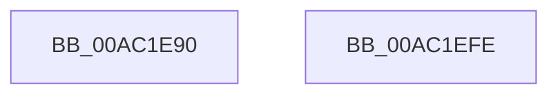

# DbgkWerCaptureLiveKernelDump

- RVA: `0x00AC1E90`–`0x00AC1EFF` (길이 `111` bytes)
- VA: `0x0000000140AC1E90`
- 실행 섹션: `PAGE`
- PDB 이름 있음: `예`; PDB Function 태그: `아니요`
- unwind 정보 RVA: `0x0006C9B8`
- 디코드: `22`개 명령, `111/111` bytes 표시
- 미해석 바이트: `0` (있으면 어셈블리에 `.byte`로 보존)

> 이 문서는 커널 이미지의 기계어와 PDB 기호를 분석해 생성했습니다. 4번과 5번은 함수 원형과 자료형을 바이너리 사용 방식에서 추정한 C 해석이며 원본 소스 복구 결과는 아닙니다.

## 1. Dependencies

- 직접 호출 지점: **1**; 고유 호출 대상: **1**
- 직접 호출자로 확인된 함수: **16**
- RIP 상대 이미지 참조: **0**

### Outgoing calls
- `0x00AC1EF4` → [DbgkWerCaptureLiveKernelDump2](DbgkWerCaptureLiveKernelDump2_function_00AC1F10.md) (function, `0x00AC1F10`)

### Direct callers
- [PopIdlePhaseWatchdogCallback](../../text/4C/PopIdlePhaseWatchdogCallback_function_004CB090.md) at `0x004CB199`
- [PopFxEnforceDirectedPowerTransition](../../text/5D/PopFxEnforceDirectedPowerTransition_function_005D2ACC.md) at `0x005D2B80`
- [PopPowerButtonWorkCallback](../../text/5D/PopPowerButtonWorkCallback_function_005D9A70.md) at `0x005D9CC7`
- [CarLiveDump](../../text/61/CarLiveDump_function_0061BB30.md) at `0x0061BBB4`
- [ExpResourceTimeoutCaptureLiveDump](../../text/65/ExpResourceTimeoutCaptureLiveDump_function_0065D5E0.md) at `0x0065D61B`
- [UcpLogEventGenerateDump](../../text/69/UcpLogEventGenerateDump_function_0069B2C0.md) at `0x0069B36C`
- [sub_006EF914](../../text/6E/Unknown_function_006EF914.md) at `0x006EFA0B`
- [sub_006F52A6](../../text/6F/Unknown_function_006F52A6.md) at `0x006F52F4`
- [PopWin32CalloutWatchdogCallback](../76/PopWin32CalloutWatchdogCallback_function_0076C140.md) at `0x0076C1AD`
- [PopDripsWatchdogCheckHwDivergence](../76/PopDripsWatchdogCheckHwDivergence_function_0076C534.md) at `0x0076C5E2`
- [PopDeepSleepWatchdogTakeAction](../77/PopDeepSleepWatchdogTakeAction_function_007731F8.md) at `0x007732AF`
- [PopDripsWatchdogTakeAction](../77/PopDripsWatchdogTakeAction_function_007732D0.md) at `0x007735E6`
- [TtmpCalloutWatchdogCallback](../77/TtmpCalloutWatchdogCallback_function_00776280.md) at `0x00776364`
- [ExpIoPoolDeadlockWorker](../7C/ExpIoPoolDeadlockWorker_function_007CF7D0.md) at `0x007CF800`
- [MiForceCrashForInvalidAccess](MiForceCrashForInvalidAccess_function_00ACEFA4.md) at `0x00ACF0C9`
- [VfPtGenerateTraceInformation](../../pagevrfy/B9/VfPtGenerateTraceInformation_function_00B9BF5C.md) at `0x00B9C15B`

### Static image references
- 디코드된 RIP-relative 메모리 참조가 없습니다.

## 2. Other-region calls and transfers

- 다른 실행 섹션으로 향하는 call: **0**
- 별도 외부 분기/꼬리 이동을 확인하지 못했습니다.

## 3. Assembly (complete function range)

```asm
00AC1E90  4C 8B DC                        mov r11, rsp
00AC1E93  48 83 EC 78                     sub rsp, 0x78
00AC1E97  49 83 63 E4 00                  and qword ptr [r11 - 0x1c], 0
00AC1E9C  83 64 24 64 00                  and dword ptr [rsp + 0x64], 0
00AC1EA1  48 8B 84 24 B8 00 00 00         mov rax, qword ptr [rsp + 0xb8]
00AC1EA9  C7 44 24 40 01 00 00 00         mov dword ptr [rsp + 0x40], 1
00AC1EB1  C7 44 24 44 28 00 00 00         mov dword ptr [rsp + 0x44], 0x28
00AC1EB9  49 89 43 D0                     mov qword ptr [r11 - 0x30], rax
00AC1EBD  48 8B 84 24 B0 00 00 00         mov rax, qword ptr [rsp + 0xb0]
00AC1EC5  49 89 43 D8                     mov qword ptr [r11 - 0x28], rax
00AC1EC9  8B 84 24 C0 00 00 00            mov eax, dword ptr [rsp + 0xc0]
00AC1ED0  89 44 24 58                     mov dword ptr [rsp + 0x58], eax
00AC1ED4  49 8D 43 C8                     lea rax, [r11 - 0x38]
00AC1ED8  49 89 43 B8                     mov qword ptr [r11 - 0x48], rax
00AC1EDC  48 8B 84 24 A8 00 00 00         mov rax, qword ptr [rsp + 0xa8]
00AC1EE4  49 89 43 B0                     mov qword ptr [r11 - 0x50], rax
00AC1EE8  48 8B 84 24 A0 00 00 00         mov rax, qword ptr [rsp + 0xa0]
00AC1EF0  49 89 43 A8                     mov qword ptr [r11 - 0x58], rax
00AC1EF4  E8 17 00 00 00                  call 0x140ac1f10
00AC1EF9  48 83 C4 78                     add rsp, 0x78
00AC1EFD  C3                              ret
00AC1EFE  CC                              int3
```

## 4. C-style interpretation (structured pseudocode)

```c
__int64 __fastcall DbgkWerCaptureLiveKernelDump(__int64 a1, __int64 a2, __int64 a3, __int64 a4, __int64 a5, __int64 a6, __int64 a7, __int64 a8, unsigned int a9)
{
    __int64 result;
    __int64 v_rsp;
    unsigned int v_stack_m14;
    unsigned int v_stack_m20;
    unsigned int v_stack_m34;
    unsigned int v_stack_m38;

    v_rsp = (v_rsp) - (120);
    v_stack_m38 = 1;
    v_stack_m34 = 40;
    *(unsigned __int64 *)(v_rsp - 48) = a8;
    *(unsigned __int64 *)(v_rsp - 40) = a7;
    v_stack_m20 = (unsigned int)((unsigned int)(a9));
    *(unsigned __int64 *)(v_rsp - 72) = v_rsp - 56;
    *(unsigned __int64 *)(v_rsp - 80) = a6;
    *(unsigned __int64 *)(v_rsp - 88) = a5;
    result = DbgkWerCaptureLiveKernelDump2(a1, a2, a3, a4);
    v_rsp = (v_rsp) + (120);
    return result;
}
```

## 5. (Beta) C Style

```c
int64_t DbgkWerCaptureLiveKernelDump(int64_t Arg1, int64_t Arg2, int64_t Arg3, int64_t Arg4, int64_t Arg5, int64_t Arg6, int64_t Arg7, int64_t Arg8, uint32_t Arg9)
{
    int64_t result;
    int64_t local_rsp;
    uint32_t v_stack_m14;
    uint32_t v_stack_m20;
    uint32_t v_stack_m34;
    uint32_t v_stack_m38;

    local_rsp = (local_rsp) - (120);
    v_stack_m38 = 1;
    v_stack_m34 = 40;
    *(uint64_t *)(local_rsp - 0x30) = Arg8;
    *(uint64_t *)(local_rsp - 0x28) = Arg7;
    v_stack_m20 = (uint32_t)((uint32_t)(Arg9));
    *(uint64_t *)(local_rsp - 0x48) = local_rsp - 56;
    *(uint64_t *)(local_rsp - 0x50) = Arg6;
    *(uint64_t *)(local_rsp - 0x58) = Arg5;
    result = DbgkWerCaptureLiveKernelDump2(Arg1, Arg2, Arg3, Arg4);
    local_rsp = (local_rsp) + (120);
    return result;
}
```

## 6. Execution-region graph

[열기: 2D/3D 그래프와 함수 탐색 컨트롤 패널](../../../control-panel.html?section=page&rva=0x00AC1E90&view=graph)

- 2D 그래프는 위에서 아래로 흐르고, 3D 그래프는 빈 공간을 드래그해 회전합니다. Shift+드래그는 이동, 휠은 확대·축소, 함수 노드 선택은 대상 보고서 이동입니다.

### Static fallback


