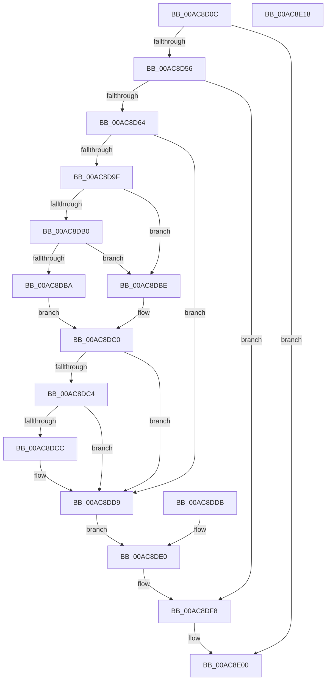

# DbgkpMarkProcessPeb

- RVA: `0x00AC8D0C`–`0x00AC8E19` (길이 `269` bytes)
- VA: `0x0000000140AC8D0C`
- 실행 섹션: `PAGE`
- PDB 이름 있음: `예`; PDB Function 태그: `아니요`
- unwind 정보 RVA: `0x000BE1A4`
- 디코드: `67`개 명령, `269/269` bytes 표시
- 미해석 바이트: `0` (있으면 어셈블리에 `.byte`로 보존)

> 이 문서는 커널 이미지의 기계어와 PDB 기호를 분석해 생성했습니다. 4번과 5번은 함수 원형과 자료형을 바이너리 사용 방식에서 추정한 C 해석이며 원본 소스 복구 결과는 아닙니다.

## 1. Dependencies

- 직접 호출 지점: **7**; 고유 호출 대상: **7**
- 직접 호출자로 확인된 함수: **4**
- RIP 상대 이미지 참조: **2**

### Outgoing calls
- `0x00AC8D49` → [ExAcquireRundownProtection](../../text/21/ExAcquireRundownProtection_function_00216620.md) (function, `0x00216620`)
- `0x00AC8D6C` → [KeStackAttachProcess](../../text/21/KeStackAttachProcess_function_00216800.md) (function, `0x00216800`)
- `0x00AC8D78` → [ExAcquireFastMutex](../../text/20/ExAcquireFastMutex_function_0020E5A0.md) (function, `0x0020E5A0`)
- `0x00AC8DE7` → [ExReleaseFastMutex](../../text/25/ExReleaseFastMutex_function_002519C0.md) (function, `0x002519C0`)
- `0x00AC8DF3` → [KiUnstackDetachProcess](../../text/21/KiUnstackDetachProcess_function_00217D30.md) (function, `0x00217D30`)
- `0x00AC8DFB` → [ExReleaseRundownProtection](../../text/34/ExReleaseRundownProtection_function_00349E80.md) (function, `0x00349E80`)
- `0x00AC8E08` → [_security_check_cookie](../../text/6A/_security_check_cookie_function_006AC640.md) (function, `0x006AC640`)

### Direct callers
- [DbgkClearProcessDebugObject](../A1/DbgkClearProcessDebugObject_function_00A10110.md) at `0x00A10265`
- [DbgkpSetProcessDebugObject](../A1/DbgkpSetProcessDebugObject_function_00A10468.md) at `0x00A1069C`
- [sub_00B21BBC](../B2/Unknown_function_00B21BBC.md) at `0x00B21BD4`
- [sub_00B256F6](../B2/Unknown_function_00B256F6.md) at `0x00B257C2`

### Static image references
- `0x00AC8D16` → RVA `0x00E0A740` (`.data`; read)
- `0x00AC8D71` → RVA `0x00F8F220` (`.data`; read)

## 2. Other-region calls and transfers

- 다른 실행 섹션으로 향하는 call: **7**
  - `0x00AC8D49` → [ExAcquireRundownProtection](../../text/21/ExAcquireRundownProtection_function_00216620.md) (`PAGE` → `.text`)
  - `0x00AC8D6C` → [KeStackAttachProcess](../../text/21/KeStackAttachProcess_function_00216800.md) (`PAGE` → `.text`)
  - `0x00AC8D78` → [ExAcquireFastMutex](../../text/20/ExAcquireFastMutex_function_0020E5A0.md) (`PAGE` → `.text`)
  - `0x00AC8DE7` → [ExReleaseFastMutex](../../text/25/ExReleaseFastMutex_function_002519C0.md) (`PAGE` → `.text`)
  - `0x00AC8DF3` → [KiUnstackDetachProcess](../../text/21/KiUnstackDetachProcess_function_00217D30.md) (`PAGE` → `.text`)
  - `0x00AC8DFB` → [ExReleaseRundownProtection](../../text/34/ExReleaseRundownProtection_function_00349E80.md) (`PAGE` → `.text`)
  - `0x00AC8E08` → [_security_check_cookie](../../text/6A/_security_check_cookie_function_006AC640.md) (`PAGE` → `.text`)
- 별도 외부 분기/꼬리 이동을 확인하지 못했습니다.

## 3. Assembly (complete function range)

```asm
00AC8D0C  48 89 5C 24 10                  mov qword ptr [rsp + 0x10], rbx
00AC8D11  57                              push rdi
00AC8D12  48 83 EC 60                     sub rsp, 0x60
00AC8D16  48 8B 05 23 1A 34 00            mov rax, qword ptr [rip + 0x341a23]
00AC8D1D  48 33 C4                        xor rax, rsp
00AC8D20  48 89 44 24 58                  mov qword ptr [rsp + 0x58], rax
00AC8D25  48 8B D9                        mov rbx, rcx
00AC8D28  0F 57 C0                        xorps xmm0, xmm0
00AC8D2B  0F 11 44 24 28                  movups xmmword ptr [rsp + 0x28], xmm0
00AC8D30  0F 11 44 24 38                  movups xmmword ptr [rsp + 0x38], xmm0
00AC8D35  0F 11 44 24 48                  movups xmmword ptr [rsp + 0x48], xmm0
00AC8D3A  48 8D B9 E8 01 00 00            lea rdi, [rcx + 0x1e8]
00AC8D41  48 89 7C 24 20                  mov qword ptr [rsp + 0x20], rdi
00AC8D46  48 8B CF                        mov rcx, rdi
00AC8D49  E8 D2 D8 74 FF                  call 0x140216620
00AC8D4E  84 C0                           test al, al
00AC8D50  0F 84 AA 00 00 00               je 0x140ac8e00
00AC8D56  48 83 BB E0 02 00 00 00         cmp qword ptr [rbx + 0x2e0], 0
00AC8D5E  0F 84 94 00 00 00               je 0x140ac8df8
00AC8D64  48 8D 54 24 28                  lea rdx, [rsp + 0x28]
00AC8D69  48 8B CB                        mov rcx, rbx
00AC8D6C  E8 8F DA 74 FF                  call 0x140216800
00AC8D71  48 8D 0D A8 64 4C 00            lea rcx, [rip + 0x4c64a8]
00AC8D78  E8 23 58 74 FF                  call 0x14020e5a0
00AC8D7D  90                              nop
00AC8D7E  48 83 BB 08 03 00 00 00         cmp qword ptr [rbx + 0x308], 0
00AC8D86  0F 95 C1                        setne cl
00AC8D89  48 8B 83 E0 02 00 00            mov rax, qword ptr [rbx + 0x2e0]
00AC8D90  88 48 02                        mov byte ptr [rax + 2], cl
00AC8D93  48 8B 93 10 03 00 00            mov rdx, qword ptr [rbx + 0x310]
00AC8D9A  48 85 D2                        test rdx, rdx
00AC8D9D  74 3A                           je 0x140ac8dd9
00AC8D9F  0F B7 83 EC 06 00 00            movzx eax, word ptr [rbx + 0x6ec]
00AC8DA6  B9 4C 01 00 00                  mov ecx, 0x14c
00AC8DAB  66 3B C1                        cmp ax, cx
00AC8DAE  74 0E                           je 0x140ac8dbe
00AC8DB0  B9 C4 01 00 00                  mov ecx, 0x1c4
00AC8DB5  66 3B C1                        cmp ax, cx
00AC8DB8  74 04                           je 0x140ac8dbe
00AC8DBA  32 C0                           xor al, al
00AC8DBC  EB 02                           jmp 0x140ac8dc0
00AC8DBE  B0 01                           mov al, 1
00AC8DC0  84 C0                           test al, al
00AC8DC2  74 15                           je 0x140ac8dd9
00AC8DC4  48 8B 12                        mov rdx, qword ptr [rdx]
00AC8DC7  48 85 D2                        test rdx, rdx
00AC8DCA  74 0D                           je 0x140ac8dd9
00AC8DCC  48 8B 83 E0 02 00 00            mov rax, qword ptr [rbx + 0x2e0]
00AC8DD3  8A 48 02                        mov cl, byte ptr [rax + 2]
00AC8DD6  88 4A 02                        mov byte ptr [rdx + 2], cl
00AC8DD9  EB 05                           jmp 0x140ac8de0
00AC8DDB  48 8B 7C 24 20                  mov rdi, qword ptr [rsp + 0x20]
00AC8DE0  48 8D 0D 39 64 4C 00            lea rcx, [rip + 0x4c6439]
00AC8DE7  E8 D4 8B 78 FF                  call 0x1402519c0
00AC8DEC  33 D2                           xor edx, edx
00AC8DEE  48 8D 4C 24 28                  lea rcx, [rsp + 0x28]
00AC8DF3  E8 38 EF 74 FF                  call 0x140217d30
00AC8DF8  48 8B CF                        mov rcx, rdi
00AC8DFB  E8 80 10 88 FF                  call 0x140349e80
00AC8E00  48 8B 4C 24 58                  mov rcx, qword ptr [rsp + 0x58]
00AC8E05  48 33 CC                        xor rcx, rsp
00AC8E08  E8 33 38 BE FF                  call 0x1406ac640
00AC8E0D  48 8B 5C 24 78                  mov rbx, qword ptr [rsp + 0x78]
00AC8E12  48 83 C4 60                     add rsp, 0x60
00AC8E16  5F                              pop rdi
00AC8E17  C3                              ret
00AC8E18  CC                              int3
```

## 4. C-style interpretation (structured pseudocode)

```c
__int64 __fastcall DbgkpMarkProcessPeb(__int64 a1)
{
    __int64 result;
    __int64 v_rsp;
    unsigned __int64 v_stack_m10;
    unsigned __int64 v_stack_m20;
    unsigned __int64 v_stack_m30;
    unsigned __int64 v_stack_m40;
    unsigned __int64 v_stack_m48;
    unsigned __int64 v_stack_p10;

    v_stack_p10 = v_rbx;
    v_rsp = (v_rsp) - (96);
    result = (*(unsigned __int64 *)(v_rip + 3414563)) ^ (v_rsp);
    v_stack_m10 = result;
    v_stack_m40 = v_xmm0;
    v_stack_m30 = v_xmm0;
    v_stack_m20 = v_xmm0;
    v_stack_m48 = a1 + 488;
    result = ExAcquireRundownProtection(a1 + 488, a2, a3, a4);
    if ((unsigned __int8)(result) == 0) goto loc_00AC8E00;
    if ((*(unsigned __int64 *)(a1 + 736)) == 0) goto loc_00AC8DF8;
    result = KeStackAttachProcess(a1, v_stack_m40, a3, a4);
    result = ExAcquireFastMutex(v_rip + 5006504, v_stack_m40, a3, a4);
    a1 = ((*(unsigned __int64 *)(a1 + 776)) != 0) ? 1 : 0;
    *(unsigned __int8 *)(*(unsigned __int64 *)(a1 + 736) + 2) = (unsigned __int8)(a1);
    if (*(unsigned __int64 *)(a1 + 784) == 0) goto loc_00AC8DD9;
    if (((unsigned __int16)(*(unsigned __int16 *)(a1 + 1772))) == 332) goto loc_00AC8DBE;
    if (((unsigned __int16)(*(unsigned __int16 *)(a1 + 1772))) == 452) goto loc_00AC8DBE;
    result = 0;
    goto loc_00AC8DC0;
loc_00AC8DBE:
loc_00AC8DC0:
    if (1 == 0) goto loc_00AC8DD9;
    result = 1;
    if (*(unsigned __int64 *)(*(unsigned __int64 *)(a1 + 784)) != 0) {
        result = *(unsigned __int64 *)(a1 + 736);
        a1 = *(unsigned __int8 *)(result + 2);
        *(unsigned __int8 *)(*(unsigned __int64 *)(*(unsigned __int64 *)(a1 + 784)) + 2) = (unsigned __int8)(a1);
    }
    goto loc_00AC8DE0;
loc_00AC8DE0:
    result = ExReleaseFastMutex(v_rip + 5006393, *(unsigned __int64 *)(*(unsigned __int64 *)(a1 + 784)), a3, a4);
    a2 = 0;
    result = KiUnstackDetachProcess(v_stack_m40, a2, a3, a4);
loc_00AC8DF8:
    result = ExReleaseRundownProtection(a1 + 488, a2, a3, a4);
loc_00AC8E00:
    a1 = (v_stack_m10) ^ (v_rsp);
    result = _security_check_cookie(a1, a2, a3, a4);
    v_rsp = (v_rsp) + (96);
    return result;
}
```

## 5. (Beta) C Style

```c
int64_t DbgkpMarkProcessPeb(void *Arg1)
{
    uint8_t *arg1 = (uint8_t *)Arg1;

    int64_t result;
    int64_t local_rsp;
    uint64_t v_stack_m10;
    uint64_t v_stack_m20;
    uint64_t v_stack_m30;
    uint64_t v_stack_m40;
    uint64_t v_stack_m48;
    uint64_t v_stack_p10;

    v_stack_p10 = local_rbx;
    local_rsp = (local_rsp) - (96);
    result = (*(uint64_t *)(v_rip + 0x341A23)) ^ (local_rsp);
    v_stack_m10 = result;
    v_stack_m40 = v_xmm0;
    v_stack_m30 = v_xmm0;
    v_stack_m20 = v_xmm0;
    v_stack_m48 = Arg1 + 488;
    result = ExAcquireRundownProtection(Arg1 + 488, a2, a3, a4);
    if ((uint8_t)(result) == 0) goto loc_00AC8E00;
    if ((*(uint64_t *)(arg1 + 0x2E0)) == 0) goto loc_00AC8DF8;
    result = KeStackAttachProcess(Arg1, v_stack_m40, a3, a4);
    result = ExAcquireFastMutex(v_rip + 5006504, v_stack_m40, a3, a4);
    Arg1 = ((*(uint64_t *)(arg1 + 0x308)) != 0) ? 1 : 0;
    *(uint8_t *)(*(uint64_t *)(arg1 + 0x2E0) + 0x2) = (uint8_t)(Arg1);
    if (*(uint64_t *)(arg1 + 0x310) == 0) goto loc_00AC8DD9;
    if (((uint16_t)(*(uint16_t *)(arg1 + 0x6EC))) == 332) goto loc_00AC8DBE;
    if (((uint16_t)(*(uint16_t *)(arg1 + 0x6EC))) == 452) goto loc_00AC8DBE;
    result = 0;
    goto loc_00AC8DC0;
loc_00AC8DBE:
loc_00AC8DC0:
    if (1 == 0) goto loc_00AC8DD9;
    result = 1;
    if (*(uint64_t *)(*(uint64_t *)(arg1 + 0x310)) != 0) {
        result = *(uint64_t *)(arg1 + 0x2E0);
        Arg1 = *(uint8_t *)(result + 0x2);
        *(uint8_t *)(*(uint64_t *)(*(uint64_t *)(arg1 + 0x310)) + 0x2) = (uint8_t)(Arg1);
    }
    goto loc_00AC8DE0;
loc_00AC8DE0:
    result = ExReleaseFastMutex(v_rip + 5006393, *(uint64_t *)(*(uint64_t *)(arg1 + 0x310)), a3, a4);
    a2 = 0;
    result = KiUnstackDetachProcess(v_stack_m40, a2, a3, a4);
loc_00AC8DF8:
    result = ExReleaseRundownProtection(Arg1 + 488, a2, a3, a4);
loc_00AC8E00:
    Arg1 = (v_stack_m10) ^ (local_rsp);
    result = _security_check_cookie(Arg1, a2, a3, a4);
    local_rsp = (local_rsp) + (96);
    return result;
}
```

### 관측된 메모리 오프셋

구조체 형식이 확인되지 않은 접근은 인자 기준의 오프셋으로만 기록했습니다.

| 기준 인자 | 오프셋 표현 | 폭 (bit) | 접근 |
|---|---:|---:|---|
| `Arg1` | `+ 0x1E8` | `64` | `R` |
| `Arg1` | `+ 0x2E0` | `64` | `R` |
| `Arg1` | `+ 0x308` | `64` | `R` |
| `Arg1` | `+ 0x310` | `64` | `R` |
| `Arg1` | `+ 0x6EC` | `16` | `R` |

## 6. Execution-region graph

[열기: 2D/3D 그래프와 함수 탐색 컨트롤 패널](../../../control-panel.html?section=page&rva=0x00AC8D0C&view=graph)

- 2D 그래프는 위에서 아래로 흐르고, 3D 그래프는 빈 공간을 드래그해 회전합니다. Shift+드래그는 이동, 휠은 확대·축소, 함수 노드 선택은 대상 보고서 이동입니다.

### Static fallback


