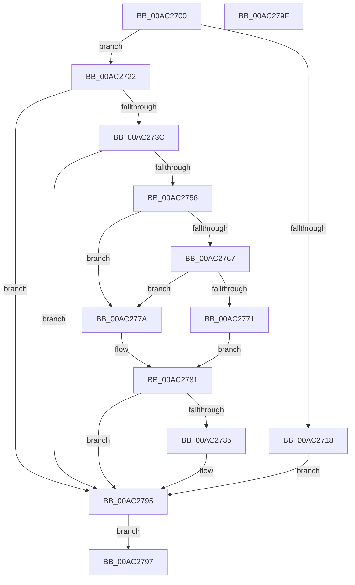

# DbgkpSuppressDbgMsg

- RVA: `0x00AC2700`–`0x00AC27A0` (길이 `160` bytes)
- VA: `0x0000000140AC2700`
- 실행 섹션: `PAGE`
- PDB 이름 있음: `예`; PDB Function 태그: `아니요`
- unwind 정보 RVA: `0x000BDC90`
- 디코드: `40`개 명령, `160/160` bytes 표시
- 미해석 바이트: `0` (있으면 어셈블리에 `.byte`로 보존)

> 이 문서는 커널 이미지의 기계어와 PDB 기호를 분석해 생성했습니다. 4번과 5번은 함수 원형과 자료형을 바이너리 사용 방식에서 추정한 C 해석이며 원본 소스 복구 결과는 아닙니다.

## 1. Dependencies

- 직접 호출 지점: **0**; 고유 호출 대상: **0**
- 직접 호출자로 확인된 함수: **2**
- RIP 상대 이미지 참조: **0**

### Outgoing calls
- 직접 디코드된 call 명령이 없습니다.

### Direct callers
- [DbgkMapViewOfSection](../89/DbgkMapViewOfSection_function_00897460.md) at `0x00897605`
- [DbgkUnMapViewOfSection](../A3/DbgkUnMapViewOfSection_function_00A3B18C.md) at `0x00A3B254`

### Static image references
- 디코드된 RIP-relative 메모리 참조가 없습니다.

## 2. Other-region calls and transfers

- 다른 실행 섹션으로 향하는 call: **0**
- 별도 외부 분기/꼬리 이동을 확인하지 못했습니다.

## 3. Assembly (complete function range)

```asm
00AC2700  48 83 EC 18                     sub rsp, 0x18
00AC2704  48 8B D1                        mov rdx, rcx
00AC2707  C7 04 24 00 00 00 00            mov dword ptr [rsp], 0
00AC270E  8A 81 EE 17 00 00               mov al, byte ptr [rcx + 0x17ee]
00AC2714  84 C0                           test al, al
00AC2716  79 0A                           jns 0x140ac2722
00AC2718  B9 01 00 00 00                  mov ecx, 1
00AC271D  89 0C 24                        mov dword ptr [rsp], ecx
00AC2720  EB 73                           jmp 0x140ac2795
00AC2722  65 48 8B 04 25 88 01 00 00      mov rax, qword ptr gs:[0x188]
00AC272B  48 8B 80 B8 00 00 00            mov rax, qword ptr [rax + 0xb8]
00AC2732  48 83 B8 10 03 00 00 00         cmp qword ptr [rax + 0x310], 0
00AC273A  74 59                           je 0x140ac2795
00AC273C  65 48 8B 04 25 88 01 00 00      mov rax, qword ptr gs:[0x188]
00AC2745  48 8B 80 B8 00 00 00            mov rax, qword ptr [rax + 0xb8]
00AC274C  48 83 B8 10 03 00 00 00         cmp qword ptr [rax + 0x310], 0
00AC2754  74 3F                           je 0x140ac2795
00AC2756  0F B7 80 EC 06 00 00            movzx eax, word ptr [rax + 0x6ec]
00AC275D  B9 4C 01 00 00                  mov ecx, 0x14c
00AC2762  66 3B C1                        cmp ax, cx
00AC2765  74 13                           je 0x140ac277a
00AC2767  B9 C4 01 00 00                  mov ecx, 0x1c4
00AC276C  66 3B C1                        cmp ax, cx
00AC276F  74 09                           je 0x140ac277a
00AC2771  32 C0                           xor al, al
00AC2773  B9 01 00 00 00                  mov ecx, 1
00AC2778  EB 07                           jmp 0x140ac2781
00AC277A  B9 01 00 00 00                  mov ecx, 1
00AC277F  8A C1                           mov al, cl
00AC2781  84 C0                           test al, al
00AC2783  74 10                           je 0x140ac2795
00AC2785  F6 82 CA 2F 00 00 80            test byte ptr [rdx + 0x2fca], 0x80
00AC278C  8B 04 24                        mov eax, dword ptr [rsp]
00AC278F  0F 45 C1                        cmovne eax, ecx
00AC2792  89 04 24                        mov dword ptr [rsp], eax
00AC2795  EB 00                           jmp 0x140ac2797
00AC2797  8B 04 24                        mov eax, dword ptr [rsp]
00AC279A  48 83 C4 18                     add rsp, 0x18
00AC279E  C3                              ret
00AC279F  CC                              int3
```

## 4. C-style interpretation (structured pseudocode)

```c
__int64 __fastcall DbgkpSuppressDbgMsg(__int64 a1)
{
    __int64 result;
    __int64 v_rsp;
    unsigned int v_stack_m18;

    v_rsp = (v_rsp) - (24);
    v_stack_m18 = 0;
    if (!sign_flag) goto loc_00AC2722;
    v_stack_m18 = 1;
    goto loc_00AC2795;
loc_00AC2722:
    if ((*(unsigned __int64 *)(*(unsigned __int64 *)(*(unsigned __int64 *)(gs_base + (0 + 392)) + 184) + 784)) == 0) goto loc_00AC2795;
    if ((*(unsigned __int64 *)(*(unsigned __int64 *)(*(unsigned __int64 *)(gs_base + (0 + 392)) + 184) + 784)) == 0) goto loc_00AC2795;
    if (((unsigned __int16)(*(unsigned __int16 *)(*(unsigned __int64 *)(*(unsigned __int64 *)(gs_base + (0 + 392)) + 184) + 1772))) == 332) goto loc_00AC277A;
    if (((unsigned __int16)(*(unsigned __int16 *)(*(unsigned __int64 *)(*(unsigned __int64 *)(gs_base + (0 + 392)) + 184) + 1772))) == 452) goto loc_00AC277A;
    result = 0;
    goto loc_00AC2781;
loc_00AC277A:
loc_00AC2781:
    result = 1;
    if (1 != 0) {
        result = v_stack_m18;
        if (((*(unsigned __int8 *)(a1 + 12234)) & (128)) != 0) { result = 1; }
        v_stack_m18 = (unsigned int)(result);
    }
    goto loc_00AC2797;
loc_00AC2797:
    v_rsp = (v_rsp) + (24);
    return (unsigned int)(v_stack_m18);
}
```

## 5. (Beta) C Style

```c
int64_t DbgkpSuppressDbgMsg(void *Arg1)
{
    uint8_t *arg1 = (uint8_t *)Arg1;

    int64_t result;
    int64_t local_rsp;
    uint32_t v_stack_m18;

    local_rsp = (local_rsp) - (24);
    v_stack_m18 = 0;
    if (!sign_flag) goto loc_00AC2722;
    v_stack_m18 = 1;
    goto loc_00AC2795;
loc_00AC2722:
    if ((*(uint64_t *)(*(uint64_t *)(*(uint64_t *)(gs_base + (0 + 0x188)) + 0xB8) + 0x310)) == 0) goto loc_00AC2795;
    if ((*(uint64_t *)(*(uint64_t *)(*(uint64_t *)(gs_base + (0 + 0x188)) + 0xB8) + 0x310)) == 0) goto loc_00AC2795;
    if (((uint16_t)(*(uint16_t *)(*(uint64_t *)(*(uint64_t *)(gs_base + (0 + 0x188)) + 0xB8) + 0x6EC))) == 332) goto loc_00AC277A;
    if (((uint16_t)(*(uint16_t *)(*(uint64_t *)(*(uint64_t *)(gs_base + (0 + 0x188)) + 0xB8) + 0x6EC))) == 452) goto loc_00AC277A;
    result = 0;
    goto loc_00AC2781;
loc_00AC277A:
loc_00AC2781:
    result = 1;
    if (1 != 0) {
        result = v_stack_m18;
        if (((*(uint8_t *)(arg1 + 0x2FCA)) & (128)) != 0) { result = 1; }
        v_stack_m18 = (uint32_t)(result);
    }
    goto loc_00AC2797;
loc_00AC2797:
    local_rsp = (local_rsp) + (24);
    return (uint32_t)(v_stack_m18);
}
```

### 관측된 메모리 오프셋

구조체 형식이 확인되지 않은 접근은 인자 기준의 오프셋으로만 기록했습니다.

| 기준 인자 | 오프셋 표현 | 폭 (bit) | 접근 |
|---|---:|---:|---|
| `Arg1` | `+ 0x17EE` | `8` | `R` |
| `Arg1` | `+ 0x2FCA` | `8` | `R` |

## 6. Execution-region graph

[열기: 2D/3D 그래프와 함수 탐색 컨트롤 패널](../../../control-panel.html?section=page&rva=0x00AC2700&view=graph)

- 2D 그래프는 위에서 아래로 흐르고, 3D 그래프는 빈 공간을 드래그해 회전합니다. Shift+드래그는 이동, 휠은 확대·축소, 함수 노드 선택은 대상 보고서 이동입니다.

### Static fallback


