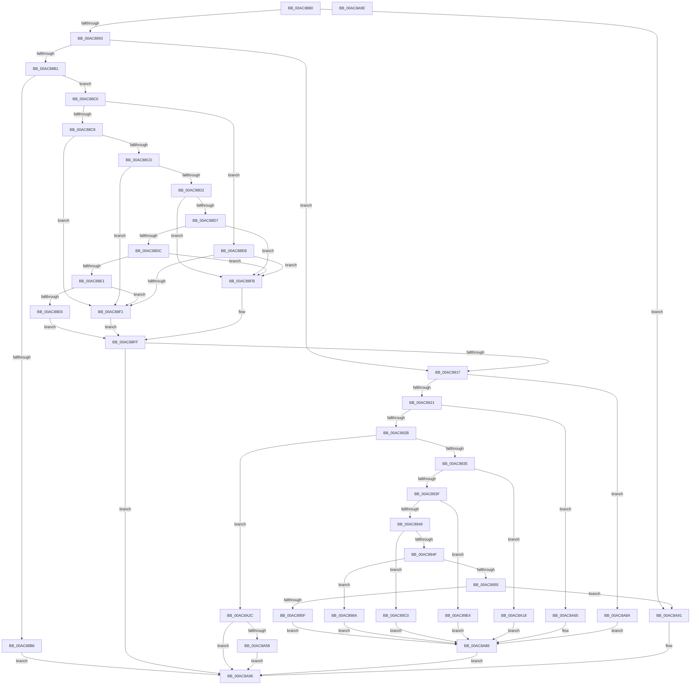

# DrvDbDispatchDriverFile

- RVA: `0x00AC8880`–`0x00AC8A9F` (길이 `543` bytes)
- VA: `0x0000000140AC8880`
- 실행 섹션: `PAGE`
- PDB 이름 있음: `예`; PDB Function 태그: `아니요`
- unwind 정보 RVA: `0x000697A4`
- 디코드: `148`개 명령, `543/543` bytes 표시
- 미해석 바이트: `0` (있으면 어셈블리에 `.byte`로 보존)

> 이 문서는 커널 이미지의 기계어와 PDB 기호를 분석해 생성했습니다. 4번과 5번은 함수 원형과 자료형을 바이너리 사용 방식에서 추정한 C 해석이며 원본 소스 복구 결과는 아닙니다.

## 1. Dependencies

- 직접 호출 지점: **8**; 고유 호출 대상: **7**
- 직접 호출자로 확인된 함수: **0**
- RIP 상대 이미지 참조: **0**

### Outgoing calls
- `0x00AC8980` → [DrvDbSetDriverFileMappedProperty](../83/DrvDbSetDriverFileMappedProperty_function_008345E8.md) (function, `0x008345E8`)
- `0x00AC89B6` → [DrvDbGetDriverFileMappedProperty](../83/DrvDbGetDriverFileMappedProperty_function_00833778.md) (function, `0x00833778`)
- `0x00AC89DA` → [DrvDbGetDriverFileMappedPropertyKeys](../83/DrvDbGetDriverFileMappedPropertyKeys_function_008338FC.md) (function, `0x008338FC`)
- `0x00AC8A11` → [DrvDbGetObjectList](../92/DrvDbGetObjectList_function_0092F224.md) (function, `0x0092F224`)
- `0x00AC8A25` → [DrvDbDeleteObjectRegKey](../83/DrvDbDeleteObjectRegKey_function_00832D70.md) (function, `0x00832D70`)
- `0x00AC8A4D` → [DrvDbOpenDriverFileRegKey](../83/DrvDbOpenDriverFileRegKey_function_00833FCC.md) (function, `0x00833FCC`)
- `0x00AC8A81` → [DrvDbOpenDriverFileRegKey](../83/DrvDbOpenDriverFileRegKey_function_00833FCC.md) (function, `0x00833FCC`)
- `0x00AC8A8A` → [DrvDbValidateDriverFileName](../83/DrvDbValidateDriverFileName_function_00834F3C.md) (function, `0x00834F3C`)

### Direct callers
- 이 함수 시작 RVA로 연결되는 직접 call은 확인되지 않았습니다. 간접 호출은 완전히 역산할 수 없습니다.

### Static image references
- 디코드된 RIP-relative 메모리 참조가 없습니다.

## 2. Other-region calls and transfers

- 다른 실행 섹션으로 향하는 call: **0**
- 별도 외부 분기/꼬리 이동을 확인하지 못했습니다.

## 3. Assembly (complete function range)

```asm
00AC8880  40 53                           push rbx
00AC8882  48 83 EC 40                     sub rsp, 0x40
00AC8886  41 8D 40 FF                     lea eax, [r8 - 1]
00AC888A  83 F8 0A                        cmp eax, 0xa
00AC888D  0F 87 FE 01 00 00               ja 0x140ac8a91
00AC8893  0F AE E8                        lfence
00AC8896  48 8B 5C 24 70                  mov rbx, qword ptr [rsp + 0x70]
00AC889B  49 63 C0                        movsxd rax, r8d
00AC889E  4C 8B 94 C1 88 01 00 00         mov r10, qword ptr [rcx + rax*8 + 0x188]
00AC88A6  45 8B 42 0C                     mov r8d, dword ptr [r10 + 0xc]
00AC88AA  41 0F BA E0 1C                  bt r8d, 0x1c
00AC88AF  72 66                           jb 0x140ac8917
00AC88B1  45 85 C0                        test r8d, r8d
00AC88B4  75 0A                           jne 0x140ac88c0
00AC88B6  B9 67 04 00 C0                  mov ecx, 0xc0000467
00AC88BB  E9 D6 01 00 00                  jmp 0x140ac8a96
00AC88C0  41 8B C9                        mov ecx, r9d
00AC88C3  83 E9 02                        sub ecx, 2
00AC88C6  74 23                           je 0x140ac88eb
00AC88C8  83 E9 01                        sub ecx, 1
00AC88CB  74 24                           je 0x140ac88f1
00AC88CD  83 E9 01                        sub ecx, 1
00AC88D0  74 1F                           je 0x140ac88f1
00AC88D2  83 E9 01                        sub ecx, 1
00AC88D5  74 24                           je 0x140ac88fb
00AC88D7  83 E9 01                        sub ecx, 1
00AC88DA  74 1F                           je 0x140ac88fb
00AC88DC  83 E9 02                        sub ecx, 2
00AC88DF  74 1A                           je 0x140ac88fb
00AC88E1  83 F9 01                        cmp ecx, 1
00AC88E4  74 0B                           je 0x140ac88f1
00AC88E6  41 B0 01                        mov r8b, 1
00AC88E9  EB 14                           jmp 0x140ac88ff
00AC88EB  80 7B 04 00                     cmp byte ptr [rbx + 4], 0
00AC88EF  74 0A                           je 0x140ac88fb
00AC88F1  41 C1 E8 1E                     shr r8d, 0x1e
00AC88F5  41 80 E0 01                     and r8b, 1
00AC88F9  EB 04                           jmp 0x140ac88ff
00AC88FB  41 C1 E8 1F                     shr r8d, 0x1f
00AC88FF  41 8A C0                        mov al, r8b
00AC8902  F6 D8                           neg al
00AC8904  1B C9                           sbb ecx, ecx
00AC8906  F7 D1                           not ecx
00AC8908  81 E1 22 00 00 C0               and ecx, 0xc0000022
00AC890E  45 84 C0                        test r8b, r8b
00AC8911  0F 84 7F 01 00 00               je 0x140ac8a96
00AC8917  41 83 E9 01                     sub r9d, 1
00AC891B  0F 84 69 01 00 00               je 0x140ac8a8a
00AC8921  41 83 E9 01                     sub r9d, 1
00AC8925  0F 84 3A 01 00 00               je 0x140ac8a65
00AC892B  41 83 E9 01                     sub r9d, 1
00AC892F  0F 84 F7 00 00 00               je 0x140ac8a2c
00AC8935  41 83 E9 01                     sub r9d, 1
00AC8939  0F 84 D9 00 00 00               je 0x140ac8a18
00AC893F  41 83 E9 01                     sub r9d, 1
00AC8943  0F 84 9B 00 00 00               je 0x140ac89e4
00AC8949  41 83 E9 01                     sub r9d, 1
00AC894D  74 71                           je 0x140ac89c0
00AC894F  41 83 E9 02                     sub r9d, 2
00AC8953  74 35                           je 0x140ac898a
00AC8955  41 83 F9 01                     cmp r9d, 1
00AC8959  0F 85 32 01 00 00               jne 0x140ac8a91
00AC895F  8B 43 28                        mov eax, dword ptr [rbx + 0x28]
00AC8962  49 8B CA                        mov rcx, r10
00AC8965  4C 8B 4B 10                     mov r9, qword ptr [rbx + 0x10]
00AC8969  4C 8B 03                        mov r8, qword ptr [rbx]
00AC896C  89 44 24 30                     mov dword ptr [rsp + 0x30], eax
00AC8970  48 8B 43 20                     mov rax, qword ptr [rbx + 0x20]
00AC8974  48 89 44 24 28                  mov qword ptr [rsp + 0x28], rax
00AC8979  8B 43 18                        mov eax, dword ptr [rbx + 0x18]
00AC897C  89 44 24 20                     mov dword ptr [rsp + 0x20], eax
00AC8980  E8 63 BC D6 FF                  call 0x1408345e8
00AC8985  E9 FC 00 00 00                  jmp 0x140ac8a86
00AC898A  48 8B 43 30                     mov rax, qword ptr [rbx + 0x30]
00AC898E  49 8B CA                        mov rcx, r10
00AC8991  4C 8B 4B 10                     mov r9, qword ptr [rbx + 0x10]
00AC8995  4C 8B 03                        mov r8, qword ptr [rbx]
00AC8998  48 89 44 24 38                  mov qword ptr [rsp + 0x38], rax
00AC899D  8B 43 28                        mov eax, dword ptr [rbx + 0x28]
00AC89A0  89 44 24 30                     mov dword ptr [rsp + 0x30], eax
00AC89A4  48 8B 43 20                     mov rax, qword ptr [rbx + 0x20]
00AC89A8  48 89 44 24 28                  mov qword ptr [rsp + 0x28], rax
00AC89AD  48 8B 43 18                     mov rax, qword ptr [rbx + 0x18]
00AC89B1  48 89 44 24 20                  mov qword ptr [rsp + 0x20], rax
00AC89B6  E8 BD AD D6 FF                  call 0x140833778
00AC89BB  E9 C6 00 00 00                  jmp 0x140ac8a86
00AC89C0  48 8B 43 28                     mov rax, qword ptr [rbx + 0x28]
00AC89C4  49 8B CA                        mov rcx, r10
00AC89C7  4C 8B 4B 18                     mov r9, qword ptr [rbx + 0x18]
00AC89CB  4C 8B 03                        mov r8, qword ptr [rbx]
00AC89CE  48 89 44 24 28                  mov qword ptr [rsp + 0x28], rax
00AC89D3  8B 43 20                        mov eax, dword ptr [rbx + 0x20]
00AC89D6  89 44 24 20                     mov dword ptr [rsp + 0x20], eax
00AC89DA  E8 1D AF D6 FF                  call 0x1408338fc
00AC89DF  E9 A2 00 00 00                  jmp 0x140ac8a86
00AC89E4  48 8B 43 20                     mov rax, qword ptr [rbx + 0x20]
00AC89E8  8B 4B 18                        mov ecx, dword ptr [rbx + 0x18]
00AC89EB  48 8B 53 10                     mov rdx, qword ptr [rbx + 0x10]
00AC89EF  4C 8B 4B 08                     mov r9, qword ptr [rbx + 8]
00AC89F3  4C 8B 03                        mov r8, qword ptr [rbx]
00AC89F6  83 64 24 38 00                  and dword ptr [rsp + 0x38], 0
00AC89FB  48 89 44 24 30                  mov qword ptr [rsp + 0x30], rax
00AC8A00  89 4C 24 28                     mov dword ptr [rsp + 0x28], ecx
00AC8A04  49 8B CA                        mov rcx, r10
00AC8A07  48 89 54 24 20                  mov qword ptr [rsp + 0x20], rdx
00AC8A0C  BA 04 00 00 00                  mov edx, 4
00AC8A11  E8 0E 68 E6 FF                  call 0x14092f224
00AC8A16  EB 6E                           jmp 0x140ac8a86
00AC8A18  45 33 C9                        xor r9d, r9d
00AC8A1B  4C 8B C2                        mov r8, rdx
00AC8A1E  49 8B CA                        mov rcx, r10
00AC8A21  41 8D 51 04                     lea edx, [r9 + 4]
00AC8A25  E8 46 A3 D6 FF                  call 0x140832d70
00AC8A2A  EB 5A                           jmp 0x140ac8a86
00AC8A2C  44 8B 03                        mov r8d, dword ptr [rbx]
00AC8A2F  48 8D 4C 24 60                  lea rcx, [rsp + 0x60]
00AC8A34  83 64 24 60 00                  and dword ptr [rsp + 0x60], 0
00AC8A39  48 8D 43 08                     lea rax, [rbx + 8]
00AC8A3D  48 89 4C 24 28                  mov qword ptr [rsp + 0x28], rcx
00AC8A42  41 B1 01                        mov r9b, 1
00AC8A45  49 8B CA                        mov rcx, r10
00AC8A48  48 89 44 24 20                  mov qword ptr [rsp + 0x20], rax
00AC8A4D  E8 7A B5 D6 FF                  call 0x140833fcc
00AC8A52  8B C8                           mov ecx, eax
00AC8A54  85 C0                           test eax, eax
00AC8A56  78 3E                           js 0x140ac8a96
00AC8A58  83 7C 24 60 01                  cmp dword ptr [rsp + 0x60], 1
00AC8A5D  0F 94 C0                        sete al
00AC8A60  88 43 10                        mov byte ptr [rbx + 0x10], al
00AC8A63  EB 31                           jmp 0x140ac8a96
00AC8A65  44 8A 4B 04                     mov r9b, byte ptr [rbx + 4]
00AC8A69  48 8D 43 10                     lea rax, [rbx + 0x10]
00AC8A6D  44 8B 03                        mov r8d, dword ptr [rbx]
00AC8A70  49 8B CA                        mov rcx, r10
00AC8A73  48 89 44 24 28                  mov qword ptr [rsp + 0x28], rax
00AC8A78  48 8B 43 08                     mov rax, qword ptr [rbx + 8]
00AC8A7C  48 89 44 24 20                  mov qword ptr [rsp + 0x20], rax
00AC8A81  E8 46 B5 D6 FF                  call 0x140833fcc
00AC8A86  8B C8                           mov ecx, eax
00AC8A88  EB 0C                           jmp 0x140ac8a96
00AC8A8A  E8 AD C4 D6 FF                  call 0x140834f3c
00AC8A8F  EB F5                           jmp 0x140ac8a86
00AC8A91  B9 0D 00 00 C0                  mov ecx, 0xc000000d
00AC8A96  8B C1                           mov eax, ecx
00AC8A98  48 83 C4 40                     add rsp, 0x40
00AC8A9C  5B                              pop rbx
00AC8A9D  C3                              ret
00AC8A9E  CC                              int3
```

## 4. C-style interpretation (structured pseudocode)

```c
__int64 __fastcall DrvDbDispatchDriverFile(__int64 a1, __int64 a2, __int64 a3, int a4, __int64 a5)
{
    __int64 result;
    __int64 v_rsp;
    unsigned __int64 v_stack_m10;
    unsigned int v_stack_m18;
    unsigned __int64 v_stack_m20;
    unsigned int v_stack_m28;
    unsigned __int64 v_stack_p18;

    v_rsp = (v_rsp) - (64);
    if (((unsigned int)(a3 - 1)) > 10) goto loc_00AC8A91;
    if (((unsigned int)(a3 - 1)) < 10) goto loc_00AC8917;
    if ((unsigned int)((unsigned int)(*(unsigned int *)(*(unsigned __int64 *)(a1 + (int)((unsigned int)(a3)) * 8 + 392) + 12))) != 0) goto loc_00AC88C0;
    goto loc_00AC8A96;
loc_00AC88C0:
    a1 = (unsigned int)(((unsigned int)(a4)) - (2));
    if (condition_is_equal) goto loc_00AC88EB;
    a1 = (unsigned int)((a1) - (1));
    if (condition_is_equal) goto loc_00AC88F1;
    a1 = (unsigned int)((a1) - (1));
    if (condition_is_equal) goto loc_00AC88F1;
    a1 = (unsigned int)((a1) - (1));
    if (condition_is_equal) goto loc_00AC88FB;
    a1 = (unsigned int)((a1) - (1));
    if (condition_is_equal) goto loc_00AC88FB;
    a1 = (unsigned int)((a1) - (2));
    if (condition_is_equal) goto loc_00AC88FB;
    if (((unsigned int)(a1)) == 1) goto loc_00AC88F1;
    goto loc_00AC88FF;
loc_00AC88EB:
    if ((*(unsigned __int8 *)(a5 + 4)) == 0) goto loc_00AC88FB;
loc_00AC88F1:
    a3 = (unsigned int)((1) >> (30));
    a3 = (unsigned __int8)((a3) & (1));
    goto loc_00AC88FF;
loc_00AC88FB:
    a3 = (unsigned int)((a3) >> (31));
loc_00AC88FF:
    result = (unsigned __int8)(-((unsigned __int8)(a3)));
    a1 = (unsigned int)(~(a1));
    a1 = (unsigned int)((a1) & (0xC0000022ULL));
    if ((unsigned __int8)(a3) == 0) goto loc_00AC8A96;
loc_00AC8917:
    a4 = (unsigned int)((a4) - (1));
    if (condition_is_equal) goto loc_00AC8A8A;
    a4 = (unsigned int)((a4) - (1));
    if (condition_is_equal) goto loc_00AC8A65;
    a4 = (unsigned int)((a4) - (1));
    if (condition_is_equal) goto loc_00AC8A2C;
    a4 = (unsigned int)((a4) - (1));
    if (condition_is_equal) goto loc_00AC8A18;
    a4 = (unsigned int)((a4) - (1));
    if (condition_is_equal) goto loc_00AC89E4;
    a4 = (unsigned int)((a4) - (1));
    if (condition_is_equal) goto loc_00AC89C0;
    a4 = (unsigned int)((a4) - (2));
    if (condition_is_equal) goto loc_00AC898A;
    if (a4 != 1) goto loc_00AC8A91;
    v_stack_m18 = (unsigned int)((unsigned int)(*(unsigned int *)(a5 + 40)));
    v_stack_m20 = *(unsigned __int64 *)(a5 + 32);
    v_stack_m28 = (unsigned int)((unsigned int)(*(unsigned int *)(a5 + 24)));
    result = DrvDbSetDriverFileMappedProperty(*(unsigned __int64 *)(a1 + (int)((unsigned int)(a3)) * 8 + 392), a2, *(unsigned __int64 *)(a5), *(unsigned __int64 *)(a5 + 16));
    goto loc_00AC8A86;
loc_00AC898A:
    v_stack_m10 = *(unsigned __int64 *)(a5 + 48);
    v_stack_m18 = (unsigned int)((unsigned int)(*(unsigned int *)(a5 + 40)));
    v_stack_m20 = *(unsigned __int64 *)(a5 + 32);
    v_stack_m28 = *(unsigned __int64 *)(a5 + 24);
    result = DrvDbGetDriverFileMappedProperty(*(unsigned __int64 *)(a1 + (int)((unsigned int)(a3)) * 8 + 392), a2, *(unsigned __int64 *)(a5), *(unsigned __int64 *)(a5 + 16));
    goto loc_00AC8A86;
loc_00AC89C0:
    v_stack_m20 = *(unsigned __int64 *)(a5 + 40);
    v_stack_m28 = (unsigned int)((unsigned int)(*(unsigned int *)(a5 + 32)));
    result = DrvDbGetDriverFileMappedPropertyKeys(*(unsigned __int64 *)(a1 + (int)((unsigned int)(a3)) * 8 + 392), a2, *(unsigned __int64 *)(a5), *(unsigned __int64 *)(a5 + 24));
    goto loc_00AC8A86;
loc_00AC89E4:
    v_stack_m18 = *(unsigned __int64 *)(a5 + 32);
    v_stack_m20 = (unsigned int)((unsigned int)(*(unsigned int *)(a5 + 24)));
    v_stack_m28 = *(unsigned __int64 *)(a5 + 16);
    result = DrvDbGetObjectList(*(unsigned __int64 *)(a1 + (int)((unsigned int)(a3)) * 8 + 392), 4, *(unsigned __int64 *)(a5), *(unsigned __int64 *)(a5 + 8));
    goto loc_00AC8A86;
loc_00AC8A18:
    a4 = 0;
    result = DrvDbDeleteObjectRegKey(*(unsigned __int64 *)(a1 + (int)((unsigned int)(a3)) * 8 + 392), a4 + 4, 4, a4);
    goto loc_00AC8A86;
loc_00AC8A2C:
    v_stack_m20 = v_stack_p18;
    v_stack_m28 = a5 + 8;
    result = DrvDbOpenDriverFileRegKey(*(unsigned __int64 *)(a1 + (int)((unsigned int)(a3)) * 8 + 392), a4 + 4, (unsigned int)(*(unsigned int *)(a5)), 1);
    if (sign_flag) goto loc_00AC8A96;
    result = (v_stack_p18 == 1) ? 1 : 0;
    *(unsigned __int8 *)(a5 + 16) = (unsigned __int8)(result);
    goto loc_00AC8A96;
loc_00AC8A65:
    v_stack_m20 = a5 + 16;
    v_stack_m28 = *(unsigned __int64 *)(a5 + 8);
    result = DrvDbOpenDriverFileRegKey(*(unsigned __int64 *)(a1 + (int)((unsigned int)(a3)) * 8 + 392), a4 + 4, (unsigned int)(*(unsigned int *)(a5)), *(unsigned __int8 *)(a5 + 4));
loc_00AC8A86:
    goto loc_00AC8A96;
loc_00AC8A8A:
    result = DrvDbValidateDriverFileName((unsigned int)((unsigned int)(result)), a4 + 4, (unsigned int)(*(unsigned int *)(a5)), *(unsigned __int8 *)(a5 + 4));
    goto loc_00AC8A86;
loc_00AC8A91:
loc_00AC8A96:
    v_rsp = (v_rsp) + (64);
    return (unsigned int)((unsigned int)((unsigned int)(0xC000000DULL)));
}
```

## 5. (Beta) C Style

```c
int64_t DrvDbDispatchDriverFile(void *Arg1, int64_t Arg2, void *Arg3, int32_t Arg4, void *Arg5)
{
    uint8_t *arg1 = (uint8_t *)Arg1;
    uint8_t *arg3 = (uint8_t *)Arg3;
    uint8_t *arg5 = (uint8_t *)Arg5;

    int64_t result;
    int64_t local_rsp;
    uint64_t v_stack_m10;
    uint32_t v_stack_m18;
    uint64_t v_stack_m20;
    uint32_t v_stack_m28;
    uint64_t v_stack_p18;

    local_rsp = (local_rsp) - (64);
    if (((uint32_t)(Arg3 - 1)) > 10) goto loc_00AC8A91;
    if (((uint32_t)(Arg3 - 1)) < 10) goto loc_00AC8917;
    if ((uint32_t)((uint32_t)(*(uint32_t *)(*(uint64_t *)(arg1 + (int32_t)((uint32_t)(arg3)) * 8 + 0x188) + 0xC))) != 0) goto loc_00AC88C0;
    goto loc_00AC8A96;
loc_00AC88C0:
    Arg1 = (uint32_t)(((uint32_t)(Arg4)) - (2));
    if (condition_is_equal) goto loc_00AC88EB;
    Arg1 = (uint32_t)((Arg1) - (1));
    if (condition_is_equal) goto loc_00AC88F1;
    Arg1 = (uint32_t)((Arg1) - (1));
    if (condition_is_equal) goto loc_00AC88F1;
    Arg1 = (uint32_t)((Arg1) - (1));
    if (condition_is_equal) goto loc_00AC88FB;
    Arg1 = (uint32_t)((Arg1) - (1));
    if (condition_is_equal) goto loc_00AC88FB;
    Arg1 = (uint32_t)((Arg1) - (2));
    if (condition_is_equal) goto loc_00AC88FB;
    if (((uint32_t)(Arg1)) == 1) goto loc_00AC88F1;
    goto loc_00AC88FF;
loc_00AC88EB:
    if ((*(uint8_t *)(arg5 + 0x4)) == 0) goto loc_00AC88FB;
loc_00AC88F1:
    Arg3 = (uint32_t)((1) >> (30));
    Arg3 = (uint8_t)((Arg3) & (1));
    goto loc_00AC88FF;
loc_00AC88FB:
    Arg3 = (uint32_t)((Arg3) >> (31));
loc_00AC88FF:
    result = (uint8_t)(-((uint8_t)(Arg3)));
    Arg1 = (uint32_t)(~(Arg1));
    Arg1 = (uint32_t)((Arg1) & (0xC0000022ULL));
    if ((uint8_t)(Arg3) == 0) goto loc_00AC8A96;
loc_00AC8917:
    Arg4 = (uint32_t)((Arg4) - (1));
    if (condition_is_equal) goto loc_00AC8A8A;
    Arg4 = (uint32_t)((Arg4) - (1));
    if (condition_is_equal) goto loc_00AC8A65;
    Arg4 = (uint32_t)((Arg4) - (1));
    if (condition_is_equal) goto loc_00AC8A2C;
    Arg4 = (uint32_t)((Arg4) - (1));
    if (condition_is_equal) goto loc_00AC8A18;
    Arg4 = (uint32_t)((Arg4) - (1));
    if (condition_is_equal) goto loc_00AC89E4;
    Arg4 = (uint32_t)((Arg4) - (1));
    if (condition_is_equal) goto loc_00AC89C0;
    Arg4 = (uint32_t)((Arg4) - (2));
    if (condition_is_equal) goto loc_00AC898A;
    if (Arg4 != 1) goto loc_00AC8A91;
    v_stack_m18 = (uint32_t)((uint32_t)(*(uint32_t *)(arg5 + 0x28)));
    v_stack_m20 = *(uint64_t *)(arg5 + 0x20);
    v_stack_m28 = (uint32_t)((uint32_t)(*(uint32_t *)(arg5 + 0x18)));
    result = DrvDbSetDriverFileMappedProperty(*(uint64_t *)(arg1 + (int32_t)((uint32_t)(arg3)) * 8 + 0x188), Arg2, *(uint64_t *)(arg5), *(uint64_t *)(arg5 + 0x10));
    goto loc_00AC8A86;
loc_00AC898A:
    v_stack_m10 = *(uint64_t *)(arg5 + 0x30);
    v_stack_m18 = (uint32_t)((uint32_t)(*(uint32_t *)(arg5 + 0x28)));
    v_stack_m20 = *(uint64_t *)(arg5 + 0x20);
    v_stack_m28 = *(uint64_t *)(arg5 + 0x18);
    result = DrvDbGetDriverFileMappedProperty(*(uint64_t *)(arg1 + (int32_t)((uint32_t)(arg3)) * 8 + 0x188), Arg2, *(uint64_t *)(arg5), *(uint64_t *)(arg5 + 0x10));
    goto loc_00AC8A86;
loc_00AC89C0:
    v_stack_m20 = *(uint64_t *)(arg5 + 0x28);
    v_stack_m28 = (uint32_t)((uint32_t)(*(uint32_t *)(arg5 + 0x20)));
    result = DrvDbGetDriverFileMappedPropertyKeys(*(uint64_t *)(arg1 + (int32_t)((uint32_t)(arg3)) * 8 + 0x188), Arg2, *(uint64_t *)(arg5), *(uint64_t *)(arg5 + 0x18));
    goto loc_00AC8A86;
loc_00AC89E4:
    v_stack_m18 = *(uint64_t *)(arg5 + 0x20);
    v_stack_m20 = (uint32_t)((uint32_t)(*(uint32_t *)(arg5 + 0x18)));
    v_stack_m28 = *(uint64_t *)(arg5 + 0x10);
    result = DrvDbGetObjectList(*(uint64_t *)(arg1 + (int32_t)((uint32_t)(arg3)) * 8 + 0x188), 4, *(uint64_t *)(arg5), *(uint64_t *)(arg5 + 0x8));
    goto loc_00AC8A86;
loc_00AC8A18:
    Arg4 = 0;
    result = DrvDbDeleteObjectRegKey(*(uint64_t *)(arg1 + (int32_t)((uint32_t)(arg3)) * 8 + 0x188), Arg4 + 4, 4, Arg4);
    goto loc_00AC8A86;
loc_00AC8A2C:
    v_stack_m20 = v_stack_p18;
    v_stack_m28 = Arg5 + 8;
    result = DrvDbOpenDriverFileRegKey(*(uint64_t *)(arg1 + (int32_t)((uint32_t)(arg3)) * 8 + 0x188), Arg4 + 4, (uint32_t)(*(uint32_t *)(arg5)), 1);
    if (sign_flag) goto loc_00AC8A96;
    result = (v_stack_p18 == 1) ? 1 : 0;
    *(uint8_t *)(arg5 + 0x10) = (uint8_t)(result);
    goto loc_00AC8A96;
loc_00AC8A65:
    v_stack_m20 = Arg5 + 16;
    v_stack_m28 = *(uint64_t *)(arg5 + 0x8);
    result = DrvDbOpenDriverFileRegKey(*(uint64_t *)(arg1 + (int32_t)((uint32_t)(arg3)) * 8 + 0x188), Arg4 + 4, (uint32_t)(*(uint32_t *)(arg5)), *(uint8_t *)(arg5 + 0x4));
loc_00AC8A86:
    goto loc_00AC8A96;
loc_00AC8A8A:
    result = DrvDbValidateDriverFileName((uint32_t)((uint32_t)(result)), Arg4 + 4, (uint32_t)(*(uint32_t *)(arg5)), *(uint8_t *)(arg5 + 0x4));
    goto loc_00AC8A86;
loc_00AC8A91:
loc_00AC8A96:
    local_rsp = (local_rsp) + (64);
    return (uint32_t)((uint32_t)((uint32_t)(0xC000000DULL)));
}
```

### 관측된 메모리 오프셋

구조체 형식이 확인되지 않은 접근은 인자 기준의 오프셋으로만 기록했습니다.

| 기준 인자 | 오프셋 표현 | 폭 (bit) | 접근 |
|---|---:|---:|---|
| `Arg1` | `+ 0x188 + rax*8` | `64` | `R` |
| `Arg3` | `- 0x1` | `32` | `R` |
| `Arg5` | `+ 0x0` | `32` | `R` |
| `Arg5` | `+ 0x0` | `64` | `R` |
| `Arg5` | `+ 0x4` | `8` | `R` |
| `Arg5` | `+ 0x8` | `64` | `R` |
| `Arg5` | `+ 0x10` | `8` | `W` |
| `Arg5` | `+ 0x10` | `64` | `R` |
| `Arg5` | `+ 0x18` | `32` | `R` |
| `Arg5` | `+ 0x18` | `64` | `R` |
| `Arg5` | `+ 0x20` | `32` | `R` |
| `Arg5` | `+ 0x20` | `64` | `R` |
| `Arg5` | `+ 0x28` | `32` | `R` |
| `Arg5` | `+ 0x28` | `64` | `R` |
| `Arg5` | `+ 0x30` | `64` | `R` |

## 6. Execution-region graph

[열기: 2D/3D 그래프와 함수 탐색 컨트롤 패널](../../../control-panel.html?section=page&rva=0x00AC8880&view=graph)

- 2D 그래프는 위에서 아래로 흐르고, 3D 그래프는 빈 공간을 드래그해 회전합니다. Shift+드래그는 이동, 휠은 확대·축소, 함수 노드 선택은 대상 보고서 이동입니다.

### Static fallback


