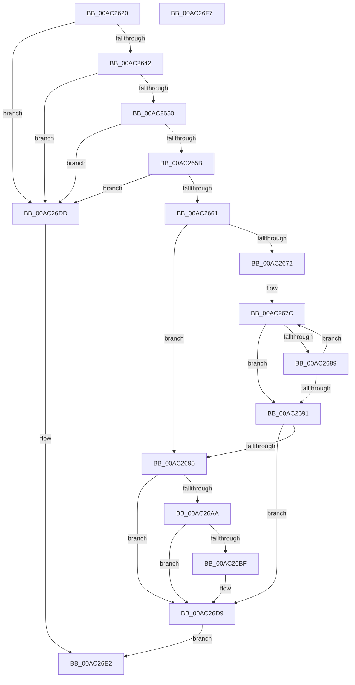

# EmCpuMatchCallback

- RVA: `0x00AC2620`–`0x00AC26F8` (길이 `216` bytes)
- VA: `0x0000000140AC2620`
- 실행 섹션: `PAGE`
- PDB 이름 있음: `예`; PDB Function 태그: `아니요`
- unwind 정보 RVA: `0x0005C954`
- 디코드: `61`개 명령, `216/216` bytes 표시
- 미해석 바이트: `0` (있으면 어셈블리에 `.byte`로 보존)

> 이 문서는 커널 이미지의 기계어와 PDB 기호를 분석해 생성했습니다. 4번과 5번은 함수 원형과 자료형을 바이너리 사용 방식에서 추정한 C 해석이며 원본 소스 복구 결과는 아닙니다.

## 1. Dependencies

- 직접 호출 지점: **3**; 고유 호출 대상: **1**
- 직접 호출자로 확인된 함수: **0**
- RIP 상대 이미지 참조: **0**

### Outgoing calls
- `0x00AC26A1` → [EmpCheckOperator](../71/EmpCheckOperator_function_00713670.md) (function, `0x00713670`)
- `0x00AC26B6` → [EmpCheckOperator](../71/EmpCheckOperator_function_00713670.md) (function, `0x00713670`)
- `0x00AC26CB` → [EmpCheckOperator](../71/EmpCheckOperator_function_00713670.md) (function, `0x00713670`)

### Direct callers
- 이 함수 시작 RVA로 연결되는 직접 call은 확인되지 않았습니다. 간접 호출은 완전히 역산할 수 없습니다.

### Static image references
- 디코드된 RIP-relative 메모리 참조가 없습니다.

## 2. Other-region calls and transfers

- 다른 실행 섹션으로 향하는 call: **0**
- 별도 외부 분기/꼬리 이동을 확인하지 못했습니다.

## 3. Assembly (complete function range)

```asm
00AC2620  48 89 5C 24 08                  mov qword ptr [rsp + 8], rbx
00AC2625  48 89 6C 24 10                  mov qword ptr [rsp + 0x10], rbp
00AC262A  48 89 74 24 18                  mov qword ptr [rsp + 0x18], rsi
00AC262F  57                              push rdi
00AC2630  48 83 EC 20                     sub rsp, 0x20
00AC2634  33 DB                           xor ebx, ebx
00AC2636  49 8B F8                        mov rdi, r8
00AC2639  4D 85 C0                        test r8, r8
00AC263C  0F 84 9B 00 00 00               je 0x140ac26dd
00AC2642  48 8B 74 24 50                  mov rsi, qword ptr [rsp + 0x50]
00AC2647  48 85 F6                        test rsi, rsi
00AC264A  0F 84 8D 00 00 00               je 0x140ac26dd
00AC2650  83 7C 24 58 04                  cmp dword ptr [rsp + 0x58], 4
00AC2655  0F 85 82 00 00 00               jne 0x140ac26dd
00AC265B  41 83 F9 04                     cmp r9d, 4
00AC265F  75 7C                           jne 0x140ac26dd
00AC2661  65 48 8B 2C 25 20 00 00 00      mov rbp, qword ptr gs:[0x20]
00AC266A  49 8B 00                        mov rax, qword ptr [r8]
00AC266D  80 38 2A                        cmp byte ptr [rax], 0x2a
00AC2670  74 23                           je 0x140ac2695
00AC2672  48 8D 8D 90 8F 00 00            lea rcx, [rbp + 0x8f90]
00AC2679  48 2B C1                        sub rax, rcx
00AC267C  0F B6 11                        movzx edx, byte ptr [rcx]
00AC267F  44 0F B6 04 01                  movzx r8d, byte ptr [rcx + rax]
00AC2684  41 2B D0                        sub edx, r8d
00AC2687  75 08                           jne 0x140ac2691
00AC2689  48 FF C1                        inc rcx
00AC268C  45 85 C0                        test r8d, r8d
00AC268F  75 EB                           jne 0x140ac267c
00AC2691  85 D2                           test edx, edx
00AC2693  75 44                           jne 0x140ac26d9
00AC2695  0F BE 55 40                     movsx edx, byte ptr [rbp + 0x40]
00AC2699  48 8B 4F 08                     mov rcx, qword ptr [rdi + 8]
00AC269D  44 8B 46 04                     mov r8d, dword ptr [rsi + 4]
00AC26A1  E8 CA 0F C5 FF                  call 0x140713670
00AC26A6  85 C0                           test eax, eax
00AC26A8  74 2F                           je 0x140ac26d9
00AC26AA  0F B6 55 43                     movzx edx, byte ptr [rbp + 0x43]
00AC26AE  48 8B 4F 10                     mov rcx, qword ptr [rdi + 0x10]
00AC26B2  44 8B 46 08                     mov r8d, dword ptr [rsi + 8]
00AC26B6  E8 B5 0F C5 FF                  call 0x140713670
00AC26BB  85 C0                           test eax, eax
00AC26BD  74 1A                           je 0x140ac26d9
00AC26BF  0F B6 55 42                     movzx edx, byte ptr [rbp + 0x42]
00AC26C3  48 8B 4F 18                     mov rcx, qword ptr [rdi + 0x18]
00AC26C7  44 8B 46 0C                     mov r8d, dword ptr [rsi + 0xc]
00AC26CB  E8 A0 0F C5 FF                  call 0x140713670
00AC26D0  F7 D8                           neg eax
00AC26D2  1B C9                           sbb ecx, ecx
00AC26D4  83 E1 02                        and ecx, 2
00AC26D7  8B D9                           mov ebx, ecx
00AC26D9  8B C3                           mov eax, ebx
00AC26DB  EB 05                           jmp 0x140ac26e2
00AC26DD  B8 01 00 00 00                  mov eax, 1
00AC26E2  48 8B 5C 24 30                  mov rbx, qword ptr [rsp + 0x30]
00AC26E7  48 8B 6C 24 38                  mov rbp, qword ptr [rsp + 0x38]
00AC26EC  48 8B 74 24 40                  mov rsi, qword ptr [rsp + 0x40]
00AC26F1  48 83 C4 20                     add rsp, 0x20
00AC26F5  5F                              pop rdi
00AC26F6  C3                              ret
00AC26F7  CC                              int3
```

## 4. C-style interpretation (structured pseudocode)

```c
__int64 __fastcall EmCpuMatchCallback(__int64 a1, __int64 a2, __int64 a3, int a4, __int64 a5, unsigned int a6)
{
    __int64 result;
    __int64 v_rbx;
    __int64 v_rsp;
    unsigned __int64 v_stack_p10;
    unsigned __int64 v_stack_p18;
    unsigned __int64 v_stack_p8;

    v_stack_p8 = v_rbx;
    v_stack_p10 = v_rbp;
    v_stack_p18 = v_rsi;
    v_rsp = (v_rsp) - (32);
    v_rbx = 0;
    if (a3 == 0) goto loc_00AC26DD;
    if (a5 == 0) goto loc_00AC26DD;
    if (a6 != 4) goto loc_00AC26DD;
    if (a4 != 4) goto loc_00AC26DD;
    if ((*(unsigned __int8 *)(*(unsigned __int64 *)(a3))) == 42) goto loc_00AC2695;
    result = (*(unsigned __int64 *)(a3)) - (*(unsigned __int64 *)(gs_base + (0 + 32)) + 36752);
loc_00AC267C:
    a2 = (unsigned int)((*(unsigned __int8 *)(*(unsigned __int64 *)(gs_base + (0 + 32)) + 36752)) - ((unsigned int)(*(unsigned __int8 *)(*(unsigned __int64 *)(gs_base + (0 + 32)) + 36752 + result * 1))));
    if (condition_is_not_equal) goto loc_00AC2691;
    a1 = (*(unsigned __int64 *)(gs_base + (0 + 32)) + 36752) + 1;
    if ((unsigned int)(*(unsigned __int8 *)(*(unsigned __int64 *)(gs_base + (0 + 32)) + 36752 + result * 1)) != 0) goto loc_00AC267C;
loc_00AC2691:
    if ((unsigned int)(a2) != 0) goto loc_00AC26D9;
loc_00AC2695:
    result = EmpCheckOperator(*(unsigned __int64 *)(a3 + 8), (__int8)(*(unsigned __int8 *)(*(unsigned __int64 *)(gs_base + (0 + 32)) + 64)), (unsigned int)(*(unsigned int *)(a5 + 4)), a4);
    if ((unsigned int)(result) == 0) goto loc_00AC26D9;
    result = EmpCheckOperator(*(unsigned __int64 *)(a3 + 16), *(unsigned __int8 *)(*(unsigned __int64 *)(gs_base + (0 + 32)) + 67), (unsigned int)(*(unsigned int *)(a5 + 8)), a4);
    if ((unsigned int)(result) != 0) {
        a2 = *(unsigned __int8 *)(*(unsigned __int64 *)(gs_base + (0 + 32)) + 66);
        a1 = *(unsigned __int64 *)(a3 + 24);
        a3 = *(unsigned int *)(a5 + 12);
        result = EmpCheckOperator(a1, a2, a3, a4);
        result = (unsigned int)(-(result));
        a1 = (unsigned int)((a1) & (2));
        v_rbx = (unsigned int)(a1);
    }
    goto loc_00AC26E2;
loc_00AC26DD:
loc_00AC26E2:
    v_rsp = (v_rsp) + (32);
    return 1;
}
```

## 5. (Beta) C Style

```c
int64_t EmCpuMatchCallback(int64_t Arg1, int64_t Arg2, void *Arg3, int32_t Arg4, int64_t Arg5, uint32_t Arg6)
{
    uint8_t *arg3 = (uint8_t *)Arg3;

    int64_t result;
    int64_t local_rbx;
    int64_t local_rsp;
    uint64_t v_stack_p10;
    uint64_t v_stack_p18;
    uint64_t v_stack_p8;

    v_stack_p8 = local_rbx;
    v_stack_p10 = local_rbp;
    v_stack_p18 = local_rsi;
    local_rsp = (local_rsp) - (32);
    local_rbx = 0;
    if (Arg3 == NULL) goto loc_00AC26DD;
    if (Arg5 == 0) goto loc_00AC26DD;
    if (Arg6 != 4) goto loc_00AC26DD;
    if (Arg4 != 4) goto loc_00AC26DD;
    if ((*(uint8_t *)(*(uint64_t *)(arg3))) == 42) goto loc_00AC2695;
    result = (*(uint64_t *)(arg3)) - (*(uint64_t *)(gs_base + (0 + 0x20)) + 36752);
loc_00AC267C:
    Arg2 = (uint32_t)((*(uint8_t *)(*(uint64_t *)(gs_base + (0 + 0x20)) + 0x8F90)) - ((uint32_t)(*(uint8_t *)(*(uint64_t *)(gs_base + (0 + 0x20)) + 0x8F90 + result * 1))));
    if (condition_is_not_equal) goto loc_00AC2691;
    Arg1 = (*(uint64_t *)(gs_base + (0 + 0x20)) + 36752) + 1;
    if ((uint32_t)(*(uint8_t *)(*(uint64_t *)(gs_base + (0 + 0x20)) + 0x8F90 + result * 1)) != 0) goto loc_00AC267C;
loc_00AC2691:
    if ((uint32_t)(Arg2) != 0) goto loc_00AC26D9;
loc_00AC2695:
    result = EmpCheckOperator(*(uint64_t *)(arg3 + 0x8), (int8_t)(*(uint8_t *)(*(uint64_t *)(gs_base + (0 + 0x20)) + 0x40)), (uint32_t)(*(uint32_t *)(Arg5 + 0x4)), Arg4);
    if ((uint32_t)(result) == 0) goto loc_00AC26D9;
    result = EmpCheckOperator(*(uint64_t *)(arg3 + 0x10), *(uint8_t *)(*(uint64_t *)(gs_base + (0 + 0x20)) + 0x43), (uint32_t)(*(uint32_t *)(Arg5 + 0x8)), Arg4);
    if ((uint32_t)(result) != 0) {
        Arg2 = *(uint8_t *)(*(uint64_t *)(gs_base + (0 + 0x20)) + 0x42);
        Arg1 = *(uint64_t *)(arg3 + 0x18);
        Arg3 = *(uint32_t *)(Arg5 + 0xC);
        result = EmpCheckOperator(Arg1, Arg2, Arg3, Arg4);
        result = (uint32_t)(-(result));
        Arg1 = (uint32_t)((Arg1) & (2));
        local_rbx = (uint32_t)(Arg1);
    }
    goto loc_00AC26E2;
loc_00AC26DD:
loc_00AC26E2:
    local_rsp = (local_rsp) + (32);
    return 1;
}
```

### 관측된 메모리 오프셋

구조체 형식이 확인되지 않은 접근은 인자 기준의 오프셋으로만 기록했습니다.

| 기준 인자 | 오프셋 표현 | 폭 (bit) | 접근 |
|---|---:|---:|---|
| `Arg3` | `+ 0x8` | `64` | `R` |
| `Arg3` | `+ 0x10` | `64` | `R` |
| `Arg3` | `+ 0x18` | `64` | `R` |

## 6. Execution-region graph

[열기: 2D/3D 그래프와 함수 탐색 컨트롤 패널](../../../control-panel.html?section=page&rva=0x00AC2620&view=graph)

- 2D 그래프는 위에서 아래로 흐르고, 3D 그래프는 빈 공간을 드래그해 회전합니다. Shift+드래그는 이동, 휠은 확대·축소, 함수 노드 선택은 대상 보고서 이동입니다.

### Static fallback


