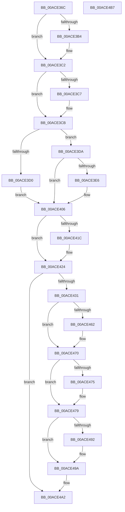

# EmPowerPagingEnabled

- RVA: `0x00ACE36C`–`0x00ACE4B8` (길이 `332` bytes)
- VA: `0x0000000140ACE36C`
- 실행 섹션: `PAGE`
- PDB 이름 있음: `예`; PDB Function 태그: `아니요`
- unwind 정보 RVA: `0x0006F874`
- 디코드: `88`개 명령, `332/332` bytes 표시
- 미해석 바이트: `0` (있으면 어셈블리에 `.byte`로 보존)

> 이 문서는 커널 이미지의 기계어와 PDB 기호를 분석해 생성했습니다. 4번과 5번은 함수 원형과 자료형을 바이너리 사용 방식에서 추정한 C 해석이며 원본 소스 복구 결과는 아닙니다.

## 1. Dependencies

- 직접 호출 지점: **10**; 고유 호출 대상: **6**
- 직접 호출자로 확인된 함수: **1**
- RIP 상대 이미지 참조: **5**

### Outgoing calls
- `0x00ACE3A3` → [KeAbPreAcquire](../../text/21/KeAbPreAcquire_function_00210230.md) (function, `0x00210230`)
- `0x00ACE3BD` → [ExfAcquirePushLockExclusiveEx](../../text/20/ExfAcquirePushLockExclusiveEx_function_0020FC90.md) (function, `0x0020FC90`)
- `0x00ACE3F2` → [KeInitializeEvent](../../text/40/KeInitializeEvent_function_0040DD10.md) (function, `0x0040DD10`)
- `0x00ACE41F` → [ExfTryToWakePushLock](../../text/26/ExfTryToWakePushLock_function_00265DD0.md) (function, `0x00265DD0`)
- `0x00ACE427` → [KeAbPostRelease](../../text/2E/KeAbPostRelease_function_002E1600.md) (function, `0x002E1600`)
- `0x00ACE444` → [KeWaitForSingleObject](../../text/20/KeWaitForSingleObject_function_0020E6B0.md) (function, `0x0020E6B0`)
- `0x00ACE451` → [KeAbPreAcquire](../../text/21/KeAbPreAcquire_function_00210230.md) (function, `0x00210230`)
- `0x00ACE46B` → [ExfAcquirePushLockExclusiveEx](../../text/20/ExfAcquirePushLockExclusiveEx_function_0020FC90.md) (function, `0x0020FC90`)
- `0x00ACE495` → [ExfTryToWakePushLock](../../text/26/ExfTryToWakePushLock_function_00265DD0.md) (function, `0x00265DD0`)
- `0x00ACE49D` → [KeAbPostRelease](../../text/2E/KeAbPostRelease_function_002E1600.md) (function, `0x002E1600`)

### Direct callers
- [sub_00B80364](../../pagelk/B8/Unknown_function_00B80364.md) at `0x00B80371`
- [sub_00B80364](../../pagelk/B8/Unknown_function_00B80364.md) at `0x00B80491`

### Static image references
- `0x00ACE383` → RVA `0x00F8F190` (`.data`; read)
- `0x00ACE3D0` → RVA `0x00F8F1F8` (`.data`; read/write)
- `0x00ACE3FF` → RVA `0x00F8F1F0` (`.data`; write)
- `0x00ACE40D` → RVA `0x00F8F190` (`.data`; read/write)
- `0x00ACE479` → RVA `0x00F8F1F0` (`.data`; read/write)

## 2. Other-region calls and transfers

- 다른 실행 섹션으로 향하는 call: **10**
  - `0x00ACE3A3` → [KeAbPreAcquire](../../text/21/KeAbPreAcquire_function_00210230.md) (`PAGE` → `.text`)
  - `0x00ACE3BD` → [ExfAcquirePushLockExclusiveEx](../../text/20/ExfAcquirePushLockExclusiveEx_function_0020FC90.md) (`PAGE` → `.text`)
  - `0x00ACE3F2` → [KeInitializeEvent](../../text/40/KeInitializeEvent_function_0040DD10.md) (`PAGE` → `.text`)
  - `0x00ACE41F` → [ExfTryToWakePushLock](../../text/26/ExfTryToWakePushLock_function_00265DD0.md) (`PAGE` → `.text`)
  - `0x00ACE427` → [KeAbPostRelease](../../text/2E/KeAbPostRelease_function_002E1600.md) (`PAGE` → `.text`)
  - `0x00ACE444` → [KeWaitForSingleObject](../../text/20/KeWaitForSingleObject_function_0020E6B0.md) (`PAGE` → `.text`)
  - `0x00ACE451` → [KeAbPreAcquire](../../text/21/KeAbPreAcquire_function_00210230.md) (`PAGE` → `.text`)
  - `0x00ACE46B` → [ExfAcquirePushLockExclusiveEx](../../text/20/ExfAcquirePushLockExclusiveEx_function_0020FC90.md) (`PAGE` → `.text`)
  - `0x00ACE495` → [ExfTryToWakePushLock](../../text/26/ExfTryToWakePushLock_function_00265DD0.md) (`PAGE` → `.text`)
  - `0x00ACE49D` → [KeAbPostRelease](../../text/2E/KeAbPostRelease_function_002E1600.md) (`PAGE` → `.text`)
- 별도 외부 분기/꼬리 이동을 확인하지 못했습니다.

## 3. Assembly (complete function range)

```asm
00ACE36C  4C 8B DC                        mov r11, rsp
00ACE36F  49 89 5B 08                     mov qword ptr [r11 + 8], rbx
00ACE373  49 89 6B 10                     mov qword ptr [r11 + 0x10], rbp
00ACE377  49 89 73 18                     mov qword ptr [r11 + 0x18], rsi
00ACE37B  57                              push rdi
00ACE37C  48 83 EC 50                     sub rsp, 0x50
00ACE380  0F 57 C0                        xorps xmm0, xmm0
00ACE383  48 8D 2D 06 0E 4C 00            lea rbp, [rip + 0x4c0e06]
00ACE38A  40 8A F1                        mov sil, cl
00ACE38D  33 C0                           xor eax, eax
00ACE38F  0F 11 44 24 30                  movups xmmword ptr [rsp + 0x30], xmm0
00ACE394  48 8B CD                        mov rcx, rbp
00ACE397  49 89 43 E8                     mov qword ptr [r11 - 0x18], rax
00ACE39B  45 33 C0                        xor r8d, r8d
00ACE39E  33 D2                           xor edx, edx
00ACE3A0  40 32 FF                        xor dil, dil
00ACE3A3  E8 88 1E 74 FF                  call 0x140210230
00ACE3A8  F0 48 0F BA 6D 00 00            lock bts qword ptr [rbp], 0
00ACE3AF  48 8B D8                        mov rbx, rax
00ACE3B2  73 0E                           jae 0x140ace3c2
00ACE3B4  4C 8B C5                        mov r8, rbp
00ACE3B7  48 8B D0                        mov rdx, rax
00ACE3BA  48 8B CD                        mov rcx, rbp
00ACE3BD  E8 CE 18 74 FF                  call 0x14020fc90
00ACE3C2  48 85 DB                        test rbx, rbx
00ACE3C5  74 04                           je 0x140ace3cb
00ACE3C7  C6 43 0A 01                     mov byte ptr [rbx + 0xa], 1
00ACE3CB  40 84 F6                        test sil, sil
00ACE3CE  74 0A                           je 0x140ace3da
00ACE3D0  0F BA 2D 20 0E 4C 00 1F         bts dword ptr [rip + 0x4c0e20], 0x1f
00ACE3D8  EB 2C                           jmp 0x140ace406
00ACE3DA  81 25 14 0E 4C 00 FF FF FF 7F   and dword ptr [rip + 0x4c0e14], 0x7fffffff
00ACE3E4  74 20                           je 0x140ace406
00ACE3E6  45 33 C0                        xor r8d, r8d
00ACE3E9  48 8D 4C 24 30                  lea rcx, [rsp + 0x30]
00ACE3EE  41 8D 50 01                     lea edx, [r8 + 1]
00ACE3F2  E8 19 F9 93 FF                  call 0x14040dd10
00ACE3F7  48 8D 44 24 30                  lea rax, [rsp + 0x30]
00ACE3FC  40 B7 01                        mov dil, 1
00ACE3FF  48 89 05 EA 0D 4C 00            mov qword ptr [rip + 0x4c0dea], rax
00ACE406  48 83 CB FF                     or rbx, 0xffffffffffffffff
00ACE40A  48 8B C3                        mov rax, rbx
00ACE40D  F0 48 0F C1 05 7A 0D 4C 00      lock xadd qword ptr [rip + 0x4c0d7a], rax
00ACE416  24 06                           and al, 6
00ACE418  3C 02                           cmp al, 2
00ACE41A  75 08                           jne 0x140ace424
00ACE41C  48 8B CD                        mov rcx, rbp
00ACE41F  E8 AC 79 79 FF                  call 0x140265dd0
00ACE424  48 8B CD                        mov rcx, rbp
00ACE427  E8 D4 31 81 FF                  call 0x1402e1600
00ACE42C  40 84 FF                        test dil, dil
00ACE42F  74 71                           je 0x140ace4a2
00ACE431  48 83 64 24 20 00               and qword ptr [rsp + 0x20], 0
00ACE437  48 8D 4C 24 30                  lea rcx, [rsp + 0x30]
00ACE43C  45 33 C9                        xor r9d, r9d
00ACE43F  45 33 C0                        xor r8d, r8d
00ACE442  33 D2                           xor edx, edx
00ACE444  E8 67 02 74 FF                  call 0x14020e6b0
00ACE449  45 33 C0                        xor r8d, r8d
00ACE44C  33 D2                           xor edx, edx
00ACE44E  48 8B CD                        mov rcx, rbp
00ACE451  E8 DA 1D 74 FF                  call 0x140210230
00ACE456  F0 48 0F BA 6D 00 00            lock bts qword ptr [rbp], 0
00ACE45D  48 8B F8                        mov rdi, rax
00ACE460  73 0E                           jae 0x140ace470
00ACE462  4C 8B C5                        mov r8, rbp
00ACE465  48 8B D0                        mov rdx, rax
00ACE468  48 8B CD                        mov rcx, rbp
00ACE46B  E8 20 18 74 FF                  call 0x14020fc90
00ACE470  48 85 FF                        test rdi, rdi
00ACE473  74 04                           je 0x140ace479
00ACE475  C6 47 0A 01                     mov byte ptr [rdi + 0xa], 1
00ACE479  48 83 25 6F 0D 4C 00 00         and qword ptr [rip + 0x4c0d6f], 0
00ACE481  F0 48 0F C1 1D 06 0D 4C 00      lock xadd qword ptr [rip + 0x4c0d06], rbx
00ACE48A  80 E3 06                        and bl, 6
00ACE48D  80 FB 02                        cmp bl, 2
00ACE490  75 08                           jne 0x140ace49a
00ACE492  48 8B CD                        mov rcx, rbp
00ACE495  E8 36 79 79 FF                  call 0x140265dd0
00ACE49A  48 8B CD                        mov rcx, rbp
00ACE49D  E8 5E 31 81 FF                  call 0x1402e1600
00ACE4A2  48 8B 5C 24 60                  mov rbx, qword ptr [rsp + 0x60]
00ACE4A7  48 8B 6C 24 68                  mov rbp, qword ptr [rsp + 0x68]
00ACE4AC  48 8B 74 24 70                  mov rsi, qword ptr [rsp + 0x70]
00ACE4B1  48 83 C4 50                     add rsp, 0x50
00ACE4B5  5F                              pop rdi
00ACE4B6  C3                              ret
00ACE4B7  CC                              int3
```

## 4. C-style interpretation (structured pseudocode)

```c
__int64 __fastcall EmPowerPagingEnabled(unsigned __int8 a1, int a2, int a3, int a4)
{
    __int64 result;
    __int64 v_rbx;
    __int64 v_rdi;
    __int64 v_rsp;
    unsigned __int64 v_stack_m28;
    unsigned __int64 v_stack_m38;
    unsigned __int64 v_stack_p10;
    unsigned __int64 v_stack_p18;
    unsigned __int64 v_stack_p8;

    *(unsigned __int64 *)(v_rsp + 8) = v_rbx;
    *(unsigned __int64 *)(v_rsp + 16) = v_rbp;
    *(unsigned __int64 *)(v_rsp + 24) = v_rsi;
    v_rsp = (v_rsp) - (80);
    result = 0;
    v_stack_m28 = v_xmm0;
    *(unsigned __int64 *)(v_rsp - 24) = 0;
    a3 = 0;
    a2 = 0;
    v_rdi = 0;
    result = KeAbPreAcquire(v_rip + 4984326, a2, a3, a4);
    if (!(condition_is_above_or_equal)) {
        a3 = v_rip + 4984326;
        a2 = result;
        a1 = v_rip + 4984326;
        result = ExfAcquirePushLockExclusiveEx(a1, a2, a3, a4);
    }
    if (result != 0) {
        *(unsigned __int8 *)(result + 10) = 1;
    }
    if (a1 == 0) goto loc_00ACE3DA;
    goto loc_00ACE406;
loc_00ACE3DA:
    if (a1 != 0) {
        a3 = 0;
        a1 = v_stack_m28;
        a2 = a3 + 1;
        result = KeInitializeEvent(a1, a2, a3, a4);
        result = v_stack_m28;
        v_rdi = 1;
        *(unsigned __int64 *)(v_rip + 4984298) = result;
    }
    v_rbx = (result) | (-1);
    result = (unsigned __int8)((v_rbx) & (6));
    if (((unsigned __int8)(result)) == 2) {
        a1 = v_rip + 4984326;
        result = ExfTryToWakePushLock(a1, a2, a3, a4);
    }
    result = KeAbPostRelease(v_rip + 4984326, a2, a3, a4);
    if ((unsigned __int8)(v_rdi) == 0) goto loc_00ACE4A2;
    a4 = 0;
    a3 = 0;
    a2 = 0;
    result = KeWaitForSingleObject(v_stack_m28, a2, a3, a4);
    a3 = 0;
    a2 = 0;
    result = KeAbPreAcquire(v_rip + 4984326, a2, a3, a4);
    if (!(condition_is_above_or_equal)) {
        a3 = v_rip + 4984326;
        a2 = result;
        a1 = v_rip + 4984326;
        result = ExfAcquirePushLockExclusiveEx(a1, a2, a3, a4);
    }
    if (result != 0) {
        *(unsigned __int8 *)(result + 10) = 1;
    }
    v_rbx = (unsigned __int8)((v_rbx) & (6));
    if (((unsigned __int8)(v_rbx)) == 2) {
        a1 = v_rip + 4984326;
        result = ExfTryToWakePushLock(a1, a2, a3, a4);
    }
    result = KeAbPostRelease(v_rip + 4984326, a2, a3, a4);
loc_00ACE4A2:
    v_rsp = (v_rsp) + (80);
    return result;
}
```

## 5. (Beta) C Style

```c
int64_t EmPowerPagingEnabled(uint8_t Arg1, int32_t Arg2, int32_t Arg3, int32_t Arg4)
{
    int64_t result;
    int64_t local_rbx;
    int64_t local_rdi;
    int64_t local_rsp;
    uint64_t v_stack_m28;
    uint64_t v_stack_m38;
    uint64_t v_stack_p10;
    uint64_t v_stack_p18;
    uint64_t v_stack_p8;

    *(uint64_t *)(local_rsp + 0x8) = local_rbx;
    *(uint64_t *)(local_rsp + 0x10) = local_rbp;
    *(uint64_t *)(local_rsp + 0x18) = local_rsi;
    local_rsp = (local_rsp) - (80);
    result = 0;
    v_stack_m28 = v_xmm0;
    *(uint64_t *)(local_rsp - 0x18) = 0;
    Arg3 = 0;
    Arg2 = 0;
    local_rdi = 0;
    result = KeAbPreAcquire(v_rip + 4984326, Arg2, Arg3, Arg4);
    if (!(condition_is_above_or_equal)) {
        Arg3 = v_rip + 4984326;
        Arg2 = result;
        Arg1 = v_rip + 4984326;
        result = ExfAcquirePushLockExclusiveEx(Arg1, Arg2, Arg3, Arg4);
    }
    if (result != 0) {
        *(uint8_t *)(result + 0xA) = 1;
    }
    if (Arg1 == 0) goto loc_00ACE3DA;
    goto loc_00ACE406;
loc_00ACE3DA:
    if (Arg1 != 0) {
        Arg3 = 0;
        Arg1 = v_stack_m28;
        Arg2 = Arg3 + 1;
        result = KeInitializeEvent(Arg1, Arg2, Arg3, Arg4);
        result = v_stack_m28;
        local_rdi = 1;
        *(uint64_t *)(v_rip + 0x4C0DEA) = result;
    }
    local_rbx = (result) | (-1);
    result = (uint8_t)((local_rbx) & (6));
    if (((uint8_t)(result)) == 2) {
        Arg1 = v_rip + 4984326;
        result = ExfTryToWakePushLock(Arg1, Arg2, Arg3, Arg4);
    }
    result = KeAbPostRelease(v_rip + 4984326, Arg2, Arg3, Arg4);
    if ((uint8_t)(local_rdi) == 0) goto loc_00ACE4A2;
    Arg4 = 0;
    Arg3 = 0;
    Arg2 = 0;
    result = KeWaitForSingleObject(v_stack_m28, Arg2, Arg3, Arg4);
    Arg3 = 0;
    Arg2 = 0;
    result = KeAbPreAcquire(v_rip + 4984326, Arg2, Arg3, Arg4);
    if (!(condition_is_above_or_equal)) {
        Arg3 = v_rip + 4984326;
        Arg2 = result;
        Arg1 = v_rip + 4984326;
        result = ExfAcquirePushLockExclusiveEx(Arg1, Arg2, Arg3, Arg4);
    }
    if (result != 0) {
        *(uint8_t *)(result + 0xA) = 1;
    }
    local_rbx = (uint8_t)((local_rbx) & (6));
    if (((uint8_t)(local_rbx)) == 2) {
        Arg1 = v_rip + 4984326;
        result = ExfTryToWakePushLock(Arg1, Arg2, Arg3, Arg4);
    }
    result = KeAbPostRelease(v_rip + 4984326, Arg2, Arg3, Arg4);
loc_00ACE4A2:
    local_rsp = (local_rsp) + (80);
    return result;
}
```

## 6. Execution-region graph

[열기: 2D/3D 그래프와 함수 탐색 컨트롤 패널](../../../control-panel.html?section=page&rva=0x00ACE36C&view=graph)

- 2D 그래프는 위에서 아래로 흐르고, 3D 그래프는 빈 공간을 드래그해 회전합니다. Shift+드래그는 이동, 휠은 확대·축소, 함수 노드 선택은 대상 보고서 이동입니다.

### Static fallback


