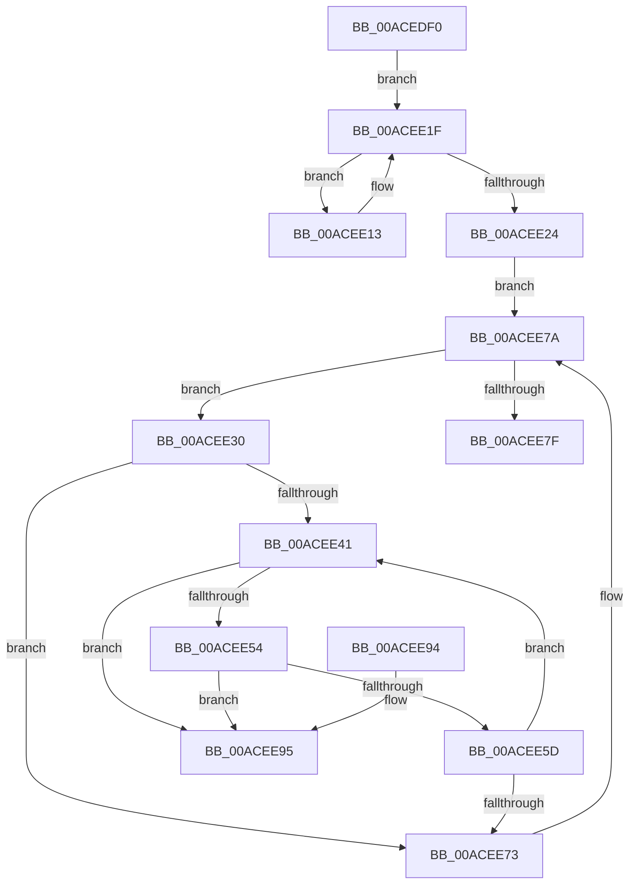

# EtwpCovSampCaptureFreeLookasides

- RVA: `0x00ACEDF0`–`0x00ACEE9C` (길이 `172` bytes)
- VA: `0x0000000140ACEDF0`
- 실행 섹션: `PAGE`
- PDB 이름 있음: `예`; PDB Function 태그: `아니요`
- unwind 정보 RVA: `0x00069AD0`
- 디코드: `50`개 명령, `172/172` bytes 표시
- 미해석 바이트: `0` (있으면 어셈블리에 `.byte`로 보존)

> 이 문서는 커널 이미지의 기계어와 PDB 기호를 분석해 생성했습니다. 4번과 5번은 함수 원형과 자료형을 바이너리 사용 방식에서 추정한 C 해석이며 원본 소스 복구 결과는 아닙니다.

## 1. Dependencies

- 직접 호출 지점: **3**; 고유 호출 대상: **3**
- 직접 호출자로 확인된 함수: **2**
- RIP 상대 이미지 참조: **0**

### Outgoing calls
- `0x00ACEE17` → [EtwpCovSampLookasideFlushFreeListToCleanupList](../../text/65/EtwpCovSampLookasideFlushFreeListToCleanupList_function_006540BC.md) (function, `0x006540BC`)
- `0x00ACEE34` → [ExpInterlockedFlushSList](../../text/6B/ExpInterlockedFlushSList_function_006BA5F0.md) (function, `0x006BA5F0`)
- `0x00ACEE69` → [ExFreePoolWithTag](../../poolcode/B8/ExFreePoolWithTag_function_00B82870.md) (function, `0x00B82870`)

### Direct callers
- [EtwpCovSampCaptureContextStop](../../text/43/EtwpCovSampCaptureContextStop_function_0043BE5C.md) at `0x0043BF74`
- [EtwpCovSampCaptureContextStart](../7C/EtwpCovSampCaptureContextStart_function_007C14AC.md) at `0x007C1948`

### Static image references
- 디코드된 RIP-relative 메모리 참조가 없습니다.

## 2. Other-region calls and transfers

- 다른 실행 섹션으로 향하는 call: **3**
  - `0x00ACEE17` → [EtwpCovSampLookasideFlushFreeListToCleanupList](../../text/65/EtwpCovSampLookasideFlushFreeListToCleanupList_function_006540BC.md) (`PAGE` → `.text`)
  - `0x00ACEE34` → [ExpInterlockedFlushSList](../../text/6B/ExpInterlockedFlushSList_function_006BA5F0.md) (`PAGE` → `.text`)
  - `0x00ACEE69` → [ExFreePoolWithTag](../../poolcode/B8/ExFreePoolWithTag_function_00B82870.md) (`PAGE` → `POOLCODE`)
- 별도 외부 분기/꼬리 이동을 확인하지 못했습니다.

## 3. Assembly (complete function range)

```asm
00ACEDF0  48 89 5C 24 08                  mov qword ptr [rsp + 8], rbx
00ACEDF5  48 89 6C 24 10                  mov qword ptr [rsp + 0x10], rbp
00ACEDFA  48 89 74 24 18                  mov qword ptr [rsp + 0x18], rsi
00ACEDFF  57                              push rdi
00ACEE00  48 83 EC 20                     sub rsp, 0x20
00ACEE04  48 8D B9 B0 03 00 00            lea rdi, [rcx + 0x3b0]
00ACEE0B  48 8B F1                        mov rsi, rcx
00ACEE0E  48 8B 1F                        mov rbx, qword ptr [rdi]
00ACEE11  EB 0C                           jmp 0x140acee1f
00ACEE13  48 8D 4B F0                     lea rcx, [rbx - 0x10]
00ACEE17  E8 A0 52 B8 FF                  call 0x1406540bc
00ACEE1C  48 8B 1B                        mov rbx, qword ptr [rbx]
00ACEE1F  48 3B DF                        cmp rbx, rdi
00ACEE22  75 EF                           jne 0x140acee13
00ACEE24  48 8D BE C0 03 00 00            lea rdi, [rsi + 0x3c0]
00ACEE2B  48 8B 1F                        mov rbx, qword ptr [rdi]
00ACEE2E  EB 4A                           jmp 0x140acee7a
00ACEE30  48 8D 4B F0                     lea rcx, [rbx - 0x10]
00ACEE34  E8 B7 B7 BE FF                  call 0x1406ba5f0
00ACEE39  48 8B F0                        mov rsi, rax
00ACEE3C  48 85 C0                        test rax, rax
00ACEE3F  74 32                           je 0x140acee73
00ACEE41  48 8B CE                        mov rcx, rsi
00ACEE44  48 8B 36                        mov rsi, qword ptr [rsi]
00ACEE47  48 8D 41 18                     lea rax, [rcx + 0x18]
00ACEE4B  4C 8B 00                        mov r8, qword ptr [rax]
00ACEE4E  49 39 40 08                     cmp qword ptr [r8 + 8], rax
00ACEE52  75 41                           jne 0x140acee95
00ACEE54  48 8B 50 08                     mov rdx, qword ptr [rax + 8]
00ACEE58  48 39 02                        cmp qword ptr [rdx], rax
00ACEE5B  75 38                           jne 0x140acee95
00ACEE5D  4C 89 02                        mov qword ptr [rdx], r8
00ACEE60  49 89 50 08                     mov qword ptr [r8 + 8], rdx
00ACEE64  BA 45 74 77 56                  mov edx, 0x56777445
00ACEE69  E8 02 3A 0B 00                  call 0x140b82870
00ACEE6E  48 85 F6                        test rsi, rsi
00ACEE71  75 CE                           jne 0x140acee41
00ACEE73  83 63 38 00                     and dword ptr [rbx + 0x38], 0
00ACEE77  48 8B 1B                        mov rbx, qword ptr [rbx]
00ACEE7A  48 3B DF                        cmp rbx, rdi
00ACEE7D  75 B1                           jne 0x140acee30
00ACEE7F  48 8B 5C 24 30                  mov rbx, qword ptr [rsp + 0x30]
00ACEE84  48 8B 6C 24 38                  mov rbp, qword ptr [rsp + 0x38]
00ACEE89  48 8B 74 24 40                  mov rsi, qword ptr [rsp + 0x40]
00ACEE8E  48 83 C4 20                     add rsp, 0x20
00ACEE92  5F                              pop rdi
00ACEE93  C3                              ret
00ACEE94  CC                              int3
00ACEE95  B9 03 00 00 00                  mov ecx, 3
00ACEE9A  CD 29                           int 0x29
```

## 4. C-style interpretation (structured pseudocode)

```c
__int64 __fastcall EtwpCovSampCaptureFreeLookasides(__int64 a1)
{
    __int64 result;
    __int64 v_rsp;
    unsigned __int64 v_stack_p10;
    unsigned __int64 v_stack_p18;
    unsigned __int64 v_stack_p8;

    v_stack_p8 = v_rbx;
    v_stack_p10 = v_rbp;
    v_stack_p18 = v_rsi;
    v_rsp = (v_rsp) - (32);
    goto loc_00ACEE1F;
loc_00ACEE13:
    result = EtwpCovSampLookasideFlushFreeListToCleanupList(*(unsigned __int64 *)(a1 + 944) - 16, a2, a3, a4);
loc_00ACEE1F:
    if ((*(unsigned __int64 *)(*(unsigned __int64 *)(a1 + 944))) != (a1 + 944)) goto loc_00ACEE13;
    goto loc_00ACEE7A;
loc_00ACEE30:
    result = ExpInterlockedFlushSList(*(unsigned __int64 *)(a1 + 960) - 16, a2, a3, a4);
    if (result == 0) goto loc_00ACEE73;
loc_00ACEE41:
    if ((*(unsigned __int64 *)(*(unsigned __int64 *)(result + 24) + 8)) != (result + 24)) goto loc_00ACEE95;
    if ((*(unsigned __int64 *)(*(unsigned __int64 *)(result + 24 + 8))) != (result + 24)) goto loc_00ACEE95;
    *(unsigned __int64 *)(*(unsigned __int64 *)(result + 24 + 8)) = *(unsigned __int64 *)(result + 24);
    *(unsigned __int64 *)(*(unsigned __int64 *)(result + 24) + 8) = *(unsigned __int64 *)(result + 24 + 8);
    result = ExFreePoolWithTag(result, (unsigned int)(0x56777445ULL), *(unsigned __int64 *)(result + 24), a4);
    if (*(unsigned __int64 *)(result) != 0) goto loc_00ACEE41;
loc_00ACEE73:
loc_00ACEE7A:
    if ((*(unsigned __int64 *)(*(unsigned __int64 *)(a1 + 960))) != (a1 + 960)) goto loc_00ACEE30;
    v_rsp = (v_rsp) + (32);
    return result;
loc_00ACEE95:
    return result;
}
```

## 5. (Beta) C Style

```c
int64_t EtwpCovSampCaptureFreeLookasides(void *Arg1)
{
    uint8_t *arg1 = (uint8_t *)Arg1;

    int64_t result;
    int64_t local_rsp;
    uint64_t v_stack_p10;
    uint64_t v_stack_p18;
    uint64_t v_stack_p8;

    v_stack_p8 = local_rbx;
    v_stack_p10 = local_rbp;
    v_stack_p18 = local_rsi;
    local_rsp = (local_rsp) - (32);
    goto loc_00ACEE1F;
loc_00ACEE13:
    result = EtwpCovSampLookasideFlushFreeListToCleanupList(*(uint64_t *)(arg1 + 0x3B0) - 16, a2, a3, a4);
loc_00ACEE1F:
    if ((*(uint64_t *)(*(uint64_t *)(arg1 + 0x3B0))) != (Arg1 + 944)) goto loc_00ACEE13;
    goto loc_00ACEE7A;
loc_00ACEE30:
    result = ExpInterlockedFlushSList(*(uint64_t *)(arg1 + 0x3C0) - 16, a2, a3, a4);
    if (result == 0) goto loc_00ACEE73;
loc_00ACEE41:
    if ((*(uint64_t *)(*(uint64_t *)(result + 0x18) + 0x8)) != (result + 24)) goto loc_00ACEE95;
    if ((*(uint64_t *)(*(uint64_t *)(result + 0x18 + 0x8))) != (result + 24)) goto loc_00ACEE95;
    *(uint64_t *)(*(uint64_t *)(result + 0x18 + 0x8)) = *(uint64_t *)(result + 0x18);
    *(uint64_t *)(*(uint64_t *)(result + 0x18) + 0x8) = *(uint64_t *)(result + 0x18 + 0x8);
    result = ExFreePoolWithTag(result, (uint32_t)(0x56777445ULL), *(uint64_t *)(result + 0x18), a4);
    if (*(uint64_t *)(result) != 0) goto loc_00ACEE41;
loc_00ACEE73:
loc_00ACEE7A:
    if ((*(uint64_t *)(*(uint64_t *)(arg1 + 0x3C0))) != (Arg1 + 960)) goto loc_00ACEE30;
    local_rsp = (local_rsp) + (32);
    return result;
loc_00ACEE95:
    return result;
}
```

### 관측된 메모리 오프셋

구조체 형식이 확인되지 않은 접근은 인자 기준의 오프셋으로만 기록했습니다.

| 기준 인자 | 오프셋 표현 | 폭 (bit) | 접근 |
|---|---:|---:|---|
| `Arg1` | `+ 0x0` | `64` | `R` |
| `Arg1` | `+ 0x3B0` | `64` | `R` |
| `Arg1` | `+ 0x3C0` | `64` | `R` |

## 6. Execution-region graph

[열기: 2D/3D 그래프와 함수 탐색 컨트롤 패널](../../../control-panel.html?section=page&rva=0x00ACEDF0&view=graph)

- 2D 그래프는 위에서 아래로 흐르고, 3D 그래프는 빈 공간을 드래그해 회전합니다. Shift+드래그는 이동, 휠은 확대·축소, 함수 노드 선택은 대상 보고서 이동입니다.

### Static fallback


