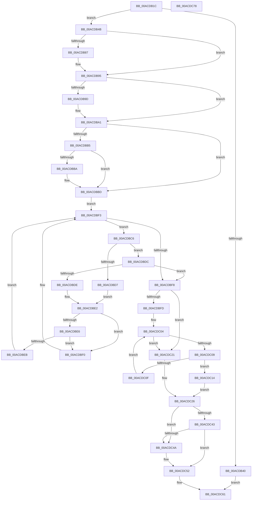

# EtwpDemuxPrivateTraceHandle

- RVA: `0x00ACDB1C`–`0x00ACDC79` (길이 `349` bytes)
- VA: `0x0000000140ACDB1C`
- 실행 섹션: `PAGE`
- PDB 이름 있음: `예`; PDB Function 태그: `아니요`
- unwind 정보 RVA: `0x0009C52C`
- 디코드: `108`개 명령, `349/349` bytes 표시
- 미해석 바이트: `0` (있으면 어셈블리에 `.byte`로 보존)

> 이 문서는 커널 이미지의 기계어와 PDB 기호를 분석해 생성했습니다. 4번과 5번은 함수 원형과 자료형을 바이너리 사용 방식에서 추정한 C 해석이며 원본 소스 복구 결과는 아닙니다.

## 1. Dependencies

- 직접 호출 지점: **7**; 고유 호출 대상: **7**
- 직접 호출자로 확인된 함수: **2**
- RIP 상대 이미지 참조: **0**

### Outgoing calls
- `0x00ACDB4B` → [PsGetCurrentServerSiloGlobals](../../text/2F/PsGetCurrentServerSiloGlobals_function_002FE1F0.md) (function, `0x002FE1F0`)
- `0x00ACDB77` → [KeAbPreAcquire](../../text/21/KeAbPreAcquire_function_00210230.md) (function, `0x00210230`)
- `0x00ACDB90` → [ExfAcquirePushLockExclusiveEx](../../text/20/ExfAcquirePushLockExclusiveEx_function_0020FC90.md) (function, `0x0020FC90`)
- `0x00ACDBCE` → [PidNodeCompare](../7B/PidNodeCompare_function_007BCF10.md) (function, `0x007BCF10`)
- `0x00ACDC4D` → [ExfReleasePushLock](../../text/26/ExfReleasePushLock_function_002638D0.md) (function, `0x002638D0`)
- `0x00ACDC55` → [KeAbPostRelease](../../text/2E/KeAbPostRelease_function_002E1600.md) (function, `0x002E1600`)
- `0x00ACDC5A` → [KeLeaveCriticalRegion](../../text/25/KeLeaveCriticalRegion_function_0025D8B0.md) (function, `0x0025D8B0`)

### Direct callers
- [EtwpNotifyGuid](../8C/EtwpNotifyGuid_function_008C8110.md) at `0x008C83C7`
- [EtwpEnableGuid](../A5/EtwpEnableGuid_function_00A5CD28.md) at `0x00A5D795`

### Static image references
- 디코드된 RIP-relative 메모리 참조가 없습니다.

## 2. Other-region calls and transfers

- 다른 실행 섹션으로 향하는 call: **6**
  - `0x00ACDB4B` → [PsGetCurrentServerSiloGlobals](../../text/2F/PsGetCurrentServerSiloGlobals_function_002FE1F0.md) (`PAGE` → `.text`)
  - `0x00ACDB77` → [KeAbPreAcquire](../../text/21/KeAbPreAcquire_function_00210230.md) (`PAGE` → `.text`)
  - `0x00ACDB90` → [ExfAcquirePushLockExclusiveEx](../../text/20/ExfAcquirePushLockExclusiveEx_function_0020FC90.md) (`PAGE` → `.text`)
  - `0x00ACDC4D` → [ExfReleasePushLock](../../text/26/ExfReleasePushLock_function_002638D0.md) (`PAGE` → `.text`)
  - `0x00ACDC55` → [KeAbPostRelease](../../text/2E/KeAbPostRelease_function_002E1600.md) (`PAGE` → `.text`)
  - `0x00ACDC5A` → [KeLeaveCriticalRegion](../../text/25/KeLeaveCriticalRegion_function_0025D8B0.md) (`PAGE` → `.text`)
- 별도 외부 분기/꼬리 이동을 확인하지 못했습니다.

## 3. Assembly (complete function range)

```asm
00ACDB1C  48 89 5C 24 08                  mov qword ptr [rsp + 8], rbx
00ACDB21  48 89 6C 24 18                  mov qword ptr [rsp + 0x18], rbp
00ACDB26  56                              push rsi
00ACDB27  57                              push rdi
00ACDB28  41 54                           push r12
00ACDB2A  41 56                           push r14
00ACDB2C  41 57                           push r15
00ACDB2E  48 83 EC 20                     sub rsp, 0x20
00ACDB32  4D 8B F0                        mov r14, r8
00ACDB35  0F B7 EA                        movzx ebp, dx
00ACDB38  8B F1                           mov esi, ecx
00ACDB3A  66 83 FA 40                     cmp dx, 0x40
00ACDB3E  73 0B                           jae 0x140acdb4b
00ACDB40  66 41 89 10                     mov word ptr [r8], dx
00ACDB44  33 C0                           xor eax, eax
00ACDB46  E9 16 01 00 00                  jmp 0x140acdc61
00ACDB4B  E8 A0 06 83 FF                  call 0x1402fe1f0
00ACDB50  45 33 C0                        xor r8d, r8d
00ACDB53  33 D2                           xor edx, edx
00ACDB55  4C 8B B8 40 03 00 00            mov r15, qword ptr [rax + 0x340]
00ACDB5C  65 48 8B 04 25 88 01 00 00      mov rax, qword ptr gs:[0x188]
00ACDB65  49 8D BF 10 11 00 00            lea rdi, [r15 + 0x1110]
00ACDB6C  66 FF 88 E4 01 00 00            dec word ptr [rax + 0x1e4]
00ACDB73  48 8B CF                        mov rcx, rdi
00ACDB76  90                              nop
00ACDB77  E8 B4 26 74 FF                  call 0x140210230
00ACDB7C  F0 48 0F BA 2F 00               lock bts qword ptr [rdi], 0
00ACDB82  48 8B D8                        mov rbx, rax
00ACDB85  73 0E                           jae 0x140acdb95
00ACDB87  4C 8B C7                        mov r8, rdi
00ACDB8A  48 8B D0                        mov rdx, rax
00ACDB8D  48 8B CF                        mov rcx, rdi
00ACDB90  E8 FB 20 74 FF                  call 0x14020fc90
00ACDB95  45 33 E4                        xor r12d, r12d
00ACDB98  48 85 DB                        test rbx, rbx
00ACDB9B  74 04                           je 0x140acdba1
00ACDB9D  C6 43 0A 01                     mov byte ptr [rbx + 0xa], 1
00ACDBA1  49 8D 8F 00 11 00 00            lea rcx, [r15 + 0x1100]
00ACDBA8  89 74 24 58                     mov dword ptr [rsp + 0x58], esi
00ACDBAC  F6 41 08 01                     test byte ptr [rcx + 8], 1
00ACDBB0  48 8B 19                        mov rbx, qword ptr [rcx]
00ACDBB3  74 08                           je 0x140acdbbd
00ACDBB5  48 85 DB                        test rbx, rbx
00ACDBB8  74 03                           je 0x140acdbbd
00ACDBBA  48 33 D9                        xor rbx, rcx
00ACDBBD  0F B6 71 08                     movzx esi, byte ptr [rcx + 8]
00ACDBC1  83 E6 01                        and esi, 1
00ACDBC4  EB 2D                           jmp 0x140acdbf3
00ACDBC6  48 8B D3                        mov rdx, rbx
00ACDBC9  48 8D 4C 24 58                  lea rcx, [rsp + 0x58]
00ACDBCE  E8 3D F3 CE FF                  call 0x1407bcf10
00ACDBD3  85 C0                           test eax, eax
00ACDBD5  79 05                           jns 0x140acdbdc
00ACDBD7  48 8B 03                        mov rax, qword ptr [rbx]
00ACDBDA  EB 06                           jmp 0x140acdbe2
00ACDBDC  7E 1A                           jle 0x140acdbf8
00ACDBDE  48 8B 43 08                     mov rax, qword ptr [rbx + 8]
00ACDBE2  85 F6                           test esi, esi
00ACDBE4  74 0A                           je 0x140acdbf0
00ACDBE6  48 85 C0                        test rax, rax
00ACDBE9  74 05                           je 0x140acdbf0
00ACDBEB  48 33 D8                        xor rbx, rax
00ACDBEE  EB 03                           jmp 0x140acdbf3
00ACDBF0  48 8B D8                        mov rbx, rax
00ACDBF3  48 85 DB                        test rbx, rbx
00ACDBF6  75 CE                           jne 0x140acdbc6
00ACDBF8  48 85 DB                        test rbx, rbx
00ACDBFB  74 24                           je 0x140acdc21
00ACDBFD  48 83 C3 20                     add rbx, 0x20
00ACDC01  48 8B 03                        mov rax, qword ptr [rbx]
00ACDC04  48 3B C3                        cmp rax, rbx
00ACDC07  74 18                           je 0x140acdc21
00ACDC09  66 39 68 12                     cmp word ptr [rax + 0x12], bp
00ACDC0D  74 05                           je 0x140acdc14
00ACDC0F  48 8B 00                        mov rax, qword ptr [rax]
00ACDC12  EB F0                           jmp 0x140acdc04
00ACDC14  0F B7 40 10                     movzx eax, word ptr [rax + 0x10]
00ACDC18  41 8B DC                        mov ebx, r12d
00ACDC1B  66 41 89 06                     mov word ptr [r14], ax
00ACDC1F  EB 05                           jmp 0x140acdc26
00ACDC21  BB 96 02 00 C0                  mov ebx, 0xc0000296
00ACDC26  0F 0D 0F                        prefetchw byte ptr [rdi]
00ACDC29  48 8B 07                        mov rax, qword ptr [rdi]
00ACDC2C  48 8B C8                        mov rcx, rax
00ACDC2F  48 83 E1 F0                     and rcx, 0xfffffffffffffff0
00ACDC33  48 83 F9 10                     cmp rcx, 0x10
00ACDC37  48 8D 50 F0                     lea rdx, [rax - 0x10]
00ACDC3B  49 0F 46 D4                     cmovbe rdx, r12
00ACDC3F  A8 02                           test al, 2
00ACDC41  75 07                           jne 0x140acdc4a
00ACDC43  F0 48 0F B1 17                  lock cmpxchg qword ptr [rdi], rdx
00ACDC48  74 08                           je 0x140acdc52
00ACDC4A  48 8B CF                        mov rcx, rdi
00ACDC4D  E8 7E 5C 79 FF                  call 0x1402638d0
00ACDC52  48 8B CF                        mov rcx, rdi
00ACDC55  E8 A6 39 81 FF                  call 0x1402e1600
00ACDC5A  E8 51 FC 78 FF                  call 0x14025d8b0
00ACDC5F  8B C3                           mov eax, ebx
00ACDC61  48 8B 5C 24 50                  mov rbx, qword ptr [rsp + 0x50]
00ACDC66  48 8B 6C 24 60                  mov rbp, qword ptr [rsp + 0x60]
00ACDC6B  48 83 C4 20                     add rsp, 0x20
00ACDC6F  41 5F                           pop r15
00ACDC71  41 5E                           pop r14
00ACDC73  41 5C                           pop r12
00ACDC75  5F                              pop rdi
00ACDC76  5E                              pop rsi
00ACDC77  C3                              ret
00ACDC78  CC                              int3
```

## 4. C-style interpretation (structured pseudocode)

```c
__int64 __fastcall EtwpDemuxPrivateTraceHandle(int a1, int a2, __int64 a3)
{
    __int64 result;
    __int64 v_r12;
    __int64 v_rbx;
    __int64 v_rsi;
    __int64 v_rsp;
    unsigned int v_stack_p10;
    unsigned __int64 v_stack_p18;
    unsigned __int64 v_stack_p8;

    v_stack_p8 = v_rbx;
    v_stack_p18 = v_rbp;
    v_rsp = (v_rsp) - (32);
    if (((unsigned __int16)(a2)) >= 64) goto loc_00ACDB4B;
    *(unsigned __int16 *)(a3) = (unsigned __int16)(a2);
    result = 0;
    goto loc_00ACDC61;
loc_00ACDB4B:
    result = PsGetCurrentServerSiloGlobals(a1, a2, a3, a4);
    a3 = 0;
    a2 = 0;
    result = KeAbPreAcquire(*(unsigned __int64 *)(result + 832) + 4368, a2, a3, a4);
    if (!(condition_is_above_or_equal)) {
        a3 = *(unsigned __int64 *)(result + 832) + 4368;
        a2 = result;
        a1 = *(unsigned __int64 *)(result + 832) + 4368;
        result = ExfAcquirePushLockExclusiveEx(a1, a2, a3, a4);
    }
    v_r12 = 0;
    if (result != 0) {
        *(unsigned __int8 *)(result + 10) = 1;
    }
    v_stack_p10 = (unsigned int)((unsigned int)(a1));
    if (((*(unsigned __int8 *)(*(unsigned __int64 *)(result + 832) + 4352 + 8)) & (1)) == 0) goto loc_00ACDBBD;
    v_rbx = *(unsigned __int64 *)(*(unsigned __int64 *)(result + 832) + 4352);
    if (*(unsigned __int64 *)(*(unsigned __int64 *)(result + 832) + 4352) != 0) {
        v_rbx = (*(unsigned __int64 *)(*(unsigned __int64 *)(result + 832) + 4352)) ^ (*(unsigned __int64 *)(result + 832) + 4352);
    }
    v_rsi = (unsigned int)((*(unsigned __int8 *)(*(unsigned __int64 *)(result + 832) + 4352 + 8)) & (1));
    goto loc_00ACDBF3;
loc_00ACDBC6:
    result = PidNodeCompare(v_stack_p10, v_rbx, a3, a4);
    if (!sign_flag) goto loc_00ACDBDC;
    goto loc_00ACDBE2;
loc_00ACDBDC:
    if (condition_is_less_or_equal) goto loc_00ACDBF8;
loc_00ACDBE2:
    if ((unsigned int)(v_rsi) == 0) goto loc_00ACDBF0;
    if (*(unsigned __int64 *)(v_rbx + 8) == 0) goto loc_00ACDBF0;
    v_rbx = (v_rbx) ^ (*(unsigned __int64 *)(v_rbx + 8));
    goto loc_00ACDBF3;
loc_00ACDBF0:
loc_00ACDBF3:
    if (*(unsigned __int64 *)(v_rbx + 8) != 0) goto loc_00ACDBC6;
loc_00ACDBF8:
    if (*(unsigned __int64 *)(v_rbx + 8) == 0) goto loc_00ACDC21;
    v_rbx = (*(unsigned __int64 *)(v_rbx + 8)) + (32);
loc_00ACDC04:
    if ((*(unsigned __int64 *)(v_rbx)) == v_rbx) goto loc_00ACDC21;
    if ((*(unsigned __int16 *)(*(unsigned __int64 *)(v_rbx) + 18)) == ((unsigned __int16)((unsigned __int16)(a2)))) goto loc_00ACDC14;
    goto loc_00ACDC04;
loc_00ACDC14:
    *(unsigned __int16 *)(a3) = (unsigned __int16)(*(unsigned __int16 *)(*(unsigned __int64 *)(*(unsigned __int64 *)(v_rbx)) + 16));
    goto loc_00ACDC26;
loc_00ACDC21:
loc_00ACDC26:
    a1 = (*(unsigned __int64 *)(*(unsigned __int64 *)(result + 832) + 4368)) & (-16);
    a2 = *(unsigned __int64 *)(*(unsigned __int64 *)(result + 832) + 4368) - 16;
    if (a1 <= 16) { a2 = 0; }
    if ((((unsigned __int8)(*(unsigned __int64 *)(*(unsigned __int64 *)(result + 832) + 4368))) & (2)) != 0) goto loc_00ACDC4A;
    result = *(unsigned __int64 *)(*(unsigned __int64 *)(result + 832) + 4368);
    if ((((unsigned __int8)(*(unsigned __int64 *)(*(unsigned __int64 *)(result + 832) + 4368))) & (2)) != 0) {
        a1 = *(unsigned __int64 *)(result + 832) + 4368;
        result = ExfReleasePushLock(a1, a2, a3, a4);
    }
    result = KeAbPostRelease(*(unsigned __int64 *)(result + 832) + 4368, a2, a3, a4);
    result = KeLeaveCriticalRegion(*(unsigned __int64 *)(result + 832) + 4368, a2, a3, a4);
loc_00ACDC61:
    v_rsp = (v_rsp) + (32);
    return (unsigned int)((unsigned int)((unsigned int)(0xC0000296ULL)));
}
```

## 5. (Beta) C Style

```c
int64_t EtwpDemuxPrivateTraceHandle(int32_t Arg1, int32_t Arg2, void *Arg3)
{
    uint8_t *arg3 = (uint8_t *)Arg3;

    int64_t result;
    int64_t local_r12;
    int64_t local_rbx;
    int64_t local_rsi;
    int64_t local_rsp;
    uint32_t v_stack_p10;
    uint64_t v_stack_p18;
    uint64_t v_stack_p8;

    v_stack_p8 = local_rbx;
    v_stack_p18 = local_rbp;
    local_rsp = (local_rsp) - (32);
    if (((uint16_t)(Arg2)) >= 64) goto loc_00ACDB4B;
    *(uint16_t *)(arg3) = (uint16_t)(Arg2);
    result = 0;
    goto loc_00ACDC61;
loc_00ACDB4B:
    result = PsGetCurrentServerSiloGlobals(Arg1, Arg2, Arg3, a4);
    Arg3 = 0;
    Arg2 = 0;
    result = KeAbPreAcquire(*(uint64_t *)(result + 0x340) + 4368, Arg2, Arg3, a4);
    if (!(condition_is_above_or_equal)) {
        Arg3 = *(uint64_t *)(result + 0x340) + 4368;
        Arg2 = result;
        Arg1 = *(uint64_t *)(result + 0x340) + 4368;
        result = ExfAcquirePushLockExclusiveEx(Arg1, Arg2, Arg3, a4);
    }
    local_r12 = 0;
    if (result != 0) {
        *(uint8_t *)(result + 0xA) = 1;
    }
    v_stack_p10 = (uint32_t)((uint32_t)(Arg1));
    if (((*(uint8_t *)(*(uint64_t *)(result + 0x340) + 0x1100 + 0x8)) & (1)) == 0) goto loc_00ACDBBD;
    local_rbx = *(uint64_t *)(*(uint64_t *)(result + 0x340) + 0x1100);
    if (*(uint64_t *)(*(uint64_t *)(result + 0x340) + 0x1100) != 0) {
        local_rbx = (*(uint64_t *)(*(uint64_t *)(result + 0x340) + 0x1100)) ^ (*(uint64_t *)(result + 0x340) + 4352);
    }
    local_rsi = (uint32_t)((*(uint8_t *)(*(uint64_t *)(result + 0x340) + 0x1100 + 0x8)) & (1));
    goto loc_00ACDBF3;
loc_00ACDBC6:
    result = PidNodeCompare(v_stack_p10, local_rbx, Arg3, a4);
    if (!sign_flag) goto loc_00ACDBDC;
    goto loc_00ACDBE2;
loc_00ACDBDC:
    if (condition_is_less_or_equal) goto loc_00ACDBF8;
loc_00ACDBE2:
    if ((uint32_t)(local_rsi) == 0) goto loc_00ACDBF0;
    if (*(uint64_t *)(local_rbx + 0x8) == 0) goto loc_00ACDBF0;
    local_rbx = (local_rbx) ^ (*(uint64_t *)(local_rbx + 0x8));
    goto loc_00ACDBF3;
loc_00ACDBF0:
loc_00ACDBF3:
    if (*(uint64_t *)(local_rbx + 0x8) != 0) goto loc_00ACDBC6;
loc_00ACDBF8:
    if (*(uint64_t *)(local_rbx + 0x8) == 0) goto loc_00ACDC21;
    local_rbx = (*(uint64_t *)(local_rbx + 0x8)) + (32);
loc_00ACDC04:
    if ((*(uint64_t *)(local_rbx)) == local_rbx) goto loc_00ACDC21;
    if ((*(uint16_t *)(*(uint64_t *)(local_rbx) + 0x12)) == ((uint16_t)((uint16_t)(Arg2)))) goto loc_00ACDC14;
    goto loc_00ACDC04;
loc_00ACDC14:
    *(uint16_t *)(arg3) = (uint16_t)(*(uint16_t *)(*(uint64_t *)(*(uint64_t *)(local_rbx)) + 0x10));
    goto loc_00ACDC26;
loc_00ACDC21:
loc_00ACDC26:
    Arg1 = (*(uint64_t *)(*(uint64_t *)(result + 0x340) + 0x1110)) & (-16);
    Arg2 = *(uint64_t *)(*(uint64_t *)(result + 0x340) + 0x1110) - 16;
    if (Arg1 <= 16) { Arg2 = 0; }
    if ((((uint8_t)(*(uint64_t *)(*(uint64_t *)(result + 0x340) + 0x1110))) & (2)) != 0) goto loc_00ACDC4A;
    result = *(uint64_t *)(*(uint64_t *)(result + 0x340) + 0x1110);
    if ((((uint8_t)(*(uint64_t *)(*(uint64_t *)(result + 0x340) + 0x1110))) & (2)) != 0) {
        Arg1 = *(uint64_t *)(result + 0x340) + 4368;
        result = ExfReleasePushLock(Arg1, Arg2, Arg3, a4);
    }
    result = KeAbPostRelease(*(uint64_t *)(result + 0x340) + 4368, Arg2, Arg3, a4);
    result = KeLeaveCriticalRegion(*(uint64_t *)(result + 0x340) + 4368, Arg2, Arg3, a4);
loc_00ACDC61:
    local_rsp = (local_rsp) + (32);
    return (uint32_t)((uint32_t)((uint32_t)(0xC0000296ULL)));
}
```

### 관측된 메모리 오프셋

구조체 형식이 확인되지 않은 접근은 인자 기준의 오프셋으로만 기록했습니다.

| 기준 인자 | 오프셋 표현 | 폭 (bit) | 접근 |
|---|---:|---:|---|
| `Arg3` | `+ 0x0` | `16` | `W` |

## 6. Execution-region graph

[열기: 2D/3D 그래프와 함수 탐색 컨트롤 패널](../../../control-panel.html?section=page&rva=0x00ACDB1C&view=graph)

- 2D 그래프는 위에서 아래로 흐르고, 3D 그래프는 빈 공간을 드래그해 회전합니다. Shift+드래그는 이동, 휠은 확대·축소, 함수 노드 선택은 대상 보고서 이동입니다.

### Static fallback


