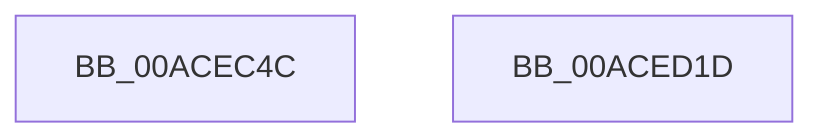

# EtwpEventWriteTemplateSessionEnd

- RVA: `0x00ACEC4C`–`0x00ACED1E` (길이 `210` bytes)
- VA: `0x0000000140ACEC4C`
- 실행 섹션: `PAGE`
- PDB 이름 있음: `예`; PDB Function 태그: `아니요`
- unwind 정보 RVA: `0x00079278`
- 디코드: `46`개 명령, `210/210` bytes 표시
- 미해석 바이트: `0` (있으면 어셈블리에 `.byte`로 보존)

> 이 문서는 커널 이미지의 기계어와 PDB 기호를 분석해 생성했습니다. 4번과 5번은 함수 원형과 자료형을 바이너리 사용 방식에서 추정한 C 해석이며 원본 소스 복구 결과는 아닙니다.

## 1. Dependencies

- 직접 호출 지점: **2**; 고유 호출 대상: **2**
- 직접 호출자로 확인된 함수: **1**
- RIP 상대 이미지 참조: **4**

### Outgoing calls
- `0x00ACED03` → [EtwWrite](../../text/41/EtwWrite_function_0041C720.md) (function, `0x0041C720`)
- `0x00ACED0F` → [_security_check_cookie](../../text/6A/_security_check_cookie_function_006AC640.md) (function, `0x006AC640`)

### Direct callers
- [EtwpLogger](../9B/EtwpLogger_function_009BE310.md) at `0x009BE8DA`

### Static image references
- `0x00ACEC5A` → RVA `0x00E0A740` (`.data`; read)
- `0x00ACEC6C` → RVA `0x000105E0` (`.rdata`; read)
- `0x00ACEC77` → RVA `0x00013D88` (`.rdata`; read)
- `0x00ACEC97` → RVA `0x00EFF840` (`.data`; read)

## 2. Other-region calls and transfers

- 다른 실행 섹션으로 향하는 call: **2**
  - `0x00ACED03` → [EtwWrite](../../text/41/EtwWrite_function_0041C720.md) (`PAGE` → `.text`)
  - `0x00ACED0F` → [_security_check_cookie](../../text/6A/_security_check_cookie_function_006AC640.md) (`PAGE` → `.text`)
- 별도 외부 분기/꼬리 이동을 확인하지 못했습니다.

## 3. Assembly (complete function range)

```asm
00ACEC4C  40 55                           push rbp
00ACEC4E  48 8D 6C 24 C9                  lea rbp, [rsp - 0x37]
00ACEC53  48 81 EC B0 00 00 00            sub rsp, 0xb0
00ACEC5A  48 8B 05 DF BA 33 00            mov rax, qword ptr [rip + 0x33badf]
00ACEC61  48 33 C4                        xor rax, rsp
00ACEC64  48 89 45 27                     mov qword ptr [rbp + 0x27], rax
00ACEC68  49 8B 41 08                     mov rax, qword ptr [r9 + 8]
00ACEC6C  4C 8D 05 6D 19 54 FF            lea r8, [rip - 0xabe693]
00ACEC73  48 8B 4D 67                     mov rcx, qword ptr [rbp + 0x67]
00ACEC77  48 8D 15 0A 51 54 FF            lea rdx, [rip - 0xabaef6]
00ACEC7E  48 89 45 B7                     mov qword ptr [rbp - 0x49], rax
00ACEC82  41 0F B7 01                     movzx eax, word ptr [r9]
00ACEC86  45 33 C9                        xor r9d, r9d
00ACEC89  89 45 BF                        mov dword ptr [rbp - 0x41], eax
00ACEC8C  48 8B 41 08                     mov rax, qword ptr [rcx + 8]
00ACEC90  48 89 45 D7                     mov qword ptr [rbp - 0x29], rax
00ACEC94  0F B7 01                        movzx eax, word ptr [rcx]
00ACEC97  48 8B 0D A2 0B 43 00            mov rcx, qword ptr [rip + 0x430ba2]
00ACEC9E  89 45 DF                        mov dword ptr [rbp - 0x21], eax
00ACECA1  48 8D 45 6F                     lea rax, [rbp + 0x6f]
00ACECA5  48 89 45 F7                     mov qword ptr [rbp - 9], rax
00ACECA9  48 8D 45 77                     lea rax, [rbp + 0x77]
00ACECAD  48 89 45 07                     mov qword ptr [rbp + 7], rax
00ACECB1  48 8D 45 7F                     lea rax, [rbp + 0x7f]
00ACECB5  48 89 45 17                     mov qword ptr [rbp + 0x17], rax
00ACECB9  48 8D 45 B7                     lea rax, [rbp - 0x49]
00ACECBD  44 89 4D C3                     mov dword ptr [rbp - 0x3d], r9d
00ACECC1  4C 89 45 C7                     mov qword ptr [rbp - 0x39], r8
00ACECC5  44 89 4D E3                     mov dword ptr [rbp - 0x1d], r9d
00ACECC9  41 B9 07 00 00 00               mov r9d, 7
00ACECCF  4C 89 45 E7                     mov qword ptr [rbp - 0x19], r8
00ACECD3  45 33 C0                        xor r8d, r8d
00ACECD6  48 89 44 24 20                  mov qword ptr [rsp + 0x20], rax
00ACECDB  48 C7 45 CF 02 00 00 00         mov qword ptr [rbp - 0x31], 2
00ACECE3  48 C7 45 EF 02 00 00 00         mov qword ptr [rbp - 0x11], 2
00ACECEB  48 C7 45 FF 04 00 00 00         mov qword ptr [rbp - 1], 4
00ACECF3  48 C7 45 0F 04 00 00 00         mov qword ptr [rbp + 0xf], 4
00ACECFB  48 C7 45 1F 04 00 00 00         mov qword ptr [rbp + 0x1f], 4
00ACED03  E8 18 DA 94 FF                  call 0x14041c720
00ACED08  48 8B 4D 27                     mov rcx, qword ptr [rbp + 0x27]
00ACED0C  48 33 CC                        xor rcx, rsp
00ACED0F  E8 2C D9 BD FF                  call 0x1406ac640
00ACED14  48 81 C4 B0 00 00 00            add rsp, 0xb0
00ACED1B  5D                              pop rbp
00ACED1C  C3                              ret
00ACED1D  CC                              int3
```

## 4. C-style interpretation (structured pseudocode)

```c
__int64 __fastcall EtwpEventWriteTemplateSessionEnd(__int64 a1, __int64 a2, __int64 a3, __int64 a4, __int64 a5, __int64 a6, __int64 a7, __int64 a8)
{
    __int64 result;
    __int64 v_rsp;
    unsigned __int64 v_stack_m18;
    unsigned __int64 v_stack_m20;
    unsigned __int64 v_stack_m28;
    unsigned __int64 v_stack_m30;
    unsigned __int64 v_stack_m38;
    unsigned __int64 v_stack_m3F;
    unsigned __int64 v_stack_m40;
    unsigned __int64 v_stack_m48;
    unsigned __int64 v_stack_m50;
    unsigned __int64 v_stack_m58;
    unsigned int v_stack_m5C;
    unsigned int v_stack_m60;
    unsigned __int64 v_stack_m68;
    unsigned __int64 v_stack_m70;
    unsigned __int64 v_stack_m78;
    unsigned int v_stack_m7C;
    unsigned int v_stack_m80;
    unsigned __int64 v_stack_m88;
    unsigned __int64 v_stack_m98;

    v_rsp = (v_rsp) - (176);
    result = (*(unsigned __int64 *)(v_rip + 3390175)) ^ (v_rsp);
    v_stack_m18 = result;
    v_stack_m88 = *(unsigned __int64 *)(a4 + 8);
    a4 = 0;
    v_stack_m80 = (unsigned int)(*(unsigned __int16 *)(a4));
    v_stack_m68 = *(unsigned __int64 *)(a5 + 8);
    v_stack_m60 = (unsigned int)(*(unsigned __int16 *)(a5));
    v_stack_m48 = a6;
    v_stack_m38 = a7;
    v_stack_m28 = a8;
    v_stack_m7C = 0;
    v_stack_m78 = v_rip - 11265683;
    v_stack_m5C = 0;
    v_stack_m58 = v_rip - 11265683;
    a3 = 0;
    v_stack_m98 = v_stack_m88;
    v_stack_m70 = 2;
    v_stack_m50 = 2;
    v_stack_m40 = 4;
    v_stack_m30 = 4;
    v_stack_m20 = 4;
    result = EtwWrite(*(unsigned __int64 *)(v_rip + 4393890), v_rip - 11251446, a3, 7);
    a1 = (v_stack_m18) ^ (v_rsp);
    result = _security_check_cookie(a1, v_rip - 11251446, a3, 7);
    v_rsp = (v_rsp) + (176);
    return result;
}
```

## 5. (Beta) C Style

```c
int64_t EtwpEventWriteTemplateSessionEnd(int64_t Arg1, int64_t Arg2, int64_t Arg3, void *Arg4, void *Arg5, int64_t Arg6, int64_t Arg7, int64_t Arg8)
{
    uint8_t *arg4 = (uint8_t *)Arg4;
    uint8_t *arg5 = (uint8_t *)Arg5;

    int64_t result;
    int64_t local_rsp;
    uint64_t v_stack_m18;
    uint64_t v_stack_m20;
    uint64_t v_stack_m28;
    uint64_t v_stack_m30;
    uint64_t v_stack_m38;
    uint64_t v_stack_m3F;
    uint64_t v_stack_m40;
    uint64_t v_stack_m48;
    uint64_t v_stack_m50;
    uint64_t v_stack_m58;
    uint32_t v_stack_m5C;
    uint32_t v_stack_m60;
    uint64_t v_stack_m68;
    uint64_t v_stack_m70;
    uint64_t v_stack_m78;
    uint32_t v_stack_m7C;
    uint32_t v_stack_m80;
    uint64_t v_stack_m88;
    uint64_t v_stack_m98;

    local_rsp = (local_rsp) - (176);
    result = (*(uint64_t *)(v_rip + 0x33BADF)) ^ (local_rsp);
    v_stack_m18 = result;
    v_stack_m88 = *(uint64_t *)(arg4 + 0x8);
    Arg4 = 0;
    v_stack_m80 = (uint32_t)(*(uint16_t *)(arg4));
    v_stack_m68 = *(uint64_t *)(arg5 + 0x8);
    v_stack_m60 = (uint32_t)(*(uint16_t *)(arg5));
    v_stack_m48 = Arg6;
    v_stack_m38 = Arg7;
    v_stack_m28 = Arg8;
    v_stack_m7C = 0;
    v_stack_m78 = v_rip - 11265683;
    v_stack_m5C = 0;
    v_stack_m58 = v_rip - 11265683;
    Arg3 = 0;
    v_stack_m98 = v_stack_m88;
    v_stack_m70 = 2;
    v_stack_m50 = 2;
    v_stack_m40 = 4;
    v_stack_m30 = 4;
    v_stack_m20 = 4;
    result = EtwWrite(*(uint64_t *)(v_rip + 0x430BA2), v_rip - 11251446, Arg3, 7);
    Arg1 = (v_stack_m18) ^ (local_rsp);
    result = _security_check_cookie(Arg1, v_rip - 11251446, Arg3, 7);
    local_rsp = (local_rsp) + (176);
    return result;
}
```

### 관측된 메모리 오프셋

구조체 형식이 확인되지 않은 접근은 인자 기준의 오프셋으로만 기록했습니다.

| 기준 인자 | 오프셋 표현 | 폭 (bit) | 접근 |
|---|---:|---:|---|
| `Arg4` | `+ 0x0` | `16` | `R` |
| `Arg4` | `+ 0x8` | `64` | `R` |
| `Arg5` | `+ 0x0` | `16` | `R` |
| `Arg5` | `+ 0x8` | `64` | `R` |

## 6. Execution-region graph

[열기: 2D/3D 그래프와 함수 탐색 컨트롤 패널](../../../control-panel.html?section=page&rva=0x00ACEC4C&view=graph)

- 2D 그래프는 위에서 아래로 흐르고, 3D 그래프는 빈 공간을 드래그해 회전합니다. Shift+드래그는 이동, 휠은 확대·축소, 함수 노드 선택은 대상 보고서 이동입니다.

### Static fallback


