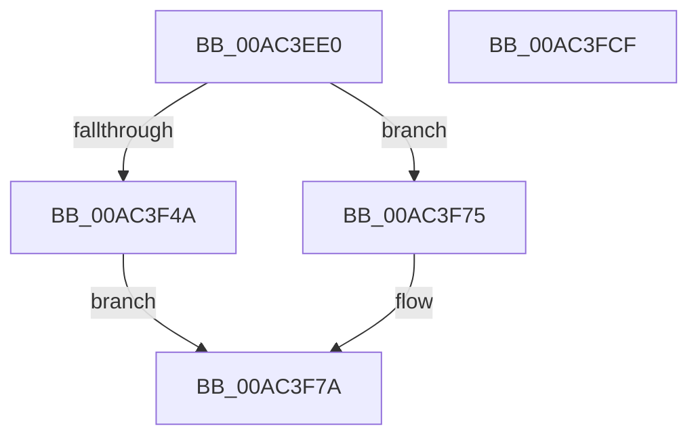

# EtwpGetPsmKeyExtendedHeaderItem

- RVA: `0x00AC3EE0`–`0x00AC3FD0` (길이 `240` bytes)
- VA: `0x0000000140AC3EE0`
- 실행 섹션: `PAGE`
- PDB 이름 있음: `예`; PDB Function 태그: `아니요`
- unwind 정보 RVA: `0x00083688`
- 디코드: `62`개 명령, `240/240` bytes 표시
- 미해석 바이트: `0` (있으면 어셈블리에 `.byte`로 보존)

> 이 문서는 커널 이미지의 기계어와 PDB 기호를 분석해 생성했습니다. 4번과 5번은 함수 원형과 자료형을 바이너리 사용 방식에서 추정한 C 해석이며 원본 소스 복구 결과는 아닙니다.

## 1. Dependencies

- 직접 호출 지점: **6**; 고유 호출 대상: **5**
- 직접 호출자로 확인된 함수: **1**
- RIP 상대 이미지 참조: **2**

### Outgoing calls
- `0x00AC3F1E` → [PsReferencePrimaryTokenWithTag](../../text/20/PsReferencePrimaryTokenWithTag_function_0020FF80.md) (function, `0x0020FF80`)
- `0x00AC3F30` → [SeSecurityAttributePresent](../../text/21/SeSecurityAttributePresent_function_00213660.md) (function, `0x00213660`)
- `0x00AC3F41` → [SeSecurityAttributePresent](../../text/21/SeSecurityAttributePresent_function_00213660.md) (function, `0x00213660`)
- `0x00AC3F5F` → [EtwpQueryPsmKey](../7B/EtwpQueryPsmKey_function_007B8C40.md) (function, `0x007B8C40`)
- `0x00AC3F8A` → [ObFastDereferenceObject](../../text/3E/ObFastDereferenceObject_function_003ED5F0.md) (function, `0x003ED5F0`)
- `0x00AC3FB3` → [memset](../../text/6C/memset_function_006C6C40.md) (function, `0x006C6C40`)

### Direct callers
- [EtwpWriteUserEvent](../AF/EtwpWriteUserEvent_function_00AF2FEC.md) at `0x00AF3738`

### Static image references
- `0x00AC3F23` → RVA `0x00B4BEA8` (`PspSysAppIdClaim`; read)
- `0x00AC3F35` → RVA `0x00B4BE98` (`PspPackagedAppClaim`; read)

## 2. Other-region calls and transfers

- 다른 실행 섹션으로 향하는 call: **5**
  - `0x00AC3F1E` → [PsReferencePrimaryTokenWithTag](../../text/20/PsReferencePrimaryTokenWithTag_function_0020FF80.md) (`PAGE` → `.text`)
  - `0x00AC3F30` → [SeSecurityAttributePresent](../../text/21/SeSecurityAttributePresent_function_00213660.md) (`PAGE` → `.text`)
  - `0x00AC3F41` → [SeSecurityAttributePresent](../../text/21/SeSecurityAttributePresent_function_00213660.md) (`PAGE` → `.text`)
  - `0x00AC3F8A` → [ObFastDereferenceObject](../../text/3E/ObFastDereferenceObject_function_003ED5F0.md) (`PAGE` → `.text`)
  - `0x00AC3FB3` → [memset](../../text/6C/memset_function_006C6C40.md) (`PAGE` → `.text`)
- 별도 외부 분기/꼬리 이동을 확인하지 못했습니다.

## 3. Assembly (complete function range)

```asm
00AC3EE0  48 89 5C 24 10                  mov qword ptr [rsp + 0x10], rbx
00AC3EE5  48 89 6C 24 18                  mov qword ptr [rsp + 0x18], rbp
00AC3EEA  56                              push rsi
00AC3EEB  57                              push rdi
00AC3EEC  41 54                           push r12
00AC3EEE  41 56                           push r14
00AC3EF0  41 57                           push r15
00AC3EF2  48 83 EC 20                     sub rsp, 0x20
00AC3EF6  65 48 8B 04 25 88 01 00 00      mov rax, qword ptr gs:[0x188]
00AC3EFF  45 33 E4                        xor r12d, r12d
00AC3F02  48 8B F9                        mov rdi, rcx
00AC3F05  4C 89 64 24 50                  mov qword ptr [rsp + 0x50], r12
00AC3F0A  BA 44 66 6C 74                  mov edx, 0x746c6644
00AC3F0F  4C 8B B8 B8 00 00 00            mov r15, qword ptr [rax + 0xb8]
00AC3F16  45 8D 74 24 08                  lea r14d, [r12 + 8]
00AC3F1B  49 8B CF                        mov rcx, r15
00AC3F1E  E8 5D C0 74 FF                  call 0x14020ff80
00AC3F23  48 8D 15 7E 7F 08 00            lea rdx, [rip + 0x87f7e]
00AC3F2A  48 8B C8                        mov rcx, rax
00AC3F2D  48 8B F0                        mov rsi, rax
00AC3F30  E8 2B F7 74 FF                  call 0x140213660
00AC3F35  48 8D 15 5C 7F 08 00            lea rdx, [rip + 0x87f5c]
00AC3F3C  48 8B CE                        mov rcx, rsi
00AC3F3F  8A D8                           mov bl, al
00AC3F41  E8 1A F7 74 FF                  call 0x140213660
00AC3F46  84 DB                           test bl, bl
00AC3F48  74 2B                           je 0x140ac3f75
00AC3F4A  4C 8D 44 24 50                  lea r8, [rsp + 0x50]
00AC3F4F  48 C7 44 24 50 D2 01 00 00      mov qword ptr [rsp + 0x50], 0x1d2
00AC3F58  48 8D 57 08                     lea rdx, [rdi + 8]
00AC3F5C  48 8B CE                        mov rcx, rsi
00AC3F5F  E8 DC 4C CF FF                  call 0x1407b8c40
00AC3F64  48 8B 5C 24 50                  mov rbx, qword ptr [rsp + 0x50]
00AC3F69  85 C0                           test eax, eax
00AC3F6B  49 0F 48 DC                     cmovs rbx, r12
00AC3F6F  4C 8D 73 08                     lea r14, [rbx + 8]
00AC3F73  EB 05                           jmp 0x140ac3f7a
00AC3F75  48 8B 5C 24 50                  mov rbx, qword ptr [rsp + 0x50]
00AC3F7A  49 8D 8F 48 02 00 00            lea rcx, [r15 + 0x248]
00AC3F81  41 B8 44 66 6C 74               mov r8d, 0x746c6644
00AC3F87  48 8B D6                        mov rdx, rsi
00AC3F8A  E8 61 96 92 FF                  call 0x1403ed5f0
00AC3F8F  B8 F8 FF FF FF                  mov eax, 0xfffffff8
00AC3F94  C7 47 02 09 00 00 00            mov dword ptr [rdi + 2], 9
00AC3F9B  45 8D 46 07                     lea r8d, [r14 + 7]
00AC3F9F  66 89 5F 06                     mov word ptr [rdi + 6], bx
00AC3FA3  4C 23 C0                        and r8, rax
00AC3FA6  49 8D 0C 3E                     lea rcx, [r14 + rdi]
00AC3FAA  66 44 89 07                     mov word ptr [rdi], r8w
00AC3FAE  33 D2                           xor edx, edx
00AC3FB0  4D 2B C6                        sub r8, r14
00AC3FB3  E8 88 2C C0 FF                  call 0x1406c6c40
00AC3FB8  48 8B 5C 24 58                  mov rbx, qword ptr [rsp + 0x58]
00AC3FBD  48 8B 6C 24 60                  mov rbp, qword ptr [rsp + 0x60]
00AC3FC2  48 83 C4 20                     add rsp, 0x20
00AC3FC6  41 5F                           pop r15
00AC3FC8  41 5E                           pop r14
00AC3FCA  41 5C                           pop r12
00AC3FCC  5F                              pop rdi
00AC3FCD  5E                              pop rsi
00AC3FCE  C3                              ret
00AC3FCF  CC                              int3
```

## 4. C-style interpretation (structured pseudocode)

```c
__int64 __fastcall EtwpGetPsmKeyExtendedHeaderItem(__int64 a1)
{
    __int64 result;
    __int64 v_r12;
    __int64 v_rbx;
    __int64 v_rsp;
    unsigned __int64 v_stack_p10;
    unsigned __int64 v_stack_p18;
    unsigned __int64 v_stack_p8;

    v_stack_p10 = v_rbx;
    v_stack_p18 = v_rbp;
    v_rsp = (v_rsp) - (32);
    v_r12 = 0;
    v_stack_p8 = 0;
    result = PsReferencePrimaryTokenWithTag(*(unsigned __int64 *)(*(unsigned __int64 *)(gs_base + (0 + 392)) + 184), (unsigned int)(0x746C6644ULL), a3, a4);
    result = SeSecurityAttributePresent(result, v_rip + 556926, a3, a4);
    result = SeSecurityAttributePresent(result, v_rip + 556892, a3, a4);
    if ((unsigned __int8)((unsigned __int8)(result)) == 0) goto loc_00AC3F75;
    v_stack_p8 = 466;
    result = EtwpQueryPsmKey(result, a1 + 8, v_stack_p8, a4);
    v_rbx = v_stack_p8;
    if (sign_flag) { v_rbx = 0; }
    goto loc_00AC3F7A;
loc_00AC3F75:
loc_00AC3F7A:
    result = ObFastDereferenceObject(*(unsigned __int64 *)(*(unsigned __int64 *)(gs_base + (0 + 392)) + 184) + 584, result, (unsigned int)(0x746C6644ULL), a4);
    *(unsigned int *)(a1 + 2) = 9;
    *(unsigned __int16 *)(a1 + 6) = (unsigned __int16)(v_stack_p8);
    a3 = (v_rbx + 8 + 7) & ((unsigned int)(0xFFFFFFF8ULL));
    *(unsigned __int16 *)(a1) = (unsigned __int16)(a3);
    a2 = 0;
    a3 = (a3) - (v_rbx + 8);
    result = memset(v_rbx + 8 + a1 * 1, a2, a3, a4);
    v_rsp = (v_rsp) + (32);
    return result;
}
```

## 5. (Beta) C Style

```c
int64_t EtwpGetPsmKeyExtendedHeaderItem(void *Arg1)
{
    uint8_t *arg1 = (uint8_t *)Arg1;

    int64_t result;
    int64_t local_r12;
    int64_t local_rbx;
    int64_t local_rsp;
    uint64_t v_stack_p10;
    uint64_t v_stack_p18;
    uint64_t v_stack_p8;

    v_stack_p10 = local_rbx;
    v_stack_p18 = local_rbp;
    local_rsp = (local_rsp) - (32);
    local_r12 = 0;
    v_stack_p8 = 0;
    result = PsReferencePrimaryTokenWithTag(*(uint64_t *)(*(uint64_t *)(gs_base + (0 + 0x188)) + 0xB8), (uint32_t)(0x746C6644ULL), a3, a4);
    result = SeSecurityAttributePresent(result, v_rip + 556926, a3, a4);
    result = SeSecurityAttributePresent(result, v_rip + 556892, a3, a4);
    if ((uint8_t)((uint8_t)(result)) == 0) goto loc_00AC3F75;
    v_stack_p8 = 466;
    result = EtwpQueryPsmKey(result, Arg1 + 8, v_stack_p8, a4);
    local_rbx = v_stack_p8;
    if (sign_flag) { local_rbx = 0; }
    goto loc_00AC3F7A;
loc_00AC3F75:
loc_00AC3F7A:
    result = ObFastDereferenceObject(*(uint64_t *)(*(uint64_t *)(gs_base + (0 + 0x188)) + 0xB8) + 584, result, (uint32_t)(0x746C6644ULL), a4);
    *(uint32_t *)(arg1 + 0x2) = 9;
    *(uint16_t *)(arg1 + 0x6) = (uint16_t)(v_stack_p8);
    a3 = (local_rbx + 8 + 7) & ((uint32_t)(0xFFFFFFF8ULL));
    *(uint16_t *)(arg1) = (uint16_t)(a3);
    a2 = 0;
    a3 = (a3) - (local_rbx + 8);
    result = memset(local_rbx + 8 + Arg1 * 1, a2, a3, a4);
    local_rsp = (local_rsp) + (32);
    return result;
}
```

### 관측된 메모리 오프셋

구조체 형식이 확인되지 않은 접근은 인자 기준의 오프셋으로만 기록했습니다.

| 기준 인자 | 오프셋 표현 | 폭 (bit) | 접근 |
|---|---:|---:|---|
| `Arg1` | `+ 0x0` | `16` | `W` |
| `Arg1` | `+ 0x2` | `32` | `W` |
| `Arg1` | `+ 0x6` | `16` | `W` |
| `Arg1` | `+ 0x8` | `64` | `R` |

## 6. Execution-region graph

[열기: 2D/3D 그래프와 함수 탐색 컨트롤 패널](../../../control-panel.html?section=page&rva=0x00AC3EE0&view=graph)

- 2D 그래프는 위에서 아래로 흐르고, 3D 그래프는 빈 공간을 드래그해 회전합니다. Shift+드래그는 이동, 휠은 확대·축소, 함수 노드 선택은 대상 보고서 이동입니다.

### Static fallback


