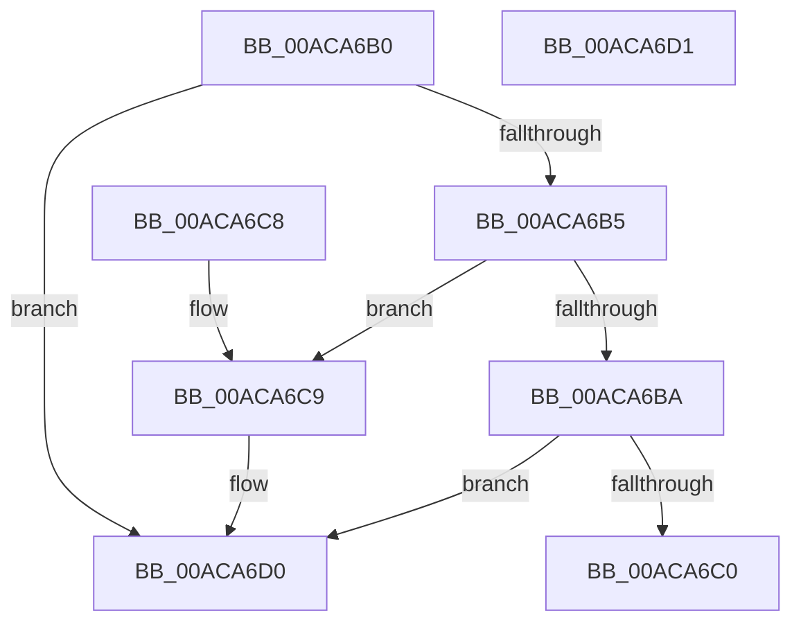

# EtwpPowerStateCallback

- RVA: `0x00ACA6B0`–`0x00ACA6D2` (길이 `34` bytes)
- VA: `0x0000000140ACA6B0`
- 실행 섹션: `PAGE`
- PDB 이름 있음: `예`; PDB Function 태그: `아니요`
- unwind 정보 RVA: `0x000DB714`
- 디코드: `12`개 명령, `34/34` bytes 표시
- 미해석 바이트: `0` (있으면 어셈블리에 `.byte`로 보존)

> 이 문서는 커널 이미지의 기계어와 PDB 기호를 분석해 생성했습니다. 4번과 5번은 함수 원형과 자료형을 바이너리 사용 방식에서 추정한 C 해석이며 원본 소스 복구 결과는 아닙니다.

## 1. Dependencies

- 직접 호출 지점: **0**; 고유 호출 대상: **0**
- 직접 호출자로 확인된 함수: **0**
- RIP 상대 이미지 참조: **1**

### Outgoing calls
- 직접 디코드된 call 명령이 없습니다.

### Direct callers
- 이 함수 시작 RVA로 연결되는 직접 call은 확인되지 않았습니다. 간접 호출은 완전히 역산할 수 없습니다.

### Static image references
- `0x00ACA6C0` → RVA `0x00EFF285` (`.data`; write)

## 2. Other-region calls and transfers

- 다른 실행 섹션으로 향하는 call: **0**
- 별도 외부 분기/꼬리 이동을 확인하지 못했습니다.

## 3. Assembly (complete function range)

```asm
00ACA6B0  83 FA 03                        cmp edx, 3
00ACA6B3  75 1B                           jne 0x140aca6d0
00ACA6B5  45 85 C0                        test r8d, r8d
00ACA6B8  74 0F                           je 0x140aca6c9
00ACA6BA  41 83 F8 01                     cmp r8d, 1
00ACA6BE  75 10                           jne 0x140aca6d0
00ACA6C0  C6 05 BE 4B 43 00 00            mov byte ptr [rip + 0x434bbe], 0
00ACA6C7  C3                              ret
00ACA6C8  CC                              int3
00ACA6C9  C6 05 B5 4B 43 00 01            mov byte ptr [rip + 0x434bb5], 1
00ACA6D0  C3                              ret
00ACA6D1  CC                              int3
```

## 4. C-style interpretation (structured pseudocode)

```c
void __fastcall EtwpPowerStateCallback(__int64 a1, int a2, int a3)
{
    if (a2 != 3) goto loc_00ACA6D0;
    if (a3 == 0) goto loc_00ACA6C9;
    if (a3 != 1) goto loc_00ACA6D0;
    *(unsigned __int8 *)(v_rip + 4410302) = 0;
    return;
loc_00ACA6C9:
    *(unsigned __int8 *)(v_rip + 4410293) = 1;
loc_00ACA6D0:
    return;
}
```

## 5. (Beta) C Style

```c
void EtwpPowerStateCallback(int64_t Arg1, int32_t Arg2, int32_t Arg3)
{
    if (Arg2 != 3) goto loc_00ACA6D0;
    if (Arg3 == 0) goto loc_00ACA6C9;
    if (Arg3 != 1) goto loc_00ACA6D0;
    *(uint8_t *)(v_rip + 0x434BBE) = 0;
    return;
loc_00ACA6C9:
    *(uint8_t *)(v_rip + 0x434BB5) = 1;
loc_00ACA6D0:
    return;
}
```

## 6. Execution-region graph

[열기: 2D/3D 그래프와 함수 탐색 컨트롤 패널](../../../control-panel.html?section=page&rva=0x00ACA6B0&view=graph)

- 2D 그래프는 위에서 아래로 흐르고, 3D 그래프는 빈 공간을 드래그해 회전합니다. Shift+드래그는 이동, 휠은 확대·축소, 함수 노드 선택은 대상 보고서 이동입니다.

### Static fallback


