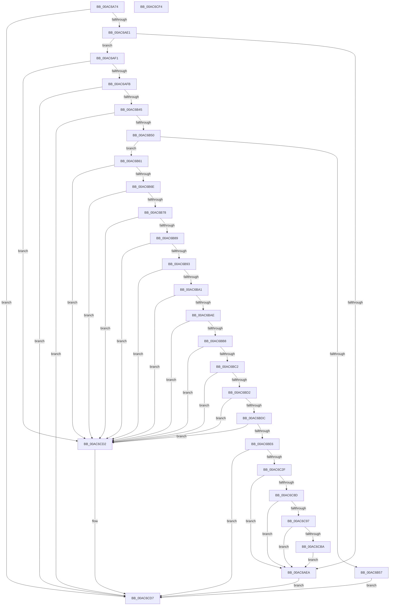

# EtwpRealtimeRestoreState

- RVA: `0x00AC6A74`–`0x00AC6CF5` (길이 `641` bytes)
- VA: `0x0000000140AC6A74`
- 실행 섹션: `PAGE`
- PDB 이름 있음: `예`; PDB Function 태그: `아니요`
- unwind 정보 RVA: `0x000BDF64`
- 디코드: `139`개 명령, `641/641` bytes 표시
- 미해석 바이트: `0` (있으면 어셈블리에 `.byte`로 보존)

> 이 문서는 커널 이미지의 기계어와 PDB 기호를 분석해 생성했습니다. 4번과 5번은 함수 원형과 자료형을 바이너리 사용 방식에서 추정한 C 해석이며 원본 소스 복구 결과는 아닙니다.

## 1. Dependencies

- 직접 호출 지점: **8**; 고유 호출 대상: **8**
- 직접 호출자로 확인된 함수: **1**
- RIP 상대 이미지 참조: **3**

### Outgoing calls
- `0x00AC6AB2` → [memset](../../text/6C/memset_function_006C6C40.md) (function, `0x006C6C40`)
- `0x00AC6AD4` → [ZwQueryInformationFile](../../text/6A/ZwQueryInformationFile_function_006AD2F0.md) (function, `0x006AD2F0`)
- `0x00AC6B38` → [ZwReadFile](../../text/6A/ZwReadFile_function_006AD190.md) (function, `0x006AD190`)
- `0x00AC6B7B` → [EtwpQueryUsedProcessorCount](../../text/3E/EtwpQueryUsedProcessorCount_function_003EB940.md) (function, `0x003EB940`)
- `0x00AC6C22` → [ZwWriteFile](../../text/6A/ZwWriteFile_function_006AD1D0.md) (function, `0x006AD1D0`)
- `0x00AC6CAD` → [EtwEventEnabled](../../text/39/EtwEventEnabled_function_00392450.md) (function, `0x00392450`)
- `0x00AC6CC8` → [EtwpEventWriteTemplateBackingFile](../7B/EtwpEventWriteTemplateBackingFile_function_007B5F64.md) (function, `0x007B5F64`)
- `0x00AC6CDE` → [_security_check_cookie](../../text/6A/_security_check_cookie_function_006AC640.md) (function, `0x006AC640`)

### Direct callers
- [sub_00B2EA5E](../B2/Unknown_function_00B2EA5E.md) at `0x00B2EA8A`

### Static image references
- `0x00AC6A86` → RVA `0x00E0A740` (`.data`; read)
- `0x00AC6C9C` → RVA `0x00013DB8` (`.rdata`; read)
- `0x00AC6CA6` → RVA `0x00EFF840` (`.data`; read)

## 2. Other-region calls and transfers

- 다른 실행 섹션으로 향하는 call: **7**
  - `0x00AC6AB2` → [memset](../../text/6C/memset_function_006C6C40.md) (`PAGE` → `.text`)
  - `0x00AC6AD4` → [ZwQueryInformationFile](../../text/6A/ZwQueryInformationFile_function_006AD2F0.md) (`PAGE` → `.text`)
  - `0x00AC6B38` → [ZwReadFile](../../text/6A/ZwReadFile_function_006AD190.md) (`PAGE` → `.text`)
  - `0x00AC6B7B` → [EtwpQueryUsedProcessorCount](../../text/3E/EtwpQueryUsedProcessorCount_function_003EB940.md) (`PAGE` → `.text`)
  - `0x00AC6C22` → [ZwWriteFile](../../text/6A/ZwWriteFile_function_006AD1D0.md) (`PAGE` → `.text`)
  - `0x00AC6CAD` → [EtwEventEnabled](../../text/39/EtwEventEnabled_function_00392450.md) (`PAGE` → `.text`)
  - `0x00AC6CDE` → [_security_check_cookie](../../text/6A/_security_check_cookie_function_006AC640.md) (`PAGE` → `.text`)
- 별도 외부 분기/꼬리 이동을 확인하지 못했습니다.

## 3. Assembly (complete function range)

```asm
00AC6A74  48 89 5C 24 10                  mov qword ptr [rsp + 0x10], rbx
00AC6A79  55                              push rbp
00AC6A7A  48 8D 6C 24 A9                  lea rbp, [rsp - 0x57]
00AC6A7F  48 81 EC E0 00 00 00            sub rsp, 0xe0
00AC6A86  48 8B 05 B3 3C 34 00            mov rax, qword ptr [rip + 0x343cb3]
00AC6A8D  48 33 C4                        xor rax, rsp
00AC6A90  48 89 45 4F                     mov qword ptr [rbp + 0x4f], rax
00AC6A94  33 C0                           xor eax, eax
00AC6A96  0F 57 C0                        xorps xmm0, xmm0
00AC6A99  48 8B D9                        mov rbx, rcx
00AC6A9C  48 89 45 47                     mov qword ptr [rbp + 0x47], rax
00AC6AA0  33 D2                           xor edx, edx
00AC6AA2  48 8D 4D E7                     lea rcx, [rbp - 0x19]
00AC6AA6  0F 11 45 37                     movups xmmword ptr [rbp + 0x37], xmm0
00AC6AAA  44 8D 40 48                     lea r8d, [rax + 0x48]
00AC6AAE  0F 11 45 CF                     movups xmmword ptr [rbp - 0x31], xmm0
00AC6AB2  E8 89 01 C0 FF                  call 0x1406c6c40
00AC6AB7  48 8B 8B 68 01 00 00            mov rcx, qword ptr [rbx + 0x168]
00AC6ABE  4C 8D 45 37                     lea r8, [rbp + 0x37]
00AC6AC2  41 B9 18 00 00 00               mov r9d, 0x18
00AC6AC8  C7 44 24 20 05 00 00 00         mov dword ptr [rsp + 0x20], 5
00AC6AD0  48 8D 55 CF                     lea rdx, [rbp - 0x31]
00AC6AD4  E8 17 68 BE FF                  call 0x1406ad2f0
00AC6AD9  85 C0                           test eax, eax
00AC6ADB  0F 88 F6 01 00 00               js 0x140ac6cd7
00AC6AE1  48 8B 45 3F                     mov rax, qword ptr [rbp + 0x3f]
00AC6AE5  48 85 C0                        test rax, rax
00AC6AE8  75 07                           jne 0x140ac6af1
00AC6AEA  33 C0                           xor eax, eax
00AC6AEC  E9 E6 01 00 00                  jmp 0x140ac6cd7
00AC6AF1  48 83 F8 48                     cmp rax, 0x48
00AC6AF5  0F 8C D7 01 00 00               jl 0x140ac6cd2
00AC6AFB  48 83 64 24 40 00               and qword ptr [rsp + 0x40], 0
00AC6B01  48 8D 45 C7                     lea rax, [rbp - 0x39]
00AC6B05  48 8B 8B 68 01 00 00            mov rcx, qword ptr [rbx + 0x168]
00AC6B0C  45 33 C9                        xor r9d, r9d
00AC6B0F  48 83 65 C7 00                  and qword ptr [rbp - 0x39], 0
00AC6B14  45 33 C0                        xor r8d, r8d
00AC6B17  48 89 44 24 38                  mov qword ptr [rsp + 0x38], rax
00AC6B1C  33 D2                           xor edx, edx
00AC6B1E  48 8D 45 E7                     lea rax, [rbp - 0x19]
00AC6B22  C7 44 24 30 48 00 00 00         mov dword ptr [rsp + 0x30], 0x48
00AC6B2A  48 89 44 24 28                  mov qword ptr [rsp + 0x28], rax
00AC6B2F  48 8D 45 CF                     lea rax, [rbp - 0x31]
00AC6B33  48 89 44 24 20                  mov qword ptr [rsp + 0x20], rax
00AC6B38  E8 53 66 BE FF                  call 0x1406ad190
00AC6B3D  85 C0                           test eax, eax
00AC6B3F  0F 88 92 01 00 00               js 0x140ac6cd7
00AC6B45  8B 45 CF                        mov eax, dword ptr [rbp - 0x31]
00AC6B48  85 C0                           test eax, eax
00AC6B4A  0F 88 87 01 00 00               js 0x140ac6cd7
00AC6B50  48 83 7D D7 48                  cmp qword ptr [rbp - 0x29], 0x48
00AC6B55  74 0A                           je 0x140ac6b61
00AC6B57  B8 11 00 00 C0                  mov eax, 0xc0000011
00AC6B5C  E9 76 01 00 00                  jmp 0x140ac6cd7
00AC6B61  81 7D E7 52 6C 46 73            cmp dword ptr [rbp - 0x19], 0x73466c52
00AC6B68  0F 85 64 01 00 00               jne 0x140ac6cd2
00AC6B6E  83 7D EF 01                     cmp dword ptr [rbp - 0x11], 1
00AC6B72  0F 85 5A 01 00 00               jne 0x140ac6cd2
00AC6B78  48 8B CB                        mov rcx, rbx
00AC6B7B  E8 C0 4D 92 FF                  call 0x1403eb940
00AC6B80  39 45 F3                        cmp dword ptr [rbp - 0xd], eax
00AC6B83  0F 85 49 01 00 00               jne 0x140ac6cd2
00AC6B89  83 7D 07 00                     cmp dword ptr [rbp + 7], 0
00AC6B8D  0F 84 3F 01 00 00               je 0x140ac6cd2
00AC6B93  48 8B 4D 1F                     mov rcx, qword ptr [rbp + 0x1f]
00AC6B97  48 39 4D 0F                     cmp qword ptr [rbp + 0xf], rcx
00AC6B9B  0F 8F 31 01 00 00               jg 0x140ac6cd2
00AC6BA1  48 8B 45 17                     mov rax, qword ptr [rbp + 0x17]
00AC6BA5  48 3B C1                        cmp rax, rcx
00AC6BA8  0F 8F 24 01 00 00               jg 0x140ac6cd2
00AC6BAE  48 3B 45 0F                     cmp rax, qword ptr [rbp + 0xf]
00AC6BB2  0F 84 1A 01 00 00               je 0x140ac6cd2
00AC6BB8  48 83 F9 48                     cmp rcx, 0x48
00AC6BBC  0F 82 10 01 00 00               jb 0x140ac6cd2
00AC6BC2  48 8B 83 A0 01 00 00            mov rax, qword ptr [rbx + 0x1a0]
00AC6BC9  48 3B C8                        cmp rcx, rax
00AC6BCC  0F 8F 00 01 00 00               jg 0x140ac6cd2
00AC6BD2  48 39 45 27                     cmp qword ptr [rbp + 0x27], rax
00AC6BD6  0F 87 F6 00 00 00               ja 0x140ac6cd2
00AC6BDC  48 39 4D 3F                     cmp qword ptr [rbp + 0x3f], rcx
00AC6BE0  0F 8C EC 00 00 00               jl 0x140ac6cd2
00AC6BE6  48 83 64 24 40 00               and qword ptr [rsp + 0x40], 0
00AC6BEC  48 8D 45 C7                     lea rax, [rbp - 0x39]
00AC6BF0  48 8B 8B 68 01 00 00            mov rcx, qword ptr [rbx + 0x168]
00AC6BF7  45 33 C9                        xor r9d, r9d
00AC6BFA  83 65 E7 00                     and dword ptr [rbp - 0x19], 0
00AC6BFE  45 33 C0                        xor r8d, r8d
00AC6C01  48 89 44 24 38                  mov qword ptr [rsp + 0x38], rax
00AC6C06  33 D2                           xor edx, edx
00AC6C08  48 8D 45 E7                     lea rax, [rbp - 0x19]
00AC6C0C  C7 44 24 30 48 00 00 00         mov dword ptr [rsp + 0x30], 0x48
00AC6C14  48 89 44 24 28                  mov qword ptr [rsp + 0x28], rax
00AC6C19  48 8D 45 CF                     lea rax, [rbp - 0x31]
00AC6C1D  48 89 44 24 20                  mov qword ptr [rsp + 0x20], rax
00AC6C22  E8 A9 65 BE FF                  call 0x1406ad1d0
00AC6C27  85 C0                           test eax, eax
00AC6C29  0F 88 A8 00 00 00               js 0x140ac6cd7
00AC6C2F  8B 45 07                        mov eax, dword ptr [rbp + 7]
00AC6C32  8B 8B EC 00 00 00               mov ecx, dword ptr [rbx + 0xec]
00AC6C38  48 8B 55 27                     mov rdx, qword ptr [rbp + 0x27]
00AC6C3C  0F AF 4B 04                     imul ecx, dword ptr [rbx + 4]
00AC6C40  0F 28 45 F7                     movaps xmm0, xmmword ptr [rbp - 9]
00AC6C44  89 83 A8 01 00 00               mov dword ptr [rbx + 0x1a8], eax
00AC6C4A  48 8B 45 0F                     mov rax, qword ptr [rbp + 0xf]
00AC6C4E  48 89 83 88 01 00 00            mov qword ptr [rbx + 0x188], rax
00AC6C55  48 8B 45 17                     mov rax, qword ptr [rbp + 0x17]
00AC6C59  48 89 83 80 01 00 00            mov qword ptr [rbx + 0x180], rax
00AC6C60  48 8B 45 1F                     mov rax, qword ptr [rbp + 0x1f]
00AC6C64  48 89 83 90 01 00 00            mov qword ptr [rbx + 0x190], rax
00AC6C6B  48 8B 83 A0 01 00 00            mov rax, qword ptr [rbx + 0x1a0]
00AC6C72  48 2B C2                        sub rax, rdx
00AC6C75  48 89 93 98 01 00 00            mov qword ptr [rbx + 0x198], rdx
00AC6C7C  F3 0F 7F 83 B0 01 00 00         movdqu xmmword ptr [rbx + 0x1b0], xmm0
00AC6C84  48 3B C1                        cmp rax, rcx
00AC6C87  0F 87 5D FE FF FF               ja 0x140ac6aea
00AC6C8D  83 7B 10 00                     cmp dword ptr [rbx + 0x10], 0
00AC6C91  0F 8C 53 FE FF FF               jl 0x140ac6aea
00AC6C97  B8 88 01 00 C0                  mov eax, 0xc0000188
00AC6C9C  48 8D 15 15 D1 54 FF            lea rdx, [rip - 0xab2eeb]
00AC6CA3  87 43 10                        xchg dword ptr [rbx + 0x10], eax
00AC6CA6  48 8B 0D 93 8B 43 00            mov rcx, qword ptr [rip + 0x438b93]
00AC6CAD  E8 9E B7 8C FF                  call 0x140392450
00AC6CB2  84 C0                           test al, al
00AC6CB4  0F 84 30 FE FF FF               je 0x140ac6aea
00AC6CBA  8B 43 0C                        mov eax, dword ptr [rbx + 0xc]
00AC6CBD  4C 8D 8B 88 00 00 00            lea r9, [rbx + 0x88]
00AC6CC4  89 44 24 28                     mov dword ptr [rsp + 0x28], eax
00AC6CC8  E8 97 F2 CE FF                  call 0x1407b5f64
00AC6CCD  E9 18 FE FF FF                  jmp 0x140ac6aea
00AC6CD2  B8 02 01 00 C0                  mov eax, 0xc0000102
00AC6CD7  48 8B 4D 4F                     mov rcx, qword ptr [rbp + 0x4f]
00AC6CDB  48 33 CC                        xor rcx, rsp
00AC6CDE  E8 5D 59 BE FF                  call 0x1406ac640
00AC6CE3  48 8B 9C 24 F8 00 00 00         mov rbx, qword ptr [rsp + 0xf8]
00AC6CEB  48 81 C4 E0 00 00 00            add rsp, 0xe0
00AC6CF2  5D                              pop rbp
00AC6CF3  C3                              ret
00AC6CF4  CC                              int3
```

## 4. C-style interpretation (structured pseudocode)

```c
__int64 __fastcall EtwpRealtimeRestoreState(__int64 a1, int a2)
{
    __int64 result;
    __int64 v_rsp;
    unsigned __int64 v_stack_m10;
    unsigned __int64 v_stack_m18;
    unsigned __int64 v_stack_m20;
    unsigned __int64 v_stack_m28;
    unsigned __int64 v_stack_m38;
    unsigned __int64 v_stack_m40;
    unsigned __int64 v_stack_m48;
    unsigned __int64 v_stack_m50;
    unsigned int v_stack_m58;
    unsigned __int64 v_stack_m5F;
    unsigned __int64 v_stack_m68;
    unsigned int v_stack_m6C;
    unsigned int v_stack_m70;
    unsigned __int64 v_stack_m78;
    unsigned __int64 v_stack_m88;
    unsigned __int64 v_stack_m90;
    unsigned __int64 v_stack_m98;
    unsigned __int64 v_stack_mA8;
    unsigned __int64 v_stack_mB0;
    unsigned int v_stack_mB8;
    unsigned __int64 v_stack_mC0;
    unsigned int v_stack_mC8;
    unsigned __int64 v_stack_p10;

    v_stack_p10 = v_rbx;
    v_rsp = (v_rsp) - (224);
    result = (*(unsigned __int64 *)(v_rip + 3423411)) ^ (v_rsp);
    v_stack_m10 = result;
    result = 0;
    v_stack_m18 = 0;
    a2 = 0;
    v_stack_m28 = v_xmm0;
    v_stack_m90 = v_xmm0;
    result = memset(v_stack_m78, a2, result + 72, a4);
    v_stack_mC8 = 5;
    result = ZwQueryInformationFile(*(unsigned __int64 *)(a1 + 360), v_stack_m90, v_stack_m28, 24);
    if (sign_flag) goto loc_00AC6CD7;
    if (v_stack_m20 != 0) goto loc_00AC6AF1;
loc_00AC6AEA:
    result = 0;
    goto loc_00AC6CD7;
loc_00AC6AF1:
    if (0 < 72) goto loc_00AC6CD2;
    a4 = 0;
    a3 = 0;
    v_stack_mB0 = v_stack_m98;
    a2 = 0;
    v_stack_mB8 = 72;
    v_stack_mC0 = v_stack_m78;
    v_stack_mC8 = v_stack_m90;
    result = ZwReadFile(*(unsigned __int64 *)(a1 + 360), a2, a3, a4);
    if (sign_flag) goto loc_00AC6CD7;
    if (sign_flag) goto loc_00AC6CD7;
    if (v_stack_m88 == 72) goto loc_00AC6B61;
    goto loc_00AC6CD7;
loc_00AC6B61:
    if (v_stack_m78 != 0x73466C52ULL) goto loc_00AC6CD2;
    if (v_stack_m70 != 1) goto loc_00AC6CD2;
    result = EtwpQueryUsedProcessorCount(a1, a2, a3, a4);
    if (v_stack_m6C != ((unsigned int)(result))) goto loc_00AC6CD2;
    if (v_stack_m58 == 0) goto loc_00AC6CD2;
    if (v_stack_m50 > v_stack_m40) goto loc_00AC6CD2;
    if (v_stack_m48 > v_stack_m40) goto loc_00AC6CD2;
    if (v_stack_m48 == v_stack_m50) goto loc_00AC6CD2;
    if (v_stack_m40 < 72) goto loc_00AC6CD2;
    if (v_stack_m40 > (*(unsigned __int64 *)(a1 + 416))) goto loc_00AC6CD2;
    if (v_stack_m38 > (*(unsigned __int64 *)(a1 + 416))) goto loc_00AC6CD2;
    if (v_stack_m20 < v_stack_m40) goto loc_00AC6CD2;
    a4 = 0;
    a3 = 0;
    v_stack_mB0 = v_stack_m98;
    a2 = 0;
    v_stack_mB8 = 72;
    v_stack_mC0 = v_stack_m78;
    v_stack_mC8 = v_stack_m90;
    result = ZwWriteFile(*(unsigned __int64 *)(a1 + 360), a2, a3, a4);
    if (sign_flag) goto loc_00AC6CD7;
    a1 = (unsigned int)(((unsigned int)(*(unsigned int *)(a1 + 236))) * (*(unsigned int *)(a1 + 4)));
    *(unsigned int *)(a1 + 424) = (unsigned int)((unsigned int)(v_stack_m58));
    *(unsigned __int64 *)(a1 + 392) = v_stack_m50;
    *(unsigned __int64 *)(a1 + 384) = v_stack_m48;
    *(unsigned __int64 *)(a1 + 400) = v_stack_m40;
    result = (*(unsigned __int64 *)(a1 + 416)) - (v_stack_m38);
    *(unsigned __int64 *)(a1 + 408) = v_stack_m38;
    *(unsigned __int64 *)(a1 + 432) = v_xmm0;
    if (result > a1) goto loc_00AC6AEA;
    if ((*(unsigned int *)(a1 + 16)) < 0) goto loc_00AC6AEA;
    result = EtwEventEnabled(*(unsigned __int64 *)(v_rip + 4426643), v_rip - 11218667, a3, a4);
    if ((unsigned __int8)(result) == 0) goto loc_00AC6AEA;
    v_stack_mC0 = (unsigned int)((unsigned int)(*(unsigned int *)(a1 + 12)));
    result = EtwpEventWriteTemplateBackingFile(*(unsigned __int64 *)(v_rip + 4426643), v_rip - 11218667, a3, a1 + 136);
    goto loc_00AC6AEA;
loc_00AC6CD2:
loc_00AC6CD7:
    a1 = (v_stack_m10) ^ (v_rsp);
    result = _security_check_cookie(a1, v_rip - 11218667, a3, a1 + 136);
    v_rsp = (v_rsp) + (224);
    return result;
}
```

## 5. (Beta) C Style

```c
int64_t EtwpRealtimeRestoreState(void *Arg1, int32_t Arg2)
{
    uint8_t *arg1 = (uint8_t *)Arg1;

    int64_t result;
    int64_t local_rsp;
    uint64_t v_stack_m10;
    uint64_t v_stack_m18;
    uint64_t v_stack_m20;
    uint64_t v_stack_m28;
    uint64_t v_stack_m38;
    uint64_t v_stack_m40;
    uint64_t v_stack_m48;
    uint64_t v_stack_m50;
    uint32_t v_stack_m58;
    uint64_t v_stack_m5F;
    uint64_t v_stack_m68;
    uint32_t v_stack_m6C;
    uint32_t v_stack_m70;
    uint64_t v_stack_m78;
    uint64_t v_stack_m88;
    uint64_t v_stack_m90;
    uint64_t v_stack_m98;
    uint64_t v_stack_mA8;
    uint64_t v_stack_mB0;
    uint32_t v_stack_mB8;
    uint64_t v_stack_mC0;
    uint32_t v_stack_mC8;
    uint64_t v_stack_p10;

    v_stack_p10 = local_rbx;
    local_rsp = (local_rsp) - (224);
    result = (*(uint64_t *)(v_rip + 0x343CB3)) ^ (local_rsp);
    v_stack_m10 = result;
    result = 0;
    v_stack_m18 = 0;
    Arg2 = 0;
    v_stack_m28 = v_xmm0;
    v_stack_m90 = v_xmm0;
    result = memset(v_stack_m78, Arg2, result + 72, a4);
    v_stack_mC8 = 5;
    result = ZwQueryInformationFile(*(uint64_t *)(arg1 + 0x168), v_stack_m90, v_stack_m28, 24);
    if (sign_flag) goto loc_00AC6CD7;
    if (v_stack_m20 != 0) goto loc_00AC6AF1;
loc_00AC6AEA:
    result = 0;
    goto loc_00AC6CD7;
loc_00AC6AF1:
    if (0 < 72) goto loc_00AC6CD2;
    a4 = 0;
    a3 = 0;
    v_stack_mB0 = v_stack_m98;
    Arg2 = 0;
    v_stack_mB8 = 72;
    v_stack_mC0 = v_stack_m78;
    v_stack_mC8 = v_stack_m90;
    result = ZwReadFile(*(uint64_t *)(arg1 + 0x168), Arg2, a3, a4);
    if (sign_flag) goto loc_00AC6CD7;
    if (sign_flag) goto loc_00AC6CD7;
    if (v_stack_m88 == 72) goto loc_00AC6B61;
    goto loc_00AC6CD7;
loc_00AC6B61:
    if (v_stack_m78 != 0x73466C52ULL) goto loc_00AC6CD2;
    if (v_stack_m70 != 1) goto loc_00AC6CD2;
    result = EtwpQueryUsedProcessorCount(Arg1, Arg2, a3, a4);
    if (v_stack_m6C != ((uint32_t)(result))) goto loc_00AC6CD2;
    if (v_stack_m58 == 0) goto loc_00AC6CD2;
    if (v_stack_m50 > v_stack_m40) goto loc_00AC6CD2;
    if (v_stack_m48 > v_stack_m40) goto loc_00AC6CD2;
    if (v_stack_m48 == v_stack_m50) goto loc_00AC6CD2;
    if (v_stack_m40 < 72) goto loc_00AC6CD2;
    if (v_stack_m40 > (*(uint64_t *)(arg1 + 0x1A0))) goto loc_00AC6CD2;
    if (v_stack_m38 > (*(uint64_t *)(arg1 + 0x1A0))) goto loc_00AC6CD2;
    if (v_stack_m20 < v_stack_m40) goto loc_00AC6CD2;
    a4 = 0;
    a3 = 0;
    v_stack_mB0 = v_stack_m98;
    Arg2 = 0;
    v_stack_mB8 = 72;
    v_stack_mC0 = v_stack_m78;
    v_stack_mC8 = v_stack_m90;
    result = ZwWriteFile(*(uint64_t *)(arg1 + 0x168), Arg2, a3, a4);
    if (sign_flag) goto loc_00AC6CD7;
    Arg1 = (uint32_t)(((uint32_t)(*(uint32_t *)(arg1 + 0xEC))) * (*(uint32_t *)(arg1 + 0x4)));
    *(uint32_t *)(arg1 + 0x1A8) = (uint32_t)((uint32_t)(v_stack_m58));
    *(uint64_t *)(arg1 + 0x188) = v_stack_m50;
    *(uint64_t *)(arg1 + 0x180) = v_stack_m48;
    *(uint64_t *)(arg1 + 0x190) = v_stack_m40;
    result = (*(uint64_t *)(arg1 + 0x1A0)) - (v_stack_m38);
    *(uint64_t *)(arg1 + 0x198) = v_stack_m38;
    *(uint64_t *)(arg1 + 0x1B0) = v_xmm0;
    if (result > Arg1) goto loc_00AC6AEA;
    if ((*(uint32_t *)(arg1 + 0x10)) < 0) goto loc_00AC6AEA;
    result = EtwEventEnabled(*(uint64_t *)(v_rip + 0x438B93), v_rip - 11218667, a3, a4);
    if ((uint8_t)(result) == 0) goto loc_00AC6AEA;
    v_stack_mC0 = (uint32_t)((uint32_t)(*(uint32_t *)(arg1 + 0xC)));
    result = EtwpEventWriteTemplateBackingFile(*(uint64_t *)(v_rip + 0x438B93), v_rip - 11218667, a3, Arg1 + 136);
    goto loc_00AC6AEA;
loc_00AC6CD2:
loc_00AC6CD7:
    Arg1 = (v_stack_m10) ^ (local_rsp);
    result = _security_check_cookie(Arg1, v_rip - 11218667, a3, Arg1 + 136);
    local_rsp = (local_rsp) + (224);
    return result;
}
```

### 관측된 메모리 오프셋

구조체 형식이 확인되지 않은 접근은 인자 기준의 오프셋으로만 기록했습니다.

| 기준 인자 | 오프셋 표현 | 폭 (bit) | 접근 |
|---|---:|---:|---|
| `Arg1` | `+ 0x4` | `32` | `R` |
| `Arg1` | `+ 0xC` | `32` | `R` |
| `Arg1` | `+ 0x10` | `32` | `R` |
| `Arg1` | `+ 0x10` | `32` | `R/W` |
| `Arg1` | `+ 0x88` | `64` | `R` |
| `Arg1` | `+ 0xEC` | `32` | `R` |
| `Arg1` | `+ 0x168` | `64` | `R` |
| `Arg1` | `+ 0x180` | `64` | `W` |
| `Arg1` | `+ 0x188` | `64` | `W` |
| `Arg1` | `+ 0x190` | `64` | `W` |
| `Arg1` | `+ 0x198` | `64` | `W` |
| `Arg1` | `+ 0x1A0` | `64` | `R` |
| `Arg1` | `+ 0x1A8` | `32` | `W` |
| `Arg1` | `+ 0x1B0` | `128` | `W` |

## 6. Execution-region graph

[열기: 2D/3D 그래프와 함수 탐색 컨트롤 패널](../../../control-panel.html?section=page&rva=0x00AC6A74&view=graph)

- 2D 그래프는 위에서 아래로 흐르고, 3D 그래프는 빈 공간을 드래그해 회전합니다. Shift+드래그는 이동, 휠은 확대·축소, 함수 노드 선택은 대상 보고서 이동입니다.

### Static fallback


