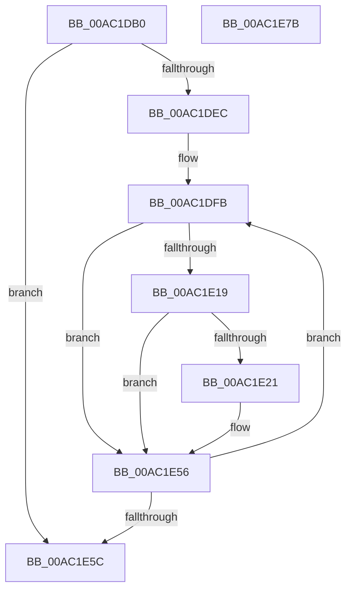

# EtwpTraceRegistryTransaction

- RVA: `0x00AC1DB0`–`0x00AC1E7C` (길이 `204` bytes)
- VA: `0x0000000140AC1DB0`
- 실행 섹션: `PAGE`
- PDB 이름 있음: `예`; PDB Function 태그: `아니요`
- unwind 정보 RVA: `0x0007FF48`
- 디코드: `53`개 명령, `204/204` bytes 표시
- 미해석 바이트: `0` (있으면 어셈블리에 `.byte`로 보존)

> 이 문서는 커널 이미지의 기계어와 PDB 기호를 분석해 생성했습니다. 4번과 5번은 함수 원형과 자료형을 바이너리 사용 방식에서 추정한 C 해석이며 원본 소스 복구 결과는 아닙니다.

## 1. Dependencies

- 직접 호출 지점: **1**; 고유 호출 대상: **1**
- 직접 호출자로 확인된 함수: **0**
- RIP 상대 이미지 참조: **1**

### Outgoing calls
- `0x00AC1E51` → [EtwpLogTxREvent](../7B/EtwpLogTxREvent_function_007B86A4.md) (function, `0x007B86A4`)

### Direct callers
- 이 함수 시작 RVA로 연결되는 직접 call은 확인되지 않았습니다. 간접 호출은 완전히 역산할 수 없습니다.

### Static image references
- `0x00AC1DCD` → RVA `0x00FC6AA8` (`ALMOSTRO`; read)

## 2. Other-region calls and transfers

- 다른 실행 섹션으로 향하는 call: **0**
- 별도 외부 분기/꼬리 이동을 확인하지 못했습니다.

## 3. Assembly (complete function range)

```asm
00AC1DB0  48 8B C4                        mov rax, rsp
00AC1DB3  48 89 58 08                     mov qword ptr [rax + 8], rbx
00AC1DB7  48 89 68 10                     mov qword ptr [rax + 0x10], rbp
00AC1DBB  48 89 70 18                     mov qword ptr [rax + 0x18], rsi
00AC1DBF  48 89 78 20                     mov qword ptr [rax + 0x20], rdi
00AC1DC3  41 54                           push r12
00AC1DC5  41 56                           push r14
00AC1DC7  41 57                           push r15
00AC1DC9  48 83 EC 50                     sub rsp, 0x50
00AC1DCD  48 8B 05 D4 4C 50 00            mov rax, qword ptr [rip + 0x504cd4]
00AC1DD4  41 8B E9                        mov ebp, r9d
00AC1DD7  4D 8B F0                        mov r14, r8
00AC1DDA  4C 8B FA                        mov r15, rdx
00AC1DDD  44 8A E1                        mov r12b, cl
00AC1DE0  8B 98 A8 11 00 00               mov ebx, dword ptr [rax + 0x11a8]
00AC1DE6  44 0F BC D3                     bsf r10d, ebx
00AC1DEA  74 70                           je 0x140ac1e5c
00AC1DEC  48 8B BC 24 98 00 00 00         mov rdi, qword ptr [rsp + 0x98]
00AC1DF4  8B B4 24 90 00 00 00            mov esi, dword ptr [rsp + 0x90]
00AC1DFB  4C 8B 05 A6 4C 50 00            mov r8, qword ptr [rip + 0x504ca6]
00AC1E02  8D 43 FF                        lea eax, [rbx - 1]
00AC1E05  23 D8                           and ebx, eax
00AC1E07  41 8B C2                        mov eax, r10d
00AC1E0A  48 C1 E0 05                     shl rax, 5
00AC1E0E  48 05 CC 11 00 00               add rax, 0x11cc
00AC1E14  49 03 C0                        add rax, r8
00AC1E17  74 3D                           je 0x140ac1e56
00AC1E19  F7 00 00 00 02 00               test dword ptr [rax], 0x20000
00AC1E1F  74 35                           je 0x140ac1e56
00AC1E21  43 0F B6 84 50 99 11 00 00      movzx eax, byte ptr [r8 + r10*2 + 0x1199]
00AC1E2A  44 8B CD                        mov r9d, ebp
00AC1E2D  43 0F B6 8C 50 98 11 00 00      movzx ecx, byte ptr [r8 + r10*2 + 0x1198]
00AC1E36  48 FF C8                        dec rax
00AC1E39  48 89 7C 24 30                  mov qword ptr [rsp + 0x30], rdi
00AC1E3E  4D 8B C6                        mov r8, r14
00AC1E41  49 8D 14 C7                     lea rdx, [r15 + rax*8]
00AC1E45  48 89 54 24 28                  mov qword ptr [rsp + 0x28], rdx
00AC1E4A  41 8A D4                        mov dl, r12b
00AC1E4D  89 74 24 20                     mov dword ptr [rsp + 0x20], esi
00AC1E51  E8 4E 68 CF FF                  call 0x1407b86a4
00AC1E56  44 0F BC D3                     bsf r10d, ebx
00AC1E5A  75 9F                           jne 0x140ac1dfb
00AC1E5C  4C 8D 5C 24 50                  lea r11, [rsp + 0x50]
00AC1E61  49 8B 5B 20                     mov rbx, qword ptr [r11 + 0x20]
00AC1E65  49 8B 6B 28                     mov rbp, qword ptr [r11 + 0x28]
00AC1E69  49 8B 73 30                     mov rsi, qword ptr [r11 + 0x30]
00AC1E6D  49 8B 7B 38                     mov rdi, qword ptr [r11 + 0x38]
00AC1E71  49 8B E3                        mov rsp, r11
00AC1E74  41 5F                           pop r15
00AC1E76  41 5E                           pop r14
00AC1E78  41 5C                           pop r12
00AC1E7A  C3                              ret
00AC1E7B  CC                              int3
```

## 4. C-style interpretation (structured pseudocode)

```c
__int64 __fastcall EtwpTraceRegistryTransaction(unsigned __int8 a1, __int64 a2, __int64 a3, int a4, unsigned int a5, __int64 a6)
{
    __int64 result;
    __int64 v_rbx;
    __int64 v_rsp;
    unsigned __int64 v_stack_m18;
    unsigned __int64 v_stack_m38;
    unsigned __int64 v_stack_m40;
    unsigned int v_stack_m48;

    *(unsigned __int64 *)(v_rsp + 8) = v_rbx;
    *(unsigned __int64 *)(v_rsp + 16) = v_rbp;
    *(unsigned __int64 *)(v_rsp + 24) = v_rsi;
    *(unsigned __int64 *)(v_rsp + 32) = v_rdi;
    v_rsp = (v_rsp) - (80);
    if (condition_is_equal) goto loc_00AC1E5C;
loc_00AC1DFB:
    v_rbx = (unsigned int)(((unsigned int)(*(unsigned int *)(*(unsigned __int64 *)(v_rip + 5262548) + 4520))) & ((unsigned int)((unsigned int)(*(unsigned int *)(*(unsigned __int64 *)(v_rip + 5262548) + 4520)) - 1)));
    result = ((unsigned int)((unsigned int)(v_r10))) << (5);
    result = (result) + (0x11CCULL);
    result = (result) + (*(unsigned __int64 *)(v_rip + 5262502));
    if (condition_is_equal) goto loc_00AC1E56;
    if (((*(unsigned int *)(result)) & (0x20000ULL)) != 0) {
        result = *(unsigned __int8 *)(*(unsigned __int64 *)(v_rip + 5262502) + v_r10 * 2 + 4505);
        a4 = (unsigned int)((unsigned int)(a4));
        a1 = *(unsigned __int8 *)(*(unsigned __int64 *)(v_rip + 5262502) + v_r10 * 2 + 4504);
        result = (result) - 1;
        v_stack_m38 = a6;
        a3 = a3;
        a2 = a2 + result * 8;
        v_stack_m40 = a2;
        a2 = a1;
        v_stack_m48 = (unsigned int)((unsigned int)(a5));
        result = EtwpLogTxREvent(a1, a2, a3, a4);
    }
    if (((*(unsigned int *)(result)) & (0x20000ULL)) != 0) goto loc_00AC1DFB;
loc_00AC1E5C:
    return result;
}
```

## 5. (Beta) C Style

```c
int64_t EtwpTraceRegistryTransaction(uint8_t Arg1, void *Arg2, int64_t Arg3, int32_t Arg4, uint32_t Arg5, int64_t Arg6)
{
    uint8_t *arg2 = (uint8_t *)Arg2;

    int64_t result;
    int64_t local_rbx;
    int64_t local_rsp;
    uint64_t v_stack_m18;
    uint64_t v_stack_m38;
    uint64_t v_stack_m40;
    uint32_t v_stack_m48;

    *(uint64_t *)(local_rsp + 0x8) = local_rbx;
    *(uint64_t *)(local_rsp + 0x10) = local_rbp;
    *(uint64_t *)(local_rsp + 0x18) = local_rsi;
    *(uint64_t *)(local_rsp + 0x20) = local_rdi;
    local_rsp = (local_rsp) - (80);
    if (condition_is_equal) goto loc_00AC1E5C;
loc_00AC1DFB:
    local_rbx = (uint32_t)(((uint32_t)(*(uint32_t *)(*(uint64_t *)(v_rip + 0x504CD4) + 0x11A8))) & ((uint32_t)((uint32_t)(*(uint32_t *)(*(uint64_t *)(v_rip + 0x504CD4) + 0x11A8)) - 1)));
    result = ((uint32_t)((uint32_t)(local_r10))) << (5);
    result = (result) + (0x11CCULL);
    result = (result) + (*(uint64_t *)(v_rip + 0x504CA6));
    if (condition_is_equal) goto loc_00AC1E56;
    if (((*(uint32_t *)(result)) & (0x20000ULL)) != 0) {
        result = *(uint8_t *)(*(uint64_t *)(v_rip + 0x504CA6) + local_r10 * 2 + 0x1199);
        Arg4 = (uint32_t)((uint32_t)(Arg4));
        Arg1 = *(uint8_t *)(*(uint64_t *)(v_rip + 0x504CA6) + local_r10 * 2 + 0x1198);
        result = (result) - 1;
        v_stack_m38 = Arg6;
        Arg3 = Arg3;
        Arg2 = Arg2 + result * 8;
        v_stack_m40 = Arg2;
        Arg2 = Arg1;
        v_stack_m48 = (uint32_t)((uint32_t)(Arg5));
        result = EtwpLogTxREvent(Arg1, Arg2, Arg3, Arg4);
    }
    if (((*(uint32_t *)(result)) & (0x20000ULL)) != 0) goto loc_00AC1DFB;
loc_00AC1E5C:
    return result;
}
```

### 관측된 메모리 오프셋

구조체 형식이 확인되지 않은 접근은 인자 기준의 오프셋으로만 기록했습니다.

| 기준 인자 | 오프셋 표현 | 폭 (bit) | 접근 |
|---|---:|---:|---|
| `Arg2` | `+ 0x0 + rax*8` | `64` | `R` |

## 6. Execution-region graph

[열기: 2D/3D 그래프와 함수 탐색 컨트롤 패널](../../../control-panel.html?section=page&rva=0x00AC1DB0&view=graph)

- 2D 그래프는 위에서 아래로 흐르고, 3D 그래프는 빈 공간을 드래그해 회전합니다. Shift+드래그는 이동, 휠은 확대·축소, 함수 노드 선택은 대상 보고서 이동입니다.

### Static fallback


