# EtwpTracingProvEnableCallback

- RVA: `0x00AC28B0`–`0x00AC2BD9` (길이 `809` bytes)
- VA: `0x0000000140AC28B0`
- 실행 섹션: `PAGE`
- PDB 이름 있음: `예`; PDB Function 태그: `아니요`
- unwind 정보 RVA: `0x000BDCB4`
- 디코드: `205`개 명령, `809/809` bytes 표시
- 미해석 바이트: `0` (있으면 어셈블리에 `.byte`로 보존)

> 이 문서는 커널 이미지의 기계어와 PDB 기호를 분석해 생성했습니다. 4번과 5번은 함수 원형과 자료형을 바이너리 사용 방식에서 추정한 C 해석이며 원본 소스 복구 결과는 아닙니다.

## 1. Dependencies

- 직접 호출 지점: **25**; 고유 호출 대상: **13**
- 직접 호출자로 확인된 함수: **0**
- RIP 상대 이미지 참조: **9**

### Outgoing calls
- `0x00AC28EC` → [EtwpAcquireLoggerContextByLoggerId](../93/EtwpAcquireLoggerContextByLoggerId_function_00932920.md) (function, `0x00932920`)
- `0x00AC2903` → [EtwpEventWriteTemplateSession](../9B/EtwpEventWriteTemplateSession_function_009BD120.md) (function, `0x009BD120`)
- `0x00AC290D` → [EtwpReleaseLoggerContext](../A0/EtwpReleaseLoggerContext_function_00A04160.md) (function, `0x00A04160`)
- `0x00AC2947` → [KeAbPreAcquire](../../text/21/KeAbPreAcquire_function_00210230.md) (function, `0x00210230`)
- `0x00AC2960` → [ExfAcquirePushLockExclusiveEx](../../text/20/ExfAcquirePushLockExclusiveEx_function_0020FC90.md) (function, `0x0020FC90`)
- `0x00AC298C` → [EtwEventEnabled](../../text/39/EtwEventEnabled_function_00392450.md) (function, `0x00392450`)
- `0x00AC299F` → [EtwpEventWriteGuidEntry](../7B/EtwpEventWriteGuidEntry_function_007B5C84.md) (function, `0x007B5C84`)
- `0x00AC29C2` → [EtwEventEnabled](../../text/39/EtwEventEnabled_function_00392450.md) (function, `0x00392450`)
- `0x00AC29D1` → [EtwpEventWriteEnableInfo](../7B/EtwpEventWriteEnableInfo_function_007B5B8C.md) (function, `0x007B5B8C`)
- `0x00AC2A0F` → [ExfReleasePushLock](../../text/26/ExfReleasePushLock_function_002638D0.md) (function, `0x002638D0`)
- `0x00AC2A17` → [KeAbPostRelease](../../text/2E/KeAbPostRelease_function_002E1600.md) (function, `0x002E1600`)
- `0x00AC2A1C` → [KeLeaveCriticalRegion](../../text/25/KeLeaveCriticalRegion_function_0025D8B0.md) (function, `0x0025D8B0`)
- `0x00AC2A31` → [EtwpGetNextGuidEntry](../8C/EtwpGetNextGuidEntry_function_008C3170.md) (function, `0x008C3170`)
- `0x00AC2A86` → [KeAbPreAcquire](../../text/21/KeAbPreAcquire_function_00210230.md) (function, `0x00210230`)
- `0x00AC2A9F` → [ExfAcquirePushLockExclusiveEx](../../text/20/ExfAcquirePushLockExclusiveEx_function_0020FC90.md) (function, `0x0020FC90`)
- `0x00AC2ACE` → [EtwEventEnabled](../../text/39/EtwEventEnabled_function_00392450.md) (function, `0x00392450`)
- `0x00AC2AE1` → [EtwpEventWriteGuidEntry](../7B/EtwpEventWriteGuidEntry_function_007B5C84.md) (function, `0x007B5C84`)
- `0x00AC2B03` → [EtwEventEnabled](../../text/39/EtwEventEnabled_function_00392450.md) (function, `0x00392450`)
- `0x00AC2B12` → [EtwpEventWriteEnableInfo](../7B/EtwpEventWriteEnableInfo_function_007B5B8C.md) (function, `0x007B5B8C`)
- `0x00AC2B39` → [EtwEventEnabled](../../text/39/EtwEventEnabled_function_00392450.md) (function, `0x00392450`)
- `0x00AC2B45` → [EtwpEventWriteRegEntry](../7B/EtwpEventWriteRegEntry_function_007B5DE8.md) (function, `0x007B5DE8`)
- `0x00AC2B8C` → [ExfReleasePushLock](../../text/26/ExfReleasePushLock_function_002638D0.md) (function, `0x002638D0`)
- `0x00AC2B94` → [KeAbPostRelease](../../text/2E/KeAbPostRelease_function_002E1600.md) (function, `0x002E1600`)
- `0x00AC2B99` → [KeLeaveCriticalRegion](../../text/25/KeLeaveCriticalRegion_function_0025D8B0.md) (function, `0x0025D8B0`)
- `0x00AC2BAE` → [EtwpGetNextGuidEntry](../8C/EtwpGetNextGuidEntry_function_008C3170.md) (function, `0x008C3170`)

### Direct callers
- 이 함수 시작 RVA로 연결되는 직접 call은 확인되지 않았습니다. 간접 호출은 완전히 역산할 수 없습니다.

### Static image references
- `0x00AC28D1` → RVA `0x00FC6AA8` (`ALMOSTRO`; read)
- `0x00AC28FC` → RVA `0x00013E10` (`.rdata`; read)
- `0x00AC2977` → RVA `0x000228A8` (`.rdata`; read)
- `0x00AC2985` → RVA `0x00EFF840` (`.data`; read)
- `0x00AC29BB` → RVA `0x00021DF0` (`.rdata`; read)
- `0x00AC2A4D` → RVA `0x00013050` (`.rdata`; read)
- `0x00AC2A5A` → RVA `0x00013058` (`.rdata`; read)
- `0x00AC2AC7` → RVA `0x00022CE8` (`.rdata`; read)
- `0x00AC2B32` → RVA `0x00021668` (`.rdata`; read)

## 2. Other-region calls and transfers

- 다른 실행 섹션으로 향하는 call: **15**
  - `0x00AC2947` → [KeAbPreAcquire](../../text/21/KeAbPreAcquire_function_00210230.md) (`PAGE` → `.text`)
  - `0x00AC2960` → [ExfAcquirePushLockExclusiveEx](../../text/20/ExfAcquirePushLockExclusiveEx_function_0020FC90.md) (`PAGE` → `.text`)
  - `0x00AC298C` → [EtwEventEnabled](../../text/39/EtwEventEnabled_function_00392450.md) (`PAGE` → `.text`)
  - `0x00AC29C2` → [EtwEventEnabled](../../text/39/EtwEventEnabled_function_00392450.md) (`PAGE` → `.text`)
  - `0x00AC2A0F` → [ExfReleasePushLock](../../text/26/ExfReleasePushLock_function_002638D0.md) (`PAGE` → `.text`)
  - `0x00AC2A17` → [KeAbPostRelease](../../text/2E/KeAbPostRelease_function_002E1600.md) (`PAGE` → `.text`)
  - `0x00AC2A1C` → [KeLeaveCriticalRegion](../../text/25/KeLeaveCriticalRegion_function_0025D8B0.md) (`PAGE` → `.text`)
  - `0x00AC2A86` → [KeAbPreAcquire](../../text/21/KeAbPreAcquire_function_00210230.md) (`PAGE` → `.text`)
  - `0x00AC2A9F` → [ExfAcquirePushLockExclusiveEx](../../text/20/ExfAcquirePushLockExclusiveEx_function_0020FC90.md) (`PAGE` → `.text`)
  - `0x00AC2ACE` → [EtwEventEnabled](../../text/39/EtwEventEnabled_function_00392450.md) (`PAGE` → `.text`)
  - `0x00AC2B03` → [EtwEventEnabled](../../text/39/EtwEventEnabled_function_00392450.md) (`PAGE` → `.text`)
  - `0x00AC2B39` → [EtwEventEnabled](../../text/39/EtwEventEnabled_function_00392450.md) (`PAGE` → `.text`)
  - `0x00AC2B8C` → [ExfReleasePushLock](../../text/26/ExfReleasePushLock_function_002638D0.md) (`PAGE` → `.text`)
  - `0x00AC2B94` → [KeAbPostRelease](../../text/2E/KeAbPostRelease_function_002E1600.md) (`PAGE` → `.text`)
  - `0x00AC2B99` → [KeLeaveCriticalRegion](../../text/25/KeLeaveCriticalRegion_function_0025D8B0.md) (`PAGE` → `.text`)
- 별도 외부 분기/꼬리 이동을 확인하지 못했습니다.

## 3. Assembly (complete function range)

```asm
00AC28B0  83 FA 02                        cmp edx, 2
00AC28B3  0F 85 1E 03 00 00               jne 0x140ac2bd7
00AC28B9  48 89 5C 24 08                  mov qword ptr [rsp + 8], rbx
00AC28BE  48 89 6C 24 10                  mov qword ptr [rsp + 0x10], rbp
00AC28C3  48 89 74 24 18                  mov qword ptr [rsp + 0x18], rsi
00AC28C8  57                              push rdi
00AC28C9  41 56                           push r14
00AC28CB  41 57                           push r15
00AC28CD  48 83 EC 20                     sub rsp, 0x20
00AC28D1  48 8B 0D D0 41 50 00            mov rcx, qword ptr [rip + 0x5041d0]
00AC28D8  45 33 FF                        xor r15d, r15d
00AC28DB  45 8A F7                        mov r14b, r15b
00AC28DE  41 8B DF                        mov ebx, r15d
00AC28E1  44 39 79 10                     cmp dword ptr [rcx + 0x10], r15d
00AC28E5  76 39                           jbe 0x140ac2920
00AC28E7  45 33 C0                        xor r8d, r8d
00AC28EA  8B D3                           mov edx, ebx
00AC28EC  E8 2F 00 E7 FF                  call 0x140932920
00AC28F1  48 8B F8                        mov rdi, rax
00AC28F4  48 85 C0                        test rax, rax
00AC28F7  74 19                           je 0x140ac2912
00AC28F9  4C 8B C0                        mov r8, rax
00AC28FC  48 8D 15 0D 15 55 FF            lea rdx, [rip - 0xaaeaf3]
00AC2903  E8 18 A8 EF FF                  call 0x1409bd120
00AC2908  33 D2                           xor edx, edx
00AC290A  48 8B CF                        mov rcx, rdi
00AC290D  E8 4E 18 F4 FF                  call 0x140a04160
00AC2912  48 8B 0D 8F 41 50 00            mov rcx, qword ptr [rip + 0x50418f]
00AC2919  FF C3                           inc ebx
00AC291B  3B 59 10                        cmp ebx, dword ptr [rcx + 0x10]
00AC291E  72 C7                           jb 0x140ac28e7
00AC2920  33 D2                           xor edx, edx
00AC2922  E9 04 01 00 00                  jmp 0x140ac2a2b
00AC2927  65 48 8B 0C 25 88 01 00 00      mov rcx, qword ptr gs:[0x188]
00AC2930  48 8D BB 98 02 00 00            lea rdi, [rbx + 0x298]
00AC2937  45 33 C0                        xor r8d, r8d
00AC293A  33 D2                           xor edx, edx
00AC293C  66 FF 89 E4 01 00 00            dec word ptr [rcx + 0x1e4]
00AC2943  48 8B CF                        mov rcx, rdi
00AC2946  90                              nop
00AC2947  E8 E4 D8 74 FF                  call 0x140210230
00AC294C  F0 48 0F BA 2F 00               lock bts qword ptr [rdi], 0
00AC2952  48 8B F0                        mov rsi, rax
00AC2955  73 0E                           jae 0x140ac2965
00AC2957  4C 8B C7                        mov r8, rdi
00AC295A  48 8B D0                        mov rdx, rax
00AC295D  48 8B CF                        mov rcx, rdi
00AC2960  E8 2B D3 74 FF                  call 0x14020fc90
00AC2965  48 85 F6                        test rsi, rsi
00AC2968  74 04                           je 0x140ac296e
00AC296A  C6 46 0A 01                     mov byte ptr [rsi + 0xa], 1
00AC296E  65 48 8B 04 25 88 01 00 00      mov rax, qword ptr gs:[0x188]
00AC2977  48 8D 15 2A FF 55 FF            lea rdx, [rip - 0xaa00d6]
00AC297E  48 89 83 A0 02 00 00            mov qword ptr [rbx + 0x2a0], rax
00AC2985  48 8B 0D B4 CE 43 00            mov rcx, qword ptr [rip + 0x43ceb4]
00AC298C  E8 BF FA 8C FF                  call 0x140392450
00AC2991  84 C0                           test al, al
00AC2993  74 0F                           je 0x140ac29a4
00AC2995  4C 8B C3                        mov r8, rbx
00AC2998  48 8D 15 09 FF 55 FF            lea rdx, [rip - 0xaa00f7]
00AC299F  E8 E0 32 CF FF                  call 0x1407b5c84
00AC29A4  41 8B F7                        mov esi, r15d
00AC29A7  48 8D AB 80 00 00 00            lea rbp, [rbx + 0x80]
00AC29AE  44 39 7D 00                     cmp dword ptr [rbp], r15d
00AC29B2  74 22                           je 0x140ac29d6
00AC29B4  48 8B 0D 85 CE 43 00            mov rcx, qword ptr [rip + 0x43ce85]
00AC29BB  48 8D 15 2E F4 55 FF            lea rdx, [rip - 0xaa0bd2]
00AC29C2  E8 89 FA 8C FF                  call 0x140392450
00AC29C7  84 C0                           test al, al
00AC29C9  74 0B                           je 0x140ac29d6
00AC29CB  44 8A C6                        mov r8b, sil
00AC29CE  48 8B D3                        mov rdx, rbx
00AC29D1  E8 B6 31 CF FF                  call 0x1407b5b8c
00AC29D6  FF C6                           inc esi
00AC29D8  48 83 C5 20                     add rbp, 0x20
00AC29DC  83 FE 10                        cmp esi, 0x10
00AC29DF  72 CD                           jb 0x140ac29ae
00AC29E1  4C 89 BB A0 02 00 00            mov qword ptr [rbx + 0x2a0], r15
00AC29E8  0F 0D 0F                        prefetchw byte ptr [rdi]
00AC29EB  48 8B 07                        mov rax, qword ptr [rdi]
00AC29EE  48 8B C8                        mov rcx, rax
00AC29F1  48 83 E1 F0                     and rcx, 0xfffffffffffffff0
00AC29F5  48 83 F9 10                     cmp rcx, 0x10
00AC29F9  48 8D 50 F0                     lea rdx, [rax - 0x10]
00AC29FD  49 0F 46 D7                     cmovbe rdx, r15
00AC2A01  A8 02                           test al, 2
00AC2A03  75 07                           jne 0x140ac2a0c
00AC2A05  F0 48 0F B1 17                  lock cmpxchg qword ptr [rdi], rdx
00AC2A0A  74 08                           je 0x140ac2a14
00AC2A0C  48 8B CF                        mov rcx, rdi
00AC2A0F  E8 BC 0E 7A FF                  call 0x1402638d0
00AC2A14  48 8B CF                        mov rcx, rdi
00AC2A17  E8 E4 EB 81 FF                  call 0x1402e1600
00AC2A1C  E8 8F AE 79 FF                  call 0x14025d8b0
00AC2A21  48 8B 0D 80 40 50 00            mov rcx, qword ptr [rip + 0x504080]
00AC2A28  48 8B D3                        mov rdx, rbx
00AC2A2B  41 B8 02 00 00 00               mov r8d, 2
00AC2A31  E8 3A 07 E0 FF                  call 0x1408c3170
00AC2A36  48 8B D8                        mov rbx, rax
00AC2A39  48 85 C0                        test rax, rax
00AC2A3C  0F 85 E5 FE FF FF               jne 0x140ac2927
00AC2A42  33 D2                           xor edx, edx
00AC2A44  E9 5B 01 00 00                  jmp 0x140ac2ba4
00AC2A49  48 8B 43 28                     mov rax, qword ptr [rbx + 0x28]
00AC2A4D  48 2B 05 FC 05 55 FF            sub rax, qword ptr [rip - 0xaafa04]
00AC2A54  75 0B                           jne 0x140ac2a61
00AC2A56  48 8B 43 30                     mov rax, qword ptr [rbx + 0x30]
00AC2A5A  48 2B 05 F7 05 55 FF            sub rax, qword ptr [rip - 0xaafa09]
00AC2A61  48 85 C0                        test rax, rax
00AC2A64  74 5A                           je 0x140ac2ac0
00AC2A66  65 48 8B 04 25 88 01 00 00      mov rax, qword ptr gs:[0x188]
00AC2A6F  48 8D BB 98 02 00 00            lea rdi, [rbx + 0x298]
00AC2A76  45 33 C0                        xor r8d, r8d
00AC2A79  33 D2                           xor edx, edx
00AC2A7B  48 8B CF                        mov rcx, rdi
00AC2A7E  66 FF 88 E4 01 00 00            dec word ptr [rax + 0x1e4]
00AC2A85  90                              nop
00AC2A86  E8 A5 D7 74 FF                  call 0x140210230
00AC2A8B  F0 48 0F BA 2F 00               lock bts qword ptr [rdi], 0
00AC2A91  48 8B F0                        mov rsi, rax
00AC2A94  73 0E                           jae 0x140ac2aa4
00AC2A96  4C 8B C7                        mov r8, rdi
00AC2A99  48 8B D0                        mov rdx, rax
00AC2A9C  48 8B CF                        mov rcx, rdi
00AC2A9F  E8 EC D1 74 FF                  call 0x14020fc90
00AC2AA4  48 85 F6                        test rsi, rsi
00AC2AA7  74 04                           je 0x140ac2aad
00AC2AA9  C6 46 0A 01                     mov byte ptr [rsi + 0xa], 1
00AC2AAD  65 48 8B 04 25 88 01 00 00      mov rax, qword ptr gs:[0x188]
00AC2AB6  41 B6 01                        mov r14b, 1
00AC2AB9  48 89 83 A0 02 00 00            mov qword ptr [rbx + 0x2a0], rax
00AC2AC0  48 8B 0D 79 CD 43 00            mov rcx, qword ptr [rip + 0x43cd79]
00AC2AC7  48 8D 15 1A 02 56 FF            lea rdx, [rip - 0xa9fde6]
00AC2ACE  E8 7D F9 8C FF                  call 0x140392450
00AC2AD3  84 C0                           test al, al
00AC2AD5  74 0F                           je 0x140ac2ae6
00AC2AD7  4C 8B C3                        mov r8, rbx
00AC2ADA  48 8D 15 07 02 56 FF            lea rdx, [rip - 0xa9fdf9]
00AC2AE1  E8 9E 31 CF FF                  call 0x1407b5c84
00AC2AE6  41 8B FF                        mov edi, r15d
00AC2AE9  48 8D B3 80 00 00 00            lea rsi, [rbx + 0x80]
00AC2AF0  44 39 3E                        cmp dword ptr [rsi], r15d
00AC2AF3  74 22                           je 0x140ac2b17
00AC2AF5  48 8B 0D 44 CD 43 00            mov rcx, qword ptr [rip + 0x43cd44]
00AC2AFC  48 8D 15 ED F2 55 FF            lea rdx, [rip - 0xaa0d13]
00AC2B03  E8 48 F9 8C FF                  call 0x140392450
00AC2B08  84 C0                           test al, al
00AC2B0A  74 0B                           je 0x140ac2b17
00AC2B0C  44 8A C7                        mov r8b, dil
00AC2B0F  48 8B D3                        mov rdx, rbx
00AC2B12  E8 75 30 CF FF                  call 0x1407b5b8c
00AC2B17  FF C7                           inc edi
00AC2B19  48 83 C6 20                     add rsi, 0x20
00AC2B1D  83 FF 10                        cmp edi, 0x10
00AC2B20  72 CE                           jb 0x140ac2af0
00AC2B22  48 8D 73 38                     lea rsi, [rbx + 0x38]
00AC2B26  48 8B 3E                        mov rdi, qword ptr [rsi]
00AC2B29  EB 22                           jmp 0x140ac2b4d
00AC2B2B  48 8B 0D 0E CD 43 00            mov rcx, qword ptr [rip + 0x43cd0e]
00AC2B32  48 8D 15 2F EB 55 FF            lea rdx, [rip - 0xaa14d1]
00AC2B39  E8 12 F9 8C FF                  call 0x140392450
00AC2B3E  84 C0                           test al, al
00AC2B40  74 08                           je 0x140ac2b4a
00AC2B42  48 8B D7                        mov rdx, rdi
00AC2B45  E8 9E 32 CF FF                  call 0x1407b5de8
00AC2B4A  48 8B 3F                        mov rdi, qword ptr [rdi]
00AC2B4D  48 3B FE                        cmp rdi, rsi
00AC2B50  75 D9                           jne 0x140ac2b2b
00AC2B52  45 84 F6                        test r14b, r14b
00AC2B55  74 4A                           je 0x140ac2ba1
00AC2B57  4C 89 BB A0 02 00 00            mov qword ptr [rbx + 0x2a0], r15
00AC2B5E  48 8D BB 98 02 00 00            lea rdi, [rbx + 0x298]
00AC2B65  0F 0D 0F                        prefetchw byte ptr [rdi]
00AC2B68  48 8B 07                        mov rax, qword ptr [rdi]
00AC2B6B  48 8B C8                        mov rcx, rax
00AC2B6E  48 83 E1 F0                     and rcx, 0xfffffffffffffff0
00AC2B72  48 83 F9 10                     cmp rcx, 0x10
00AC2B76  48 8D 50 F0                     lea rdx, [rax - 0x10]
00AC2B7A  49 0F 46 D7                     cmovbe rdx, r15
00AC2B7E  A8 02                           test al, 2
00AC2B80  75 07                           jne 0x140ac2b89
00AC2B82  F0 48 0F B1 17                  lock cmpxchg qword ptr [rdi], rdx
00AC2B87  74 08                           je 0x140ac2b91
00AC2B89  48 8B CF                        mov rcx, rdi
00AC2B8C  E8 3F 0D 7A FF                  call 0x1402638d0
00AC2B91  48 8B CF                        mov rcx, rdi
00AC2B94  E8 67 EA 81 FF                  call 0x1402e1600
00AC2B99  E8 12 AD 79 FF                  call 0x14025d8b0
00AC2B9E  45 8A F7                        mov r14b, r15b
00AC2BA1  48 8B D3                        mov rdx, rbx
00AC2BA4  48 8B 0D FD 3E 50 00            mov rcx, qword ptr [rip + 0x503efd]
00AC2BAB  45 33 C0                        xor r8d, r8d
00AC2BAE  E8 BD 05 E0 FF                  call 0x1408c3170
00AC2BB3  48 8B D8                        mov rbx, rax
00AC2BB6  48 85 C0                        test rax, rax
00AC2BB9  0F 85 8A FE FF FF               jne 0x140ac2a49
00AC2BBF  48 8B 5C 24 40                  mov rbx, qword ptr [rsp + 0x40]
00AC2BC4  48 8B 6C 24 48                  mov rbp, qword ptr [rsp + 0x48]
00AC2BC9  48 8B 74 24 50                  mov rsi, qword ptr [rsp + 0x50]
00AC2BCE  48 83 C4 20                     add rsp, 0x20
00AC2BD2  41 5F                           pop r15
00AC2BD4  41 5E                           pop r14
00AC2BD6  5F                              pop rdi
00AC2BD7  C3                              ret
00AC2BD8  CC                              int3
```

## 4. C-style interpretation (structured pseudocode)

```c
__int64 __fastcall EtwpTracingProvEnableCallback(__int64 a1, int a2, int a3)
{
    __int64 result;
    __int64 v_r15;
    __int64 v_rbp;
    __int64 v_rbx;
    __int64 v_rdi;
    __int64 v_rsi;
    __int64 v_rsp;
    unsigned __int64 v_stack_p10;
    unsigned __int64 v_stack_p18;
    unsigned __int64 v_stack_p8;

    if (a2 != 2) goto loc_00AC2BD7;
    v_stack_p8 = v_rbx;
    v_stack_p10 = v_rbp;
    v_stack_p18 = v_rsi;
    v_rsp = (v_rsp) - (32);
    v_r15 = 0;
    if ((*(unsigned int *)(*(unsigned __int64 *)(v_rip + 5259728) + 16)) <= 0) goto loc_00AC2920;
loc_00AC28E7:
    a3 = 0;
    result = EtwpAcquireLoggerContextByLoggerId(*(unsigned __int64 *)(v_rip + 5259728), 0, a3, a4);
    if (result != 0) {
        a3 = result;
        a2 = v_rip - 11201267;
        result = EtwpEventWriteTemplateSession(*(unsigned __int64 *)(v_rip + 5259728), a2, a3, a4);
        a2 = 0;
        a1 = result;
        result = EtwpReleaseLoggerContext(a1, a2, a3, a4);
    }
    v_rbx = (unsigned int)((0) + 1);
    if (((unsigned int)(v_rbx)) < (*(unsigned int *)(*(unsigned __int64 *)(v_rip + 5259663) + 16))) goto loc_00AC28E7;
loc_00AC2920:
    a2 = 0;
    goto loc_00AC2A2B;
loc_00AC2927:
    a3 = 0;
    a2 = 0;
    result = KeAbPreAcquire(v_rbx + 664, a2, a3, a4);
    if (!(condition_is_above_or_equal)) {
        a3 = v_rbx + 664;
        a2 = result;
        a1 = v_rbx + 664;
        result = ExfAcquirePushLockExclusiveEx(a1, a2, a3, a4);
    }
    if (result != 0) {
        *(unsigned __int8 *)(result + 10) = 1;
    }
    *(unsigned __int64 *)(v_rbx + 672) = *(unsigned __int64 *)(gs_base + (0 + 392));
    result = EtwEventEnabled(*(unsigned __int64 *)(v_rip + 4443828), v_rip - 11141334, a3, a4);
    if ((unsigned __int8)(result) != 0) {
        a3 = v_rbx;
        a2 = v_rip - 11141367;
        result = EtwpEventWriteGuidEntry(*(unsigned __int64 *)(v_rip + 4443828), a2, a3, a4);
    }
loc_00AC29AE:
    if ((*(unsigned int *)(v_rbx + 128)) == 0) goto loc_00AC29D6;
    result = EtwEventEnabled(*(unsigned __int64 *)(v_rip + 4443781), v_rip - 11144146, a3, a4);
    if ((unsigned __int8)(result) != 0) {
        a3 = 0;
        a2 = v_rbx;
        result = EtwpEventWriteEnableInfo(*(unsigned __int64 *)(v_rip + 4443781), a2, a3, a4);
    }
    v_rsi = (unsigned int)((0) + 1);
    v_rbp = (v_rbx + 128) + (32);
    if (((unsigned int)(v_rsi)) < 16) goto loc_00AC29AE;
    *(unsigned __int64 *)(v_rbx + 672) = 0;
    a1 = (*(unsigned __int64 *)(v_rbx + 664)) & (-16);
    a2 = *(unsigned __int64 *)(v_rbx + 664) - 16;
    if (a1 <= 16) { a2 = 0; }
    if ((((unsigned __int8)(*(unsigned __int64 *)(v_rbx + 664))) & (2)) != 0) goto loc_00AC2A0C;
    result = *(unsigned __int64 *)(v_rbx + 664);
    if ((((unsigned __int8)(*(unsigned __int64 *)(v_rbx + 664))) & (2)) != 0) {
        a1 = v_rbx + 664;
        result = ExfReleasePushLock(a1, a2, a3, a4);
    }
    result = KeAbPostRelease(v_rbx + 664, a2, a3, a4);
    result = KeLeaveCriticalRegion(v_rbx + 664, a2, a3, a4);
loc_00AC2A2B:
    result = EtwpGetNextGuidEntry(*(unsigned __int64 *)(v_rip + 5259392), v_rbx, 2, a4);
    if (result != 0) goto loc_00AC2927;
    a2 = 0;
    goto loc_00AC2BA4;
loc_00AC2A49:
    result = (*(unsigned __int64 *)(result + 40)) - (*(unsigned __int64 *)(v_rip - 11205124));
    if (!(condition_is_not_equal)) {
        result = *(unsigned __int64 *)(result + 48);
        result = (result) - (*(unsigned __int64 *)(v_rip - 11205129));
    }
    if (result == 0) goto loc_00AC2AC0;
    a3 = 0;
    a2 = 0;
    result = KeAbPreAcquire(result + 664, a2, a3, a4);
    if (!(condition_is_above_or_equal)) {
        a3 = result + 664;
        a2 = result;
        a1 = result + 664;
        result = ExfAcquirePushLockExclusiveEx(a1, a2, a3, a4);
    }
    if (result != 0) {
        *(unsigned __int8 *)(result + 10) = 1;
    }
    *(unsigned __int64 *)(result + 672) = *(unsigned __int64 *)(gs_base + (0 + 392));
loc_00AC2AC0:
    result = EtwEventEnabled(*(unsigned __int64 *)(v_rip + 4443513), v_rip - 11140582, a3, a4);
    if ((unsigned __int8)(result) != 0) {
        a3 = result;
        a2 = v_rip - 11140601;
        result = EtwpEventWriteGuidEntry(*(unsigned __int64 *)(v_rip + 4443513), a2, a3, a4);
    }
loc_00AC2AF0:
    if ((*(unsigned int *)(result + 128)) == 0) goto loc_00AC2B17;
    result = EtwEventEnabled(*(unsigned __int64 *)(v_rip + 4443460), v_rip - 11144467, a3, a4);
    if ((unsigned __int8)(result) != 0) {
        a3 = 0;
        a2 = result;
        result = EtwpEventWriteEnableInfo(*(unsigned __int64 *)(v_rip + 4443460), a2, a3, a4);
    }
    v_rdi = (unsigned int)((0) + 1);
    v_rsi = (result + 128) + (32);
    if (((unsigned int)(v_rdi)) < 16) goto loc_00AC2AF0;
    goto loc_00AC2B4D;
loc_00AC2B2B:
    result = EtwEventEnabled(*(unsigned __int64 *)(v_rip + 4443406), v_rip - 11146449, a3, a4);
    if ((unsigned __int8)(result) != 0) {
        a2 = *(unsigned __int64 *)(result + 56);
        result = EtwpEventWriteRegEntry(*(unsigned __int64 *)(v_rip + 4443406), a2, a3, a4);
    }
loc_00AC2B4D:
    if ((*(unsigned __int64 *)(*(unsigned __int64 *)(result + 56))) != (result + 56)) goto loc_00AC2B2B;
    if (1 == 0) goto loc_00AC2BA1;
    *(unsigned __int64 *)(result + 672) = 0;
    a1 = (*(unsigned __int64 *)(result + 664)) & (-16);
    a2 = *(unsigned __int64 *)(result + 664) - 16;
    if (a1 <= 16) { a2 = 0; }
    if ((((unsigned __int8)(*(unsigned __int64 *)(result + 664))) & (2)) != 0) goto loc_00AC2B89;
    result = *(unsigned __int64 *)(result + 664);
    if ((((unsigned __int8)(*(unsigned __int64 *)(result + 664))) & (2)) != 0) {
        a1 = result + 664;
        result = ExfReleasePushLock(a1, a2, a3, a4);
    }
    result = KeAbPostRelease(result + 664, a2, a3, a4);
    result = KeLeaveCriticalRegion(result + 664, a2, a3, a4);
loc_00AC2BA1:
loc_00AC2BA4:
    a3 = 0;
    result = EtwpGetNextGuidEntry(*(unsigned __int64 *)(v_rip + 5259005), result, a3, a4);
    if (result != 0) goto loc_00AC2A49;
    v_rsp = (v_rsp) + (32);
loc_00AC2BD7:
    return result;
}
```

## 5. (Beta) C Style

```c
int64_t EtwpTracingProvEnableCallback(int64_t Arg1, int32_t Arg2, int32_t Arg3)
{
    int64_t result;
    int64_t local_r15;
    int64_t local_rbp;
    int64_t local_rbx;
    int64_t local_rdi;
    int64_t local_rsi;
    int64_t local_rsp;
    uint64_t v_stack_p10;
    uint64_t v_stack_p18;
    uint64_t v_stack_p8;

    if (Arg2 != 2) goto loc_00AC2BD7;
    v_stack_p8 = local_rbx;
    v_stack_p10 = local_rbp;
    v_stack_p18 = local_rsi;
    local_rsp = (local_rsp) - (32);
    local_r15 = 0;
    if ((*(uint32_t *)(*(uint64_t *)(v_rip + 0x5041D0) + 0x10)) <= 0) goto loc_00AC2920;
loc_00AC28E7:
    Arg3 = 0;
    result = EtwpAcquireLoggerContextByLoggerId(*(uint64_t *)(v_rip + 0x5041D0), 0, Arg3, a4);
    if (result != 0) {
        Arg3 = result;
        Arg2 = v_rip - 11201267;
        result = EtwpEventWriteTemplateSession(*(uint64_t *)(v_rip + 0x5041D0), Arg2, Arg3, a4);
        Arg2 = 0;
        Arg1 = result;
        result = EtwpReleaseLoggerContext(Arg1, Arg2, Arg3, a4);
    }
    local_rbx = (uint32_t)((0) + 1);
    if (((uint32_t)(local_rbx)) < (*(uint32_t *)(*(uint64_t *)(v_rip + 0x50418F) + 0x10))) goto loc_00AC28E7;
loc_00AC2920:
    Arg2 = 0;
    goto loc_00AC2A2B;
loc_00AC2927:
    Arg3 = 0;
    Arg2 = 0;
    result = KeAbPreAcquire(local_rbx + 664, Arg2, Arg3, a4);
    if (!(condition_is_above_or_equal)) {
        Arg3 = local_rbx + 664;
        Arg2 = result;
        Arg1 = local_rbx + 664;
        result = ExfAcquirePushLockExclusiveEx(Arg1, Arg2, Arg3, a4);
    }
    if (result != 0) {
        *(uint8_t *)(result + 0xA) = 1;
    }
    *(uint64_t *)(local_rbx + 0x2A0) = *(uint64_t *)(gs_base + (0 + 0x188));
    result = EtwEventEnabled(*(uint64_t *)(v_rip + 0x43CEB4), v_rip - 11141334, Arg3, a4);
    if ((uint8_t)(result) != 0) {
        Arg3 = local_rbx;
        Arg2 = v_rip - 11141367;
        result = EtwpEventWriteGuidEntry(*(uint64_t *)(v_rip + 0x43CEB4), Arg2, Arg3, a4);
    }
loc_00AC29AE:
    if ((*(uint32_t *)(local_rbx + 0x80)) == 0) goto loc_00AC29D6;
    result = EtwEventEnabled(*(uint64_t *)(v_rip + 0x43CE85), v_rip - 11144146, Arg3, a4);
    if ((uint8_t)(result) != 0) {
        Arg3 = 0;
        Arg2 = local_rbx;
        result = EtwpEventWriteEnableInfo(*(uint64_t *)(v_rip + 0x43CE85), Arg2, Arg3, a4);
    }
    local_rsi = (uint32_t)((0) + 1);
    local_rbp = (local_rbx + 128) + (32);
    if (((uint32_t)(local_rsi)) < 16) goto loc_00AC29AE;
    *(uint64_t *)(local_rbx + 0x2A0) = 0;
    Arg1 = (*(uint64_t *)(local_rbx + 0x298)) & (-16);
    Arg2 = *(uint64_t *)(local_rbx + 0x298) - 16;
    if (Arg1 <= 16) { Arg2 = 0; }
    if ((((uint8_t)(*(uint64_t *)(local_rbx + 0x298))) & (2)) != 0) goto loc_00AC2A0C;
    result = *(uint64_t *)(local_rbx + 0x298);
    if ((((uint8_t)(*(uint64_t *)(local_rbx + 0x298))) & (2)) != 0) {
        Arg1 = local_rbx + 664;
        result = ExfReleasePushLock(Arg1, Arg2, Arg3, a4);
    }
    result = KeAbPostRelease(local_rbx + 664, Arg2, Arg3, a4);
    result = KeLeaveCriticalRegion(local_rbx + 664, Arg2, Arg3, a4);
loc_00AC2A2B:
    result = EtwpGetNextGuidEntry(*(uint64_t *)(v_rip + 0x504080), local_rbx, 2, a4);
    if (result != 0) goto loc_00AC2927;
    Arg2 = 0;
    goto loc_00AC2BA4;
loc_00AC2A49:
    result = (*(uint64_t *)(result + 0x28)) - (*(uint64_t *)(v_rip - 0xAAFA04));
    if (!(condition_is_not_equal)) {
        result = *(uint64_t *)(result + 0x30);
        result = (result) - (*(uint64_t *)(v_rip - 0xAAFA09));
    }
    if (result == 0) goto loc_00AC2AC0;
    Arg3 = 0;
    Arg2 = 0;
    result = KeAbPreAcquire(result + 664, Arg2, Arg3, a4);
    if (!(condition_is_above_or_equal)) {
        Arg3 = result + 664;
        Arg2 = result;
        Arg1 = result + 664;
        result = ExfAcquirePushLockExclusiveEx(Arg1, Arg2, Arg3, a4);
    }
    if (result != 0) {
        *(uint8_t *)(result + 0xA) = 1;
    }
    *(uint64_t *)(result + 0x2A0) = *(uint64_t *)(gs_base + (0 + 0x188));
loc_00AC2AC0:
    result = EtwEventEnabled(*(uint64_t *)(v_rip + 0x43CD79), v_rip - 11140582, Arg3, a4);
    if ((uint8_t)(result) != 0) {
        Arg3 = result;
        Arg2 = v_rip - 11140601;
        result = EtwpEventWriteGuidEntry(*(uint64_t *)(v_rip + 0x43CD79), Arg2, Arg3, a4);
    }
loc_00AC2AF0:
    if ((*(uint32_t *)(result + 0x80)) == 0) goto loc_00AC2B17;
    result = EtwEventEnabled(*(uint64_t *)(v_rip + 0x43CD44), v_rip - 11144467, Arg3, a4);
    if ((uint8_t)(result) != 0) {
        Arg3 = 0;
        Arg2 = result;
        result = EtwpEventWriteEnableInfo(*(uint64_t *)(v_rip + 0x43CD44), Arg2, Arg3, a4);
    }
    local_rdi = (uint32_t)((0) + 1);
    local_rsi = (result + 128) + (32);
    if (((uint32_t)(local_rdi)) < 16) goto loc_00AC2AF0;
    goto loc_00AC2B4D;
loc_00AC2B2B:
    result = EtwEventEnabled(*(uint64_t *)(v_rip + 0x43CD0E), v_rip - 11146449, Arg3, a4);
    if ((uint8_t)(result) != 0) {
        Arg2 = *(uint64_t *)(result + 0x38);
        result = EtwpEventWriteRegEntry(*(uint64_t *)(v_rip + 0x43CD0E), Arg2, Arg3, a4);
    }
loc_00AC2B4D:
    if ((*(uint64_t *)(*(uint64_t *)(result + 0x38))) != (result + 56)) goto loc_00AC2B2B;
    if (1 == 0) goto loc_00AC2BA1;
    *(uint64_t *)(result + 0x2A0) = 0;
    Arg1 = (*(uint64_t *)(result + 0x298)) & (-16);
    Arg2 = *(uint64_t *)(result + 0x298) - 16;
    if (Arg1 <= 16) { Arg2 = 0; }
    if ((((uint8_t)(*(uint64_t *)(result + 0x298))) & (2)) != 0) goto loc_00AC2B89;
    result = *(uint64_t *)(result + 0x298);
    if ((((uint8_t)(*(uint64_t *)(result + 0x298))) & (2)) != 0) {
        Arg1 = result + 664;
        result = ExfReleasePushLock(Arg1, Arg2, Arg3, a4);
    }
    result = KeAbPostRelease(result + 664, Arg2, Arg3, a4);
    result = KeLeaveCriticalRegion(result + 664, Arg2, Arg3, a4);
loc_00AC2BA1:
loc_00AC2BA4:
    Arg3 = 0;
    result = EtwpGetNextGuidEntry(*(uint64_t *)(v_rip + 0x503EFD), result, Arg3, a4);
    if (result != 0) goto loc_00AC2A49;
    local_rsp = (local_rsp) + (32);
loc_00AC2BD7:
    return result;
}
```

## 6. Execution-region graph

[열기: 2D/3D 그래프와 함수 탐색 컨트롤 패널](../../../control-panel.html?section=page&rva=0x00AC28B0&view=graph)

- 2D 그래프는 위에서 아래로 흐르고, 3D 그래프는 빈 공간을 드래그해 회전합니다. Shift+드래그는 이동, 휠은 확대·축소, 함수 노드 선택은 대상 보고서 이동입니다.

### Static fallback

```mermaid
flowchart TD
  bb_00AC28B0[BB_00AC28B0]
  bb_00AC28B9[BB_00AC28B9]
  bb_00AC28E7[BB_00AC28E7]
  bb_00AC28F9[BB_00AC28F9]
  bb_00AC2912[BB_00AC2912]
  bb_00AC2920[BB_00AC2920]
  bb_00AC2927[BB_00AC2927]
  bb_00AC2957[BB_00AC2957]
  bb_00AC2965[BB_00AC2965]
  bb_00AC296A[BB_00AC296A]
  bb_00AC296E[BB_00AC296E]
  bb_00AC2995[BB_00AC2995]
  bb_00AC29A4[BB_00AC29A4]
  bb_00AC29AE[BB_00AC29AE]
  bb_00AC29B4[BB_00AC29B4]
  bb_00AC29CB[BB_00AC29CB]
  bb_00AC29D6[BB_00AC29D6]
  bb_00AC29E1[BB_00AC29E1]
  bb_00AC2A05[BB_00AC2A05]
  bb_00AC2A0C[BB_00AC2A0C]
  bb_00AC2A14[BB_00AC2A14]
  bb_00AC2A2B[BB_00AC2A2B]
  bb_00AC2A42[BB_00AC2A42]
  bb_00AC2A49[BB_00AC2A49]
  bb_00AC2A56[BB_00AC2A56]
  bb_00AC2A61[BB_00AC2A61]
  bb_00AC2A66[BB_00AC2A66]
  bb_00AC2A96[BB_00AC2A96]
  bb_00AC2AA4[BB_00AC2AA4]
  bb_00AC2AA9[BB_00AC2AA9]
  bb_00AC2AAD[BB_00AC2AAD]
  bb_00AC2AC0[BB_00AC2AC0]
  bb_00AC2AD7[BB_00AC2AD7]
  bb_00AC2AE6[BB_00AC2AE6]
  bb_00AC2AF0[BB_00AC2AF0]
  bb_00AC2AF5[BB_00AC2AF5]
  bb_00AC2B0C[BB_00AC2B0C]
  bb_00AC2B17[BB_00AC2B17]
  bb_00AC2B22[BB_00AC2B22]
  bb_00AC2B2B[BB_00AC2B2B]
  bb_00AC2B42[BB_00AC2B42]
  bb_00AC2B4A[BB_00AC2B4A]
  bb_00AC2B4D[BB_00AC2B4D]
  bb_00AC2B52[BB_00AC2B52]
  bb_00AC2B57[BB_00AC2B57]
  bb_00AC2B82[BB_00AC2B82]
  bb_00AC2B89[BB_00AC2B89]
  bb_00AC2B91[BB_00AC2B91]
  bb_00AC2BA1[BB_00AC2BA1]
  bb_00AC2BA4[BB_00AC2BA4]
  bb_00AC2BBF[BB_00AC2BBF]
  bb_00AC2BD7[BB_00AC2BD7]
  bb_00AC2BD8[BB_00AC2BD8]
  bb_00AC28B0 -->|branch| bb_00AC2BD7
  bb_00AC28B0 -->|fallthrough| bb_00AC28B9
  bb_00AC28B9 -->|branch| bb_00AC2920
  bb_00AC28B9 -->|fallthrough| bb_00AC28E7
  bb_00AC28E7 -->|branch| bb_00AC2912
  bb_00AC28E7 -->|fallthrough| bb_00AC28F9
  bb_00AC28F9 -->|flow| bb_00AC2912
  bb_00AC2912 -->|branch| bb_00AC28E7
  bb_00AC2912 -->|fallthrough| bb_00AC2920
  bb_00AC2920 -->|branch| bb_00AC2A2B
  bb_00AC2927 -->|branch| bb_00AC2965
  bb_00AC2927 -->|fallthrough| bb_00AC2957
  bb_00AC2957 -->|flow| bb_00AC2965
  bb_00AC2965 -->|branch| bb_00AC296E
  bb_00AC2965 -->|fallthrough| bb_00AC296A
  bb_00AC296A -->|flow| bb_00AC296E
  bb_00AC296E -->|branch| bb_00AC29A4
  bb_00AC296E -->|fallthrough| bb_00AC2995
  bb_00AC2995 -->|flow| bb_00AC29A4
  bb_00AC29A4 -->|flow| bb_00AC29AE
  bb_00AC29AE -->|branch| bb_00AC29D6
  bb_00AC29AE -->|fallthrough| bb_00AC29B4
  bb_00AC29B4 -->|branch| bb_00AC29D6
  bb_00AC29B4 -->|fallthrough| bb_00AC29CB
  bb_00AC29CB -->|flow| bb_00AC29D6
  bb_00AC29D6 -->|branch| bb_00AC29AE
  bb_00AC29D6 -->|fallthrough| bb_00AC29E1
  bb_00AC29E1 -->|branch| bb_00AC2A0C
  bb_00AC29E1 -->|fallthrough| bb_00AC2A05
  bb_00AC2A05 -->|branch| bb_00AC2A14
  bb_00AC2A05 -->|fallthrough| bb_00AC2A0C
  bb_00AC2A0C -->|flow| bb_00AC2A14
  bb_00AC2A14 -->|flow| bb_00AC2A2B
  bb_00AC2A2B -->|branch| bb_00AC2927
  bb_00AC2A2B -->|fallthrough| bb_00AC2A42
  bb_00AC2A42 -->|branch| bb_00AC2BA4
  bb_00AC2A49 -->|branch| bb_00AC2A61
  bb_00AC2A49 -->|fallthrough| bb_00AC2A56
  bb_00AC2A56 -->|flow| bb_00AC2A61
  bb_00AC2A61 -->|branch| bb_00AC2AC0
  bb_00AC2A61 -->|fallthrough| bb_00AC2A66
  bb_00AC2A66 -->|branch| bb_00AC2AA4
  bb_00AC2A66 -->|fallthrough| bb_00AC2A96
  bb_00AC2A96 -->|flow| bb_00AC2AA4
  bb_00AC2AA4 -->|branch| bb_00AC2AAD
  bb_00AC2AA4 -->|fallthrough| bb_00AC2AA9
  bb_00AC2AA9 -->|flow| bb_00AC2AAD
  bb_00AC2AAD -->|flow| bb_00AC2AC0
  bb_00AC2AC0 -->|branch| bb_00AC2AE6
  bb_00AC2AC0 -->|fallthrough| bb_00AC2AD7
  bb_00AC2AD7 -->|flow| bb_00AC2AE6
  bb_00AC2AE6 -->|flow| bb_00AC2AF0
  bb_00AC2AF0 -->|branch| bb_00AC2B17
  bb_00AC2AF0 -->|fallthrough| bb_00AC2AF5
  bb_00AC2AF5 -->|branch| bb_00AC2B17
  bb_00AC2AF5 -->|fallthrough| bb_00AC2B0C
  bb_00AC2B0C -->|flow| bb_00AC2B17
  bb_00AC2B17 -->|branch| bb_00AC2AF0
  bb_00AC2B17 -->|fallthrough| bb_00AC2B22
  bb_00AC2B22 -->|branch| bb_00AC2B4D
  bb_00AC2B2B -->|branch| bb_00AC2B4A
  bb_00AC2B2B -->|fallthrough| bb_00AC2B42
  bb_00AC2B42 -->|flow| bb_00AC2B4A
  bb_00AC2B4A -->|flow| bb_00AC2B4D
  bb_00AC2B4D -->|branch| bb_00AC2B2B
  bb_00AC2B4D -->|fallthrough| bb_00AC2B52
  bb_00AC2B52 -->|branch| bb_00AC2BA1
  bb_00AC2B52 -->|fallthrough| bb_00AC2B57
  bb_00AC2B57 -->|branch| bb_00AC2B89
  bb_00AC2B57 -->|fallthrough| bb_00AC2B82
  bb_00AC2B82 -->|branch| bb_00AC2B91
  bb_00AC2B82 -->|fallthrough| bb_00AC2B89
  bb_00AC2B89 -->|flow| bb_00AC2B91
  bb_00AC2B91 -->|flow| bb_00AC2BA1
  bb_00AC2BA1 -->|flow| bb_00AC2BA4
  bb_00AC2BA4 -->|branch| bb_00AC2A49
  bb_00AC2BA4 -->|fallthrough| bb_00AC2BBF
  bb_00AC2BBF -->|flow| bb_00AC2BD7
```


