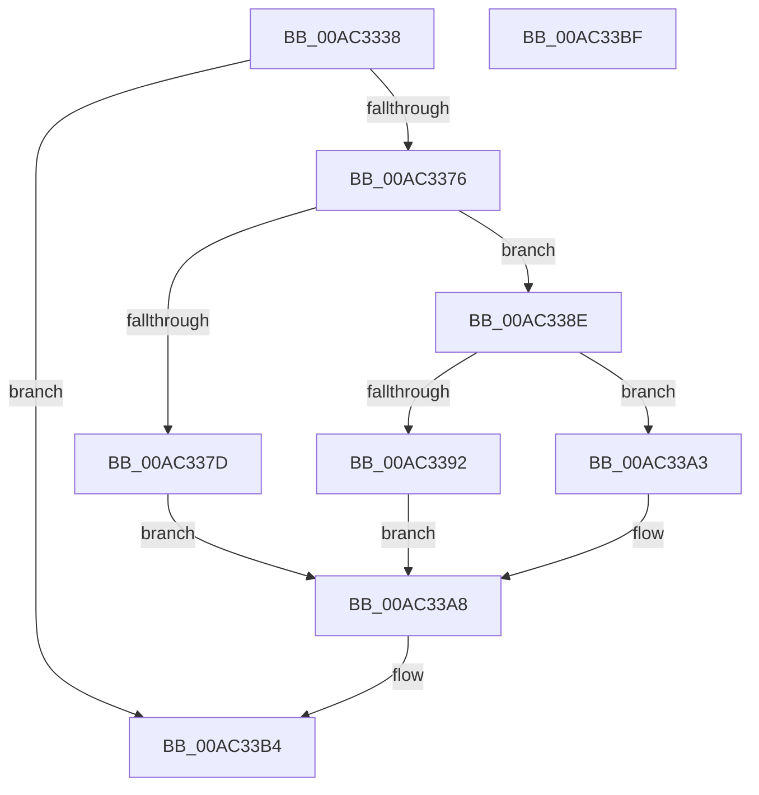

# EtwpUseDescriptorTypeUm

- RVA: `0x00AC3338`–`0x00AC33C0` (길이 `136` bytes)
- VA: `0x0000000140AC3338`
- 실행 섹션: `PAGE`
- PDB 이름 있음: `예`; PDB Function 태그: `아니요`
- unwind 정보 RVA: `0x000BDD0C`
- 디코드: `39`개 명령, `136/136` bytes 표시
- 미해석 바이트: `0` (있으면 어셈블리에 `.byte`로 보존)

> 이 문서는 커널 이미지의 기계어와 PDB 기호를 분석해 생성했습니다. 4번과 5번은 함수 원형과 자료형을 바이너리 사용 방식에서 추정한 C 해석이며 원본 소스 복구 결과는 아닙니다.

## 1. Dependencies

- 직접 호출 지점: **2**; 고유 호출 대상: **2**
- 직접 호출자로 확인된 함수: **1**
- RIP 상대 이미지 참조: **1**

### Outgoing calls
- `0x00AC336B` → [ObReferenceObjectByHandle](../86/ObReferenceObjectByHandle_function_00868DB0.md) (function, `0x00868DB0`)
- `0x00AC33AD` → [ObfDereferenceObject](../../text/2F/ObfDereferenceObject_function_002F9350.md) (function, `0x002F9350`)

### Direct callers
- [NtTraceControl](../A9/NtTraceControl_function_00A9ED40.md) at `0x00A9F420`

### Static image references
- `0x00AC334D` → RVA `0x00FC6D30` (`ALMOSTRO`; read)

## 2. Other-region calls and transfers

- 다른 실행 섹션으로 향하는 call: **1**
  - `0x00AC33AD` → [ObfDereferenceObject](../../text/2F/ObfDereferenceObject_function_002F9350.md) (`PAGE` → `.text`)
- 별도 외부 분기/꼬리 이동을 확인하지 못했습니다.

## 3. Assembly (complete function range)

```asm
00AC3338  4C 8B DC                        mov r11, rsp
00AC333B  49 89 5B 10                     mov qword ptr [r11 + 0x10], rbx
00AC333F  57                              push rdi
00AC3340  48 83 EC 30                     sub rsp, 0x30
00AC3344  49 83 63 F0 00                  and qword ptr [r11 - 0x10], 0
00AC3349  49 8D 43 08                     lea rax, [r11 + 8]
00AC334D  4C 8B 05 DC 39 50 00            mov r8, qword ptr [rip + 0x5039dc]
00AC3354  48 8B F9                        mov rdi, rcx
00AC3357  48 8B 09                        mov rcx, qword ptr [rcx]
00AC335A  41 B1 01                        mov r9b, 1
00AC335D  49 83 63 08 00                  and qword ptr [r11 + 8], 0
00AC3362  BA 00 08 00 00                  mov edx, 0x800
00AC3367  49 89 43 E8                     mov qword ptr [r11 - 0x18], rax
00AC336B  E8 40 5A DA FF                  call 0x140868db0
00AC3370  8B D8                           mov ebx, eax
00AC3372  85 C0                           test eax, eax
00AC3374  78 3E                           js 0x140ac33b4
00AC3376  8A 47 08                        mov al, byte ptr [rdi + 8]
00AC3379  3C 01                           cmp al, 1
00AC337B  75 11                           jne 0x140ac338e
00AC337D  48 8B 44 24 40                  mov rax, qword ptr [rsp + 0x40]
00AC3382  B9 00 01 00 00                  mov ecx, 0x100
00AC3387  66 F0 09 48 62                  lock or word ptr [rax + 0x62], cx
00AC338C  EB 1A                           jmp 0x140ac33a8
00AC338E  84 C0                           test al, al
00AC3390  75 11                           jne 0x140ac33a3
00AC3392  48 8B 44 24 40                  mov rax, qword ptr [rsp + 0x40]
00AC3397  B9 FF FE FF FF                  mov ecx, 0xfffffeff
00AC339C  66 F0 21 48 62                  lock and word ptr [rax + 0x62], cx
00AC33A1  EB 05                           jmp 0x140ac33a8
00AC33A3  BB 0D 00 00 C0                  mov ebx, 0xc000000d
00AC33A8  48 8B 4C 24 40                  mov rcx, qword ptr [rsp + 0x40]
00AC33AD  E8 9E 5F 83 FF                  call 0x1402f9350
00AC33B2  8B C3                           mov eax, ebx
00AC33B4  48 8B 5C 24 48                  mov rbx, qword ptr [rsp + 0x48]
00AC33B9  48 83 C4 30                     add rsp, 0x30
00AC33BD  5F                              pop rdi
00AC33BE  C3                              ret
00AC33BF  CC                              int3
```

## 4. C-style interpretation (structured pseudocode)

```c
__int64 __fastcall EtwpUseDescriptorTypeUm(__int64 a1)
{
    __int64 result;
    __int64 v_rsp;
    unsigned __int64 v_stack_p10;
    unsigned __int64 v_stack_p8;

    *(unsigned __int64 *)(v_rsp + 16) = v_rbx;
    v_rsp = (v_rsp) - (48);
    *(unsigned __int64 *)(v_rsp - 24) = v_rsp + 8;
    result = ObReferenceObjectByHandle(*(unsigned __int64 *)(a1), (unsigned int)(0x800ULL), *(unsigned __int64 *)(v_rip + 5257692), 1);
    if (sign_flag) goto loc_00AC33B4;
    if (((unsigned __int8)(*(unsigned __int8 *)(a1 + 8))) != 1) goto loc_00AC338E;
    goto loc_00AC33A8;
loc_00AC338E:
    if ((unsigned __int8)(v_stack_p8) != 0) goto loc_00AC33A3;
    goto loc_00AC33A8;
loc_00AC33A3:
loc_00AC33A8:
    result = ObfDereferenceObject(v_stack_p8, (unsigned int)(0x800ULL), *(unsigned __int64 *)(v_rip + 5257692), 1);
loc_00AC33B4:
    v_rsp = (v_rsp) + (48);
    return (unsigned int)((unsigned int)((unsigned int)(0xC000000DULL)));
}
```

## 5. (Beta) C Style

```c
int64_t EtwpUseDescriptorTypeUm(void *Arg1)
{
    uint8_t *arg1 = (uint8_t *)Arg1;

    int64_t result;
    int64_t local_rsp;
    uint64_t v_stack_p10;
    uint64_t v_stack_p8;

    *(uint64_t *)(local_rsp + 0x10) = local_rbx;
    local_rsp = (local_rsp) - (48);
    *(uint64_t *)(local_rsp - 0x18) = local_rsp + 8;
    result = ObReferenceObjectByHandle(*(uint64_t *)(arg1), (uint32_t)(0x800ULL), *(uint64_t *)(v_rip + 0x5039DC), 1);
    if (sign_flag) goto loc_00AC33B4;
    if (((uint8_t)(*(uint8_t *)(arg1 + 0x8))) != 1) goto loc_00AC338E;
    goto loc_00AC33A8;
loc_00AC338E:
    if ((uint8_t)(v_stack_p8) != 0) goto loc_00AC33A3;
    goto loc_00AC33A8;
loc_00AC33A3:
loc_00AC33A8:
    result = ObfDereferenceObject(v_stack_p8, (uint32_t)(0x800ULL), *(uint64_t *)(v_rip + 0x5039DC), 1);
loc_00AC33B4:
    local_rsp = (local_rsp) + (48);
    return (uint32_t)((uint32_t)((uint32_t)(0xC000000DULL)));
}
```

### 관측된 메모리 오프셋

구조체 형식이 확인되지 않은 접근은 인자 기준의 오프셋으로만 기록했습니다.

| 기준 인자 | 오프셋 표현 | 폭 (bit) | 접근 |
|---|---:|---:|---|
| `Arg1` | `+ 0x0` | `64` | `R` |
| `Arg1` | `+ 0x8` | `8` | `R` |

## 6. Execution-region graph

[열기: 2D/3D 그래프와 함수 탐색 컨트롤 패널](../../../control-panel.html?section=page&rva=0x00AC3338&view=graph)

- 2D 그래프는 위에서 아래로 흐르고, 3D 그래프는 빈 공간을 드래그해 회전합니다. Shift+드래그는 이동, 휠은 확대·축소, 함수 노드 선택은 대상 보고서 이동입니다.

### Static fallback


