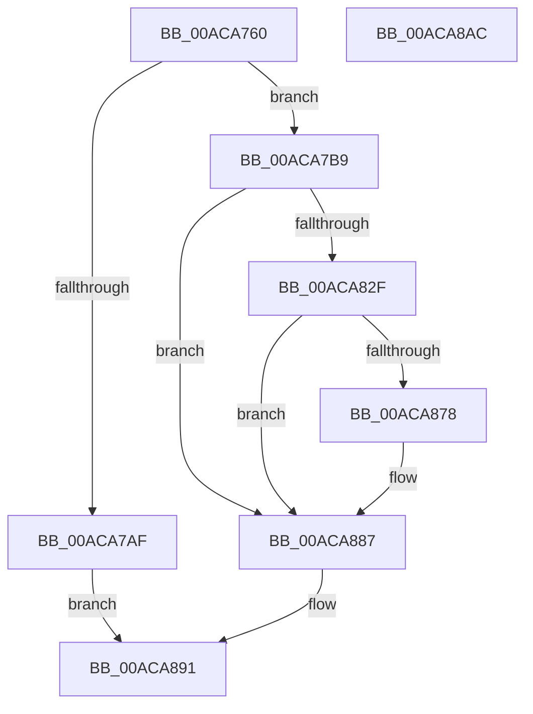

# ExpGetDriveGeometry

- RVA: `0x00ACA760`–`0x00ACA8AD` (길이 `333` bytes)
- VA: `0x0000000140ACA760`
- 실행 섹션: `PAGE`
- PDB 이름 있음: `예`; PDB Function 태그: `아니요`
- unwind 정보 RVA: `0x000BE384`
- 디코드: `83`개 명령, `333/333` bytes 표시
- 미해석 바이트: `0` (있으면 어셈블리에 `.byte`로 보존)

> 이 문서는 커널 이미지의 기계어와 PDB 기호를 분석해 생성했습니다. 4번과 5번은 함수 원형과 자료형을 바이너리 사용 방식에서 추정한 C 해석이며 원본 소스 복구 결과는 아닙니다.

## 1. Dependencies

- 직접 호출 지점: **7**; 고유 호출 대상: **7**
- 직접 호출자로 확인된 함수: **3**
- RIP 상대 이미지 참조: **1**

### Outgoing calls
- `0x00ACA7A2` → [ExAllocatePool2](../../poolcode/B8/ExAllocatePool2_function_00B820F0.md) (function, `0x00B820F0`)
- `0x00ACA7CB` → [swprintf_s](../../text/50/swprintf_s_function_00504B20.md) (function, `0x00504B20`)
- `0x00ACA7D7` → [RtlInitUnicodeString](../../text/42/RtlInitUnicodeString_function_0042A780.md) (function, `0x0042A780`)
- `0x00ACA824` → [ZwOpenFile](../../text/6A/ZwOpenFile_function_006AD730.md) (function, `0x006AD730`)
- `0x00ACA864` → [ZwDeviceIoControlFile](../../text/6A/ZwDeviceIoControlFile_function_006AD1B0.md) (function, `0x006AD1B0`)
- `0x00ACA86F` → [ZwClose](../../text/6A/ZwClose_function_006AD2B0.md) (function, `0x006AD2B0`)
- `0x00ACA88C` → [ExFreePoolWithTag](../../poolcode/B8/ExFreePoolWithTag_function_00B82870.md) (function, `0x00B82870`)

### Direct callers
- [ExpTranslateEfiPath](../A7/ExpTranslateEfiPath_function_00A7AF84.md) at `0x00A7B1F2`
- [sub_00B42460](../B4/Unknown_function_00B42460.md) at `0x00B42467`
- [sub_00B42738](../B4/Unknown_function_00B42738.md) at `0x00B42785`

### Static image references
- `0x00ACA7BC` → RVA `0x00B08810` (` ?? ::NNGAKEGL::`string'`; read)

## 2. Other-region calls and transfers

- 다른 실행 섹션으로 향하는 call: **7**
  - `0x00ACA7A2` → [ExAllocatePool2](../../poolcode/B8/ExAllocatePool2_function_00B820F0.md) (`PAGE` → `POOLCODE`)
  - `0x00ACA7CB` → [swprintf_s](../../text/50/swprintf_s_function_00504B20.md) (`PAGE` → `.text`)
  - `0x00ACA7D7` → [RtlInitUnicodeString](../../text/42/RtlInitUnicodeString_function_0042A780.md) (`PAGE` → `.text`)
  - `0x00ACA824` → [ZwOpenFile](../../text/6A/ZwOpenFile_function_006AD730.md) (`PAGE` → `.text`)
  - `0x00ACA864` → [ZwDeviceIoControlFile](../../text/6A/ZwDeviceIoControlFile_function_006AD1B0.md) (`PAGE` → `.text`)
  - `0x00ACA86F` → [ZwClose](../../text/6A/ZwClose_function_006AD2B0.md) (`PAGE` → `.text`)
  - `0x00ACA88C` → [ExFreePoolWithTag](../../poolcode/B8/ExFreePoolWithTag_function_00B82870.md) (`PAGE` → `POOLCODE`)
- 별도 외부 분기/꼬리 이동을 확인하지 못했습니다.

## 3. Assembly (complete function range)

```asm
00ACA760  48 8B C4                        mov rax, rsp
00ACA763  48 89 58 08                     mov qword ptr [rax + 8], rbx
00ACA767  48 89 70 10                     mov qword ptr [rax + 0x10], rsi
00ACA76B  48 89 78 20                     mov qword ptr [rax + 0x20], rdi
00ACA76F  55                              push rbp
00ACA770  48 8D 68 A1                     lea rbp, [rax - 0x5f]
00ACA774  48 81 EC A0 00 00 00            sub rsp, 0xa0
00ACA77B  33 C0                           xor eax, eax
00ACA77D  48 8B F2                        mov rsi, rdx
00ACA780  21 45 43                        and dword ptr [rbp + 0x43], eax
00ACA783  8B D9                           mov ebx, ecx
00ACA785  48 21 45 77                     and qword ptr [rbp + 0x77], rax
00ACA789  0F 57 C0                        xorps xmm0, xmm0
00ACA78C  89 45 2B                        mov dword ptr [rbp + 0x2b], eax
00ACA78F  41 B8 45 6E 76 72               mov r8d, 0x72766e45
00ACA795  21 45 2B                        and dword ptr [rbp + 0x2b], eax
00ACA798  8D 50 4C                        lea edx, [rax + 0x4c]
00ACA79B  8D 48 40                        lea ecx, [rax + 0x40]
00ACA79E  0F 11 45 07                     movups xmmword ptr [rbp + 7], xmm0
00ACA7A2  E8 49 79 0B 00                  call 0x140b820f0
00ACA7A7  48 8B F8                        mov rdi, rax
00ACA7AA  48 85 C0                        test rax, rax
00ACA7AD  75 0A                           jne 0x140aca7b9
00ACA7AF  BB 9A 00 00 C0                  mov ebx, 0xc000009a
00ACA7B4  E9 D8 00 00 00                  jmp 0x140aca891
00ACA7B9  44 8B CB                        mov r9d, ebx
00ACA7BC  4C 8D 05 4D E0 03 00            lea r8, [rip + 0x3e04d]
00ACA7C3  BA 26 00 00 00                  mov edx, 0x26
00ACA7C8  48 8B CF                        mov rcx, rdi
00ACA7CB  E8 50 A3 A3 FF                  call 0x140504b20
00ACA7D0  48 8B D7                        mov rdx, rdi
00ACA7D3  48 8D 4D 07                     lea rcx, [rbp + 7]
00ACA7D7  E8 A4 FF 95 FF                  call 0x14042a780
00ACA7DC  48 83 65 2F 00                  and qword ptr [rbp + 0x2f], 0
00ACA7E1  48 8D 45 07                     lea rax, [rbp + 7]
00ACA7E5  0F 57 C0                        xorps xmm0, xmm0
00ACA7E8  C7 44 24 28 60 00 00 00         mov dword ptr [rsp + 0x28], 0x60
00ACA7F0  4C 8D 4D 17                     lea r9, [rbp + 0x17]
00ACA7F4  48 89 45 37                     mov qword ptr [rbp + 0x37], rax
00ACA7F8  4C 8D 45 27                     lea r8, [rbp + 0x27]
00ACA7FC  C7 45 27 30 00 00 00            mov dword ptr [rbp + 0x27], 0x30
00ACA803  BA 80 00 10 00                  mov edx, 0x100080
00ACA808  C7 45 3F 40 02 00 00            mov dword ptr [rbp + 0x3f], 0x240
00ACA80F  48 8D 4D 77                     lea rcx, [rbp + 0x77]
00ACA813  C7 44 24 20 03 00 00 00         mov dword ptr [rsp + 0x20], 3
00ACA81B  F3 0F 7F 45 47                  movdqu xmmword ptr [rbp + 0x47], xmm0
00ACA820  0F 11 45 17                     movups xmmword ptr [rbp + 0x17], xmm0
00ACA824  E8 07 2F BE FF                  call 0x1406ad730
00ACA829  8B D8                           mov ebx, eax
00ACA82B  85 C0                           test eax, eax
00ACA82D  78 58                           js 0x140aca887
00ACA82F  48 8B 4D 77                     mov rcx, qword ptr [rbp + 0x77]
00ACA833  48 8D 45 17                     lea rax, [rbp + 0x17]
00ACA837  C7 44 24 48 18 00 00 00         mov dword ptr [rsp + 0x48], 0x18
00ACA83F  45 33 C9                        xor r9d, r9d
00ACA842  48 89 74 24 40                  mov qword ptr [rsp + 0x40], rsi
00ACA847  45 33 C0                        xor r8d, r8d
00ACA84A  83 64 24 38 00                  and dword ptr [rsp + 0x38], 0
00ACA84F  33 D2                           xor edx, edx
00ACA851  48 83 64 24 30 00               and qword ptr [rsp + 0x30], 0
00ACA857  C7 44 24 28 00 00 07 00         mov dword ptr [rsp + 0x28], 0x70000
00ACA85F  48 89 44 24 20                  mov qword ptr [rsp + 0x20], rax
00ACA864  E8 47 29 BE FF                  call 0x1406ad1b0
00ACA869  48 8B 4D 77                     mov rcx, qword ptr [rbp + 0x77]
00ACA86D  8B D8                           mov ebx, eax
00ACA86F  E8 3C 2A BE FF                  call 0x1406ad2b0
00ACA874  85 DB                           test ebx, ebx
00ACA876  78 0F                           js 0x140aca887
00ACA878  81 7E 14 00 02 00 00            cmp dword ptr [rsi + 0x14], 0x200
00ACA87F  B8 01 00 00 C0                  mov eax, 0xc0000001
00ACA884  0F 42 D8                        cmovb ebx, eax
00ACA887  33 D2                           xor edx, edx
00ACA889  48 8B CF                        mov rcx, rdi
00ACA88C  E8 DF 7F 0B 00                  call 0x140b82870
00ACA891  4C 8D 9C 24 A0 00 00 00         lea r11, [rsp + 0xa0]
00ACA899  8B C3                           mov eax, ebx
00ACA89B  49 8B 5B 10                     mov rbx, qword ptr [r11 + 0x10]
00ACA89F  49 8B 73 18                     mov rsi, qword ptr [r11 + 0x18]
00ACA8A3  49 8B 7B 28                     mov rdi, qword ptr [r11 + 0x28]
00ACA8A7  49 8B E3                        mov rsp, r11
00ACA8AA  5D                              pop rbp
00ACA8AB  C3                              ret
00ACA8AC  CC                              int3
```

## 4. C-style interpretation (structured pseudocode)

```c
__int64 __fastcall ExpGetDriveGeometry(int a1, __int64 a2)
{
    __int64 result;
    __int64 v_rbx;
    __int64 v_rsp;
    unsigned int v_stack_m60;
    unsigned __int64 v_stack_m68;
    unsigned int v_stack_m70;
    unsigned __int64 v_stack_m78;
    unsigned __int64 v_stack_m8;
    unsigned int v_stack_m80;
    unsigned int v_stack_m88;

    *(unsigned __int64 *)(v_rsp + 8) = v_rbx;
    *(unsigned __int64 *)(v_rsp + 16) = v_rsi;
    *(unsigned __int64 *)(v_rsp + 32) = v_rdi;
    v_rsp = (v_rsp) - (160);
    result = 0;
    *(unsigned int *)(v_rsp - 95 + 43) = 0;
    *(unsigned __int64 *)(v_rsp - 95 + 7) = v_xmm0;
    result = ExAllocatePool2(result + 64, result + 76, (unsigned int)(0x72766E45ULL), a4);
    if (result != 0) goto loc_00ACA7B9;
    goto loc_00ACA891;
loc_00ACA7B9:
    result = swprintf_s(result, 38, v_rip + 254029, (unsigned int)((unsigned int)((unsigned int)(0xC000009AULL))));
    result = RtlInitUnicodeString(v_rsp - 95 + 7, result, v_rip + 254029, (unsigned int)((unsigned int)((unsigned int)(0xC000009AULL))));
    v_stack_m80 = 96;
    *(unsigned __int64 *)(v_rsp - 95 + 55) = v_rsp - 95 + 7;
    *(unsigned int *)(v_rsp - 95 + 39) = 48;
    *(unsigned int *)(v_rsp - 95 + 63) = 576;
    v_stack_m88 = 3;
    *(unsigned __int64 *)(v_rsp - 95 + 71) = v_xmm0;
    *(unsigned __int64 *)(v_rsp - 95 + 23) = v_xmm0;
    result = ZwOpenFile(v_rsp - 95 + 119, (unsigned int)(0x100080ULL), v_rsp - 95 + 39, v_rsp - 95 + 23);
    if (sign_flag) goto loc_00ACA887;
    v_stack_m60 = 24;
    a4 = 0;
    v_stack_m68 = a2;
    a3 = 0;
    a2 = 0;
    v_stack_m80 = 0x70000ULL;
    v_stack_m88 = v_rsp - 95 + 23;
    result = ZwDeviceIoControlFile(*(unsigned __int64 *)(v_rsp - 95 + 119), a2, a3, a4);
    result = ZwClose(*(unsigned __int64 *)(v_rsp - 95 + 119), a2, a3, a4);
    v_rbx = (unsigned int)((unsigned int)(result));
    if (!(sign_flag)) {
        result = 0xC0000001ULL;
        v_rbx = (unsigned int)((unsigned int)(result));
        if ((*(unsigned int *)(a2 + 20)) < 512) { v_rbx = (unsigned int)(result); }
    }
    a2 = 0;
    result = ExFreePoolWithTag(result, a2, a3, a4);
loc_00ACA891:
    return (unsigned int)((unsigned int)(v_rbx));
}
```

## 5. (Beta) C Style

```c
int64_t ExpGetDriveGeometry(int32_t Arg1, void *Arg2)
{
    uint8_t *arg2 = (uint8_t *)Arg2;

    int64_t result;
    int64_t local_rbx;
    int64_t local_rsp;
    uint32_t v_stack_m60;
    uint64_t v_stack_m68;
    uint32_t v_stack_m70;
    uint64_t v_stack_m78;
    uint64_t v_stack_m8;
    uint32_t v_stack_m80;
    uint32_t v_stack_m88;

    *(uint64_t *)(local_rsp + 0x8) = local_rbx;
    *(uint64_t *)(local_rsp + 0x10) = local_rsi;
    *(uint64_t *)(local_rsp + 0x20) = local_rdi;
    local_rsp = (local_rsp) - (160);
    result = 0;
    *(uint32_t *)(local_rsp - 0x5F + 0x2B) = 0;
    *(uint64_t *)(local_rsp - 0x5F + 0x7) = v_xmm0;
    result = ExAllocatePool2(result + 64, result + 76, (uint32_t)(0x72766E45ULL), a4);
    if (result != 0) goto loc_00ACA7B9;
    goto loc_00ACA891;
loc_00ACA7B9:
    result = swprintf_s(result, 38, v_rip + 254029, (uint32_t)((uint32_t)((uint32_t)(0xC000009AULL))));
    result = RtlInitUnicodeString(local_rsp - 95 + 7, result, v_rip + 254029, (uint32_t)((uint32_t)((uint32_t)(0xC000009AULL))));
    v_stack_m80 = 96;
    *(uint64_t *)(local_rsp - 0x5F + 0x37) = local_rsp - 95 + 7;
    *(uint32_t *)(local_rsp - 0x5F + 0x27) = 48;
    *(uint32_t *)(local_rsp - 0x5F + 0x3F) = 576;
    v_stack_m88 = 3;
    *(uint64_t *)(local_rsp - 0x5F + 0x47) = v_xmm0;
    *(uint64_t *)(local_rsp - 0x5F + 0x17) = v_xmm0;
    result = ZwOpenFile(local_rsp - 95 + 119, (uint32_t)(0x100080ULL), local_rsp - 95 + 39, local_rsp - 95 + 23);
    if (sign_flag) goto loc_00ACA887;
    v_stack_m60 = 24;
    a4 = 0;
    v_stack_m68 = Arg2;
    a3 = 0;
    Arg2 = 0;
    v_stack_m80 = 0x70000ULL;
    v_stack_m88 = local_rsp - 95 + 23;
    result = ZwDeviceIoControlFile(*(uint64_t *)(local_rsp - 0x5F + 0x77), Arg2, a3, a4);
    result = ZwClose(*(uint64_t *)(local_rsp - 0x5F + 0x77), Arg2, a3, a4);
    local_rbx = (uint32_t)((uint32_t)(result));
    if (!(sign_flag)) {
        result = 0xC0000001ULL;
        local_rbx = (uint32_t)((uint32_t)(result));
        if ((*(uint32_t *)(arg2 + 0x14)) < 512) { local_rbx = (uint32_t)(result); }
    }
    Arg2 = 0;
    result = ExFreePoolWithTag(result, Arg2, a3, a4);
loc_00ACA891:
    return (uint32_t)((uint32_t)(local_rbx));
}
```

### 관측된 메모리 오프셋

구조체 형식이 확인되지 않은 접근은 인자 기준의 오프셋으로만 기록했습니다.

| 기준 인자 | 오프셋 표현 | 폭 (bit) | 접근 |
|---|---:|---:|---|
| `Arg2` | `+ 0x14` | `32` | `R` |

## 6. Execution-region graph

[열기: 2D/3D 그래프와 함수 탐색 컨트롤 패널](../../../control-panel.html?section=page&rva=0x00ACA760&view=graph)

- 2D 그래프는 위에서 아래로 흐르고, 3D 그래프는 빈 공간을 드래그해 회전합니다. Shift+드래그는 이동, 휠은 확대·축소, 함수 노드 선택은 대상 보고서 이동입니다.

### Static fallback


