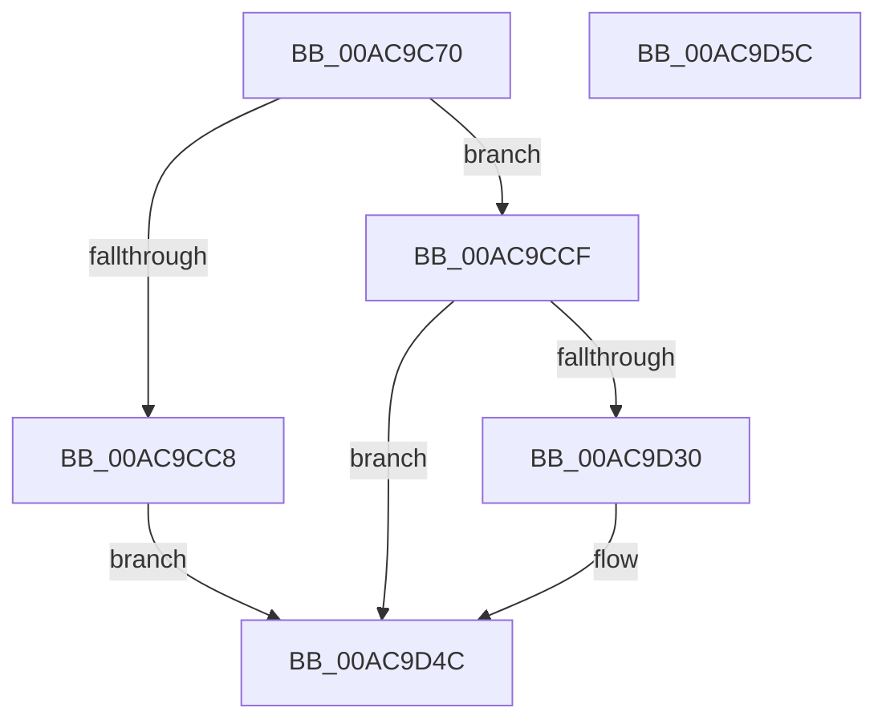

# FsRtlGetDirectImageOriginalBase

- RVA: `0x00AC9C70`–`0x00AC9D5D` (길이 `237` bytes)
- VA: `0x0000000140AC9C70`
- 실행 섹션: `PAGE`
- PDB 이름 있음: `예`; PDB Function 태그: `아니요`
- unwind 정보 RVA: `0x0007AFEC`
- 디코드: `60`개 명령, `237/237` bytes 표시
- 미해석 바이트: `0` (있으면 어셈블리에 `.byte`로 보존)

> 이 문서는 커널 이미지의 기계어와 PDB 기호를 분석해 생성했습니다. 4번과 5번은 함수 원형과 자료형을 바이너리 사용 방식에서 추정한 C 해석이며 원본 소스 복구 결과는 아닙니다.

## 1. Dependencies

- 직접 호출 지점: **5**; 고유 호출 대상: **5**
- 직접 호출자로 확인된 함수: **1**
- RIP 상대 이미지 참조: **0**

### Outgoing calls
- `0x00AC9CA2` → [KeInitializeEvent](../../text/40/KeInitializeEvent_function_0040DD10.md) (function, `0x0040DD10`)
- `0x00AC9CAA` → [IoGetRelatedDeviceObject](../../text/29/IoGetRelatedDeviceObject_function_0029B120.md) (function, `0x0029B120`)
- `0x00AC9CBB` → [IoAllocateIrpEx](../../text/20/IoAllocateIrpEx_function_00207510.md) (function, `0x00207510`)
- `0x00AC9D24` → [IofCallDriver](../../text/29/IofCallDriver_function_0029B4B0.md) (function, `0x0029B4B0`)
- `0x00AC9D43` → [KeWaitForSingleObject](../../text/20/KeWaitForSingleObject_function_0020E6B0.md) (function, `0x0020E6B0`)

### Direct callers
- [MiCreateNewSection](../98/MiCreateNewSection_function_00985DB0.md) at `0x009863ED`

### Static image references
- 디코드된 RIP-relative 메모리 참조가 없습니다.

## 2. Other-region calls and transfers

- 다른 실행 섹션으로 향하는 call: **5**
  - `0x00AC9CA2` → [KeInitializeEvent](../../text/40/KeInitializeEvent_function_0040DD10.md) (`PAGE` → `.text`)
  - `0x00AC9CAA` → [IoGetRelatedDeviceObject](../../text/29/IoGetRelatedDeviceObject_function_0029B120.md) (`PAGE` → `.text`)
  - `0x00AC9CBB` → [IoAllocateIrpEx](../../text/20/IoAllocateIrpEx_function_00207510.md) (`PAGE` → `.text`)
  - `0x00AC9D24` → [IofCallDriver](../../text/29/IofCallDriver_function_0029B4B0.md) (`PAGE` → `.text`)
  - `0x00AC9D43` → [KeWaitForSingleObject](../../text/20/KeWaitForSingleObject_function_0020E6B0.md) (`PAGE` → `.text`)
- 별도 외부 분기/꼬리 이동을 확인하지 못했습니다.

## 3. Assembly (complete function range)

```asm
00AC9C70  4C 8B DC                        mov r11, rsp
00AC9C73  49 89 5B 08                     mov qword ptr [r11 + 8], rbx
00AC9C77  49 89 73 10                     mov qword ptr [r11 + 0x10], rsi
00AC9C7B  57                              push rdi
00AC9C7C  48 83 EC 60                     sub rsp, 0x60
00AC9C80  0F 57 C0                        xorps xmm0, xmm0
00AC9C83  48 8B F2                        mov rsi, rdx
00AC9C86  48 8B F9                        mov rdi, rcx
00AC9C89  33 C0                           xor eax, eax
00AC9C8B  0F 11 44 24 40                  movups xmmword ptr [rsp + 0x40], xmm0
00AC9C90  45 33 C0                        xor r8d, r8d
00AC9C93  49 89 43 E8                     mov qword ptr [r11 - 0x18], rax
00AC9C97  33 D2                           xor edx, edx
00AC9C99  49 8D 4B D8                     lea rcx, [r11 - 0x28]
00AC9C9D  0F 11 44 24 30                  movups xmmword ptr [rsp + 0x30], xmm0
00AC9CA2  E8 69 40 94 FF                  call 0x14040dd10
00AC9CA7  48 8B CF                        mov rcx, rdi
00AC9CAA  E8 71 14 7D FF                  call 0x14029b120
00AC9CAF  45 33 C0                        xor r8d, r8d
00AC9CB2  48 8B C8                        mov rcx, rax
00AC9CB5  48 8B D8                        mov rbx, rax
00AC9CB8  8A 50 4C                        mov dl, byte ptr [rax + 0x4c]
00AC9CBB  E8 50 D8 73 FF                  call 0x140207510
00AC9CC0  48 8B D0                        mov rdx, rax
00AC9CC3  48 85 C0                        test rax, rax
00AC9CC6  75 07                           jne 0x140ac9ccf
00AC9CC8  B8 9A 00 00 C0                  mov eax, 0xc000009a
00AC9CCD  EB 7D                           jmp 0x140ac9d4c
00AC9CCF  C6 40 40 00                     mov byte ptr [rax + 0x40], 0
00AC9CD3  48 8B CB                        mov rcx, rbx
00AC9CD6  48 89 72 18                     mov qword ptr [rdx + 0x18], rsi
00AC9CDA  48 8D 44 24 30                  lea rax, [rsp + 0x30]
00AC9CDF  48 89 42 48                     mov qword ptr [rdx + 0x48], rax
00AC9CE3  48 8D 44 24 40                  lea rax, [rsp + 0x40]
00AC9CE8  48 89 42 50                     mov qword ptr [rdx + 0x50], rax
00AC9CEC  65 48 8B 04 25 88 01 00 00      mov rax, qword ptr gs:[0x188]
00AC9CF5  48 89 82 98 00 00 00            mov qword ptr [rdx + 0x98], rax
00AC9CFC  48 8B 82 B8 00 00 00            mov rax, qword ptr [rdx + 0xb8]
00AC9D03  83 60 C8 00                     and dword ptr [rax - 0x38], 0
00AC9D07  48 83 60 D8 00                  and qword ptr [rax - 0x28], 0
00AC9D0C  66 C7 40 B8 0D 00               mov word ptr [rax - 0x48], 0xd
00AC9D12  48 89 78 E8                     mov qword ptr [rax - 0x18], rdi
00AC9D16  C7 40 D0 A4 03 09 00            mov dword ptr [rax - 0x30], 0x903a4
00AC9D1D  C7 40 C0 08 00 00 00            mov dword ptr [rax - 0x40], 8
00AC9D24  E8 87 17 7D FF                  call 0x14029b4b0
00AC9D29  3D 03 01 00 00                  cmp eax, 0x103
00AC9D2E  75 1C                           jne 0x140ac9d4c
00AC9D30  48 83 64 24 20 00               and qword ptr [rsp + 0x20], 0
00AC9D36  48 8D 4C 24 40                  lea rcx, [rsp + 0x40]
00AC9D3B  45 33 C9                        xor r9d, r9d
00AC9D3E  45 33 C0                        xor r8d, r8d
00AC9D41  33 D2                           xor edx, edx
00AC9D43  E8 68 49 74 FF                  call 0x14020e6b0
00AC9D48  8B 44 24 30                     mov eax, dword ptr [rsp + 0x30]
00AC9D4C  48 8B 5C 24 70                  mov rbx, qword ptr [rsp + 0x70]
00AC9D51  48 8B 74 24 78                  mov rsi, qword ptr [rsp + 0x78]
00AC9D56  48 83 C4 60                     add rsp, 0x60
00AC9D5A  5F                              pop rdi
00AC9D5B  C3                              ret
00AC9D5C  CC                              int3
```

## 4. C-style interpretation (structured pseudocode)

```c
__int64 __fastcall FsRtlGetDirectImageOriginalBase(__int64 a1, __int64 a2, int a3, int a4)
{
    __int64 result;
    __int64 v_rsp;
    unsigned __int64 v_stack_m28;
    unsigned __int64 v_stack_m38;
    unsigned __int64 v_stack_m48;
    unsigned __int64 v_stack_p10;
    unsigned __int64 v_stack_p8;

    *(unsigned __int64 *)(v_rsp + 8) = v_rbx;
    *(unsigned __int64 *)(v_rsp + 16) = v_rsi;
    v_rsp = (v_rsp) - (96);
    result = 0;
    v_stack_m28 = v_xmm0;
    a3 = 0;
    *(unsigned __int64 *)(v_rsp - 24) = 0;
    a2 = 0;
    v_stack_m38 = v_xmm0;
    result = KeInitializeEvent(v_rsp - 40, a2, a3, a4);
    result = IoGetRelatedDeviceObject(a1, a2, a3, a4);
    a3 = 0;
    result = IoAllocateIrpEx(result, *(unsigned __int8 *)(result + 76), a3, a4);
    if (result != 0) goto loc_00AC9CCF;
    goto loc_00AC9D4C;
loc_00AC9CCF:
    *(unsigned __int8 *)((unsigned int)(0xC000009AULL) + 64) = 0;
    *(unsigned __int64 *)(result + 24) = 0;
    *(unsigned __int64 *)(result + 72) = v_stack_m38;
    *(unsigned __int64 *)(result + 80) = v_stack_m28;
    *(unsigned __int64 *)(result + 152) = *(unsigned __int64 *)(gs_base + (0 + 392));
    *(unsigned __int16 *)(*(unsigned __int64 *)(result + 184) - 72) = 13;
    *(unsigned __int64 *)(*(unsigned __int64 *)(result + 184) - 24) = a1;
    *(unsigned int *)(*(unsigned __int64 *)(result + 184) - 48) = 0x903A4ULL;
    *(unsigned int *)(*(unsigned __int64 *)(result + 184) - 64) = 8;
    result = IofCallDriver(result, result, a3, a4);
    if (((unsigned int)(result)) == 259) {
        a1 = v_stack_m28;
        a4 = 0;
        a3 = 0;
        a2 = 0;
        result = KeWaitForSingleObject(a1, a2, a3, a4);
        result = v_stack_m38;
    }
    v_rsp = (v_rsp) + (96);
    return result;
}
```

## 5. (Beta) C Style

```c
int64_t FsRtlGetDirectImageOriginalBase(int64_t Arg1, int64_t Arg2, int32_t Arg3, int32_t Arg4)
{
    int64_t result;
    int64_t local_rsp;
    uint64_t v_stack_m28;
    uint64_t v_stack_m38;
    uint64_t v_stack_m48;
    uint64_t v_stack_p10;
    uint64_t v_stack_p8;

    *(uint64_t *)(local_rsp + 0x8) = local_rbx;
    *(uint64_t *)(local_rsp + 0x10) = local_rsi;
    local_rsp = (local_rsp) - (96);
    result = 0;
    v_stack_m28 = v_xmm0;
    Arg3 = 0;
    *(uint64_t *)(local_rsp - 0x18) = 0;
    Arg2 = 0;
    v_stack_m38 = v_xmm0;
    result = KeInitializeEvent(local_rsp - 40, Arg2, Arg3, Arg4);
    result = IoGetRelatedDeviceObject(Arg1, Arg2, Arg3, Arg4);
    Arg3 = 0;
    result = IoAllocateIrpEx(result, *(uint8_t *)(result + 0x4C), Arg3, Arg4);
    if (result != 0) goto loc_00AC9CCF;
    goto loc_00AC9D4C;
loc_00AC9CCF:
    *(uint8_t *)((uint32_t)(0xC000009AULL) + 0x40) = 0;
    *(uint64_t *)(result + 0x18) = 0;
    *(uint64_t *)(result + 0x48) = v_stack_m38;
    *(uint64_t *)(result + 0x50) = v_stack_m28;
    *(uint64_t *)(result + 0x98) = *(uint64_t *)(gs_base + (0 + 0x188));
    *(uint16_t *)(*(uint64_t *)(result + 0xB8) - 0x48) = 13;
    *(uint64_t *)(*(uint64_t *)(result + 0xB8) - 0x18) = Arg1;
    *(uint32_t *)(*(uint64_t *)(result + 0xB8) - 0x30) = 0x903A4ULL;
    *(uint32_t *)(*(uint64_t *)(result + 0xB8) - 0x40) = 8;
    result = IofCallDriver(result, result, Arg3, Arg4);
    if (((uint32_t)(result)) == 259) {
        Arg1 = v_stack_m28;
        Arg4 = 0;
        Arg3 = 0;
        Arg2 = 0;
        result = KeWaitForSingleObject(Arg1, Arg2, Arg3, Arg4);
        result = v_stack_m38;
    }
    local_rsp = (local_rsp) + (96);
    return result;
}
```

## 6. Execution-region graph

[열기: 2D/3D 그래프와 함수 탐색 컨트롤 패널](../../../control-panel.html?section=page&rva=0x00AC9C70&view=graph)

- 2D 그래프는 위에서 아래로 흐르고, 3D 그래프는 빈 공간을 드래그해 회전합니다. Shift+드래그는 이동, 휠은 확대·축소, 함수 노드 선택은 대상 보고서 이동입니다.

### Static fallback


