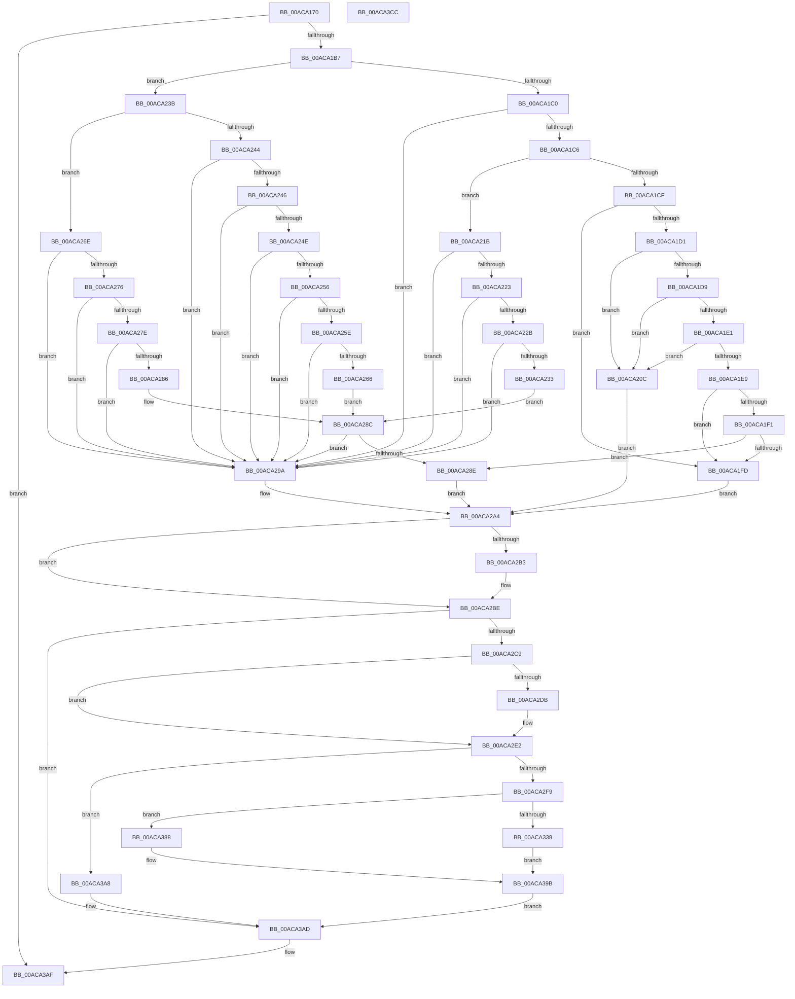

# FsRtlLogCcFlushError

- RVA: `0x00ACA170`–`0x00ACA3CD` (길이 `605` bytes)
- VA: `0x0000000140ACA170`
- 실행 섹션: `PAGE`
- PDB 이름 있음: `예`; PDB Function 태그: `아니요`
- unwind 정보 RVA: `0x00075C18`
- 디코드: `160`개 명령, `605/605` bytes 표시
- 미해석 바이트: `0` (있으면 어셈블리에 `.byte`로 보존)

> 이 문서는 커널 이미지의 기계어와 PDB 기호를 분석해 생성했습니다. 4번과 5번은 함수 원형과 자료형을 바이너리 사용 방식에서 추정한 C 해석이며 원본 소스 복구 결과는 아닙니다.

## 1. Dependencies

- 직접 호출 지점: **7**; 고유 호출 대상: **5**
- 직접 호출자로 확인된 함수: **1**
- RIP 상대 이미지 참조: **0**

### Outgoing calls
- `0x00ACA1AA` → [MmIsWriteErrorFatal](../../text/40/MmIsWriteErrorFatal_function_00408688.md) (function, `0x00408688`)
- `0x00ACA2B9` → [IoRaiseInformationalHardError](../../text/4B/IoRaiseInformationalHardError_function_004B82B0.md) (function, `0x004B82B0`)
- `0x00ACA2E8` → [IoAllocateErrorLogEntry](../../text/4A/IoAllocateErrorLogEntry_function_004ABF20.md) (function, `0x004ABF20`)
- `0x00ACA34A` → [memcpy](../../text/6C/memcpy_function_006C6840.md) (function, `0x006C6840`)
- `0x00ACA37E` → [memcpy](../../text/6C/memcpy_function_006C6840.md) (function, `0x006C6840`)
- `0x00ACA38B` → [memcpy](../../text/6C/memcpy_function_006C6840.md) (function, `0x006C6840`)
- `0x00ACA3A1` → [IoWriteErrorLogEntry](../../text/4B/IoWriteErrorLogEntry_function_004B5B30.md) (function, `0x004B5B30`)

### Direct callers
- [CcMmLogLostDelayedWriteError](../../text/4C/CcMmLogLostDelayedWriteError_function_004C6C60.md) at `0x004C6CCE`

### Static image references
- 디코드된 RIP-relative 메모리 참조가 없습니다.

## 2. Other-region calls and transfers

- 다른 실행 섹션으로 향하는 call: **7**
  - `0x00ACA1AA` → [MmIsWriteErrorFatal](../../text/40/MmIsWriteErrorFatal_function_00408688.md) (`PAGE` → `.text`)
  - `0x00ACA2B9` → [IoRaiseInformationalHardError](../../text/4B/IoRaiseInformationalHardError_function_004B82B0.md) (`PAGE` → `.text`)
  - `0x00ACA2E8` → [IoAllocateErrorLogEntry](../../text/4A/IoAllocateErrorLogEntry_function_004ABF20.md) (`PAGE` → `.text`)
  - `0x00ACA34A` → [memcpy](../../text/6C/memcpy_function_006C6840.md) (`PAGE` → `.text`)
  - `0x00ACA37E` → [memcpy](../../text/6C/memcpy_function_006C6840.md) (`PAGE` → `.text`)
  - `0x00ACA38B` → [memcpy](../../text/6C/memcpy_function_006C6840.md) (`PAGE` → `.text`)
  - `0x00ACA3A1` → [IoWriteErrorLogEntry](../../text/4B/IoWriteErrorLogEntry_function_004B5B30.md) (`PAGE` → `.text`)
- 별도 외부 분기/꼬리 이동을 확인하지 못했습니다.

## 3. Assembly (complete function range)

```asm
00ACA170  48 89 5C 24 08                  mov qword ptr [rsp + 8], rbx
00ACA175  48 89 6C 24 10                  mov qword ptr [rsp + 0x10], rbp
00ACA17A  48 89 74 24 18                  mov qword ptr [rsp + 0x18], rsi
00ACA17F  57                              push rdi
00ACA180  41 54                           push r12
00ACA182  41 55                           push r13
00ACA184  41 56                           push r14
00ACA186  41 57                           push r15
00ACA188  48 83 EC 20                     sub rsp, 0x20
00ACA18C  4C 8B F2                        mov r14, rdx
00ACA18F  4C 8B F9                        mov r15, rcx
00ACA192  8B 52 34                        mov edx, dword ptr [rdx + 0x34]
00ACA195  33 ED                           xor ebp, ebp
00ACA197  C1 EA 04                        shr edx, 4
00ACA19A  45 8B C1                        mov r8d, r9d
00ACA19D  41 8B D9                        mov ebx, r9d
00ACA1A0  44 8D 6D 01                     lea r13d, [rbp + 1]
00ACA1A4  41 23 D5                        and edx, r13d
00ACA1A7  41 8B CD                        mov ecx, r13d
00ACA1AA  E8 D9 E4 93 FF                  call 0x140408688
00ACA1AF  85 C0                           test eax, eax
00ACA1B1  0F 84 F8 01 00 00               je 0x140aca3af
00ACA1B7  B8 CC 00 00 C0                  mov eax, 0xc00000cc
00ACA1BC  3B D8                           cmp ebx, eax
00ACA1BE  7F 7B                           jg 0x140aca23b
00ACA1C0  0F 84 D4 00 00 00               je 0x140aca29a
00ACA1C6  B8 A2 00 00 C0                  mov eax, 0xc00000a2
00ACA1CB  3B D8                           cmp ebx, eax
00ACA1CD  7F 4C                           jg 0x140aca21b
00ACA1CF  74 2C                           je 0x140aca1fd
00ACA1D1  81 FB 08 00 00 C0               cmp ebx, 0xc0000008
00ACA1D7  74 33                           je 0x140aca20c
00ACA1D9  81 FB 22 00 00 C0               cmp ebx, 0xc0000022
00ACA1DF  74 2B                           je 0x140aca20c
00ACA1E1  81 FB 7F 00 00 C0               cmp ebx, 0xc000007f
00ACA1E7  74 23                           je 0x140aca20c
00ACA1E9  81 FB 98 00 00 C0               cmp ebx, 0xc0000098
00ACA1EF  74 0C                           je 0x140aca1fd
00ACA1F1  81 FB 9D 00 00 C0               cmp ebx, 0xc000009d
00ACA1F7  0F 85 91 00 00 00               jne 0x140aca28e
00ACA1FD  B9 82 A0 00 C0                  mov ecx, 0xc000a082
00ACA202  BE 8D 00 04 80                  mov esi, 0x8004008d
00ACA207  E9 98 00 00 00                  jmp 0x140aca2a4
00ACA20C  B9 81 A0 00 C0                  mov ecx, 0xc000a081
00ACA211  BE 8C 00 04 80                  mov esi, 0x8004008c
00ACA216  E9 89 00 00 00                  jmp 0x140aca2a4
00ACA21B  81 FB BC 00 00 C0               cmp ebx, 0xc00000bc
00ACA221  74 77                           je 0x140aca29a
00ACA223  81 FB BE 00 00 C0               cmp ebx, 0xc00000be
00ACA229  74 6F                           je 0x140aca29a
00ACA22B  81 FB C4 00 00 C0               cmp ebx, 0xc00000c4
00ACA231  74 67                           je 0x140aca29a
00ACA233  81 FB C9 00 00 C0               cmp ebx, 0xc00000c9
00ACA239  EB 51                           jmp 0x140aca28c
00ACA23B  B8 41 02 00 C0                  mov eax, 0xc0000241
00ACA240  3B D8                           cmp ebx, eax
00ACA242  7F 2A                           jg 0x140aca26e
00ACA244  74 54                           je 0x140aca29a
00ACA246  81 FB 03 02 00 C0               cmp ebx, 0xc0000203
00ACA24C  74 4C                           je 0x140aca29a
00ACA24E  81 FB 0C 02 00 C0               cmp ebx, 0xc000020c
00ACA254  74 44                           je 0x140aca29a
00ACA256  81 FB 0D 02 00 C0               cmp ebx, 0xc000020d
00ACA25C  74 3C                           je 0x140aca29a
00ACA25E  81 FB 36 02 00 C0               cmp ebx, 0xc0000236
00ACA264  74 34                           je 0x140aca29a
00ACA266  81 FB 3C 02 00 C0               cmp ebx, 0xc000023c
00ACA26C  EB 1E                           jmp 0x140aca28c
00ACA26E  81 FB 5C 03 00 C0               cmp ebx, 0xc000035c
00ACA274  74 24                           je 0x140aca29a
00ACA276  81 FB 66 04 00 C0               cmp ebx, 0xc0000466
00ACA27C  74 1C                           je 0x140aca29a
00ACA27E  81 FB 67 04 00 C0               cmp ebx, 0xc0000467
00ACA284  74 14                           je 0x140aca29a
00ACA286  81 FB 80 04 00 C0               cmp ebx, 0xc0000480
00ACA28C  74 0C                           je 0x140aca29a
00ACA28E  B9 22 02 00 C0                  mov ecx, 0xc0000222
00ACA293  BE 32 00 04 80                  mov esi, 0x80040032
00ACA298  EB 0A                           jmp 0x140aca2a4
00ACA29A  B9 80 A0 00 C0                  mov ecx, 0xc000a080
00ACA29F  BE 8B 00 04 80                  mov esi, 0x8004008b
00ACA2A4  65 FF 04 25 7C 89 00 00         inc dword ptr gs:[0x897c]
00ACA2AC  44 84 6C 24 70                  test byte ptr [rsp + 0x70], r13b
00ACA2B1  75 0B                           jne 0x140aca2be
00ACA2B3  45 33 C0                        xor r8d, r8d
00ACA2B6  49 8B D7                        mov rdx, r15
00ACA2B9  E8 F2 DF 9E FF                  call 0x1404b82b0
00ACA2BE  F6 44 24 70 02                  test byte ptr [rsp + 0x70], 2
00ACA2C3  0F 85 E4 00 00 00               jne 0x140aca3ad
00ACA2C9  41 0F B7 07                     movzx eax, word ptr [r15]
00ACA2CD  BF F0 00 00 00                  mov edi, 0xf0
00ACA2D2  48 83 C0 32                     add rax, 0x32
00ACA2D6  48 3B C7                        cmp rax, rdi
00ACA2D9  77 07                           ja 0x140aca2e2
00ACA2DB  41 8A 3F                        mov dil, byte ptr [r15]
00ACA2DE  40 80 C7 32                     add dil, 0x32
00ACA2E2  40 8A D7                        mov dl, dil
00ACA2E5  49 8B CE                        mov rcx, r14
00ACA2E8  E8 33 1C 9E FF                  call 0x1404abf20
00ACA2ED  4C 8B F0                        mov r14, rax
00ACA2F0  48 85 C0                        test rax, rax
00ACA2F3  0F 84 AF 00 00 00               je 0x140aca3a8
00ACA2F9  41 89 76 0C                     mov dword ptr [r14 + 0xc], esi
00ACA2FD  B8 04 00 00 00                  mov eax, 4
00ACA302  41 88 06                        mov byte ptr [r14], al
00ACA305  49 8D 76 30                     lea rsi, [r14 + 0x30]
00ACA309  41 89 5E 14                     mov dword ptr [r14 + 0x14], ebx
00ACA30D  48 8B CE                        mov rcx, rsi
00ACA310  41 C7 46 02 04 00 01 00         mov dword ptr [r14 + 2], 0x10004
00ACA318  41 89 5E 28                     mov dword ptr [r14 + 0x28], ebx
00ACA31C  66 41 C7 46 06 30 00            mov word ptr [r14 + 6], 0x30
00ACA323  41 0F B7 07                     movzx eax, word ptr [r15]
00ACA327  49 8B 57 08                     mov rdx, qword ptr [r15 + 8]
00ACA32B  44 0F B6 E7                     movzx r12d, dil
00ACA32F  41 83 EC 32                     sub r12d, 0x32
00ACA333  44 3B E0                        cmp r12d, eax
00ACA336  73 50                           jae 0x140aca388
00ACA338  41 8B C4                        mov eax, r12d
00ACA33B  C1 E8 02                        shr eax, 2
00ACA33E  8D 3C 45 FC FF FF FF            lea edi, [rax*2 - 4]
00ACA345  44 8B C7                        mov r8d, edi
00ACA348  8B DF                           mov ebx, edi
00ACA34A  E8 F1 C4 BF FF                  call 0x1406c6840
00ACA34F  48 03 F3                        add rsi, rbx
00ACA352  48 B8 20 00 2E 00 2E 00 20 00   movabs rax, 0x20002e002e0020
00ACA35C  44 2B E7                        sub r12d, edi
00ACA35F  41 83 EC 08                     sub r12d, 8
00ACA363  41 8B DC                        mov ebx, r12d
00ACA366  48 89 06                        mov qword ptr [rsi], rax
00ACA369  48 83 C6 08                     add rsi, 8
00ACA36D  41 0F B7 17                     movzx edx, word ptr [r15]
00ACA371  48 8B CE                        mov rcx, rsi
00ACA374  48 2B D3                        sub rdx, rbx
00ACA377  45 8B C4                        mov r8d, r12d
00ACA37A  49 03 57 08                     add rdx, qword ptr [r15 + 8]
00ACA37E  E8 BD C4 BF FF                  call 0x1406c6840
00ACA383  48 03 F3                        add rsi, rbx
00ACA386  EB 13                           jmp 0x140aca39b
00ACA388  4C 8B C0                        mov r8, rax
00ACA38B  E8 B0 C4 BF FF                  call 0x1406c6840
00ACA390  41 0F B7 07                     movzx eax, word ptr [r15]
00ACA394  48 D1 E8                        shr rax, 1
00ACA397  48 8D 34 46                     lea rsi, [rsi + rax*2]
00ACA39B  49 8B CE                        mov rcx, r14
00ACA39E  66 89 2E                        mov word ptr [rsi], bp
00ACA3A1  E8 8A B7 9E FF                  call 0x1404b5b30
00ACA3A6  EB 05                           jmp 0x140aca3ad
00ACA3A8  BD 9A 00 00 C0                  mov ebp, 0xc000009a
00ACA3AD  8B C5                           mov eax, ebp
00ACA3AF  48 8B 5C 24 50                  mov rbx, qword ptr [rsp + 0x50]
00ACA3B4  48 8B 6C 24 58                  mov rbp, qword ptr [rsp + 0x58]
00ACA3B9  48 8B 74 24 60                  mov rsi, qword ptr [rsp + 0x60]
00ACA3BE  48 83 C4 20                     add rsp, 0x20
00ACA3C2  41 5F                           pop r15
00ACA3C4  41 5E                           pop r14
00ACA3C6  41 5D                           pop r13
00ACA3C8  41 5C                           pop r12
00ACA3CA  5F                              pop rdi
00ACA3CB  C3                              ret
00ACA3CC  CC                              int3
```

## 4. C-style interpretation (structured pseudocode)

```c
__int64 __fastcall FsRtlLogCcFlushError(__int64 a1, __int64 a2, __int64 a3, int a4, unsigned __int8 a5)
{
    __int64 result;
    __int64 v_r12;
    __int64 v_rbp;
    __int64 v_rdi;
    __int64 v_rsi;
    __int64 v_rsp;
    unsigned __int64 v_stack_p10;
    unsigned __int64 v_stack_p18;
    unsigned __int8 v_stack_p28;
    unsigned __int64 v_stack_p8;

    v_stack_p8 = v_rbx;
    v_stack_p10 = v_rbp;
    v_stack_p18 = v_rsi;
    v_rsp = (v_rsp) - (32);
    v_rbp = 0;
    a2 = (unsigned int)(((unsigned int)(*(unsigned int *)(a2 + 52))) >> (4));
    a2 = (unsigned int)((a2) & ((unsigned int)(v_rbp + 1)));
    result = MmIsWriteErrorFatal((unsigned int)((unsigned int)(v_rbp + 1)), a2, (unsigned int)(a4), a4);
    if ((unsigned int)(result) == 0) goto loc_00ACA3AF;
    if (((unsigned int)((unsigned int)(a4))) > ((unsigned int)((unsigned int)(0xC00000CCULL)))) goto loc_00ACA23B;
    if (((unsigned int)((unsigned int)(a4))) == ((unsigned int)((unsigned int)(0xC00000CCULL)))) goto loc_00ACA29A;
    if (((unsigned int)((unsigned int)(a4))) > ((unsigned int)((unsigned int)(0xC00000A2ULL)))) goto loc_00ACA21B;
    if (((unsigned int)((unsigned int)(a4))) == ((unsigned int)((unsigned int)(0xC00000A2ULL)))) goto loc_00ACA1FD;
    if (((unsigned int)((unsigned int)(a4))) == 0xC0000008ULL) goto loc_00ACA20C;
    if (((unsigned int)((unsigned int)(a4))) == 0xC0000022ULL) goto loc_00ACA20C;
    if (((unsigned int)((unsigned int)(a4))) == 0xC000007FULL) goto loc_00ACA20C;
    if (((unsigned int)((unsigned int)(a4))) == 0xC0000098ULL) goto loc_00ACA1FD;
    if (((unsigned int)((unsigned int)(a4))) != 0xC000009DULL) goto loc_00ACA28E;
loc_00ACA1FD:
    goto loc_00ACA2A4;
loc_00ACA20C:
    goto loc_00ACA2A4;
loc_00ACA21B:
    if (((unsigned int)((unsigned int)(a4))) == 0xC00000BCULL) goto loc_00ACA29A;
    if (((unsigned int)((unsigned int)(a4))) == 0xC00000BEULL) goto loc_00ACA29A;
    if (((unsigned int)((unsigned int)(a4))) == 0xC00000C4ULL) goto loc_00ACA29A;
    goto loc_00ACA28C;
loc_00ACA23B:
    if (((unsigned int)((unsigned int)(a4))) > ((unsigned int)((unsigned int)(0xC0000241ULL)))) goto loc_00ACA26E;
    if (((unsigned int)((unsigned int)(a4))) == ((unsigned int)((unsigned int)(0xC0000241ULL)))) goto loc_00ACA29A;
    if (((unsigned int)((unsigned int)(a4))) == 0xC0000203ULL) goto loc_00ACA29A;
    if (((unsigned int)((unsigned int)(a4))) == 0xC000020CULL) goto loc_00ACA29A;
    if (((unsigned int)((unsigned int)(a4))) == 0xC000020DULL) goto loc_00ACA29A;
    if (((unsigned int)((unsigned int)(a4))) == 0xC0000236ULL) goto loc_00ACA29A;
    goto loc_00ACA28C;
loc_00ACA26E:
    if (((unsigned int)((unsigned int)(a4))) == 0xC000035CULL) goto loc_00ACA29A;
    if (((unsigned int)((unsigned int)(a4))) == 0xC0000466ULL) goto loc_00ACA29A;
    if (((unsigned int)((unsigned int)(a4))) == 0xC0000467ULL) goto loc_00ACA29A;
loc_00ACA28C:
    if (((unsigned int)((unsigned int)(a4))) == 0xC0000480ULL) goto loc_00ACA29A;
loc_00ACA28E:
    goto loc_00ACA2A4;
loc_00ACA29A:
loc_00ACA2A4:
    result = (unsigned int)(0xC0000241ULL);
    if (((v_stack_p28) & ((unsigned __int8)(v_rbp + 1))) == 0) {
        a3 = 0;
        a2 = a1;
        result = IoRaiseInformationalHardError((unsigned int)(0xC000A080ULL), a2, a3, a4);
    }
    if (((a5) & (2)) != 0) goto loc_00ACA3AD;
    result = (*(unsigned __int16 *)(a1)) + (50);
    v_rdi = 240;
    if (result <= 240) {
        v_rdi = *(unsigned __int8 *)(a1);
        v_rdi = (unsigned __int8)((v_rdi) + (50));
    }
    result = IoAllocateErrorLogEntry(a2, (unsigned __int8)(v_rdi), a3, a4);
    if (result == 0) goto loc_00ACA3A8;
    *(unsigned int *)(result + 12) = (unsigned int)((unsigned int)(0x8004008BULL));
    *(unsigned __int8 *)(result) = 4;
    *(unsigned int *)(result + 20) = (unsigned int)((unsigned int)(a4));
    *(unsigned int *)(result + 2) = 0x10004ULL;
    *(unsigned int *)(result + 40) = (unsigned int)((unsigned int)(a4));
    *(unsigned __int16 *)(result + 6) = 48;
    v_r12 = (unsigned int)(((unsigned __int8)(v_rdi)) - (50));
    if (((unsigned int)(v_r12)) >= ((unsigned int)(*(unsigned __int16 *)(a1)))) goto loc_00ACA388;
    result = (unsigned int)(((unsigned int)((unsigned int)(v_r12))) >> (2));
    result = memcpy(result + 48, *(unsigned __int64 *)(a1 + 8), (unsigned int)((unsigned int)(result * 2 - 4)), a4);
    v_rsi = (result + 48) + ((unsigned int)((unsigned int)(result * 2 - 4)));
    v_r12 = (unsigned int)((v_r12) - ((unsigned int)(result * 2 - 4)));
    v_r12 = (unsigned int)((v_r12) - (8));
    *(unsigned __int64 *)(v_rsi) = result;
    v_rsi = (v_rsi) + (8);
    a2 = (*(unsigned __int16 *)(a1)) - ((unsigned int)((unsigned int)(v_r12)));
    a2 = (a2) + (*(unsigned __int64 *)(a1 + 8));
    result = memcpy(v_rsi, a2, (unsigned int)((unsigned int)(v_r12)), a4);
    v_rsi = (v_rsi) + ((unsigned int)((unsigned int)(v_r12)));
    goto loc_00ACA39B;
loc_00ACA388:
    result = memcpy(v_rsi, a2, result, a4);
    result = (*(unsigned __int16 *)(a1)) >> (1);
loc_00ACA39B:
    *(unsigned __int16 *)(v_rsi + result * 2) = 0;
    result = IoWriteErrorLogEntry(result, a2, result, a4);
    goto loc_00ACA3AD;
loc_00ACA3A8:
loc_00ACA3AD:
loc_00ACA3AF:
    v_rsp = (v_rsp) + (32);
    return (unsigned int)((unsigned int)((unsigned int)(0xC000009AULL)));
}
```

## 5. (Beta) C Style

```c
int64_t FsRtlLogCcFlushError(void *Arg1, void *Arg2, int64_t Arg3, int32_t Arg4, uint8_t Arg5)
{
    uint8_t *arg1 = (uint8_t *)Arg1;
    uint8_t *arg2 = (uint8_t *)Arg2;

    int64_t result;
    int64_t local_r12;
    int64_t local_rbp;
    int64_t local_rdi;
    int64_t local_rsi;
    int64_t local_rsp;
    uint64_t v_stack_p10;
    uint64_t v_stack_p18;
    uint8_t v_stack_p28;
    uint64_t v_stack_p8;

    v_stack_p8 = local_rbx;
    v_stack_p10 = local_rbp;
    v_stack_p18 = local_rsi;
    local_rsp = (local_rsp) - (32);
    local_rbp = 0;
    Arg2 = (uint32_t)(((uint32_t)(*(uint32_t *)(arg2 + 0x34))) >> (4));
    Arg2 = (uint32_t)((Arg2) & ((uint32_t)(local_rbp + 1)));
    result = MmIsWriteErrorFatal((uint32_t)((uint32_t)(local_rbp + 1)), Arg2, (uint32_t)(Arg4), Arg4);
    if ((uint32_t)(result) == 0) goto loc_00ACA3AF;
    if (((uint32_t)((uint32_t)(Arg4))) > ((uint32_t)((uint32_t)(0xC00000CCULL)))) goto loc_00ACA23B;
    if (((uint32_t)((uint32_t)(Arg4))) == ((uint32_t)((uint32_t)(0xC00000CCULL)))) goto loc_00ACA29A;
    if (((uint32_t)((uint32_t)(Arg4))) > ((uint32_t)((uint32_t)(0xC00000A2ULL)))) goto loc_00ACA21B;
    if (((uint32_t)((uint32_t)(Arg4))) == ((uint32_t)((uint32_t)(0xC00000A2ULL)))) goto loc_00ACA1FD;
    if (((uint32_t)((uint32_t)(Arg4))) == 0xC0000008ULL) goto loc_00ACA20C;
    if (((uint32_t)((uint32_t)(Arg4))) == 0xC0000022ULL) goto loc_00ACA20C;
    if (((uint32_t)((uint32_t)(Arg4))) == 0xC000007FULL) goto loc_00ACA20C;
    if (((uint32_t)((uint32_t)(Arg4))) == 0xC0000098ULL) goto loc_00ACA1FD;
    if (((uint32_t)((uint32_t)(Arg4))) != 0xC000009DULL) goto loc_00ACA28E;
loc_00ACA1FD:
    goto loc_00ACA2A4;
loc_00ACA20C:
    goto loc_00ACA2A4;
loc_00ACA21B:
    if (((uint32_t)((uint32_t)(Arg4))) == 0xC00000BCULL) goto loc_00ACA29A;
    if (((uint32_t)((uint32_t)(Arg4))) == 0xC00000BEULL) goto loc_00ACA29A;
    if (((uint32_t)((uint32_t)(Arg4))) == 0xC00000C4ULL) goto loc_00ACA29A;
    goto loc_00ACA28C;
loc_00ACA23B:
    if (((uint32_t)((uint32_t)(Arg4))) > ((uint32_t)((uint32_t)(0xC0000241ULL)))) goto loc_00ACA26E;
    if (((uint32_t)((uint32_t)(Arg4))) == ((uint32_t)((uint32_t)(0xC0000241ULL)))) goto loc_00ACA29A;
    if (((uint32_t)((uint32_t)(Arg4))) == 0xC0000203ULL) goto loc_00ACA29A;
    if (((uint32_t)((uint32_t)(Arg4))) == 0xC000020CULL) goto loc_00ACA29A;
    if (((uint32_t)((uint32_t)(Arg4))) == 0xC000020DULL) goto loc_00ACA29A;
    if (((uint32_t)((uint32_t)(Arg4))) == 0xC0000236ULL) goto loc_00ACA29A;
    goto loc_00ACA28C;
loc_00ACA26E:
    if (((uint32_t)((uint32_t)(Arg4))) == 0xC000035CULL) goto loc_00ACA29A;
    if (((uint32_t)((uint32_t)(Arg4))) == 0xC0000466ULL) goto loc_00ACA29A;
    if (((uint32_t)((uint32_t)(Arg4))) == 0xC0000467ULL) goto loc_00ACA29A;
loc_00ACA28C:
    if (((uint32_t)((uint32_t)(Arg4))) == 0xC0000480ULL) goto loc_00ACA29A;
loc_00ACA28E:
    goto loc_00ACA2A4;
loc_00ACA29A:
loc_00ACA2A4:
    result = (uint32_t)(0xC0000241ULL);
    if (((v_stack_p28) & ((uint8_t)(local_rbp + 1))) == 0) {
        Arg3 = 0;
        Arg2 = Arg1;
        result = IoRaiseInformationalHardError((uint32_t)(0xC000A080ULL), Arg2, Arg3, Arg4);
    }
    if (((Arg5) & (2)) != 0) goto loc_00ACA3AD;
    result = (*(uint16_t *)(arg1)) + (50);
    local_rdi = 240;
    if (result <= 240) {
        local_rdi = *(uint8_t *)(arg1);
        local_rdi = (uint8_t)((local_rdi) + (50));
    }
    result = IoAllocateErrorLogEntry(Arg2, (uint8_t)(local_rdi), Arg3, Arg4);
    if (result == 0) goto loc_00ACA3A8;
    *(uint32_t *)(result + 0xC) = (uint32_t)((uint32_t)(0x8004008BULL));
    *(uint8_t *)(result) = 4;
    *(uint32_t *)(result + 0x14) = (uint32_t)((uint32_t)(Arg4));
    *(uint32_t *)(result + 0x2) = 0x10004ULL;
    *(uint32_t *)(result + 0x28) = (uint32_t)((uint32_t)(Arg4));
    *(uint16_t *)(result + 0x6) = 48;
    local_r12 = (uint32_t)(((uint8_t)(local_rdi)) - (50));
    if (((uint32_t)(local_r12)) >= ((uint32_t)(*(uint16_t *)(arg1)))) goto loc_00ACA388;
    result = (uint32_t)(((uint32_t)((uint32_t)(local_r12))) >> (2));
    result = memcpy(result + 48, *(uint64_t *)(arg1 + 0x8), (uint32_t)((uint32_t)(result * 2 - 4)), Arg4);
    local_rsi = (result + 48) + ((uint32_t)((uint32_t)(result * 2 - 4)));
    local_r12 = (uint32_t)((local_r12) - ((uint32_t)(result * 2 - 4)));
    local_r12 = (uint32_t)((local_r12) - (8));
    *(uint64_t *)(local_rsi) = result;
    local_rsi = (local_rsi) + (8);
    Arg2 = (*(uint16_t *)(arg1)) - ((uint32_t)((uint32_t)(local_r12)));
    Arg2 = (Arg2) + (*(uint64_t *)(arg1 + 0x8));
    result = memcpy(local_rsi, Arg2, (uint32_t)((uint32_t)(local_r12)), Arg4);
    local_rsi = (local_rsi) + ((uint32_t)((uint32_t)(local_r12)));
    goto loc_00ACA39B;
loc_00ACA388:
    result = memcpy(local_rsi, Arg2, result, Arg4);
    result = (*(uint16_t *)(arg1)) >> (1);
loc_00ACA39B:
    *(uint16_t *)(local_rsi + result * 2) = 0;
    result = IoWriteErrorLogEntry(result, Arg2, result, Arg4);
    goto loc_00ACA3AD;
loc_00ACA3A8:
loc_00ACA3AD:
loc_00ACA3AF:
    local_rsp = (local_rsp) + (32);
    return (uint32_t)((uint32_t)((uint32_t)(0xC000009AULL)));
}
```

### 관측된 메모리 오프셋

구조체 형식이 확인되지 않은 접근은 인자 기준의 오프셋으로만 기록했습니다.

| 기준 인자 | 오프셋 표현 | 폭 (bit) | 접근 |
|---|---:|---:|---|
| `Arg1` | `+ 0x0` | `8` | `R` |
| `Arg1` | `+ 0x0` | `16` | `R` |
| `Arg1` | `+ 0x8` | `64` | `R` |
| `Arg2` | `+ 0x34` | `32` | `R` |

## 6. Execution-region graph

[열기: 2D/3D 그래프와 함수 탐색 컨트롤 패널](../../../control-panel.html?section=page&rva=0x00ACA170&view=graph)

- 2D 그래프는 위에서 아래로 흐르고, 3D 그래프는 빈 공간을 드래그해 회전합니다. Shift+드래그는 이동, 휠은 확대·축소, 함수 노드 선택은 대상 보고서 이동입니다.

### Static fallback


