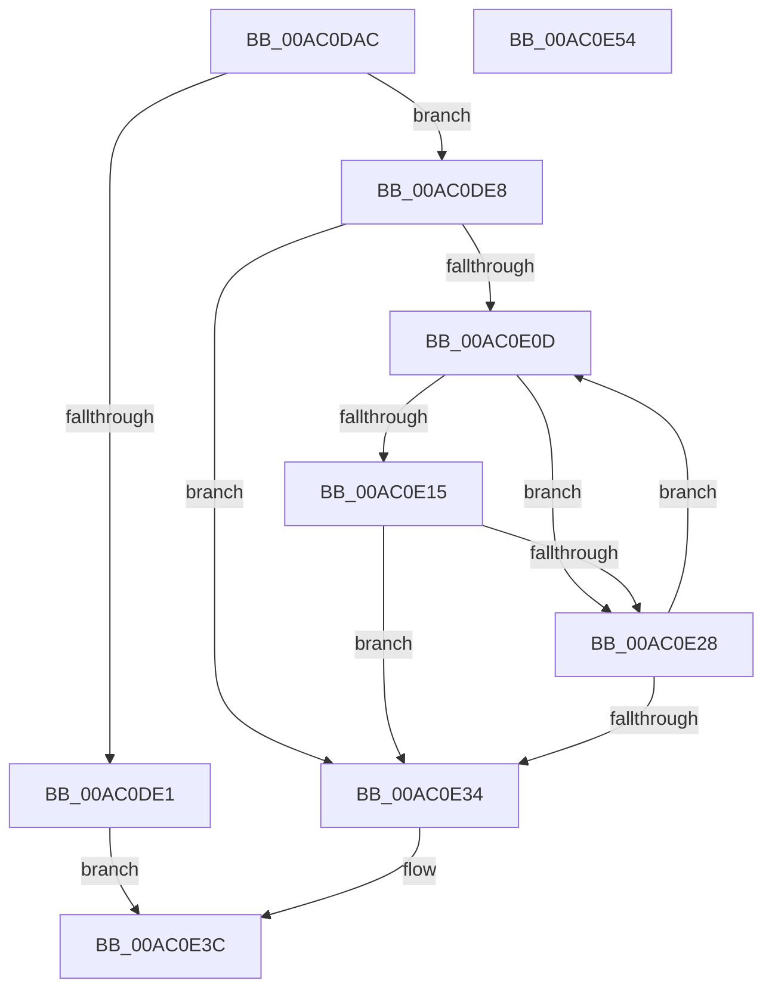

# FseInitializeGovernedFeaturesEffectiveStates

- RVA: `0x00AC0DAC`–`0x00AC0E55` (길이 `169` bytes)
- VA: `0x0000000140AC0DAC`
- 실행 섹션: `PAGE`
- PDB 이름 있음: `예`; PDB Function 태그: `아니요`
- unwind 정보 RVA: `0x0006F978`
- 디코드: `54`개 명령, `169/169` bytes 표시
- 미해석 바이트: `0` (있으면 어셈블리에 `.byte`로 보존)

> 이 문서는 커널 이미지의 기계어와 PDB 기호를 분석해 생성했습니다. 4번과 5번은 함수 원형과 자료형을 바이너리 사용 방식에서 추정한 C 해석이며 원본 소스 복구 결과는 아닙니다.

## 1. Dependencies

- 직접 호출 지점: **5**; 고유 호출 대상: **5**
- 직접 호출자로 확인된 함수: **1**
- RIP 상대 이미지 참조: **0**

### Outgoing calls
- `0x00AC0DD4` → [FcPalAlloc](../../text/6A/FcPalAlloc_function_006A7824.md) (function, `0x006A7824`)
- `0x00AC0DF0` → [memset](../../text/6C/memset_function_006C6C40.md) (function, `0x006C6C40`)
- `0x00AC0E00` → [FsepInitializeOverridesViewForGovernedFeatures](../83/FsepInitializeOverridesViewForGovernedFeatures_function_0083A718.md) (function, `0x0083A718`)
- `0x00AC0E1D` → [FsepPropagateGovernedFeatureEffectiveState](../83/FsepPropagateGovernedFeatureEffectiveState_function_0083A89C.md) (function, `0x0083A89C`)
- `0x00AC0E37` → [FcPalFree](../../text/6A/FcPalFree_function_006A7848.md) (function, `0x006A7848`)

### Direct callers
- [RtlpFcUpdateGovernedFeaturesEffectiveStates](../78/RtlpFcUpdateGovernedFeaturesEffectiveStates_function_0078F658.md) at `0x0078F70E`

### Static image references
- 디코드된 RIP-relative 메모리 참조가 없습니다.

## 2. Other-region calls and transfers

- 다른 실행 섹션으로 향하는 call: **3**
  - `0x00AC0DD4` → [FcPalAlloc](../../text/6A/FcPalAlloc_function_006A7824.md) (`PAGE` → `.text`)
  - `0x00AC0DF0` → [memset](../../text/6C/memset_function_006C6C40.md) (`PAGE` → `.text`)
  - `0x00AC0E37` → [FcPalFree](../../text/6A/FcPalFree_function_006A7848.md) (`PAGE` → `.text`)
- 별도 외부 분기/꼬리 이동을 확인하지 못했습니다.

## 3. Assembly (complete function range)

```asm
00AC0DAC  48 89 5C 24 08                  mov qword ptr [rsp + 8], rbx
00AC0DB1  48 89 74 24 10                  mov qword ptr [rsp + 0x10], rsi
00AC0DB6  48 89 7C 24 18                  mov qword ptr [rsp + 0x18], rdi
00AC0DBB  41 56                           push r14
00AC0DBD  48 83 EC 20                     sub rsp, 0x20
00AC0DC1  41 8B 00                        mov eax, dword ptr [r8]
00AC0DC4  48 8B F1                        mov rsi, rcx
00AC0DC7  0F B7 D8                        movzx ebx, ax
00AC0DCA  4D 8B F0                        mov r14, r8
00AC0DCD  48 C1 E3 02                     shl rbx, 2
00AC0DD1  48 8B CB                        mov rcx, rbx
00AC0DD4  E8 4B 6A BE FF                  call 0x1406a7824
00AC0DD9  48 8B F8                        mov rdi, rax
00AC0DDC  48 85 C0                        test rax, rax
00AC0DDF  75 07                           jne 0x140ac0de8
00AC0DE1  BB 17 00 00 C0                  mov ebx, 0xc0000017
00AC0DE6  EB 54                           jmp 0x140ac0e3c
00AC0DE8  4C 8B C3                        mov r8, rbx
00AC0DEB  33 D2                           xor edx, edx
00AC0DED  48 8B CF                        mov rcx, rdi
00AC0DF0  E8 4B 5E C0 FF                  call 0x1406c6c40
00AC0DF5  4C 8B C7                        mov r8, rdi
00AC0DF8  48 8B D6                        mov rdx, rsi
00AC0DFB  49 8B CE                        mov rcx, r14
00AC0DFE  33 DB                           xor ebx, ebx
00AC0E00  E8 13 99 D7 FF                  call 0x14083a718
00AC0E05  33 F6                           xor esi, esi
00AC0E07  66 41 39 1E                     cmp word ptr [r14], bx
00AC0E0B  74 27                           je 0x140ac0e34
00AC0E0D  8B 0C B7                        mov ecx, dword ptr [rdi + rsi*4]
00AC0E10  F6 C1 01                        test cl, 1
00AC0E13  74 13                           je 0x140ac0e28
00AC0E15  4D 8B CE                        mov r9, r14
00AC0E18  8B D6                           mov edx, esi
00AC0E1A  48 8B CF                        mov rcx, rdi
00AC0E1D  E8 7A 9A D7 FF                  call 0x14083a89c
00AC0E22  8B D8                           mov ebx, eax
00AC0E24  85 C0                           test eax, eax
00AC0E26  78 0C                           js 0x140ac0e34
00AC0E28  41 8B 0E                        mov ecx, dword ptr [r14]
00AC0E2B  FF C6                           inc esi
00AC0E2D  0F B7 D1                        movzx edx, cx
00AC0E30  3B F2                           cmp esi, edx
00AC0E32  72 D9                           jb 0x140ac0e0d
00AC0E34  48 8B CF                        mov rcx, rdi
00AC0E37  E8 0C 6A BE FF                  call 0x1406a7848
00AC0E3C  48 8B 74 24 38                  mov rsi, qword ptr [rsp + 0x38]
00AC0E41  8B C3                           mov eax, ebx
00AC0E43  48 8B 5C 24 30                  mov rbx, qword ptr [rsp + 0x30]
00AC0E48  48 8B 7C 24 40                  mov rdi, qword ptr [rsp + 0x40]
00AC0E4D  48 83 C4 20                     add rsp, 0x20
00AC0E51  41 5E                           pop r14
00AC0E53  C3                              ret
00AC0E54  CC                              int3
```

## 4. C-style interpretation (structured pseudocode)

```c
__int64 __fastcall FseInitializeGovernedFeaturesEffectiveStates(__int64 a1, int a2, __int64 a3)
{
    __int64 result;
    __int64 v_rbx;
    __int64 v_rsi;
    __int64 v_rsp;
    unsigned __int64 v_stack_p10;
    unsigned __int64 v_stack_p18;
    unsigned __int64 v_stack_p8;

    v_stack_p8 = v_rbx;
    v_stack_p10 = v_rsi;
    v_stack_p18 = v_rdi;
    v_rsp = (v_rsp) - (32);
    v_rbx = ((unsigned __int16)((unsigned int)(*(unsigned int *)(a3)))) << (2);
    result = FcPalAlloc(v_rbx, a2, a3, a4);
    if (result != 0) goto loc_00AC0DE8;
    goto loc_00AC0E3C;
loc_00AC0DE8:
    a2 = 0;
    result = memset(result, a2, (unsigned int)(0xC0000017ULL), a4);
    v_rbx = 0;
    result = FsepInitializeOverridesViewForGovernedFeatures(a3, a1, result, a4);
    v_rsi = 0;
    if ((*(unsigned __int16 *)(a3)) == 0) goto loc_00AC0E34;
loc_00AC0E0D:
    if ((((unsigned __int8)((unsigned int)(*(unsigned int *)(result + v_rsi * 4)))) & (1)) == 0) goto loc_00AC0E28;
    result = FsepPropagateGovernedFeatureEffectiveState(result, 0, result, a3);
    if (sign_flag) goto loc_00AC0E34;
loc_00AC0E28:
    v_rsi = (unsigned int)((v_rsi) + 1);
    if (((unsigned int)(v_rsi)) < ((unsigned int)((unsigned __int16)((unsigned int)(*(unsigned int *)(a3)))))) goto loc_00AC0E0D;
loc_00AC0E34:
    result = FcPalFree(result, (unsigned __int16)((unsigned int)(*(unsigned int *)(a3))), result, a3);
loc_00AC0E3C:
    v_rsp = (v_rsp) + (32);
    return (unsigned int)((unsigned int)((unsigned int)((unsigned int)(result))));
}
```

## 5. (Beta) C Style

```c
int64_t FseInitializeGovernedFeaturesEffectiveStates(int64_t Arg1, int32_t Arg2, void *Arg3)
{
    uint8_t *arg3 = (uint8_t *)Arg3;

    int64_t result;
    int64_t local_rbx;
    int64_t local_rsi;
    int64_t local_rsp;
    uint64_t v_stack_p10;
    uint64_t v_stack_p18;
    uint64_t v_stack_p8;

    v_stack_p8 = local_rbx;
    v_stack_p10 = local_rsi;
    v_stack_p18 = local_rdi;
    local_rsp = (local_rsp) - (32);
    local_rbx = ((uint16_t)((uint32_t)(*(uint32_t *)(arg3)))) << (2);
    result = FcPalAlloc(local_rbx, Arg2, Arg3, a4);
    if (result != 0) goto loc_00AC0DE8;
    goto loc_00AC0E3C;
loc_00AC0DE8:
    Arg2 = 0;
    result = memset(result, Arg2, (uint32_t)(0xC0000017ULL), a4);
    local_rbx = 0;
    result = FsepInitializeOverridesViewForGovernedFeatures(Arg3, Arg1, result, a4);
    local_rsi = 0;
    if ((*(uint16_t *)(arg3)) == 0) goto loc_00AC0E34;
loc_00AC0E0D:
    if ((((uint8_t)((uint32_t)(*(uint32_t *)(result + local_rsi * 4)))) & (1)) == 0) goto loc_00AC0E28;
    result = FsepPropagateGovernedFeatureEffectiveState(result, 0, result, Arg3);
    if (sign_flag) goto loc_00AC0E34;
loc_00AC0E28:
    local_rsi = (uint32_t)((local_rsi) + 1);
    if (((uint32_t)(local_rsi)) < ((uint32_t)((uint16_t)((uint32_t)(*(uint32_t *)(arg3)))))) goto loc_00AC0E0D;
loc_00AC0E34:
    result = FcPalFree(result, (uint16_t)((uint32_t)(*(uint32_t *)(arg3))), result, Arg3);
loc_00AC0E3C:
    local_rsp = (local_rsp) + (32);
    return (uint32_t)((uint32_t)((uint32_t)((uint32_t)(result))));
}
```

### 관측된 메모리 오프셋

구조체 형식이 확인되지 않은 접근은 인자 기준의 오프셋으로만 기록했습니다.

| 기준 인자 | 오프셋 표현 | 폭 (bit) | 접근 |
|---|---:|---:|---|
| `Arg3` | `+ 0x0` | `16` | `R` |
| `Arg3` | `+ 0x0` | `32` | `R` |

## 6. Execution-region graph

[열기: 2D/3D 그래프와 함수 탐색 컨트롤 패널](../../../control-panel.html?section=page&rva=0x00AC0DAC&view=graph)

- 2D 그래프는 위에서 아래로 흐르고, 3D 그래프는 빈 공간을 드래그해 회전합니다. Shift+드래그는 이동, 휠은 확대·축소, 함수 노드 선택은 대상 보고서 이동입니다.

### Static fallback


