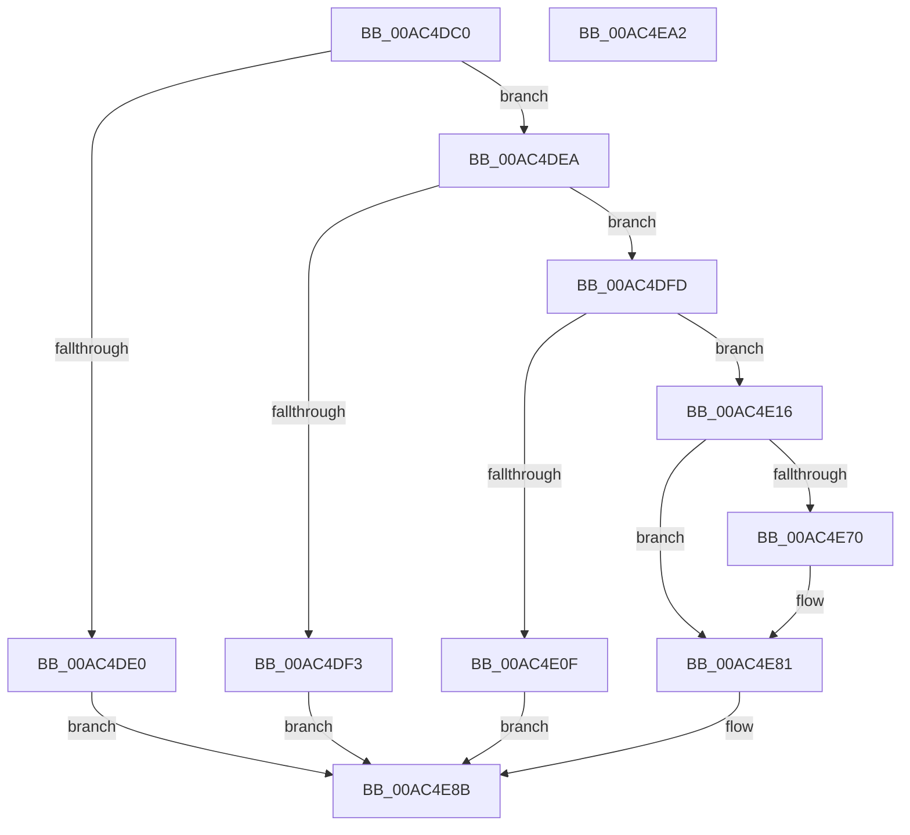

# HalpEnableSecondaryInterrupt

- RVA: `0x00AC4DC0`–`0x00AC4EA3` (길이 `227` bytes)
- VA: `0x0000000140AC4DC0`
- 실행 섹션: `PAGE`
- PDB 이름 있음: `예`; PDB Function 태그: `아니요`
- unwind 정보 RVA: `0x00066400`
- 디코드: `61`개 명령, `227/227` bytes 표시
- 미해석 바이트: `0` (있으면 어셈블리에 `.byte`로 보존)

> 이 문서는 커널 이미지의 기계어와 PDB 기호를 분석해 생성했습니다. 4번과 5번은 함수 원형과 자료형을 바이너리 사용 방식에서 추정한 C 해석이며 원본 소스 복구 결과는 아닙니다.

## 1. Dependencies

- 직접 호출 지점: **4**; 고유 호출 대상: **4**
- 직접 호출자로 확인된 함수: **1**
- RIP 상대 이미지 참조: **1**

### Outgoing calls
- `0x00AC4DEA` → [HalpCheckInterruptType](../../text/4F/HalpCheckInterruptType_function_004FC2D8.md) (function, `0x004FC2D8`)
- `0x00AC4E02` → [HalpFindSecondaryIcEntry](../../text/2D/HalpFindSecondaryIcEntry_function_002D219C.md) (function, `0x002D219C`)
- `0x00AC4E65` → [guard_dispatch_icall](../../text/6B/guard_dispatch_icall_function_006BAAD0.md) (function, `0x006BAAD0`)
- `0x00AC4E86` → [HalpReleaseSecondaryIcEntryShared](../../text/48/HalpReleaseSecondaryIcEntryShared_function_00488FD0.md) (function, `0x00488FD0`)

### Direct callers
- [HalEnableInterrupt](../../text/2D/HalEnableInterrupt_function_002D4990.md) at `0x002D4AD8`

### Static image references
- `0x00AC4DD4` → RVA `0x00E10424` (`.data`; read)

## 2. Other-region calls and transfers

- 다른 실행 섹션으로 향하는 call: **4**
  - `0x00AC4DEA` → [HalpCheckInterruptType](../../text/4F/HalpCheckInterruptType_function_004FC2D8.md) (`PAGE` → `.text`)
  - `0x00AC4E02` → [HalpFindSecondaryIcEntry](../../text/2D/HalpFindSecondaryIcEntry_function_002D219C.md) (`PAGE` → `.text`)
  - `0x00AC4E65` → [guard_dispatch_icall](../../text/6B/guard_dispatch_icall_function_006BAAD0.md) (`PAGE` → `.text`)
  - `0x00AC4E86` → [HalpReleaseSecondaryIcEntryShared](../../text/48/HalpReleaseSecondaryIcEntryShared_function_00488FD0.md) (`PAGE` → `.text`)
- 별도 외부 분기/꼬리 이동을 확인하지 못했습니다.

## 3. Assembly (complete function range)

```asm
00AC4DC0  48 89 5C 24 08                  mov qword ptr [rsp + 8], rbx
00AC4DC5  48 89 6C 24 10                  mov qword ptr [rsp + 0x10], rbp
00AC4DCA  48 89 74 24 18                  mov qword ptr [rsp + 0x18], rsi
00AC4DCF  57                              push rdi
00AC4DD0  48 83 EC 30                     sub rsp, 0x30
00AC4DD4  80 3D 49 B6 34 00 00            cmp byte ptr [rip + 0x34b649], 0
00AC4DDB  48 8B F9                        mov rdi, rcx
00AC4DDE  75 0A                           jne 0x140ac4dea
00AC4DE0  BF BB 00 00 C0                  mov edi, 0xc00000bb
00AC4DE5  E9 A1 00 00 00                  jmp 0x140ac4e8b
00AC4DEA  E8 E9 74 A3 FF                  call 0x1404fc2d8
00AC4DEF  84 C0                           test al, al
00AC4DF1  75 0A                           jne 0x140ac4dfd
00AC4DF3  BF 0D 00 00 C0                  mov edi, 0xc000000d
00AC4DF8  E9 8E 00 00 00                  jmp 0x140ac4e8b
00AC4DFD  8B 6F 40                        mov ebp, dword ptr [rdi + 0x40]
00AC4E00  8B CD                           mov ecx, ebp
00AC4E02  E8 95 D3 80 FF                  call 0x1402d219c
00AC4E07  48 8B D8                        mov rbx, rax
00AC4E0A  48 85 C0                        test rax, rax
00AC4E0D  75 07                           jne 0x140ac4e16
00AC4E0F  BF 21 A1 00 C0                  mov edi, 0xc000a121
00AC4E14  EB 75                           jmp 0x140ac4e8b
00AC4E16  4C 8B 50 38                     mov r10, qword ptr [rax + 0x38]
00AC4E1A  8B D5                           mov edx, ebp
00AC4E1C  8B C5                           mov eax, ebp
00AC4E1E  48 89 5C 24 20                  mov qword ptr [rsp + 0x20], rbx
00AC4E23  2B 43 10                        sub eax, dword ptr [rbx + 0x10]
00AC4E26  8B C8                           mov ecx, eax
00AC4E28  8B F0                           mov esi, eax
00AC4E2A  48 83 C1 0A                     add rcx, 0xa
00AC4E2E  8B 47 18                        mov eax, dword ptr [rdi + 0x18]
00AC4E31  48 03 C9                        add rcx, rcx
00AC4E34  48 03 F6                        add rsi, rsi
00AC4E37  89 84 F3 A4 00 00 00            mov dword ptr [rbx + rsi*8 + 0xa4], eax
00AC4E3E  8B 47 14                        mov eax, dword ptr [rdi + 0x14]
00AC4E41  89 04 CB                        mov dword ptr [rbx + rcx*8], eax
00AC4E44  49 8B C2                        mov rax, r10
00AC4E47  8B 4F 0C                        mov ecx, dword ptr [rdi + 0xc]
00AC4E4A  89 8C F3 A8 00 00 00            mov dword ptr [rbx + rsi*8 + 0xa8], ecx
00AC4E51  C6 84 F3 AC 00 00 00 01         mov byte ptr [rbx + rsi*8 + 0xac], 1
00AC4E59  44 8B 4F 14                     mov r9d, dword ptr [rdi + 0x14]
00AC4E5D  44 8B 47 18                     mov r8d, dword ptr [rdi + 0x18]
00AC4E61  48 8B 4B 20                     mov rcx, qword ptr [rbx + 0x20]
00AC4E65  E8 66 5C BF FF                  call 0x1406baad0
00AC4E6A  8B F8                           mov edi, eax
00AC4E6C  85 C0                           test eax, eax
00AC4E6E  79 11                           jns 0x140ac4e81
00AC4E70  0F BA AC F3 A8 00 00 00 1F      bts dword ptr [rbx + rsi*8 + 0xa8], 0x1f
00AC4E79  C6 84 F3 AC 00 00 00 00         mov byte ptr [rbx + rsi*8 + 0xac], 0
00AC4E81  B2 01                           mov dl, 1
00AC4E83  48 8B CB                        mov rcx, rbx
00AC4E86  E8 45 41 9C FF                  call 0x140488fd0
00AC4E8B  48 8B 5C 24 40                  mov rbx, qword ptr [rsp + 0x40]
00AC4E90  8B C7                           mov eax, edi
00AC4E92  48 8B 6C 24 48                  mov rbp, qword ptr [rsp + 0x48]
00AC4E97  48 8B 74 24 50                  mov rsi, qword ptr [rsp + 0x50]
00AC4E9C  48 83 C4 30                     add rsp, 0x30
00AC4EA0  5F                              pop rdi
00AC4EA1  C3                              ret
00AC4EA2  CC                              int3
```

## 4. C-style interpretation (structured pseudocode)

```c
__int64 __fastcall HalpEnableSecondaryInterrupt(__int64 a1)
{
    __int64 result;
    __int64 v_rsi;
    __int64 v_rsp;
    unsigned __int64 v_stack_m18;
    unsigned __int64 v_stack_p10;
    unsigned __int64 v_stack_p18;
    unsigned __int64 v_stack_p8;

    v_stack_p8 = v_rbx;
    v_stack_p10 = v_rbp;
    v_stack_p18 = v_rsi;
    v_rsp = (v_rsp) - (48);
    if ((*(unsigned __int8 *)(v_rip + 3454537)) != 0) goto loc_00AC4DEA;
    goto loc_00AC4E8B;
loc_00AC4DEA:
    result = HalpCheckInterruptType(a1, a2, a3, a4);
    if ((unsigned __int8)(result) != 0) goto loc_00AC4DFD;
    goto loc_00AC4E8B;
loc_00AC4DFD:
    result = HalpFindSecondaryIcEntry((unsigned int)((unsigned int)((unsigned int)(*(unsigned int *)((unsigned int)(0xC000000DULL) + 64)))), a2, a3, a4);
    if (result != 0) goto loc_00AC4E16;
    goto loc_00AC4E8B;
loc_00AC4E16:
    v_stack_m18 = result;
    result = (unsigned int)(((unsigned int)((unsigned int)((unsigned int)(*(unsigned int *)((unsigned int)(0xC000000DULL) + 64))))) - (*(unsigned int *)(result + 16)));
    a1 = ((unsigned int)((unsigned int)(result))) + (10);
    a1 = (a1) + (a1);
    v_rsi = ((unsigned int)((unsigned int)(result))) + ((unsigned int)((unsigned int)(result)));
    *(unsigned int *)(result + v_rsi * 8 + 164) = (unsigned int)((unsigned int)(*(unsigned int *)((unsigned int)(0xC000A121ULL) + 24)));
    *(unsigned int *)(result + a1 * 8) = (unsigned int)((unsigned int)(*(unsigned int *)((unsigned int)(0xC000A121ULL) + 20)));
    *(unsigned int *)(result + v_rsi * 8 + 168) = (unsigned int)((unsigned int)(*(unsigned int *)((unsigned int)(0xC000A121ULL) + 12)));
    *(unsigned __int8 *)(result + v_rsi * 8 + 172) = 1;
    result = guard_dispatch_icall(*(unsigned __int64 *)(result + 32), (unsigned int)((unsigned int)((unsigned int)(*(unsigned int *)((unsigned int)(0xC000000DULL) + 64)))), (unsigned int)(*(unsigned int *)((unsigned int)(0xC000A121ULL) + 24)), (unsigned int)(*(unsigned int *)((unsigned int)(0xC000A121ULL) + 20)));
    if (sign_flag) {
        *(unsigned __int8 *)(result + v_rsi * 8 + 172) = 0;
    }
    result = HalpReleaseSecondaryIcEntryShared(result, 1, (unsigned int)(*(unsigned int *)((unsigned int)(0xC000A121ULL) + 24)), (unsigned int)(*(unsigned int *)((unsigned int)(0xC000A121ULL) + 20)));
loc_00AC4E8B:
    v_rsp = (v_rsp) + (48);
    return (unsigned int)((unsigned int)((unsigned int)((unsigned int)(result))));
}
```

## 5. (Beta) C Style

```c
int64_t HalpEnableSecondaryInterrupt(void *Arg1)
{
    uint8_t *arg1 = (uint8_t *)Arg1;

    int64_t result;
    int64_t local_rsi;
    int64_t local_rsp;
    uint64_t v_stack_m18;
    uint64_t v_stack_p10;
    uint64_t v_stack_p18;
    uint64_t v_stack_p8;

    v_stack_p8 = local_rbx;
    v_stack_p10 = local_rbp;
    v_stack_p18 = local_rsi;
    local_rsp = (local_rsp) - (48);
    if ((*(uint8_t *)(v_rip + 0x34B649)) != 0) goto loc_00AC4DEA;
    goto loc_00AC4E8B;
loc_00AC4DEA:
    result = HalpCheckInterruptType(Arg1, a2, a3, a4);
    if ((uint8_t)(result) != 0) goto loc_00AC4DFD;
    goto loc_00AC4E8B;
loc_00AC4DFD:
    result = HalpFindSecondaryIcEntry((uint32_t)((uint32_t)((uint32_t)(*(uint32_t *)((uint32_t)(0xC000000DULL) + 0x40)))), a2, a3, a4);
    if (result != 0) goto loc_00AC4E16;
    goto loc_00AC4E8B;
loc_00AC4E16:
    v_stack_m18 = result;
    result = (uint32_t)(((uint32_t)((uint32_t)((uint32_t)(*(uint32_t *)((uint32_t)(0xC000000DULL) + 0x40))))) - (*(uint32_t *)(result + 0x10)));
    Arg1 = ((uint32_t)((uint32_t)(result))) + (10);
    Arg1 = (Arg1) + (Arg1);
    local_rsi = ((uint32_t)((uint32_t)(result))) + ((uint32_t)((uint32_t)(result)));
    *(uint32_t *)(result + local_rsi * 8 + 0xA4) = (uint32_t)((uint32_t)(*(uint32_t *)((uint32_t)(0xC000A121ULL) + 0x18)));
    *(uint32_t *)(result + arg1 * 8) = (uint32_t)((uint32_t)(*(uint32_t *)((uint32_t)(0xC000A121ULL) + 0x14)));
    *(uint32_t *)(result + local_rsi * 8 + 0xA8) = (uint32_t)((uint32_t)(*(uint32_t *)((uint32_t)(0xC000A121ULL) + 0xC)));
    *(uint8_t *)(result + local_rsi * 8 + 0xAC) = 1;
    result = guard_dispatch_icall(*(uint64_t *)(result + 0x20), (uint32_t)((uint32_t)((uint32_t)(*(uint32_t *)((uint32_t)(0xC000000DULL) + 0x40)))), (uint32_t)(*(uint32_t *)((uint32_t)(0xC000A121ULL) + 0x18)), (uint32_t)(*(uint32_t *)((uint32_t)(0xC000A121ULL) + 0x14)));
    if (sign_flag) {
        *(uint8_t *)(result + local_rsi * 8 + 0xAC) = 0;
    }
    result = HalpReleaseSecondaryIcEntryShared(result, 1, (uint32_t)(*(uint32_t *)((uint32_t)(0xC000A121ULL) + 0x18)), (uint32_t)(*(uint32_t *)((uint32_t)(0xC000A121ULL) + 0x14)));
loc_00AC4E8B:
    local_rsp = (local_rsp) + (48);
    return (uint32_t)((uint32_t)((uint32_t)((uint32_t)(result))));
}
```

### 관측된 메모리 오프셋

구조체 형식이 확인되지 않은 접근은 인자 기준의 오프셋으로만 기록했습니다.

| 기준 인자 | 오프셋 표현 | 폭 (bit) | 접근 |
|---|---:|---:|---|
| `Arg1` | `+ 0xC` | `32` | `R` |
| `Arg1` | `+ 0x14` | `32` | `R` |
| `Arg1` | `+ 0x18` | `32` | `R` |
| `Arg1` | `+ 0x40` | `32` | `R` |

## 6. Execution-region graph

[열기: 2D/3D 그래프와 함수 탐색 컨트롤 패널](../../../control-panel.html?section=page&rva=0x00AC4DC0&view=graph)

- 2D 그래프는 위에서 아래로 흐르고, 3D 그래프는 빈 공간을 드래그해 회전합니다. Shift+드래그는 이동, 휠은 확대·축소, 함수 노드 선택은 대상 보고서 이동입니다.

### Static fallback


