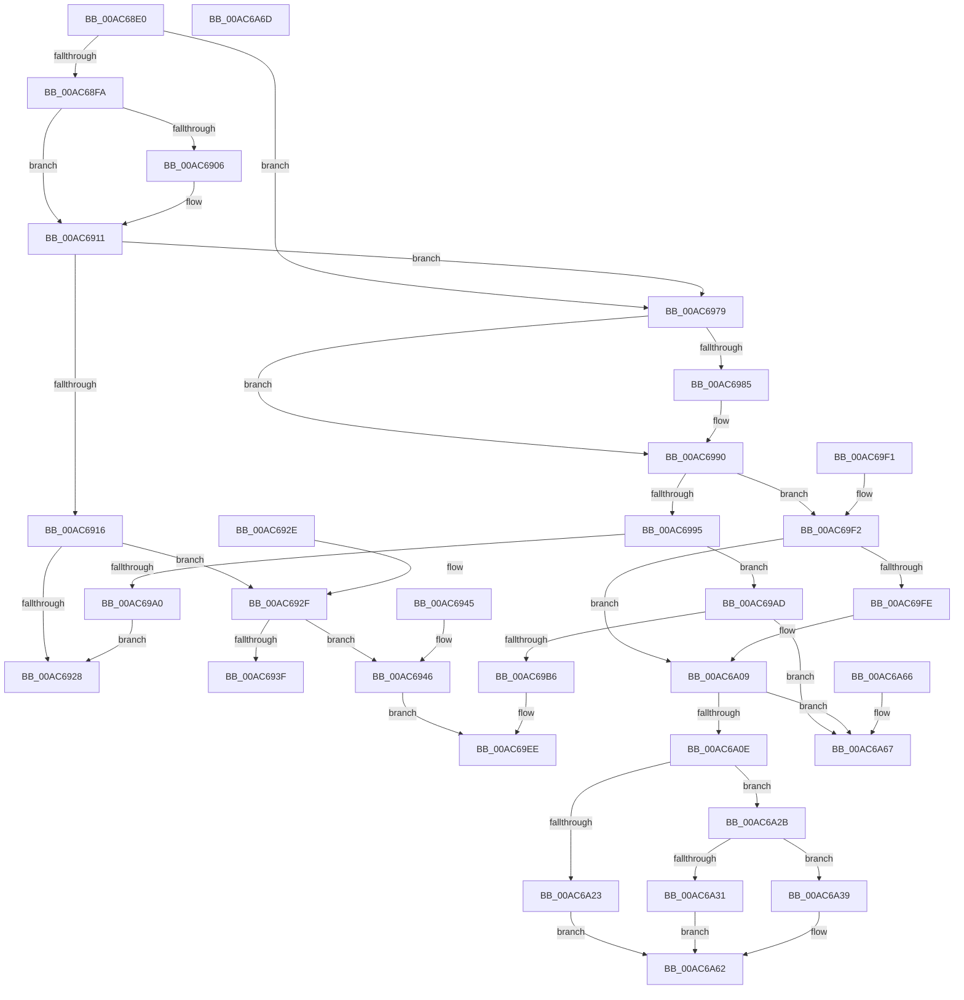

# HalpQueryInterface

- RVA: `0x00AC68E0`–`0x00AC6A6E` (길이 `398` bytes)
- VA: `0x0000000140AC68E0`
- 실행 섹션: `PAGE`
- PDB 이름 있음: `예`; PDB Function 태그: `아니요`
- unwind 정보 RVA: `0x000DB714`
- 디코드: `102`개 명령, `398/398` bytes 표시
- 미해석 바이트: `0` (있으면 어셈블리에 `.byte`로 보존)

> 이 문서는 커널 이미지의 기계어와 PDB 기호를 분석해 생성했습니다. 4번과 5번은 함수 원형과 자료형을 바이너리 사용 방식에서 추정한 C 해석이며 원본 소스 복구 결과는 아닙니다.

## 1. Dependencies

- 직접 호출 지점: **0**; 고유 호출 대상: **0**
- 직접 호출자로 확인된 함수: **1**
- RIP 상대 이미지 참조: **11**

### Outgoing calls
- 직접 디코드된 call 명령이 없습니다.

### Direct callers
- [sub_00B46B8A](../B4/Unknown_function_00B46B8A.md) at `0x00B46BB4`
- [sub_00B46B8A](../B4/Unknown_function_00B46B8A.md) at `0x00B46CE3`

### Static image references
- `0x00AC68FA` → RVA `0x00024098` (`.rdata`; read)
- `0x00AC6906` → RVA `0x000240A0` (`.rdata`; read)
- `0x00AC6946` → RVA `0x00543CC0` (`HalPnpGetDmaAdapter`; read)
- `0x00AC6951` → RVA `0x0049E550` (`EmpCheckErrataList`; read)
- `0x00AC695C` → RVA `0x0048FDC0` (`HalAdjustResourceList`; read)
- `0x00AC697C` → RVA `0x0001E9B8` (`.rdata`; read)
- `0x00AC6989` → RVA `0x0001E9C0` (`.rdata`; read)
- `0x00AC69CA` → RVA `0x004A87F0` (`HalpcGetCmosDataByType`; read)
- `0x00AC69D5` → RVA `0x00562D80` (`HalpcSetCmosDataByType`; read)
- `0x00AC69F5` → RVA `0x0001E9C8` (`.rdata`; read)
- `0x00AC6A02` → RVA `0x0001E9D0` (`.rdata`; read)

## 2. Other-region calls and transfers

- 다른 실행 섹션으로 향하는 call: **0**
- 별도 외부 분기/꼬리 이동을 확인하지 못했습니다.

## 3. Assembly (complete function range)

```asm
00AC68E0  4C 8B 51 40                     mov r10, qword ptr [rcx + 0x40]
00AC68E4  45 33 DB                        xor r11d, r11d
00AC68E7  41 8B C3                        mov eax, r11d
00AC68EA  41 81 3A C0 00 00 00            cmp dword ptr [r10], 0xc0
00AC68F1  49 0F 44 C2                     cmove rax, r10
00AC68F5  48 85 C0                        test rax, rax
00AC68F8  74 7F                           je 0x140ac6979
00AC68FA  48 8B 0D 97 D7 55 FF            mov rcx, qword ptr [rip - 0xaa2869]
00AC6901  48 2B 0A                        sub rcx, qword ptr [rdx]
00AC6904  75 0B                           jne 0x140ac6911
00AC6906  48 8B 0D 93 D7 55 FF            mov rcx, qword ptr [rip - 0xaa286d]
00AC690D  48 2B 4A 08                     sub rcx, qword ptr [rdx + 8]
00AC6911  48 85 C9                        test rcx, rcx
00AC6914  75 63                           jne 0x140ac6979
00AC6916  48 8B 44 24 38                  mov rax, qword ptr [rsp + 0x38]
00AC691B  B9 40 00 00 00                  mov ecx, 0x40
00AC6920  89 08                           mov dword ptr [rax], ecx
00AC6922  39 4C 24 28                     cmp dword ptr [rsp + 0x28], ecx
00AC6926  73 07                           jae 0x140ac692f
00AC6928  B8 23 00 00 C0                  mov eax, 0xc0000023
00AC692D  C3                              ret
00AC692E  CC                              int3
00AC692F  48 8B 44 24 30                  mov rax, qword ptr [rsp + 0x30]
00AC6934  C7 00 40 00 01 00               mov dword ptr [rax], 0x10040
00AC693A  4D 85 C9                        test r9, r9
00AC693D  75 07                           jne 0x140ac6946
00AC693F  B8 0D 00 00 C0                  mov eax, 0xc000000d
00AC6944  C3                              ret
00AC6945  CC                              int3
00AC6946  48 8D 0D 73 D3 A7 FF            lea rcx, [rip - 0x582c8d]
00AC694D  4C 89 48 08                     mov qword ptr [rax + 8], r9
00AC6951  48 8D 15 F8 7B 9D FF            lea rdx, [rip - 0x628408]
00AC6958  48 89 48 28                     mov qword ptr [rax + 0x28], rcx
00AC695C  48 8D 0D 5D 94 9C FF            lea rcx, [rip - 0x636ba3]
00AC6963  48 89 50 10                     mov qword ptr [rax + 0x10], rdx
00AC6967  48 89 48 30                     mov qword ptr [rax + 0x30], rcx
00AC696B  48 89 48 38                     mov qword ptr [rax + 0x38], rcx
00AC696F  48 89 50 18                     mov qword ptr [rax + 0x18], rdx
00AC6973  4C 89 58 20                     mov qword ptr [rax + 0x20], r11
00AC6977  EB 75                           jmp 0x140ac69ee
00AC6979  48 8B 02                        mov rax, qword ptr [rdx]
00AC697C  48 2B 05 35 80 55 FF            sub rax, qword ptr [rip - 0xaa7fcb]
00AC6983  75 0B                           jne 0x140ac6990
00AC6985  48 8B 42 08                     mov rax, qword ptr [rdx + 8]
00AC6989  48 2B 05 30 80 55 FF            sub rax, qword ptr [rip - 0xaa7fd0]
00AC6990  48 85 C0                        test rax, rax
00AC6993  75 5D                           jne 0x140ac69f2
00AC6995  44 8D 40 30                     lea r8d, [rax + 0x30]
00AC6999  44 39 44 24 28                  cmp dword ptr [rsp + 0x28], r8d
00AC699E  73 0D                           jae 0x140ac69ad
00AC69A0  48 8B 44 24 38                  mov rax, qword ptr [rsp + 0x38]
00AC69A5  44 89 00                        mov dword ptr [rax], r8d
00AC69A8  E9 7B FF FF FF                  jmp 0x140ac6928
00AC69AD  45 85 C9                        test r9d, r9d
00AC69B0  0F 85 B1 00 00 00               jne 0x140ac6a67
00AC69B6  48 8B 44 24 30                  mov rax, qword ptr [rsp + 0x30]
00AC69BB  48 8D 0D 8E 7B 9D FF            lea rcx, [rip - 0x628472]
00AC69C2  48 89 48 10                     mov qword ptr [rax + 0x10], rcx
00AC69C6  48 89 48 18                     mov qword ptr [rax + 0x18], rcx
00AC69CA  48 8D 0D 1F 1E 9E FF            lea rcx, [rip - 0x61e1e1]
00AC69D1  48 89 48 20                     mov qword ptr [rax + 0x20], rcx
00AC69D5  48 8D 0D A4 C3 A9 FF            lea rcx, [rip - 0x563c5c]
00AC69DC  48 89 48 28                     mov qword ptr [rax + 0x28], rcx
00AC69E0  C7 00 30 00 01 00               mov dword ptr [rax], 0x10030
00AC69E6  48 8B 44 24 38                  mov rax, qword ptr [rsp + 0x38]
00AC69EB  44 89 00                        mov dword ptr [rax], r8d
00AC69EE  33 C0                           xor eax, eax
00AC69F0  C3                              ret
00AC69F1  CC                              int3
00AC69F2  48 8B 02                        mov rax, qword ptr [rdx]
00AC69F5  48 2B 05 CC 7F 55 FF            sub rax, qword ptr [rip - 0xaa8034]
00AC69FC  75 0B                           jne 0x140ac6a09
00AC69FE  48 8B 42 08                     mov rax, qword ptr [rdx + 8]
00AC6A02  48 2B 05 C7 7F 55 FF            sub rax, qword ptr [rip - 0xaa8039]
00AC6A09  48 85 C0                        test rax, rax
00AC6A0C  75 59                           jne 0x140ac6a67
00AC6A0E  48 8B 44 24 38                  mov rax, qword ptr [rsp + 0x38]
00AC6A13  41 B9 28 00 00 00               mov r9d, 0x28
00AC6A19  44 89 18                        mov dword ptr [rax], r11d
00AC6A1C  44 39 4C 24 28                  cmp dword ptr [rsp + 0x28], r9d
00AC6A21  73 08                           jae 0x140ac6a2b
00AC6A23  41 BB 23 00 00 C0               mov r11d, 0xc0000023
00AC6A29  EB 37                           jmp 0x140ac6a62
00AC6A2B  66 45 85 C0                     test r8w, r8w
00AC6A2F  75 08                           jne 0x140ac6a39
00AC6A31  41 BB BB 00 00 C0               mov r11d, 0xc00000bb
00AC6A37  EB 29                           jmp 0x140ac6a62
00AC6A39  48 8B 4C 24 30                  mov rcx, qword ptr [rsp + 0x30]
00AC6A3E  BA 01 00 00 00                  mov edx, 1
00AC6A43  88 51 20                        mov byte ptr [rcx + 0x20], dl
00AC6A46  48 8D 15 03 7B 9D FF            lea rdx, [rip - 0x6284fd]
00AC6A4D  48 89 51 10                     mov qword ptr [rcx + 0x10], rdx
00AC6A51  48 89 51 18                     mov qword ptr [rcx + 0x18], rdx
00AC6A55  C7 01 28 00 01 00               mov dword ptr [rcx], 0x10028
00AC6A5B  4C 89 59 08                     mov qword ptr [rcx + 8], r11
00AC6A5F  44 89 08                        mov dword ptr [rax], r9d
00AC6A62  41 8B C3                        mov eax, r11d
00AC6A65  C3                              ret
00AC6A66  CC                              int3
00AC6A67  B8 BB 00 00 C0                  mov eax, 0xc00000bb
00AC6A6C  C3                              ret
00AC6A6D  CC                              int3
```

## 4. C-style interpretation (structured pseudocode)

```c
__int64 __fastcall HalpQueryInterface(__int64 a1, __int64 a2, __int64 a3, __int64 a4, unsigned int a5, __int64 a6, __int64 a7)
{
    __int64 result;
    __int64 v_r11;

    v_r11 = 0;
    result = 0;
    if ((*(unsigned int *)(*(unsigned __int64 *)(a1 + 64))) == 192) { result = *(unsigned __int64 *)(a1 + 64); }
    if (result == 0) goto loc_00AC6979;
    a1 = (*(unsigned __int64 *)(v_rip - 11151465)) - (*(unsigned __int64 *)(a2));
    if (!(condition_is_not_equal)) {
        a1 = *(unsigned __int64 *)(v_rip - 11151469);
        a1 = (a1) - (*(unsigned __int64 *)(a2 + 8));
    }
    if (a1 != 0) goto loc_00AC6979;
    *(unsigned int *)(a7) = 64;
    if (a5 >= 64) goto loc_00AC692F;
loc_00AC6928:
    return (unsigned int)(0xC0000023ULL);
loc_00AC692F:
    *(unsigned int *)(a6) = 0x10040ULL;
    if (a4 != 0) goto loc_00AC6946;
    return (unsigned int)(0xC000000DULL);
loc_00AC6946:
    *(unsigned __int64 *)((unsigned int)(0xC000000DULL) + 8) = a4;
    *(unsigned __int64 *)((unsigned int)(0xC000000DULL) + 40) = v_rip - 5778573;
    *(unsigned __int64 *)((unsigned int)(0xC000000DULL) + 16) = v_rip - 6456328;
    *(unsigned __int64 *)((unsigned int)(0xC000000DULL) + 48) = v_rip - 6515619;
    *(unsigned __int64 *)((unsigned int)(0xC000000DULL) + 56) = v_rip - 6515619;
    *(unsigned __int64 *)((unsigned int)(0xC000000DULL) + 24) = v_rip - 6456328;
    *(unsigned __int64 *)((unsigned int)(0xC000000DULL) + 32) = 0;
    goto loc_00AC69EE;
loc_00AC6979:
    result = (*(unsigned __int64 *)(v_rip - 6456328)) - (*(unsigned __int64 *)(v_rip - 11173835));
    if (!(condition_is_not_equal)) {
        result = *(unsigned __int64 *)(v_rip - 6456328 + 8);
        result = (result) - (*(unsigned __int64 *)(v_rip - 11173840));
    }
    if (result != 0) goto loc_00AC69F2;
    if (a5 >= ((unsigned int)(result + 48))) goto loc_00AC69AD;
    *(unsigned int *)(a7) = (unsigned int)(result + 48);
    goto loc_00AC6928;
loc_00AC69AD:
    if ((unsigned int)(a4) != 0) goto loc_00AC6A67;
    *(unsigned __int64 *)(a6 + 16) = v_rip - 6456434;
    *(unsigned __int64 *)(a6 + 24) = v_rip - 6456434;
    *(unsigned __int64 *)(a6 + 32) = v_rip - 6414817;
    *(unsigned __int64 *)(a6 + 40) = v_rip - 5651548;
    *(unsigned int *)(a6) = 0x10030ULL;
    *(unsigned int *)(a7) = (unsigned int)(result + 48);
loc_00AC69EE:
    result = 0;
    return result;
loc_00AC69F2:
    result = (*(unsigned __int64 *)(v_rip - 6456328)) - (*(unsigned __int64 *)(v_rip - 11173940));
    if (!(condition_is_not_equal)) {
        result = *(unsigned __int64 *)(v_rip - 6456328 + 8);
        result = (result) - (*(unsigned __int64 *)(v_rip - 11173945));
    }
    if (result != 0) goto loc_00AC6A67;
    *(unsigned int *)(a7) = 0;
    if (a5 >= 40) goto loc_00AC6A2B;
    goto loc_00AC6A62;
loc_00AC6A2B:
    if ((unsigned __int16)(result + 48) != 0) goto loc_00AC6A39;
    goto loc_00AC6A62;
loc_00AC6A39:
    *(unsigned __int8 *)(a6 + 32) = 1;
    *(unsigned __int64 *)(a6 + 16) = v_rip - 6456573;
    *(unsigned __int64 *)(a6 + 24) = v_rip - 6456573;
    *(unsigned int *)(a6) = 0x10028ULL;
    *(unsigned __int64 *)(a6 + 8) = (unsigned int)(0xC00000BBULL);
    *(unsigned int *)(a7) = 40;
loc_00AC6A62:
    return (unsigned int)((unsigned int)((unsigned int)(0xC00000BBULL)));
loc_00AC6A67:
    return (unsigned int)(0xC00000BBULL);
}
```

## 5. (Beta) C Style

```c
int64_t HalpQueryInterface(void *Arg1, void *Arg2, int64_t Arg3, int64_t Arg4, uint32_t Arg5, void *Arg6, void *Arg7)
{
    uint8_t *arg1 = (uint8_t *)Arg1;
    uint8_t *arg2 = (uint8_t *)Arg2;
    uint8_t *arg6 = (uint8_t *)Arg6;
    uint8_t *arg7 = (uint8_t *)Arg7;

    int64_t result;
    int64_t local_r11;

    local_r11 = 0;
    result = 0;
    if ((*(uint32_t *)(*(uint64_t *)(arg1 + 0x40))) == 192) { result = *(uint64_t *)(arg1 + 0x40); }
    if (result == 0) goto loc_00AC6979;
    Arg1 = (*(uint64_t *)(v_rip - 0xAA2869)) - (*(uint64_t *)(arg2));
    if (!(condition_is_not_equal)) {
        Arg1 = *(uint64_t *)(v_rip - 0xAA286D);
        Arg1 = (Arg1) - (*(uint64_t *)(arg2 + 0x8));
    }
    if (Arg1 != NULL) goto loc_00AC6979;
    *(uint32_t *)(arg7) = 64;
    if (Arg5 >= 64) goto loc_00AC692F;
loc_00AC6928:
    return (uint32_t)(0xC0000023ULL);
loc_00AC692F:
    *(uint32_t *)(arg6) = 0x10040ULL;
    if (Arg4 != 0) goto loc_00AC6946;
    return (uint32_t)(0xC000000DULL);
loc_00AC6946:
    *(uint64_t *)((uint32_t)(0xC000000DULL) + 0x8) = Arg4;
    *(uint64_t *)((uint32_t)(0xC000000DULL) + 0x28) = v_rip - 5778573;
    *(uint64_t *)((uint32_t)(0xC000000DULL) + 0x10) = v_rip - 6456328;
    *(uint64_t *)((uint32_t)(0xC000000DULL) + 0x30) = v_rip - 6515619;
    *(uint64_t *)((uint32_t)(0xC000000DULL) + 0x38) = v_rip - 6515619;
    *(uint64_t *)((uint32_t)(0xC000000DULL) + 0x18) = v_rip - 6456328;
    *(uint64_t *)((uint32_t)(0xC000000DULL) + 0x20) = 0;
    goto loc_00AC69EE;
loc_00AC6979:
    result = (*(uint64_t *)(v_rip - 0x628408)) - (*(uint64_t *)(v_rip - 0xAA7FCB));
    if (!(condition_is_not_equal)) {
        result = *(uint64_t *)(v_rip - 0x628408 + 0x8);
        result = (result) - (*(uint64_t *)(v_rip - 0xAA7FD0));
    }
    if (result != 0) goto loc_00AC69F2;
    if (Arg5 >= ((uint32_t)(result + 48))) goto loc_00AC69AD;
    *(uint32_t *)(arg7) = (uint32_t)(result + 48);
    goto loc_00AC6928;
loc_00AC69AD:
    if ((uint32_t)(Arg4) != 0) goto loc_00AC6A67;
    *(uint64_t *)(arg6 + 0x10) = v_rip - 6456434;
    *(uint64_t *)(arg6 + 0x18) = v_rip - 6456434;
    *(uint64_t *)(arg6 + 0x20) = v_rip - 6414817;
    *(uint64_t *)(arg6 + 0x28) = v_rip - 5651548;
    *(uint32_t *)(arg6) = 0x10030ULL;
    *(uint32_t *)(arg7) = (uint32_t)(result + 48);
loc_00AC69EE:
    result = 0;
    return result;
loc_00AC69F2:
    result = (*(uint64_t *)(v_rip - 0x628408)) - (*(uint64_t *)(v_rip - 0xAA8034));
    if (!(condition_is_not_equal)) {
        result = *(uint64_t *)(v_rip - 0x628408 + 0x8);
        result = (result) - (*(uint64_t *)(v_rip - 0xAA8039));
    }
    if (result != 0) goto loc_00AC6A67;
    *(uint32_t *)(arg7) = 0;
    if (Arg5 >= 40) goto loc_00AC6A2B;
    goto loc_00AC6A62;
loc_00AC6A2B:
    if ((uint16_t)(result + 48) != 0) goto loc_00AC6A39;
    goto loc_00AC6A62;
loc_00AC6A39:
    *(uint8_t *)(arg6 + 0x20) = 1;
    *(uint64_t *)(arg6 + 0x10) = v_rip - 6456573;
    *(uint64_t *)(arg6 + 0x18) = v_rip - 6456573;
    *(uint32_t *)(arg6) = 0x10028ULL;
    *(uint64_t *)(arg6 + 0x8) = (uint32_t)(0xC00000BBULL);
    *(uint32_t *)(arg7) = 40;
loc_00AC6A62:
    return (uint32_t)((uint32_t)((uint32_t)(0xC00000BBULL)));
loc_00AC6A67:
    return (uint32_t)(0xC00000BBULL);
}
```

### 관측된 메모리 오프셋

구조체 형식이 확인되지 않은 접근은 인자 기준의 오프셋으로만 기록했습니다.

| 기준 인자 | 오프셋 표현 | 폭 (bit) | 접근 |
|---|---:|---:|---|
| `Arg1` | `+ 0x40` | `64` | `R` |
| `Arg2` | `+ 0x0` | `64` | `R` |
| `Arg2` | `+ 0x8` | `64` | `R` |
| `Arg6` | `+ 0x0` | `32` | `W` |
| `Arg6` | `+ 0x8` | `64` | `W` |
| `Arg6` | `+ 0x10` | `64` | `W` |
| `Arg6` | `+ 0x18` | `64` | `W` |
| `Arg6` | `+ 0x20` | `8` | `W` |
| `Arg6` | `+ 0x20` | `64` | `W` |
| `Arg6` | `+ 0x28` | `64` | `W` |
| `Arg6` | `+ 0x30` | `64` | `W` |
| `Arg6` | `+ 0x38` | `64` | `W` |
| `Arg7` | `+ 0x0` | `32` | `W` |

## 6. Execution-region graph

[열기: 2D/3D 그래프와 함수 탐색 컨트롤 패널](../../../control-panel.html?section=page&rva=0x00AC68E0&view=graph)

- 2D 그래프는 위에서 아래로 흐르고, 3D 그래프는 빈 공간을 드래그해 회전합니다. Shift+드래그는 이동, 휠은 확대·축소, 함수 노드 선택은 대상 보고서 이동입니다.

### Static fallback


