# HalpUnregisterPmuNotification

- RVA: `0x00ACAB7C`–`0x00ACAE01` (길이 `645` bytes)
- VA: `0x0000000140ACAB7C`
- 실행 섹션: `PAGE`
- PDB 이름 있음: `예`; PDB Function 태그: `아니요`
- unwind 정보 RVA: `0x000BB528`
- 디코드: `173`개 명령, `645/645` bytes 표시
- 미해석 바이트: `0` (있으면 어셈블리에 `.byte`로 보존)

> 이 문서는 커널 이미지의 기계어와 PDB 기호를 분석해 생성했습니다. 4번과 5번은 함수 원형과 자료형을 바이너리 사용 방식에서 추정한 C 해석이며 원본 소스 복구 결과는 아닙니다.

## 1. Dependencies

- 직접 호출 지점: **18**; 고유 호출 대상: **9**
- 직접 호출자로 확인된 함수: **1**
- RIP 상대 이미지 참조: **12**

### Outgoing calls
- `0x00ACABD0` → [KeAbPreAcquire](../../text/21/KeAbPreAcquire_function_00210230.md) (function, `0x00210230`)
- `0x00ACABEA` → [ExfAcquirePushLockExclusiveEx](../../text/20/ExfAcquirePushLockExclusiveEx_function_0020FC90.md) (function, `0x0020FC90`)
- `0x00ACACB3` → [ExfTryToWakePushLock](../../text/26/ExfTryToWakePushLock_function_00265DD0.md) (function, `0x00265DD0`)
- `0x00ACACBB` → [KeAbPostRelease](../../text/2E/KeAbPostRelease_function_002E1600.md) (function, `0x002E1600`)
- `0x00ACACC0` → [KeLeaveCriticalRegion](../../text/25/KeLeaveCriticalRegion_function_0025D8B0.md) (function, `0x0025D8B0`)
- `0x00ACACC9` → [ExWaitForRundownProtectionRelease](../../text/2A/ExWaitForRundownProtectionRelease_function_002A4CB0.md) (function, `0x002A4CB0`)
- `0x00ACACEE` → [KeAbPreAcquire](../../text/21/KeAbPreAcquire_function_00210230.md) (function, `0x00210230`)
- `0x00ACAD08` → [ExfAcquirePushLockExclusiveEx](../../text/20/ExfAcquirePushLockExclusiveEx_function_0020FC90.md) (function, `0x0020FC90`)
- `0x00ACAD4D` → [ExDeleteTimer](../../text/39/ExDeleteTimer_function_0039F2E0.md) (function, `0x0039F2E0`)
- `0x00ACAD7E` → [ExfTryToWakePushLock](../../text/26/ExfTryToWakePushLock_function_00265DD0.md) (function, `0x00265DD0`)
- `0x00ACAD86` → [KeAbPostRelease](../../text/2E/KeAbPostRelease_function_002E1600.md) (function, `0x002E1600`)
- `0x00ACAD8B` → [KeLeaveCriticalRegion](../../text/25/KeLeaveCriticalRegion_function_0025D8B0.md) (function, `0x0025D8B0`)
- `0x00ACAD97` → [HalpNotifyActorIfPmuAvailable](../70/HalpNotifyActorIfPmuAvailable_function_00707880.md) (function, `0x00707880`)
- `0x00ACADBE` → [ExfTryToWakePushLock](../../text/26/ExfTryToWakePushLock_function_00265DD0.md) (function, `0x00265DD0`)
- `0x00ACADC6` → [KeAbPostRelease](../../text/2E/KeAbPostRelease_function_002E1600.md) (function, `0x002E1600`)
- `0x00ACADCB` → [KeLeaveCriticalRegion](../../text/25/KeLeaveCriticalRegion_function_0025D8B0.md) (function, `0x0025D8B0`)
- `0x00ACADD8` → [ExWaitForRundownProtectionRelease](../../text/2A/ExWaitForRundownProtectionRelease_function_002A4CB0.md) (function, `0x002A4CB0`)
- `0x00ACADE2` → [ExFreePoolWithTag](../../poolcode/B8/ExFreePoolWithTag_function_00B82870.md) (function, `0x00B82870`)

### Direct callers
- [HalpSetSystemInformation](../AB/HalpSetSystemInformation_function_00AB0850.md) at `0x00AB08BB`

### Static image references
- `0x00ACABB5` → RVA `0x00FC2B40` (`.data`; read)
- `0x00ACABF8` → RVA `0x00FC2B68` (`.data`; read)
- `0x00ACAC04` → RVA `0x00FC2B50` (`.data`; read)
- `0x00ACAC14` → RVA `0x00FC2B58` (`.data`; read)
- `0x00ACAC3E` → RVA `0x00FC2BB0` (`.data`; read)
- `0x00ACAC66` → RVA `0x00FC2BB0` (`.data`; write)
- `0x00ACAC6E` → RVA `0x00FC2B50` (`.data`; write)
- `0x00ACAC96` → RVA `0x00FC2BA8` (`.data`; read)
- `0x00ACACA1` → RVA `0x00FC2B40` (`.data`; read/write)
- `0x00ACAD34` → RVA `0x00FC2B68` (`.data`; read/write)
- `0x00ACAD3D` → RVA `0x00FC2B70` (`.data`; read)
- `0x00ACAD52` → RVA `0x00FC2B70` (`.data`; read/write)

## 2. Other-region calls and transfers

- 다른 실행 섹션으로 향하는 call: **17**
  - `0x00ACABD0` → [KeAbPreAcquire](../../text/21/KeAbPreAcquire_function_00210230.md) (`PAGE` → `.text`)
  - `0x00ACABEA` → [ExfAcquirePushLockExclusiveEx](../../text/20/ExfAcquirePushLockExclusiveEx_function_0020FC90.md) (`PAGE` → `.text`)
  - `0x00ACACB3` → [ExfTryToWakePushLock](../../text/26/ExfTryToWakePushLock_function_00265DD0.md) (`PAGE` → `.text`)
  - `0x00ACACBB` → [KeAbPostRelease](../../text/2E/KeAbPostRelease_function_002E1600.md) (`PAGE` → `.text`)
  - `0x00ACACC0` → [KeLeaveCriticalRegion](../../text/25/KeLeaveCriticalRegion_function_0025D8B0.md) (`PAGE` → `.text`)
  - `0x00ACACC9` → [ExWaitForRundownProtectionRelease](../../text/2A/ExWaitForRundownProtectionRelease_function_002A4CB0.md) (`PAGE` → `.text`)
  - `0x00ACACEE` → [KeAbPreAcquire](../../text/21/KeAbPreAcquire_function_00210230.md) (`PAGE` → `.text`)
  - `0x00ACAD08` → [ExfAcquirePushLockExclusiveEx](../../text/20/ExfAcquirePushLockExclusiveEx_function_0020FC90.md) (`PAGE` → `.text`)
  - `0x00ACAD4D` → [ExDeleteTimer](../../text/39/ExDeleteTimer_function_0039F2E0.md) (`PAGE` → `.text`)
  - `0x00ACAD7E` → [ExfTryToWakePushLock](../../text/26/ExfTryToWakePushLock_function_00265DD0.md) (`PAGE` → `.text`)
  - `0x00ACAD86` → [KeAbPostRelease](../../text/2E/KeAbPostRelease_function_002E1600.md) (`PAGE` → `.text`)
  - `0x00ACAD8B` → [KeLeaveCriticalRegion](../../text/25/KeLeaveCriticalRegion_function_0025D8B0.md) (`PAGE` → `.text`)
  - `0x00ACADBE` → [ExfTryToWakePushLock](../../text/26/ExfTryToWakePushLock_function_00265DD0.md) (`PAGE` → `.text`)
  - `0x00ACADC6` → [KeAbPostRelease](../../text/2E/KeAbPostRelease_function_002E1600.md) (`PAGE` → `.text`)
  - `0x00ACADCB` → [KeLeaveCriticalRegion](../../text/25/KeLeaveCriticalRegion_function_0025D8B0.md) (`PAGE` → `.text`)
  - `0x00ACADD8` → [ExWaitForRundownProtectionRelease](../../text/2A/ExWaitForRundownProtectionRelease_function_002A4CB0.md) (`PAGE` → `.text`)
  - `0x00ACADE2` → [ExFreePoolWithTag](../../poolcode/B8/ExFreePoolWithTag_function_00B82870.md) (`PAGE` → `POOLCODE`)
- 별도 외부 분기/꼬리 이동을 확인하지 못했습니다.

## 3. Assembly (complete function range)

```asm
00ACAB7C  48 89 5C 24 10                  mov qword ptr [rsp + 0x10], rbx
00ACAB81  48 89 6C 24 18                  mov qword ptr [rsp + 0x18], rbp
00ACAB86  56                              push rsi
00ACAB87  57                              push rdi
00ACAB88  41 55                           push r13
00ACAB8A  41 56                           push r14
00ACAB8C  41 57                           push r15
00ACAB8E  48 83 EC 20                     sub rsp, 0x20
00ACAB92  33 F6                           xor esi, esi
00ACAB94  45 32 FF                        xor r15b, r15b
00ACAB97  4C 8B F1                        mov r14, rcx
00ACAB9A  8D 6E 01                        lea ebp, [rsi + 1]
00ACAB9D  66 39 29                        cmp word ptr [rcx], bp
00ACABA0  74 0A                           je 0x140acabac
00ACABA2  BF 59 00 00 C0                  mov edi, 0xc0000059
00ACABA7  E9 3B 02 00 00                  jmp 0x140acade7
00ACABAC  65 48 8B 04 25 88 01 00 00      mov rax, qword ptr gs:[0x188]
00ACABB5  4C 8D 2D 84 7F 4F 00            lea r13, [rip + 0x4f7f84]
00ACABBC  48 83 CB FF                     or rbx, 0xffffffffffffffff
00ACABC0  45 33 C0                        xor r8d, r8d
00ACABC3  33 D2                           xor edx, edx
00ACABC5  49 8B CD                        mov rcx, r13
00ACABC8  66 01 98 E4 01 00 00            add word ptr [rax + 0x1e4], bx
00ACABCF  90                              nop
00ACABD0  E8 5B 56 74 FF                  call 0x140210230
00ACABD5  F0 49 0F BA 6D 00 00            lock bts qword ptr [r13], 0
00ACABDC  48 8B F8                        mov rdi, rax
00ACABDF  73 0E                           jae 0x140acabef
00ACABE1  4D 8B C5                        mov r8, r13
00ACABE4  48 8B D0                        mov rdx, rax
00ACABE7  49 8B CD                        mov rcx, r13
00ACABEA  E8 A1 50 74 FF                  call 0x14020fc90
00ACABEF  48 85 FF                        test rdi, rdi
00ACABF2  74 04                           je 0x140acabf8
00ACABF4  40 88 6F 0A                     mov byte ptr [rdi + 0xa], bpl
00ACABF8  39 35 6A 7F 4F 00               cmp dword ptr [rip + 0x4f7f6a], esi
00ACABFE  0F 84 A1 01 00 00               je 0x140acada5
00ACAC04  8B 0D 46 7F 4F 00               mov ecx, dword ptr [rip + 0x4f7f46]
00ACAC0A  2B CD                           sub ecx, ebp
00ACAC0C  0F 84 93 01 00 00               je 0x140acada5
00ACAC12  2B CD                           sub ecx, ebp
00ACAC14  48 8B 0D 3D 7F 4F 00            mov rcx, qword ptr [rip + 0x4f7f3d]
00ACAC1B  48 8D 05 36 7F 4F 00            lea rax, [rip + 0x4f7f36]
00ACAC22  48 3B C8                        cmp rcx, rax
00ACAC25  41 8B 46 04                     mov eax, dword ptr [r14 + 4]
00ACAC29  74 13                           je 0x140acac3e
00ACAC2B  48 8B F1                        mov rsi, rcx
00ACAC2E  39 41 20                        cmp dword ptr [rcx + 0x20], eax
00ACAC31  74 05                           je 0x140acac38
00ACAC33  48 8B 09                        mov rcx, qword ptr [rcx]
00ACAC36  EB E3                           jmp 0x140acac1b
00ACAC38  40 88 69 38                     mov byte ptr [rcx + 0x38], bpl
00ACAC3C  EB 3A                           jmp 0x140acac78
00ACAC3E  48 8B 0D 6B 7F 4F 00            mov rcx, qword ptr [rip + 0x4f7f6b]
00ACAC45  39 41 20                        cmp dword ptr [rcx + 0x20], eax
00ACAC48  0F 85 57 01 00 00               jne 0x140acada5
00ACAC4E  40 88 69 38                     mov byte ptr [rcx + 0x38], bpl
00ACAC52  48 8B F1                        mov rsi, rcx
00ACAC55  8B 05 F5 7E 4F 00               mov eax, dword ptr [rip + 0x4f7ef5]
00ACAC5B  44 8A FD                        mov r15b, bpl
00ACAC5E  83 F8 02                        cmp eax, 2
00ACAC61  75 15                           jne 0x140acac78
00ACAC63  0F 57 C0                        xorps xmm0, xmm0
00ACAC66  F3 0F 7F 05 42 7F 4F 00         movdqu xmmword ptr [rip + 0x4f7f42], xmm0
00ACAC6E  C7 05 D8 7E 4F 00 03 00 00 00   mov dword ptr [rip + 0x4f7ed8], 3
00ACAC78  8B 05 D2 7E 4F 00               mov eax, dword ptr [rip + 0x4f7ed2]
00ACAC7E  83 F8 04                        cmp eax, 4
00ACAC81  74 0F                           je 0x140acac92
00ACAC83  8B 05 C7 7E 4F 00               mov eax, dword ptr [rip + 0x4f7ec7]
00ACAC89  83 F8 05                        cmp eax, 5
00ACAC8C  0F 85 84 00 00 00               jne 0x140acad16
00ACAC92  41 8B 46 04                     mov eax, dword ptr [r14 + 4]
00ACAC96  39 05 0C 7F 4F 00               cmp dword ptr [rip + 0x4f7f0c], eax
00ACAC9C  75 78                           jne 0x140acad16
00ACAC9E  48 8B C3                        mov rax, rbx
00ACACA1  F0 48 0F C1 05 96 7E 4F 00      lock xadd qword ptr [rip + 0x4f7e96], rax
00ACACAA  24 06                           and al, 6
00ACACAC  3C 02                           cmp al, 2
00ACACAE  75 08                           jne 0x140acacb8
00ACACB0  49 8B CD                        mov rcx, r13
00ACACB3  E8 18 B1 79 FF                  call 0x140265dd0
00ACACB8  49 8B CD                        mov rcx, r13
00ACACBB  E8 40 69 81 FF                  call 0x1402e1600
00ACACC0  E8 EB 2B 79 FF                  call 0x14025d8b0
00ACACC5  48 8D 4E 30                     lea rcx, [rsi + 0x30]
00ACACC9  E8 E2 9F 7D FF                  call 0x1402a4cb0
00ACACCE  48 8B C5                        mov rax, rbp
00ACACD1  45 33 C0                        xor r8d, r8d
00ACACD4  48 87 46 30                     xchg qword ptr [rsi + 0x30], rax
00ACACD8  65 48 8B 0C 25 88 01 00 00      mov rcx, qword ptr gs:[0x188]
00ACACE1  33 D2                           xor edx, edx
00ACACE3  66 01 99 E4 01 00 00            add word ptr [rcx + 0x1e4], bx
00ACACEA  49 8B CD                        mov rcx, r13
00ACACED  90                              nop
00ACACEE  E8 3D 55 74 FF                  call 0x140210230
00ACACF3  F0 49 0F BA 6D 00 00            lock bts qword ptr [r13], 0
00ACACFA  48 8B F8                        mov rdi, rax
00ACACFD  73 0E                           jae 0x140acad0d
00ACACFF  4D 8B C5                        mov r8, r13
00ACAD02  48 8B D0                        mov rdx, rax
00ACAD05  49 8B CD                        mov rcx, r13
00ACAD08  E8 83 4F 74 FF                  call 0x14020fc90
00ACAD0D  48 85 FF                        test rdi, rdi
00ACAD10  74 04                           je 0x140acad16
00ACAD12  40 88 6F 0A                     mov byte ptr [rdi + 0xa], bpl
00ACAD16  45 84 FF                        test r15b, r15b
00ACAD19  75 19                           jne 0x140acad34
00ACAD1B  48 8B 0E                        mov rcx, qword ptr [rsi]
00ACAD1E  48 8B 46 08                     mov rax, qword ptr [rsi + 8]
00ACAD22  48 39 71 08                     cmp qword ptr [rcx + 8], rsi
00ACAD26  75 3A                           jne 0x140acad62
00ACAD28  48 39 30                        cmp qword ptr [rax], rsi
00ACAD2B  75 35                           jne 0x140acad62
00ACAD2D  48 89 08                        mov qword ptr [rax], rcx
00ACAD30  48 89 41 08                     mov qword ptr [rcx + 8], rax
00ACAD34  83 05 2D 7E 4F 00 FF            add dword ptr [rip + 0x4f7e2d], -1
00ACAD3B  75 2C                           jne 0x140acad69
00ACAD3D  48 8B 0D 2C 7E 4F 00            mov rcx, qword ptr [rip + 0x4f7e2c]
00ACAD44  45 33 C9                        xor r9d, r9d
00ACAD47  45 33 C0                        xor r8d, r8d
00ACAD4A  40 8A D5                        mov dl, bpl
00ACAD4D  E8 8E 45 8D FF                  call 0x14039f2e0
00ACAD52  48 83 25 16 7E 4F 00 00         and qword ptr [rip + 0x4f7e16], 0
00ACAD5A  89 2D F0 7D 4F 00               mov dword ptr [rip + 0x4f7df0], ebp
00ACAD60  EB 3A                           jmp 0x140acad9c
00ACAD62  B9 03 00 00 00                  mov ecx, 3
00ACAD67  CD 29                           int 0x29
00ACAD69  48 8B C3                        mov rax, rbx
00ACAD6C  F0 48 0F C1 05 CB 7D 4F 00      lock xadd qword ptr [rip + 0x4f7dcb], rax
00ACAD75  24 06                           and al, 6
00ACAD77  3C 02                           cmp al, 2
00ACAD79  75 08                           jne 0x140acad83
00ACAD7B  49 8B CD                        mov rcx, r13
00ACAD7E  E8 4D B0 79 FF                  call 0x140265dd0
00ACAD83  49 8B CD                        mov rcx, r13
00ACAD86  E8 75 68 81 FF                  call 0x1402e1600
00ACAD8B  E8 20 2B 79 FF                  call 0x14025d8b0
00ACAD90  33 D2                           xor edx, edx
00ACAD92  33 C9                           xor ecx, ecx
00ACAD94  40 32 ED                        xor bpl, bpl
00ACAD97  E8 E4 CA C3 FF                  call 0x140707880
00ACAD9C  33 FF                           xor edi, edi
00ACAD9E  40 84 ED                        test bpl, bpl
00ACADA1  74 31                           je 0x140acadd4
00ACADA3  EB 05                           jmp 0x140acadaa
00ACADA5  BF 25 02 00 C0                  mov edi, 0xc0000225
00ACADAA  F0 48 0F C1 1D 8D 7D 4F 00      lock xadd qword ptr [rip + 0x4f7d8d], rbx
00ACADB3  80 E3 06                        and bl, 6
00ACADB6  80 FB 02                        cmp bl, 2
00ACADB9  75 08                           jne 0x140acadc3
00ACADBB  49 8B CD                        mov rcx, r13
00ACADBE  E8 0D B0 79 FF                  call 0x140265dd0
00ACADC3  49 8B CD                        mov rcx, r13
00ACADC6  E8 35 68 81 FF                  call 0x1402e1600
00ACADCB  E8 E0 2A 79 FF                  call 0x14025d8b0
00ACADD0  85 FF                           test edi, edi
00ACADD2  78 13                           js 0x140acade7
00ACADD4  48 8D 4E 30                     lea rcx, [rsi + 0x30]
00ACADD8  E8 D3 9E 7D FF                  call 0x1402a4cb0
00ACADDD  33 D2                           xor edx, edx
00ACADDF  48 8B CE                        mov rcx, rsi
00ACADE2  E8 89 7A 0B 00                  call 0x140b82870
00ACADE7  48 8B 5C 24 58                  mov rbx, qword ptr [rsp + 0x58]
00ACADEC  8B C7                           mov eax, edi
00ACADEE  48 8B 6C 24 60                  mov rbp, qword ptr [rsp + 0x60]
00ACADF3  48 83 C4 20                     add rsp, 0x20
00ACADF7  41 5F                           pop r15
00ACADF9  41 5E                           pop r14
00ACADFB  41 5D                           pop r13
00ACADFD  5F                              pop rdi
00ACADFE  5E                              pop rsi
00ACADFF  C3                              ret
00ACAE00  CC                              int3
```

## 4. C-style interpretation (structured pseudocode)

```c
__int64 __fastcall HalpUnregisterPmuNotification(__int64 a1, int a2, int a3, int a4)
{
    __int64 result;
    __int64 v_r15;
    __int64 v_rbp;
    __int64 v_rbx;
    __int64 v_rdi;
    __int64 v_rsi;
    __int64 v_rsp;
    unsigned __int64 v_stack_p10;
    unsigned __int64 v_stack_p18;

    v_stack_p10 = v_rbx;
    v_stack_p18 = v_rbp;
    v_rsp = (v_rsp) - (32);
    v_rsi = 0;
    v_r15 = 0;
    if ((*(unsigned __int16 *)(a1)) == ((unsigned __int16)(v_rsi + 1))) goto loc_00ACABAC;
    goto loc_00ACADE7;
loc_00ACABAC:
    v_rbx = (v_rbx) | (-1);
    a3 = 0;
    a2 = 0;
    result = KeAbPreAcquire(v_rip + 5209988, a2, a3, a4);
    if (!(condition_is_above_or_equal)) {
        a3 = v_rip + 5209988;
        a2 = result;
        a1 = v_rip + 5209988;
        result = ExfAcquirePushLockExclusiveEx(a1, a2, a3, a4);
    }
    if (result != 0) {
        *(unsigned __int8 *)(result + 10) = (unsigned __int8)(v_rsi + 1);
    }
    if ((*(unsigned int *)(v_rip + 5209962)) == 0) goto loc_00ACADA5;
    a1 = (unsigned int)(((unsigned int)(*(unsigned int *)(v_rip + 5209926))) - ((unsigned int)(v_rsi + 1)));
    if (condition_is_equal) goto loc_00ACADA5;
    a1 = (unsigned int)((a1) - ((unsigned int)(v_rsi + 1)));
loc_00ACAC1B:
    if ((*(unsigned __int64 *)(v_rip + 5209917)) == (v_rip + 5209910)) goto loc_00ACAC3E;
    if ((*(unsigned int *)(*(unsigned __int64 *)(v_rip + 5209917) + 32)) == ((unsigned int)((unsigned int)(*(unsigned int *)(a1 + 4))))) goto loc_00ACAC38;
    goto loc_00ACAC1B;
loc_00ACAC38:
    *(unsigned __int8 *)(*(unsigned __int64 *)(*(unsigned __int64 *)(v_rip + 5209917)) + 56) = (unsigned __int8)(v_rsi + 1);
    goto loc_00ACAC78;
loc_00ACAC3E:
    if ((*(unsigned int *)(*(unsigned __int64 *)(v_rip + 5209963) + 32)) != ((unsigned int)((unsigned int)(*(unsigned int *)(a1 + 4))))) goto loc_00ACADA5;
    *(unsigned __int8 *)(*(unsigned __int64 *)(v_rip + 5209963) + 56) = (unsigned __int8)(v_rsi + 1);
    if (((unsigned int)((unsigned int)(*(unsigned int *)(v_rip + 5209845)))) == 2) {
        *(unsigned __int64 *)(v_rip + 5209922) = v_xmm0;
        *(unsigned int *)(v_rip + 5209816) = 3;
    }
    if (((unsigned int)((unsigned int)(*(unsigned int *)(v_rip + 5209810)))) == 4) goto loc_00ACAC92;
    if (((unsigned int)((unsigned int)(*(unsigned int *)(v_rip + 5209799)))) != 5) goto loc_00ACAD16;
loc_00ACAC92:
    if ((*(unsigned int *)(v_rip + 5209868)) != ((unsigned int)((unsigned int)(*(unsigned int *)(a1 + 4))))) goto loc_00ACAD16;
    result = (unsigned __int8)((v_rbx) & (6));
    if (((unsigned __int8)(result)) == 2) {
        a1 = v_rip + 5209988;
        result = ExfTryToWakePushLock(a1, a2, a3, a4);
    }
    result = KeAbPostRelease(v_rip + 5209988, a2, a3, a4);
    result = KeLeaveCriticalRegion(v_rip + 5209988, a2, a3, a4);
    result = ExWaitForRundownProtectionRelease(*(unsigned __int64 *)(v_rip + 5209963) + 48, a2, a3, a4);
    a3 = 0;
    a2 = 0;
    result = KeAbPreAcquire(v_rip + 5209988, a2, a3, a4);
    if (!(condition_is_above_or_equal)) {
        a3 = v_rip + 5209988;
        a2 = result;
        a1 = v_rip + 5209988;
        result = ExfAcquirePushLockExclusiveEx(a1, a2, a3, a4);
    }
    if (result != 0) {
        *(unsigned __int8 *)(result + 10) = (unsigned __int8)(v_rsi + 1);
    }
    if ((unsigned __int8)((unsigned __int8)(v_rsi + 1)) != 0) goto loc_00ACAD34;
    if ((*(unsigned __int64 *)(*(unsigned __int64 *)(*(unsigned __int64 *)(v_rip + 5209963)) + 8)) != (*(unsigned __int64 *)(v_rip + 5209963))) goto loc_00ACAD62;
    if ((*(unsigned __int64 *)(*(unsigned __int64 *)(*(unsigned __int64 *)(v_rip + 5209963) + 8))) != (*(unsigned __int64 *)(v_rip + 5209963))) goto loc_00ACAD62;
    *(unsigned __int64 *)(*(unsigned __int64 *)(*(unsigned __int64 *)(v_rip + 5209963) + 8)) = *(unsigned __int64 *)(*(unsigned __int64 *)(v_rip + 5209963));
    *(unsigned __int64 *)(*(unsigned __int64 *)(*(unsigned __int64 *)(v_rip + 5209963)) + 8) = *(unsigned __int64 *)(*(unsigned __int64 *)(v_rip + 5209963) + 8);
loc_00ACAD34:
    if ((*(unsigned __int64 *)(*(unsigned __int64 *)(*(unsigned __int64 *)(v_rip + 5209963) + 8))) != (*(unsigned __int64 *)(v_rip + 5209963))) goto loc_00ACAD69;
    a4 = 0;
    a3 = 0;
    result = ExDeleteTimer(*(unsigned __int64 *)(v_rip + 5209644), (unsigned __int8)(v_rsi + 1), a3, a4);
    *(unsigned int *)(v_rip + 5209584) = (unsigned int)(v_rsi + 1);
    goto loc_00ACAD9C;
loc_00ACAD62:
loc_00ACAD69:
    result = (unsigned __int8)((v_rbx) & (6));
    if (((unsigned __int8)(result)) == 2) {
        a1 = v_rip + 5209988;
        result = ExfTryToWakePushLock(a1, (unsigned __int8)(v_rsi + 1), a3, a4);
    }
    result = KeAbPostRelease(v_rip + 5209988, (unsigned __int8)(v_rsi + 1), a3, a4);
    result = KeLeaveCriticalRegion(v_rip + 5209988, (unsigned __int8)(v_rsi + 1), a3, a4);
    a2 = 0;
    a1 = 0;
    v_rbp = 0;
    result = HalpNotifyActorIfPmuAvailable(a1, a2, a3, a4);
loc_00ACAD9C:
    v_rdi = 0;
    if (0 == 0) goto loc_00ACADD4;
    goto loc_00ACADAA;
loc_00ACADA5:
loc_00ACADAA:
    v_rbx = (unsigned __int8)((v_rbx) & (6));
    if (((unsigned __int8)(v_rbx)) == 2) {
        a1 = v_rip + 5209988;
        result = ExfTryToWakePushLock(a1, a2, a3, a4);
    }
    result = KeAbPostRelease(v_rip + 5209988, a2, a3, a4);
    result = KeLeaveCriticalRegion(v_rip + 5209988, a2, a3, a4);
    if (!(sign_flag)) {
        a1 = *(unsigned __int64 *)(v_rip + 5209963) + 48;
        result = ExWaitForRundownProtectionRelease(a1, a2, a3, a4);
        a2 = 0;
        a1 = *(unsigned __int64 *)(v_rip + 5209963);
        result = ExFreePoolWithTag(a1, a2, a3, a4);
    }
    v_rsp = (v_rsp) + (32);
    return (unsigned int)((unsigned int)((unsigned int)(0xC0000225ULL)));
}
```

## 5. (Beta) C Style

```c
int64_t HalpUnregisterPmuNotification(void *Arg1, int32_t Arg2, int32_t Arg3, int32_t Arg4)
{
    uint8_t *arg1 = (uint8_t *)Arg1;

    int64_t result;
    int64_t local_r15;
    int64_t local_rbp;
    int64_t local_rbx;
    int64_t local_rdi;
    int64_t local_rsi;
    int64_t local_rsp;
    uint64_t v_stack_p10;
    uint64_t v_stack_p18;

    v_stack_p10 = local_rbx;
    v_stack_p18 = local_rbp;
    local_rsp = (local_rsp) - (32);
    local_rsi = 0;
    local_r15 = 0;
    if ((*(uint16_t *)(arg1)) == ((uint16_t)(local_rsi + 1))) goto loc_00ACABAC;
    goto loc_00ACADE7;
loc_00ACABAC:
    local_rbx = (local_rbx) | (-1);
    Arg3 = 0;
    Arg2 = 0;
    result = KeAbPreAcquire(v_rip + 5209988, Arg2, Arg3, Arg4);
    if (!(condition_is_above_or_equal)) {
        Arg3 = v_rip + 5209988;
        Arg2 = result;
        Arg1 = v_rip + 5209988;
        result = ExfAcquirePushLockExclusiveEx(Arg1, Arg2, Arg3, Arg4);
    }
    if (result != 0) {
        *(uint8_t *)(result + 0xA) = (uint8_t)(local_rsi + 1);
    }
    if ((*(uint32_t *)(v_rip + 0x4F7F6A)) == 0) goto loc_00ACADA5;
    Arg1 = (uint32_t)(((uint32_t)(*(uint32_t *)(v_rip + 0x4F7F46))) - ((uint32_t)(local_rsi + 1)));
    if (condition_is_equal) goto loc_00ACADA5;
    Arg1 = (uint32_t)((Arg1) - ((uint32_t)(local_rsi + 1)));
loc_00ACAC1B:
    if ((*(uint64_t *)(v_rip + 0x4F7F3D)) == (v_rip + 5209910)) goto loc_00ACAC3E;
    if ((*(uint32_t *)(*(uint64_t *)(v_rip + 0x4F7F3D) + 0x20)) == ((uint32_t)((uint32_t)(*(uint32_t *)(arg1 + 0x4))))) goto loc_00ACAC38;
    goto loc_00ACAC1B;
loc_00ACAC38:
    *(uint8_t *)(*(uint64_t *)(*(uint64_t *)(v_rip + 0x4F7F3D)) + 0x38) = (uint8_t)(local_rsi + 1);
    goto loc_00ACAC78;
loc_00ACAC3E:
    if ((*(uint32_t *)(*(uint64_t *)(v_rip + 0x4F7F6B) + 0x20)) != ((uint32_t)((uint32_t)(*(uint32_t *)(arg1 + 0x4))))) goto loc_00ACADA5;
    *(uint8_t *)(*(uint64_t *)(v_rip + 0x4F7F6B) + 0x38) = (uint8_t)(local_rsi + 1);
    if (((uint32_t)((uint32_t)(*(uint32_t *)(v_rip + 0x4F7EF5)))) == 2) {
        *(uint64_t *)(v_rip + 0x4F7F42) = v_xmm0;
        *(uint32_t *)(v_rip + 0x4F7ED8) = 3;
    }
    if (((uint32_t)((uint32_t)(*(uint32_t *)(v_rip + 0x4F7ED2)))) == 4) goto loc_00ACAC92;
    if (((uint32_t)((uint32_t)(*(uint32_t *)(v_rip + 0x4F7EC7)))) != 5) goto loc_00ACAD16;
loc_00ACAC92:
    if ((*(uint32_t *)(v_rip + 0x4F7F0C)) != ((uint32_t)((uint32_t)(*(uint32_t *)(arg1 + 0x4))))) goto loc_00ACAD16;
    result = (uint8_t)((local_rbx) & (6));
    if (((uint8_t)(result)) == 2) {
        Arg1 = v_rip + 5209988;
        result = ExfTryToWakePushLock(Arg1, Arg2, Arg3, Arg4);
    }
    result = KeAbPostRelease(v_rip + 5209988, Arg2, Arg3, Arg4);
    result = KeLeaveCriticalRegion(v_rip + 5209988, Arg2, Arg3, Arg4);
    result = ExWaitForRundownProtectionRelease(*(uint64_t *)(v_rip + 0x4F7F6B) + 48, Arg2, Arg3, Arg4);
    Arg3 = 0;
    Arg2 = 0;
    result = KeAbPreAcquire(v_rip + 5209988, Arg2, Arg3, Arg4);
    if (!(condition_is_above_or_equal)) {
        Arg3 = v_rip + 5209988;
        Arg2 = result;
        Arg1 = v_rip + 5209988;
        result = ExfAcquirePushLockExclusiveEx(Arg1, Arg2, Arg3, Arg4);
    }
    if (result != 0) {
        *(uint8_t *)(result + 0xA) = (uint8_t)(local_rsi + 1);
    }
    if ((uint8_t)((uint8_t)(local_rsi + 1)) != 0) goto loc_00ACAD34;
    if ((*(uint64_t *)(*(uint64_t *)(*(uint64_t *)(v_rip + 0x4F7F6B)) + 0x8)) != (*(uint64_t *)(v_rip + 0x4F7F6B))) goto loc_00ACAD62;
    if ((*(uint64_t *)(*(uint64_t *)(*(uint64_t *)(v_rip + 0x4F7F6B) + 0x8))) != (*(uint64_t *)(v_rip + 0x4F7F6B))) goto loc_00ACAD62;
    *(uint64_t *)(*(uint64_t *)(*(uint64_t *)(v_rip + 0x4F7F6B) + 0x8)) = *(uint64_t *)(*(uint64_t *)(v_rip + 0x4F7F6B));
    *(uint64_t *)(*(uint64_t *)(*(uint64_t *)(v_rip + 0x4F7F6B)) + 0x8) = *(uint64_t *)(*(uint64_t *)(v_rip + 0x4F7F6B) + 0x8);
loc_00ACAD34:
    if ((*(uint64_t *)(*(uint64_t *)(*(uint64_t *)(v_rip + 0x4F7F6B) + 0x8))) != (*(uint64_t *)(v_rip + 0x4F7F6B))) goto loc_00ACAD69;
    Arg4 = 0;
    Arg3 = 0;
    result = ExDeleteTimer(*(uint64_t *)(v_rip + 0x4F7E2C), (uint8_t)(local_rsi + 1), Arg3, Arg4);
    *(uint32_t *)(v_rip + 0x4F7DF0) = (uint32_t)(local_rsi + 1);
    goto loc_00ACAD9C;
loc_00ACAD62:
loc_00ACAD69:
    result = (uint8_t)((local_rbx) & (6));
    if (((uint8_t)(result)) == 2) {
        Arg1 = v_rip + 5209988;
        result = ExfTryToWakePushLock(Arg1, (uint8_t)(local_rsi + 1), Arg3, Arg4);
    }
    result = KeAbPostRelease(v_rip + 5209988, (uint8_t)(local_rsi + 1), Arg3, Arg4);
    result = KeLeaveCriticalRegion(v_rip + 5209988, (uint8_t)(local_rsi + 1), Arg3, Arg4);
    Arg2 = 0;
    Arg1 = 0;
    local_rbp = 0;
    result = HalpNotifyActorIfPmuAvailable(Arg1, Arg2, Arg3, Arg4);
loc_00ACAD9C:
    local_rdi = 0;
    if (0 == 0) goto loc_00ACADD4;
    goto loc_00ACADAA;
loc_00ACADA5:
loc_00ACADAA:
    local_rbx = (uint8_t)((local_rbx) & (6));
    if (((uint8_t)(local_rbx)) == 2) {
        Arg1 = v_rip + 5209988;
        result = ExfTryToWakePushLock(Arg1, Arg2, Arg3, Arg4);
    }
    result = KeAbPostRelease(v_rip + 5209988, Arg2, Arg3, Arg4);
    result = KeLeaveCriticalRegion(v_rip + 5209988, Arg2, Arg3, Arg4);
    if (!(sign_flag)) {
        Arg1 = *(uint64_t *)(v_rip + 0x4F7F6B) + 48;
        result = ExWaitForRundownProtectionRelease(Arg1, Arg2, Arg3, Arg4);
        Arg2 = 0;
        Arg1 = *(uint64_t *)(v_rip + 0x4F7F6B);
        result = ExFreePoolWithTag(Arg1, Arg2, Arg3, Arg4);
    }
    local_rsp = (local_rsp) + (32);
    return (uint32_t)((uint32_t)((uint32_t)(0xC0000225ULL)));
}
```

### 관측된 메모리 오프셋

구조체 형식이 확인되지 않은 접근은 인자 기준의 오프셋으로만 기록했습니다.

| 기준 인자 | 오프셋 표현 | 폭 (bit) | 접근 |
|---|---:|---:|---|
| `Arg1` | `+ 0x0` | `16` | `R` |
| `Arg1` | `+ 0x4` | `32` | `R` |

## 6. Execution-region graph

[열기: 2D/3D 그래프와 함수 탐색 컨트롤 패널](../../../control-panel.html?section=page&rva=0x00ACAB7C&view=graph)

- 2D 그래프는 위에서 아래로 흐르고, 3D 그래프는 빈 공간을 드래그해 회전합니다. Shift+드래그는 이동, 휠은 확대·축소, 함수 노드 선택은 대상 보고서 이동입니다.

### Static fallback

```mermaid
flowchart TD
  bb_00ACAB7C[BB_00ACAB7C]
  bb_00ACABA2[BB_00ACABA2]
  bb_00ACABAC[BB_00ACABAC]
  bb_00ACABE1[BB_00ACABE1]
  bb_00ACABEF[BB_00ACABEF]
  bb_00ACABF4[BB_00ACABF4]
  bb_00ACABF8[BB_00ACABF8]
  bb_00ACAC04[BB_00ACAC04]
  bb_00ACAC12[BB_00ACAC12]
  bb_00ACAC1B[BB_00ACAC1B]
  bb_00ACAC2B[BB_00ACAC2B]
  bb_00ACAC33[BB_00ACAC33]
  bb_00ACAC38[BB_00ACAC38]
  bb_00ACAC3E[BB_00ACAC3E]
  bb_00ACAC4E[BB_00ACAC4E]
  bb_00ACAC63[BB_00ACAC63]
  bb_00ACAC78[BB_00ACAC78]
  bb_00ACAC83[BB_00ACAC83]
  bb_00ACAC92[BB_00ACAC92]
  bb_00ACAC9E[BB_00ACAC9E]
  bb_00ACACB0[BB_00ACACB0]
  bb_00ACACB8[BB_00ACACB8]
  bb_00ACACFF[BB_00ACACFF]
  bb_00ACAD0D[BB_00ACAD0D]
  bb_00ACAD12[BB_00ACAD12]
  bb_00ACAD16[BB_00ACAD16]
  bb_00ACAD1B[BB_00ACAD1B]
  bb_00ACAD28[BB_00ACAD28]
  bb_00ACAD2D[BB_00ACAD2D]
  bb_00ACAD34[BB_00ACAD34]
  bb_00ACAD3D[BB_00ACAD3D]
  bb_00ACAD62[BB_00ACAD62]
  bb_00ACAD69[BB_00ACAD69]
  bb_00ACAD7B[BB_00ACAD7B]
  bb_00ACAD83[BB_00ACAD83]
  bb_00ACAD9C[BB_00ACAD9C]
  bb_00ACADA3[BB_00ACADA3]
  bb_00ACADA5[BB_00ACADA5]
  bb_00ACADAA[BB_00ACADAA]
  bb_00ACADBB[BB_00ACADBB]
  bb_00ACADC3[BB_00ACADC3]
  bb_00ACADD4[BB_00ACADD4]
  bb_00ACADE7[BB_00ACADE7]
  bb_00ACAE00[BB_00ACAE00]
  bb_00ACAB7C -->|branch| bb_00ACABAC
  bb_00ACAB7C -->|fallthrough| bb_00ACABA2
  bb_00ACABA2 -->|branch| bb_00ACADE7
  bb_00ACABAC -->|branch| bb_00ACABEF
  bb_00ACABAC -->|fallthrough| bb_00ACABE1
  bb_00ACABE1 -->|flow| bb_00ACABEF
  bb_00ACABEF -->|branch| bb_00ACABF8
  bb_00ACABEF -->|fallthrough| bb_00ACABF4
  bb_00ACABF4 -->|flow| bb_00ACABF8
  bb_00ACABF8 -->|branch| bb_00ACADA5
  bb_00ACABF8 -->|fallthrough| bb_00ACAC04
  bb_00ACAC04 -->|branch| bb_00ACADA5
  bb_00ACAC04 -->|fallthrough| bb_00ACAC12
  bb_00ACAC12 -->|flow| bb_00ACAC1B
  bb_00ACAC1B -->|branch| bb_00ACAC3E
  bb_00ACAC1B -->|fallthrough| bb_00ACAC2B
  bb_00ACAC2B -->|branch| bb_00ACAC38
  bb_00ACAC2B -->|fallthrough| bb_00ACAC33
  bb_00ACAC33 -->|branch| bb_00ACAC1B
  bb_00ACAC38 -->|branch| bb_00ACAC78
  bb_00ACAC3E -->|branch| bb_00ACADA5
  bb_00ACAC3E -->|fallthrough| bb_00ACAC4E
  bb_00ACAC4E -->|branch| bb_00ACAC78
  bb_00ACAC4E -->|fallthrough| bb_00ACAC63
  bb_00ACAC63 -->|flow| bb_00ACAC78
  bb_00ACAC78 -->|branch| bb_00ACAC92
  bb_00ACAC78 -->|fallthrough| bb_00ACAC83
  bb_00ACAC83 -->|branch| bb_00ACAD16
  bb_00ACAC83 -->|fallthrough| bb_00ACAC92
  bb_00ACAC92 -->|branch| bb_00ACAD16
  bb_00ACAC92 -->|fallthrough| bb_00ACAC9E
  bb_00ACAC9E -->|branch| bb_00ACACB8
  bb_00ACAC9E -->|fallthrough| bb_00ACACB0
  bb_00ACACB0 -->|flow| bb_00ACACB8
  bb_00ACACB8 -->|branch| bb_00ACAD0D
  bb_00ACACB8 -->|fallthrough| bb_00ACACFF
  bb_00ACACFF -->|flow| bb_00ACAD0D
  bb_00ACAD0D -->|branch| bb_00ACAD16
  bb_00ACAD0D -->|fallthrough| bb_00ACAD12
  bb_00ACAD12 -->|flow| bb_00ACAD16
  bb_00ACAD16 -->|branch| bb_00ACAD34
  bb_00ACAD16 -->|fallthrough| bb_00ACAD1B
  bb_00ACAD1B -->|branch| bb_00ACAD62
  bb_00ACAD1B -->|fallthrough| bb_00ACAD28
  bb_00ACAD28 -->|branch| bb_00ACAD62
  bb_00ACAD28 -->|fallthrough| bb_00ACAD2D
  bb_00ACAD2D -->|flow| bb_00ACAD34
  bb_00ACAD34 -->|branch| bb_00ACAD69
  bb_00ACAD34 -->|fallthrough| bb_00ACAD3D
  bb_00ACAD3D -->|branch| bb_00ACAD9C
  bb_00ACAD62 -->|flow| bb_00ACAD69
  bb_00ACAD69 -->|branch| bb_00ACAD83
  bb_00ACAD69 -->|fallthrough| bb_00ACAD7B
  bb_00ACAD7B -->|flow| bb_00ACAD83
  bb_00ACAD83 -->|flow| bb_00ACAD9C
  bb_00ACAD9C -->|branch| bb_00ACADD4
  bb_00ACAD9C -->|fallthrough| bb_00ACADA3
  bb_00ACADA3 -->|branch| bb_00ACADAA
  bb_00ACADA5 -->|flow| bb_00ACADAA
  bb_00ACADAA -->|branch| bb_00ACADC3
  bb_00ACADAA -->|fallthrough| bb_00ACADBB
  bb_00ACADBB -->|flow| bb_00ACADC3
  bb_00ACADC3 -->|branch| bb_00ACADE7
  bb_00ACADC3 -->|fallthrough| bb_00ACADD4
  bb_00ACADD4 -->|flow| bb_00ACADE7
```


