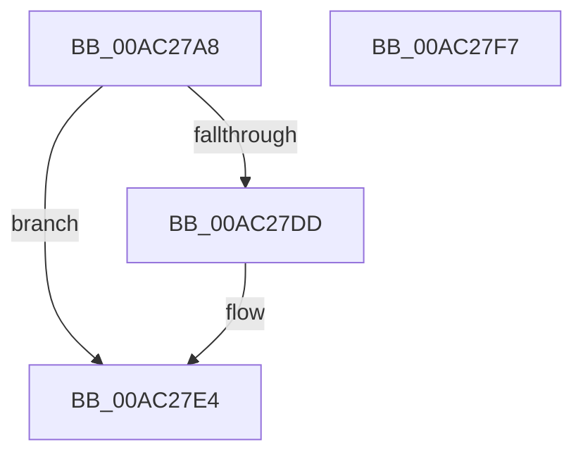

# HvFoldBackUnreconciledData

- RVA: `0x00AC27A8`–`0x00AC27F8` (길이 `80` bytes)
- VA: `0x0000000140AC27A8`
- 실행 섹션: `PAGE`
- PDB 이름 있음: `예`; PDB Function 태그: `아니요`
- unwind 정보 RVA: `0x0005CAAC`
- 디코드: `20`개 명령, `80/80` bytes 표시
- 미해석 바이트: `0` (있으면 어셈블리에 `.byte`로 보존)

> 이 문서는 커널 이미지의 기계어와 PDB 기호를 분석해 생성했습니다. 4번과 5번은 함수 원형과 자료형을 바이너리 사용 방식에서 추정한 C 해석이며 원본 소스 복구 결과는 아닙니다.

## 1. Dependencies

- 직접 호출 지점: **3**; 고유 호출 대상: **3**
- 직접 호출자로 확인된 함수: **1**
- RIP 상대 이미지 참조: **0**

### Outgoing calls
- `0x00AC27C0` → [RtlMergeBitMaps](../../text/43/RtlMergeBitMaps_function_0043DF30.md) (function, `0x0043DF30`)
- `0x00AC27C9` → [RtlNumberOfSetBits](../../text/43/RtlNumberOfSetBits_function_00433F70.md) (function, `0x00433F70`)
- `0x00AC27E7` → [HvFreeUnreconciledData](../9B/HvFreeUnreconciledData_function_009B3CCC.md) (function, `0x009B3CCC`)

### Direct callers
- [CmpFlushHive](../9B/CmpFlushHive_function_009B3DC0.md) at `0x009B44E4`

### Static image references
- 디코드된 RIP-relative 메모리 참조가 없습니다.

## 2. Other-region calls and transfers

- 다른 실행 섹션으로 향하는 call: **2**
  - `0x00AC27C0` → [RtlMergeBitMaps](../../text/43/RtlMergeBitMaps_function_0043DF30.md) (`PAGE` → `.text`)
  - `0x00AC27C9` → [RtlNumberOfSetBits](../../text/43/RtlNumberOfSetBits_function_00433F70.md) (`PAGE` → `.text`)
- 별도 외부 분기/꼬리 이동을 확인하지 못했습니다.

## 3. Assembly (complete function range)

```asm
00AC27A8  48 89 5C 24 08                  mov qword ptr [rsp + 8], rbx
00AC27AD  57                              push rdi
00AC27AE  48 83 EC 20                     sub rsp, 0x20
00AC27B2  48 8B F9                        mov rdi, rcx
00AC27B5  48 8D 91 C8 06 00 00            lea rdx, [rcx + 0x6c8]
00AC27BC  48 83 C1 70                     add rcx, 0x70
00AC27C0  E8 6B B7 97 FF                  call 0x14043df30
00AC27C5  48 8D 4F 70                     lea rcx, [rdi + 0x70]
00AC27C9  E8 A2 17 97 FF                  call 0x140433f70
00AC27CE  80 BF C4 06 00 00 00            cmp byte ptr [rdi + 0x6c4], 0
00AC27D5  89 87 80 00 00 00               mov dword ptr [rdi + 0x80], eax
00AC27DB  74 07                           je 0x140ac27e4
00AC27DD  C6 87 C3 00 00 00 01            mov byte ptr [rdi + 0xc3], 1
00AC27E4  48 8B CF                        mov rcx, rdi
00AC27E7  E8 E0 14 EF FF                  call 0x1409b3ccc
00AC27EC  48 8B 5C 24 30                  mov rbx, qword ptr [rsp + 0x30]
00AC27F1  48 83 C4 20                     add rsp, 0x20
00AC27F5  5F                              pop rdi
00AC27F6  C3                              ret
00AC27F7  CC                              int3
```

## 4. C-style interpretation (structured pseudocode)

```c
__int64 __fastcall HvFoldBackUnreconciledData(__int64 a1)
{
    __int64 result;
    __int64 v_rsp;
    unsigned __int64 v_stack_p8;

    v_stack_p8 = v_rbx;
    v_rsp = (v_rsp) - (32);
    a1 = (a1) + (112);
    result = RtlMergeBitMaps(a1, a1 + 1736, a3, a4);
    result = RtlNumberOfSetBits(a1 + 112, a1 + 1736, a3, a4);
    *(unsigned int *)(a1 + 128) = (unsigned int)(result);
    if ((*(unsigned __int8 *)(a1 + 1732)) != 0) {
        *(unsigned __int8 *)(a1 + 195) = 1;
    }
    result = HvFreeUnreconciledData(a1, a1 + 1736, a3, a4);
    v_rsp = (v_rsp) + (32);
    return result;
}
```

## 5. (Beta) C Style

```c
int64_t HvFoldBackUnreconciledData(void *Arg1)
{
    uint8_t *arg1 = (uint8_t *)Arg1;

    int64_t result;
    int64_t local_rsp;
    uint64_t v_stack_p8;

    v_stack_p8 = local_rbx;
    local_rsp = (local_rsp) - (32);
    Arg1 = (Arg1) + (112);
    result = RtlMergeBitMaps(Arg1, Arg1 + 1736, a3, a4);
    result = RtlNumberOfSetBits(Arg1 + 112, Arg1 + 1736, a3, a4);
    *(uint32_t *)(arg1 + 0x80) = (uint32_t)(result);
    if ((*(uint8_t *)(arg1 + 0x6C4)) != 0) {
        *(uint8_t *)(arg1 + 0xC3) = 1;
    }
    result = HvFreeUnreconciledData(Arg1, Arg1 + 1736, a3, a4);
    local_rsp = (local_rsp) + (32);
    return result;
}
```

### 관측된 메모리 오프셋

구조체 형식이 확인되지 않은 접근은 인자 기준의 오프셋으로만 기록했습니다.

| 기준 인자 | 오프셋 표현 | 폭 (bit) | 접근 |
|---|---:|---:|---|
| `Arg1` | `+ 0x70` | `64` | `R` |
| `Arg1` | `+ 0x80` | `32` | `W` |
| `Arg1` | `+ 0xC3` | `8` | `W` |
| `Arg1` | `+ 0x6C4` | `8` | `R` |
| `Arg1` | `+ 0x6C8` | `64` | `R` |

## 6. Execution-region graph

[열기: 2D/3D 그래프와 함수 탐색 컨트롤 패널](../../../control-panel.html?section=page&rva=0x00AC27A8&view=graph)

- 2D 그래프는 위에서 아래로 흐르고, 3D 그래프는 빈 공간을 드래그해 회전합니다. Shift+드래그는 이동, 휠은 확대·축소, 함수 노드 선택은 대상 보고서 이동입니다.

### Static fallback


