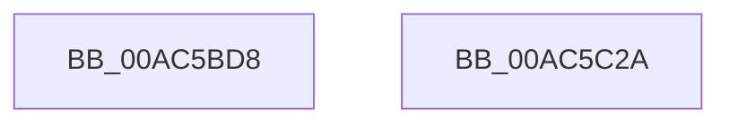

# HvpLogEntryCheckDataChecksum

- RVA: `0x00AC5BD8`–`0x00AC5C2B` (길이 `83` bytes)
- VA: `0x0000000140AC5BD8`
- 실행 섹션: `PAGE`
- PDB 이름 있음: `예`; PDB Function 태그: `아니요`
- unwind 정보 RVA: `0x000BD6E0`
- 디코드: `22`개 명령, `83/83` bytes 표시
- 미해석 바이트: `0` (있으면 어셈블리에 `.byte`로 보존)

> 이 문서는 커널 이미지의 기계어와 PDB 기호를 분석해 생성했습니다. 4번과 5번은 함수 원형과 자료형을 바이너리 사용 방식에서 추정한 C 해석이며 원본 소스 복구 결과는 아닙니다.

## 1. Dependencies

- 직접 호출 지점: **2**; 고유 호출 대상: **2**
- 직접 호출자로 확인된 함수: **1**
- RIP 상대 이미지 참조: **2**

### Outgoing calls
- `0x00AC5C04` → [SymCryptMarvin32](../../text/51/SymCryptMarvin32_function_0051F308.md) (function, `0x0051F308`)
- `0x00AC5C1F` → [_security_check_cookie](../../text/6A/_security_check_cookie_function_006AC640.md) (function, `0x006AC640`)

### Direct callers
- [HvpIncrementalLogFileEnumeratorAdvance](../AA/HvpIncrementalLogFileEnumeratorAdvance_function_00AA07B0.md) at `0x00AA0897`

### Static image references
- `0x00AC5BDE` → RVA `0x00E0A740` (`.data`; read)
- `0x00AC5BFD` → RVA `0x00E2CB20` (`.data`; read)

## 2. Other-region calls and transfers

- 다른 실행 섹션으로 향하는 call: **2**
  - `0x00AC5C04` → [SymCryptMarvin32](../../text/51/SymCryptMarvin32_function_0051F308.md) (`PAGE` → `.text`)
  - `0x00AC5C1F` → [_security_check_cookie](../../text/6A/_security_check_cookie_function_006AC640.md) (`PAGE` → `.text`)
- 별도 외부 분기/꼬리 이동을 확인하지 못했습니다.

## 3. Assembly (complete function range)

```asm
00AC5BD8  40 53                           push rbx
00AC5BDA  48 83 EC 30                     sub rsp, 0x30
00AC5BDE  48 8B 05 5B 4B 34 00            mov rax, qword ptr [rip + 0x344b5b]
00AC5BE5  48 33 C4                        xor rax, rsp
00AC5BE8  48 89 44 24 28                  mov qword ptr [rsp + 0x28], rax
00AC5BED  49 8B D8                        mov rbx, r8
00AC5BF0  4C 8D 4C 24 20                  lea r9, [rsp + 0x20]
00AC5BF5  44 8D 42 D8                     lea r8d, [rdx - 0x28]
00AC5BF9  48 8D 51 28                     lea rdx, [rcx + 0x28]
00AC5BFD  48 8D 0D 1C 6F 36 00            lea rcx, [rip + 0x366f1c]
00AC5C04  E8 FF 96 A5 FF                  call 0x14051f308
00AC5C09  48 8B 4B 18                     mov rcx, qword ptr [rbx + 0x18]
00AC5C0D  33 C0                           xor eax, eax
00AC5C0F  48 3B 4C 24 20                  cmp rcx, qword ptr [rsp + 0x20]
00AC5C14  0F 94 C0                        sete al
00AC5C17  48 8B 4C 24 28                  mov rcx, qword ptr [rsp + 0x28]
00AC5C1C  48 33 CC                        xor rcx, rsp
00AC5C1F  E8 1C 6A BE FF                  call 0x1406ac640
00AC5C24  48 83 C4 30                     add rsp, 0x30
00AC5C28  5B                              pop rbx
00AC5C29  C3                              ret
00AC5C2A  CC                              int3
```

## 4. C-style interpretation (structured pseudocode)

```c
__int64 __fastcall HvpLogEntryCheckDataChecksum(__int64 a1, __int64 a2, __int64 a3)
{
    __int64 result;
    __int64 v_rsp;
    unsigned __int64 v_stack_m10;
    unsigned __int64 v_stack_m18;

    v_rsp = (v_rsp) - (48);
    result = (*(unsigned __int64 *)(v_rip + 3427163)) ^ (v_rsp);
    v_stack_m10 = result;
    result = SymCryptMarvin32(v_rip + 3567388, a1 + 40, a2 - 40, v_stack_m18);
    result = 0;
    result = ((*(unsigned __int64 *)(a3 + 24)) == v_stack_m18) ? 1 : 0;
    a1 = (v_stack_m10) ^ (v_rsp);
    result = _security_check_cookie(a1, a1 + 40, a2 - 40, v_stack_m18);
    v_rsp = (v_rsp) + (48);
    return result;
}
```

## 5. (Beta) C Style

```c
int64_t HvpLogEntryCheckDataChecksum(void *Arg1, void *Arg2, void *Arg3)
{
    uint8_t *arg1 = (uint8_t *)Arg1;
    uint8_t *arg2 = (uint8_t *)Arg2;
    uint8_t *arg3 = (uint8_t *)Arg3;

    int64_t result;
    int64_t local_rsp;
    uint64_t v_stack_m10;
    uint64_t v_stack_m18;

    local_rsp = (local_rsp) - (48);
    result = (*(uint64_t *)(v_rip + 0x344B5B)) ^ (local_rsp);
    v_stack_m10 = result;
    result = SymCryptMarvin32(v_rip + 3567388, Arg1 + 40, Arg2 - 40, v_stack_m18);
    result = 0;
    result = ((*(uint64_t *)(arg3 + 0x18)) == v_stack_m18) ? 1 : 0;
    Arg1 = (v_stack_m10) ^ (local_rsp);
    result = _security_check_cookie(Arg1, Arg1 + 40, Arg2 - 40, v_stack_m18);
    local_rsp = (local_rsp) + (48);
    return result;
}
```

### 관측된 메모리 오프셋

구조체 형식이 확인되지 않은 접근은 인자 기준의 오프셋으로만 기록했습니다.

| 기준 인자 | 오프셋 표현 | 폭 (bit) | 접근 |
|---|---:|---:|---|
| `Arg1` | `+ 0x28` | `64` | `R` |
| `Arg2` | `- 0x28` | `32` | `R` |
| `Arg3` | `+ 0x18` | `64` | `R` |

## 6. Execution-region graph

[열기: 2D/3D 그래프와 함수 탐색 컨트롤 패널](../../../control-panel.html?section=page&rva=0x00AC5BD8&view=graph)

- 2D 그래프는 위에서 아래로 흐르고, 3D 그래프는 빈 공간을 드래그해 회전합니다. Shift+드래그는 이동, 휠은 확대·축소, 함수 노드 선택은 대상 보고서 이동입니다.

### Static fallback


