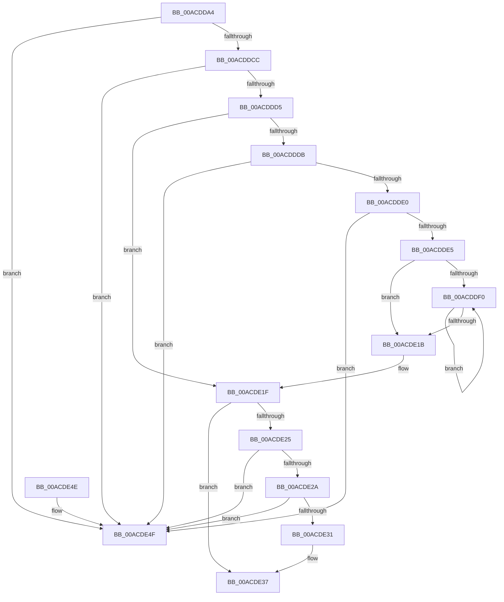

# HvpViewMapAdjustFlag

- RVA: `0x00ACDDA4`–`0x00ACDE56` (길이 `178` bytes)
- VA: `0x0000000140ACDDA4`
- 실행 섹션: `PAGE`
- PDB 이름 있음: `예`; PDB Function 태그: `아니요`
- unwind 정보 RVA: `0x00069AD0`
- 디코드: `55`개 명령, `178/178` bytes 표시
- 미해석 바이트: `0` (있으면 어셈블리에 `.byte`로 보존)

> 이 문서는 커널 이미지의 기계어와 PDB 기호를 분석해 생성했습니다. 4번과 5번은 함수 원형과 자료형을 바이너리 사용 방식에서 추정한 C 해석이며 원본 소스 복구 결과는 아닙니다.

## 1. Dependencies

- 직접 호출 지점: **2**; 고유 호출 대상: **2**
- 직접 호출자로 확인된 함수: **2**
- RIP 상대 이미지 참조: **0**

### Outgoing calls
- `0x00ACDDF6` → [HvpViewMapFindViewForFileOffset](../9B/HvpViewMapFindViewForFileOffset_function_009B5CD8.md) (function, `0x009B5CD8`)
- `0x00ACDE0C` → [HvpViewMapMakeViewRangeUnCOWByPolicy](../9B/HvpViewMapMakeViewRangeUnCOWByPolicy_function_009B76A8.md) (function, `0x009B76A8`)

### Direct callers
- [HvMarkHiveWithNoSectionExtend](../70/HvMarkHiveWithNoSectionExtend_function_00705B70.md) at `0x00705BA0`
- [HvUnlockHiveFilePages](../AA/HvUnlockHiveFilePages_function_00AA5CFC.md) at `0x00AA5D30`

### Static image references
- 디코드된 RIP-relative 메모리 참조가 없습니다.

## 2. Other-region calls and transfers

- 다른 실행 섹션으로 향하는 call: **0**
- 별도 외부 분기/꼬리 이동을 확인하지 못했습니다.

## 3. Assembly (complete function range)

```asm
00ACDDA4  48 89 5C 24 08                  mov qword ptr [rsp + 8], rbx
00ACDDA9  48 89 6C 24 10                  mov qword ptr [rsp + 0x10], rbp
00ACDDAE  48 89 74 24 18                  mov qword ptr [rsp + 0x18], rsi
00ACDDB3  57                              push rdi
00ACDDB4  48 83 EC 20                     sub rsp, 0x20
00ACDDB8  41 8A E8                        mov bpl, r8b
00ACDDBB  8B F2                           mov esi, edx
00ACDDBD  48 8B F9                        mov rdi, rcx
00ACDDC0  F7 C2 F5 FF FF FF               test edx, 0xfffffff5
00ACDDC6  0F 85 83 00 00 00               jne 0x140acde4f
00ACDDCC  8B C2                           mov eax, edx
00ACDDCE  83 E0 0A                        and eax, 0xa
00ACDDD1  3C 0A                           cmp al, 0xa
00ACDDD3  74 7A                           je 0x140acde4f
00ACDDD5  40 F6 C6 02                     test sil, 2
00ACDDD9  74 44                           je 0x140acde1f
00ACDDDB  45 84 C0                        test r8b, r8b
00ACDDDE  75 6F                           jne 0x140acde4f
00ACDDE0  85 51 20                        test dword ptr [rcx + 0x20], edx
00ACDDE3  74 6A                           je 0x140acde4f
00ACDDE5  B8 00 10 00 00                  mov eax, 0x1000
00ACDDEA  48 3B 41 08                     cmp rax, qword ptr [rcx + 8]
00ACDDEE  7D 2B                           jge 0x140acde1b
00ACDDF0  48 8B D0                        mov rdx, rax
00ACDDF3  48 8B CF                        mov rcx, rdi
00ACDDF6  E8 DD 7E EE FF                  call 0x1409b5cd8
00ACDDFB  48 8B D0                        mov rdx, rax
00ACDDFE  48 8B CF                        mov rcx, rdi
00ACDE01  48 8B D8                        mov rbx, rax
00ACDE04  4C 8B 48 30                     mov r9, qword ptr [rax + 0x30]
00ACDE08  4C 8B 40 28                     mov r8, qword ptr [rax + 0x28]
00ACDE0C  E8 97 98 EE FF                  call 0x1409b76a8
00ACDE11  48 8B 43 30                     mov rax, qword ptr [rbx + 0x30]
00ACDE15  48 3B 47 08                     cmp rax, qword ptr [rdi + 8]
00ACDE19  7C D5                           jl 0x140acddf0
00ACDE1B  83 67 20 FD                     and dword ptr [rdi + 0x20], 0xfffffffd
00ACDE1F  40 F6 C6 08                     test sil, 8
00ACDE23  74 12                           je 0x140acde37
00ACDE25  40 84 ED                        test bpl, bpl
00ACDE28  74 25                           je 0x140acde4f
00ACDE2A  8B 47 20                        mov eax, dword ptr [rdi + 0x20]
00ACDE2D  A8 08                           test al, 8
00ACDE2F  75 1E                           jne 0x140acde4f
00ACDE31  83 C8 08                        or eax, 8
00ACDE34  89 47 20                        mov dword ptr [rdi + 0x20], eax
00ACDE37  48 8B 5C 24 30                  mov rbx, qword ptr [rsp + 0x30]
00ACDE3C  33 C0                           xor eax, eax
00ACDE3E  48 8B 6C 24 38                  mov rbp, qword ptr [rsp + 0x38]
00ACDE43  48 8B 74 24 40                  mov rsi, qword ptr [rsp + 0x40]
00ACDE48  48 83 C4 20                     add rsp, 0x20
00ACDE4C  5F                              pop rdi
00ACDE4D  C3                              ret
00ACDE4E  CC                              int3
00ACDE4F  B9 05 00 00 00                  mov ecx, 5
00ACDE54  CD 29                           int 0x29
```

## 4. C-style interpretation (structured pseudocode)

```c
__int64 __fastcall HvpViewMapAdjustFlag(__int64 a1, int a2, unsigned __int8 a3)
{
    __int64 result;
    __int64 v_rsp;
    unsigned __int64 v_stack_p10;
    unsigned __int64 v_stack_p18;
    unsigned __int64 v_stack_p8;

    v_stack_p8 = v_rbx;
    v_stack_p10 = v_rbp;
    v_stack_p18 = v_rsi;
    v_rsp = (v_rsp) - (32);
    if (((a2) & (0xFFFFFFF5ULL)) != 0) goto loc_00ACDE4F;
    result = (unsigned int)(((unsigned int)(a2)) & (10));
    if (((unsigned __int8)(result)) == 10) goto loc_00ACDE4F;
    if ((((unsigned __int8)((unsigned int)(a2))) & (2)) == 0) goto loc_00ACDE1F;
    if (a3 != 0) goto loc_00ACDE4F;
    if (((*(unsigned int *)(a1 + 32)) & (a2)) == 0) goto loc_00ACDE4F;
    if (((unsigned int)(0x1000ULL)) >= (*(unsigned __int64 *)(a1 + 8))) goto loc_00ACDE1B;
loc_00ACDDF0:
    result = HvpViewMapFindViewForFileOffset(a1, (unsigned int)(0x1000ULL), a3, a4);
    result = HvpViewMapMakeViewRangeUnCOWByPolicy(a1, result, *(unsigned __int64 *)(result + 40), *(unsigned __int64 *)(result + 48));
    if ((*(unsigned __int64 *)(result + 48)) < (*(unsigned __int64 *)(a1 + 8))) goto loc_00ACDDF0;
loc_00ACDE1B:
loc_00ACDE1F:
    if ((((unsigned __int8)((unsigned int)(a2))) & (8)) == 0) goto loc_00ACDE37;
    if (a3 == 0) goto loc_00ACDE4F;
    if ((((unsigned __int8)((unsigned int)(*(unsigned int *)(a1 + 32)))) & (8)) != 0) goto loc_00ACDE4F;
    result = (unsigned int)(((unsigned int)(*(unsigned int *)(a1 + 32))) | (8));
    *(unsigned int *)(a1 + 32) = (unsigned int)(result);
loc_00ACDE37:
    result = 0;
    v_rsp = (v_rsp) + (32);
    return result;
loc_00ACDE4F:
    return result;
}
```

## 5. (Beta) C Style

```c
int64_t HvpViewMapAdjustFlag(void *Arg1, int32_t Arg2, uint8_t Arg3)
{
    uint8_t *arg1 = (uint8_t *)Arg1;

    int64_t result;
    int64_t local_rsp;
    uint64_t v_stack_p10;
    uint64_t v_stack_p18;
    uint64_t v_stack_p8;

    v_stack_p8 = local_rbx;
    v_stack_p10 = local_rbp;
    v_stack_p18 = local_rsi;
    local_rsp = (local_rsp) - (32);
    if (((Arg2) & (0xFFFFFFF5ULL)) != 0) goto loc_00ACDE4F;
    result = (uint32_t)(((uint32_t)(Arg2)) & (10));
    if (((uint8_t)(result)) == 10) goto loc_00ACDE4F;
    if ((((uint8_t)((uint32_t)(Arg2))) & (2)) == 0) goto loc_00ACDE1F;
    if (Arg3 != 0) goto loc_00ACDE4F;
    if (((*(uint32_t *)(arg1 + 0x20)) & (Arg2)) == 0) goto loc_00ACDE4F;
    if (((uint32_t)(0x1000ULL)) >= (*(uint64_t *)(arg1 + 0x8))) goto loc_00ACDE1B;
loc_00ACDDF0:
    result = HvpViewMapFindViewForFileOffset(Arg1, (uint32_t)(0x1000ULL), Arg3, a4);
    result = HvpViewMapMakeViewRangeUnCOWByPolicy(Arg1, result, *(uint64_t *)(result + 0x28), *(uint64_t *)(result + 0x30));
    if ((*(uint64_t *)(result + 0x30)) < (*(uint64_t *)(arg1 + 0x8))) goto loc_00ACDDF0;
loc_00ACDE1B:
loc_00ACDE1F:
    if ((((uint8_t)((uint32_t)(Arg2))) & (8)) == 0) goto loc_00ACDE37;
    if (Arg3 == 0) goto loc_00ACDE4F;
    if ((((uint8_t)((uint32_t)(*(uint32_t *)(arg1 + 0x20)))) & (8)) != 0) goto loc_00ACDE4F;
    result = (uint32_t)(((uint32_t)(*(uint32_t *)(arg1 + 0x20))) | (8));
    *(uint32_t *)(arg1 + 0x20) = (uint32_t)(result);
loc_00ACDE37:
    result = 0;
    local_rsp = (local_rsp) + (32);
    return result;
loc_00ACDE4F:
    return result;
}
```

### 관측된 메모리 오프셋

구조체 형식이 확인되지 않은 접근은 인자 기준의 오프셋으로만 기록했습니다.

| 기준 인자 | 오프셋 표현 | 폭 (bit) | 접근 |
|---|---:|---:|---|
| `Arg1` | `+ 0x8` | `64` | `R` |
| `Arg1` | `+ 0x20` | `32` | `R` |
| `Arg1` | `+ 0x20` | `32` | `R/W` |
| `Arg1` | `+ 0x20` | `32` | `W` |

## 6. Execution-region graph

[열기: 2D/3D 그래프와 함수 탐색 컨트롤 패널](../../../control-panel.html?section=page&rva=0x00ACDDA4&view=graph)

- 2D 그래프는 위에서 아래로 흐르고, 3D 그래프는 빈 공간을 드래그해 회전합니다. Shift+드래그는 이동, 휠은 확대·축소, 함수 노드 선택은 대상 보고서 이동입니다.

### Static fallback


