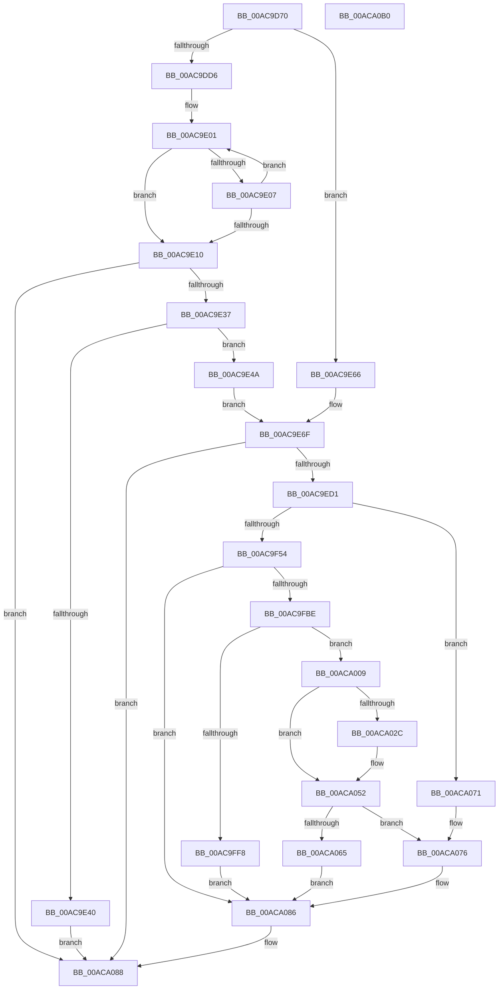

# IoCreateDriver

- RVA: `0x00AC9D70`–`0x00ACA0B1` (길이 `833` bytes)
- VA: `0x0000000140AC9D70`
- 실행 섹션: `PAGE`
- PDB 이름 있음: `예`; PDB Function 태그: `아니요`
- unwind 정보 RVA: `0x000BE310`
- 디코드: `207`개 명령, `833/833` bytes 표시
- 미해석 바이트: `0` (있으면 어셈블리에 `.byte`로 보존)

> 이 문서는 커널 이미지의 기계어와 PDB 기호를 분석해 생성했습니다. 4번과 5번은 함수 원형과 자료형을 바이너리 사용 방식에서 추정한 C 해석이며 원본 소스 복구 결과는 아닙니다.

## 1. Dependencies

- 직접 호출 지점: **18**; 고유 호출 대상: **15**
- 직접 호출자로 확인된 함수: **8**
- RIP 상대 이미지 참조: **5**

### Outgoing calls
- `0x00AC9DF6` → [RtlStringCchPrintfW](../../text/48/RtlStringCchPrintfW_function_00482D5C.md) (function, `0x00482D5C`)
- `0x00AC9EC4` → [ObCreateObjectEx](../89/ObCreateObjectEx_function_0089B1E0.md) (function, `0x0089B1E0`)
- `0x00AC9EDE` → [memset](../../text/6C/memset_function_006C6C40.md) (function, `0x006C6C40`)
- `0x00AC9F1E` → [RtlPcToFileHeader](../../text/2F/RtlPcToFileHeader_function_002F1C50.md) (function, `0x002F1C50`)
- `0x00AC9F3F` → [ExAllocatePool2](../../poolcode/B8/ExAllocatePool2_function_00B820F0.md) (function, `0x00B820F0`)
- `0x00AC9F74` → [memcpy](../../text/6C/memcpy_function_006C6840.md) (function, `0x006C6840`)
- `0x00AC9FAF` → [ObInsertObjectEx](../8B/ObInsertObjectEx_function_008B97A0.md) (function, `0x008B97A0`)
- `0x00AC9FE3` → [ObReferenceObjectByHandle](../86/ObReferenceObjectByHandle_function_00868DB0.md) (function, `0x00868DB0`)
- `0x00AC9FF8` → [ZwMakeTemporaryObject](../../text/6A/ZwMakeTemporaryObject_function_006AF3F0.md) (function, `0x006AF3F0`)
- `0x00ACA002` → [ZwClose](../../text/6A/ZwClose_function_006AD2B0.md) (function, `0x006AD2B0`)
- `0x00ACA009` → [ZwClose](../../text/6A/ZwClose_function_006AD2B0.md) (function, `0x006AD2B0`)
- `0x00ACA01E` → [ExAllocatePool2](../../poolcode/B8/ExAllocatePool2_function_00B820F0.md) (function, `0x00B820F0`)
- `0x00ACA04D` → [memcpy](../../text/6C/memcpy_function_006C6840.md) (function, `0x006C6840`)
- `0x00ACA05A` → [guard_dispatch_icall](../../text/6B/guard_dispatch_icall_function_006BAAD0.md) (function, `0x006BAAD0`)
- `0x00ACA06A` → [EtwTiLogDriverObjectLoad](../A9/EtwTiLogDriverObjectLoad_function_00A985E0.md) (function, `0x00A985E0`)
- `0x00ACA079` → [ObMakeTemporaryObject](../A7/ObMakeTemporaryObject_function_00A7F860.md) (function, `0x00A7F860`)
- `0x00ACA081` → [ObfDereferenceObject](../../text/2F/ObfDereferenceObject_function_002F9350.md) (function, `0x002F9350`)
- `0x00ACA08F` → [_security_check_cookie](../../text/6A/_security_check_cookie_function_006AC640.md) (function, `0x006AC640`)

### Direct callers
- [HaliInitPnpDriver](../70/HaliInitPnpDriver_function_00708000.md) at `0x00708025`
- [CmpBuildMachineHiveCache](../7E/CmpBuildMachineHiveCache_function_007E8B74.md) at `0x007E8B9B`
- [ViIrpLogExposeWmiCallback](../../pagevrfy/BA/ViIrpLogExposeWmiCallback_function_00BABC40.md) at `0x00BABC94`
- [VfFilterAttach](../../pagevrfy/BA/VfFilterAttach_function_00BACD80.md) at `0x00BACDC6`
- [IopInitializePlugPlayServices](../../init/C2/IopInitializePlugPlayServices_function_00C2F298.md) at `0x00C2FC71`
- [IopInitializePlugPlayServices](../../init/C2/IopInitializePlugPlayServices_function_00C2F298.md) at `0x00C2FE78`
- [PiSwInit](../../init/C3/PiSwInit_function_00C3567C.md) at `0x00C35766`
- [WMIInitialize](../../init/C4/WMIInitialize_function_00C4D264.md) at `0x00C4D2A5`
- [CmInitSystem2](../../init/C6/CmInitSystem2_function_00C6FDD8.md) at `0x00C6FE0E`

### Static image references
- `0x00AC9D8E` → RVA `0x00E0A740` (`.data`; read)
- `0x00AC9DDA` → RVA `0x00F8D410` (`.data`; read/write)
- `0x00AC9DEB` → RVA `0x00AFCB90` (` ?? ::NNGAKEGL::`string'`; read)
- `0x00AC9E6F` → RVA `0x00FC6C78` (`ALMOSTRO`; read)
- `0x00AC9F05` → RVA `0x0029B590` (`IopInvalidDeviceRequest`; read)

## 2. Other-region calls and transfers

- 다른 실행 섹션으로 향하는 call: **13**
  - `0x00AC9DF6` → [RtlStringCchPrintfW](../../text/48/RtlStringCchPrintfW_function_00482D5C.md) (`PAGE` → `.text`)
  - `0x00AC9EDE` → [memset](../../text/6C/memset_function_006C6C40.md) (`PAGE` → `.text`)
  - `0x00AC9F1E` → [RtlPcToFileHeader](../../text/2F/RtlPcToFileHeader_function_002F1C50.md) (`PAGE` → `.text`)
  - `0x00AC9F3F` → [ExAllocatePool2](../../poolcode/B8/ExAllocatePool2_function_00B820F0.md) (`PAGE` → `POOLCODE`)
  - `0x00AC9F74` → [memcpy](../../text/6C/memcpy_function_006C6840.md) (`PAGE` → `.text`)
  - `0x00AC9FF8` → [ZwMakeTemporaryObject](../../text/6A/ZwMakeTemporaryObject_function_006AF3F0.md) (`PAGE` → `.text`)
  - `0x00ACA002` → [ZwClose](../../text/6A/ZwClose_function_006AD2B0.md) (`PAGE` → `.text`)
  - `0x00ACA009` → [ZwClose](../../text/6A/ZwClose_function_006AD2B0.md) (`PAGE` → `.text`)
  - `0x00ACA01E` → [ExAllocatePool2](../../poolcode/B8/ExAllocatePool2_function_00B820F0.md) (`PAGE` → `POOLCODE`)
  - `0x00ACA04D` → [memcpy](../../text/6C/memcpy_function_006C6840.md) (`PAGE` → `.text`)
  - `0x00ACA05A` → [guard_dispatch_icall](../../text/6B/guard_dispatch_icall_function_006BAAD0.md) (`PAGE` → `.text`)
  - `0x00ACA081` → [ObfDereferenceObject](../../text/2F/ObfDereferenceObject_function_002F9350.md) (`PAGE` → `.text`)
  - `0x00ACA08F` → [_security_check_cookie](../../text/6A/_security_check_cookie_function_006AC640.md) (`PAGE` → `.text`)
- 별도 외부 분기/꼬리 이동을 확인하지 못했습니다.

## 3. Assembly (complete function range)

```asm
00AC9D70  48 89 5C 24 18                  mov qword ptr [rsp + 0x18], rbx
00AC9D75  48 89 74 24 20                  mov qword ptr [rsp + 0x20], rsi
00AC9D7A  55                              push rbp
00AC9D7B  57                              push rdi
00AC9D7C  41 54                           push r12
00AC9D7E  41 56                           push r14
00AC9D80  41 57                           push r15
00AC9D82  48 8D 6C 24 B0                  lea rbp, [rsp - 0x50]
00AC9D87  48 81 EC 50 01 00 00            sub rsp, 0x150
00AC9D8E  48 8B 05 AB 09 34 00            mov rax, qword ptr [rip + 0x3409ab]
00AC9D95  48 33 C4                        xor rax, rsp
00AC9D98  48 89 45 40                     mov qword ptr [rbp + 0x40], rax
00AC9D9C  45 33 FF                        xor r15d, r15d
00AC9D9F  0F 57 C0                        xorps xmm0, xmm0
00AC9DA2  44 89 7D 8C                     mov dword ptr [rbp - 0x74], r15d
00AC9DA6  0F 57 C9                        xorps xmm1, xmm1
00AC9DA9  44 89 7D A4                     mov dword ptr [rbp - 0x5c], r15d
00AC9DAD  48 8B F2                        mov rsi, rdx
00AC9DB0  4C 89 7C 24 70                  mov qword ptr [rsp + 0x70], r15
00AC9DB5  4C 89 7C 24 60                  mov qword ptr [rsp + 0x60], r15
00AC9DBA  45 8D 67 02                     lea r12d, [r15 + 2]
00AC9DBE  4C 89 7C 24 68                  mov qword ptr [rsp + 0x68], r15
00AC9DC3  0F 11 44 24 50                  movups xmmword ptr [rsp + 0x50], xmm0
00AC9DC8  0F 11 4C 24 78                  movups xmmword ptr [rsp + 0x78], xmm1
00AC9DCD  48 85 C9                        test rcx, rcx
00AC9DD0  0F 85 90 00 00 00               jne 0x140ac9e66
00AC9DD6  45 8D 4F 01                     lea r9d, [r15 + 1]
00AC9DDA  F0 44 0F C1 0D 2D 36 4C 00      lock xadd dword ptr [rip + 0x4c362d], r9d
00AC9DE3  8D 59 3C                        lea ebx, [rcx + 0x3c]
00AC9DE6  41 FF C1                        inc r9d
00AC9DE9  8B D3                           mov edx, ebx
00AC9DEB  4C 8D 05 9E 2D 03 00            lea r8, [rip + 0x32d9e]
00AC9DF2  48 8D 4D C0                     lea rcx, [rbp - 0x40]
00AC9DF6  E8 61 8F 9B FF                  call 0x140482d5c
00AC9DFB  48 8D 45 C0                     lea rax, [rbp - 0x40]
00AC9DFF  8B FB                           mov edi, ebx
00AC9E01  66 44 39 38                     cmp word ptr [rax], r15w
00AC9E05  74 09                           je 0x140ac9e10
00AC9E07  49 03 C4                        add rax, r12
00AC9E0A  48 83 EF 01                     sub rdi, 1
00AC9E0E  75 F1                           jne 0x140ac9e01
00AC9E10  48 8B C7                        mov rax, rdi
00AC9E13  48 8B CF                        mov rcx, rdi
00AC9E16  48 F7 D8                        neg rax
00AC9E19  1B C0                           sbb eax, eax
00AC9E1B  48 2B DF                        sub rbx, rdi
00AC9E1E  F7 D0                           not eax
00AC9E20  25 0D 00 00 C0                  and eax, 0xc000000d
00AC9E25  48 F7 D9                        neg rcx
00AC9E28  48 1B D2                        sbb rdx, rdx
00AC9E2B  48 23 D3                        and rdx, rbx
00AC9E2E  48 85 FF                        test rdi, rdi
00AC9E31  0F 84 51 02 00 00               je 0x140aca088
00AC9E37  48 81 FA FF FF 00 00            cmp rdx, 0xffff
00AC9E3E  76 0A                           jbe 0x140ac9e4a
00AC9E40  B8 05 00 00 80                  mov eax, 0x80000005
00AC9E45  E9 3E 02 00 00                  jmp 0x140aca088
00AC9E4A  66 03 D2                        add dx, dx
00AC9E4D  48 8D 45 C0                     lea rax, [rbp - 0x40]
00AC9E51  66 89 54 24 50                  mov word ptr [rsp + 0x50], dx
00AC9E56  66 41 03 D4                     add dx, r12w
00AC9E5A  66 89 54 24 52                  mov word ptr [rsp + 0x52], dx
00AC9E5F  48 89 44 24 58                  mov qword ptr [rsp + 0x58], rax
00AC9E64  EB 09                           jmp 0x140ac9e6f
00AC9E66  0F 10 01                        movups xmm0, xmmword ptr [rcx]
00AC9E69  F3 0F 7F 44 24 50               movdqu xmmword ptr [rsp + 0x50], xmm0
00AC9E6F  48 8B 15 02 CE 4F 00            mov rdx, qword ptr [rip + 0x4fce02]
00AC9E76  48 8D 44 24 50                  lea rax, [rsp + 0x50]
00AC9E7B  4C 89 7C 24 48                  mov qword ptr [rsp + 0x48], r15
00AC9E80  4C 8D 45 88                     lea r8, [rbp - 0x78]
00AC9E84  48 89 45 98                     mov qword ptr [rbp - 0x68], rax
00AC9E88  0F 57 C0                        xorps xmm0, xmm0
00AC9E8B  48 8D 44 24 70                  lea rax, [rsp + 0x70]
00AC9E90  C7 45 88 30 00 00 00            mov dword ptr [rbp - 0x78], 0x30
00AC9E97  48 89 44 24 40                  mov qword ptr [rsp + 0x40], rax
00AC9E9C  BF A8 01 00 00                  mov edi, 0x1a8
00AC9EA1  44 89 7C 24 38                  mov dword ptr [rsp + 0x38], r15d
00AC9EA6  45 33 C9                        xor r9d, r9d
00AC9EA9  44 89 7C 24 30                  mov dword ptr [rsp + 0x30], r15d
00AC9EAE  33 C9                           xor ecx, ecx
00AC9EB0  89 7C 24 28                     mov dword ptr [rsp + 0x28], edi
00AC9EB4  4C 89 7D 90                     mov qword ptr [rbp - 0x70], r15
00AC9EB8  C7 45 A0 50 02 00 00            mov dword ptr [rbp - 0x60], 0x250
00AC9EBF  F3 0F 7F 45 A8                  movdqu xmmword ptr [rbp - 0x58], xmm0
00AC9EC4  E8 17 13 DD FF                  call 0x14089b1e0
00AC9EC9  85 C0                           test eax, eax
00AC9ECB  0F 88 B7 01 00 00               js 0x140aca088
00AC9ED1  48 8B 5C 24 70                  mov rbx, qword ptr [rsp + 0x70]
00AC9ED6  44 8B C7                        mov r8d, edi
00AC9ED9  48 8B CB                        mov rcx, rbx
00AC9EDC  33 D2                           xor edx, edx
00AC9EDE  E8 5D CD BF FF                  call 0x1406c6c40
00AC9EE3  48 8D 83 50 01 00 00            lea rax, [rbx + 0x150]
00AC9EEA  B9 04 00 00 00                  mov ecx, 4
00AC9EEF  48 89 43 30                     mov qword ptr [rbx + 0x30], rax
00AC9EF3  48 8D 7B 70                     lea rdi, [rbx + 0x70]
00AC9EF7  48 89 18                        mov qword ptr [rax], rbx
00AC9EFA  48 8D 54 24 68                  lea rdx, [rsp + 0x68]
00AC9EFF  C7 03 04 00 50 01               mov dword ptr [rbx], 0x1500004
00AC9F05  48 8D 05 84 16 7D FF            lea rax, [rip - 0x82e97c]
00AC9F0C  89 4B 10                        mov dword ptr [rbx + 0x10], ecx
00AC9F0F  B9 1C 00 00 00                  mov ecx, 0x1c
00AC9F14  F3 48 AB                        rep stosq qword ptr [rdi], rax
00AC9F17  48 8B CE                        mov rcx, rsi
00AC9F1A  48 89 73 58                     mov qword ptr [rbx + 0x58], rsi
00AC9F1E  E8 2D 7D 82 FF                  call 0x1402f1c50
00AC9F23  48 8B 44 24 68                  mov rax, qword ptr [rsp + 0x68]
00AC9F28  B9 00 01 00 00                  mov ecx, 0x100
00AC9F2D  48 89 43 18                     mov qword ptr [rbx + 0x18], rax
00AC9F31  41 B8 49 6F 4E 33               mov r8d, 0x334e6f49
00AC9F37  0F B7 54 24 50                  movzx edx, word ptr [rsp + 0x50]
00AC9F3C  49 03 D4                        add rdx, r12
00AC9F3F  E8 AC 81 0B 00                  call 0x140b820f0
00AC9F44  48 89 45 80                     mov qword ptr [rbp - 0x80], rax
00AC9F48  4C 8B F0                        mov r14, rax
00AC9F4B  48 85 C0                        test rax, rax
00AC9F4E  0F 84 1D 01 00 00               je 0x140aca071
00AC9F54  0F B7 54 24 50                  movzx edx, word ptr [rsp + 0x50]
00AC9F59  66 89 54 24 78                  mov word ptr [rsp + 0x78], dx
00AC9F5E  8B FA                           mov edi, edx
00AC9F60  44 8B C2                        mov r8d, edx
00AC9F63  41 8D 0C 14                     lea ecx, [r12 + rdx]
00AC9F67  48 8B 54 24 58                  mov rdx, qword ptr [rsp + 0x58]
00AC9F6C  66 89 4C 24 7A                  mov word ptr [rsp + 0x7a], cx
00AC9F71  48 8B C8                        mov rcx, rax
00AC9F74  E8 C7 C8 BF FF                  call 0x1406c6840
00AC9F79  0F 10 44 24 78                  movups xmm0, xmmword ptr [rsp + 0x78]
00AC9F7E  45 33 C9                        xor r9d, r9d
00AC9F81  48 D1 EF                        shr rdi, 1
00AC9F84  33 D2                           xor edx, edx
00AC9F86  48 8B CB                        mov rcx, rbx
00AC9F89  66 45 89 3C 7E                  mov word ptr [r14 + rdi*2], r15w
00AC9F8E  45 8D 41 01                     lea r8d, [r9 + 1]
00AC9F92  48 8B 43 30                     mov rax, qword ptr [rbx + 0x30]
00AC9F96  F3 0F 7F 40 18                  movdqu xmmword ptr [rax + 0x18], xmm0
00AC9F9B  48 8D 44 24 60                  lea rax, [rsp + 0x60]
00AC9FA0  48 89 44 24 30                  mov qword ptr [rsp + 0x30], rax
00AC9FA5  4C 89 7C 24 28                  mov qword ptr [rsp + 0x28], r15
00AC9FAA  44 89 7C 24 20                  mov dword ptr [rsp + 0x20], r15d
00AC9FAF  E8 EC F7 DE FF                  call 0x1408b97a0
00AC9FB4  8B F8                           mov edi, eax
00AC9FB6  85 C0                           test eax, eax
00AC9FB8  0F 88 C8 00 00 00               js 0x140aca086
00AC9FBE  4C 8B 05 B3 CC 4F 00            mov r8, qword ptr [rip + 0x4fccb3]
00AC9FC5  48 8D 44 24 68                  lea rax, [rsp + 0x68]
00AC9FCA  48 8B 4C 24 60                  mov rcx, qword ptr [rsp + 0x60]
00AC9FCF  45 33 C9                        xor r9d, r9d
00AC9FD2  4C 89 7C 24 28                  mov qword ptr [rsp + 0x28], r15
00AC9FD7  33 D2                           xor edx, edx
00AC9FD9  48 89 44 24 20                  mov qword ptr [rsp + 0x20], rax
00AC9FDE  4C 89 7C 24 68                  mov qword ptr [rsp + 0x68], r15
00AC9FE3  E8 C8 ED D9 FF                  call 0x140868db0
00AC9FE8  48 8B 5C 24 68                  mov rbx, qword ptr [rsp + 0x68]
00AC9FED  8B F8                           mov edi, eax
00AC9FEF  48 8B 4C 24 60                  mov rcx, qword ptr [rsp + 0x60]
00AC9FF4  85 C0                           test eax, eax
00AC9FF6  79 11                           jns 0x140aca009
00AC9FF8  E8 F3 53 BE FF                  call 0x1406af3f0
00AC9FFD  48 8B 4C 24 60                  mov rcx, qword ptr [rsp + 0x60]
00ACA002  E8 A9 32 BE FF                  call 0x1406ad2b0
00ACA007  EB 7D                           jmp 0x140aca086
00ACA009  E8 A2 32 BE FF                  call 0x1406ad2b0
00ACA00E  0F B7 54 24 52                  movzx edx, word ptr [rsp + 0x52]
00ACA013  B9 40 00 00 00                  mov ecx, 0x40
00ACA018  41 B8 49 6F 4E 33               mov r8d, 0x334e6f49
00ACA01E  E8 CD 80 0B 00                  call 0x140b820f0
00ACA023  48 89 43 40                     mov qword ptr [rbx + 0x40], rax
00ACA027  48 85 C0                        test rax, rax
00ACA02A  74 26                           je 0x140aca052
00ACA02C  0F B7 44 24 52                  movzx eax, word ptr [rsp + 0x52]
00ACA031  66 89 43 3A                     mov word ptr [rbx + 0x3a], ax
00ACA035  0F B7 44 24 50                  movzx eax, word ptr [rsp + 0x50]
00ACA03A  66 89 43 38                     mov word ptr [rbx + 0x38], ax
00ACA03E  44 0F B7 44 24 52               movzx r8d, word ptr [rsp + 0x52]
00ACA044  48 8B 54 24 58                  mov rdx, qword ptr [rsp + 0x58]
00ACA049  48 8B 4B 40                     mov rcx, qword ptr [rbx + 0x40]
00ACA04D  E8 EE C7 BF FF                  call 0x1406c6840
00ACA052  33 D2                           xor edx, edx
00ACA054  48 8B CB                        mov rcx, rbx
00ACA057  48 8B C6                        mov rax, rsi
00ACA05A  E8 71 0A BF FF                  call 0x1406baad0
00ACA05F  8B F8                           mov edi, eax
00ACA061  85 C0                           test eax, eax
00ACA063  78 11                           js 0x140aca076
00ACA065  48 8D 4C 24 50                  lea rcx, [rsp + 0x50]
00ACA06A  E8 71 E5 FC FF                  call 0x140a985e0
00ACA06F  EB 15                           jmp 0x140aca086
00ACA071  BF 9A 00 00 C0                  mov edi, 0xc000009a
00ACA076  48 8B CB                        mov rcx, rbx
00ACA079  E8 E2 57 FB FF                  call 0x140a7f860
00ACA07E  48 8B CB                        mov rcx, rbx
00ACA081  E8 CA F2 82 FF                  call 0x1402f9350
00ACA086  8B C7                           mov eax, edi
00ACA088  48 8B 4D 40                     mov rcx, qword ptr [rbp + 0x40]
00ACA08C  48 33 CC                        xor rcx, rsp
00ACA08F  E8 AC 25 BE FF                  call 0x1406ac640
00ACA094  4C 8D 9C 24 50 01 00 00         lea r11, [rsp + 0x150]
00ACA09C  49 8B 5B 40                     mov rbx, qword ptr [r11 + 0x40]
00ACA0A0  49 8B 73 48                     mov rsi, qword ptr [r11 + 0x48]
00ACA0A4  49 8B E3                        mov rsp, r11
00ACA0A7  41 5F                           pop r15
00ACA0A9  41 5E                           pop r14
00ACA0AB  41 5C                           pop r12
00ACA0AD  5F                              pop rdi
00ACA0AE  5D                              pop rbp
00ACA0AF  C3                              ret
00ACA0B0  CC                              int3
```

## 4. C-style interpretation (structured pseudocode)

```c
__int64 __fastcall IoCreateDriver(__int64 a1, __int64 a2)
{
    __int64 result;
    __int64 v_r15;
    __int64 v_rbx;
    __int64 v_rdi;
    __int64 v_rsp;
    unsigned __int64 v_stack_m100;
    unsigned __int64 v_stack_m108;
    unsigned __int64 v_stack_m110;
    unsigned __int64 v_stack_m118;
    unsigned __int64 v_stack_m120;
    unsigned __int16 v_stack_m126;
    unsigned __int64 v_stack_m128;
    unsigned __int64 v_stack_m130;
    unsigned __int64 v_stack_m138;
    unsigned int v_stack_m140;
    unsigned int v_stack_m148;
    unsigned int v_stack_m150;
    unsigned int v_stack_m158;
    unsigned __int64 v_stack_m28;
    unsigned __int64 v_stack_m38;
    unsigned __int64 v_stack_m78;
    unsigned __int64 v_stack_mB8;
    unsigned __int64 v_stack_mD0;
    unsigned int v_stack_mD4;
    unsigned int v_stack_mD8;
    unsigned __int64 v_stack_mE0;
    unsigned __int64 v_stack_mE8;
    unsigned int v_stack_mEC;
    unsigned __int64 v_stack_mF0;
    unsigned __int64 v_stack_mF8;
    unsigned __int16 v_stack_mFE;
    unsigned __int64 v_stack_p18;
    unsigned __int64 v_stack_p20;

    v_stack_p18 = v_rbx;
    v_stack_p20 = v_rsi;
    v_rsp = (v_rsp) - (336);
    result = (*(unsigned __int64 *)(v_rip + 3410347)) ^ (v_rsp);
    v_stack_m38 = result;
    v_r15 = 0;
    v_stack_mEC = 0;
    v_stack_mD4 = 0;
    v_stack_m108 = 0;
    v_stack_m118 = 0;
    v_stack_m110 = 0;
    v_stack_m128 = v_xmm0;
    v_stack_m100 = v_xmm1;
    if (a1 != 0) goto loc_00AC9E66;
    a4 = (unsigned int)((v_r15 + 1) + 1);
    result = RtlStringCchPrintfW(v_stack_mB8, (unsigned int)((unsigned int)(a1 + 60)), v_rip + 208286, a4);
loc_00AC9E01:
    if ((*(unsigned __int16 *)(v_stack_mB8)) == 0) goto loc_00AC9E10;
    result = (v_stack_mB8) + (v_r15 + 2);
    v_rdi = ((unsigned int)((unsigned int)(a1 + 60))) - (1);
    if (condition_is_not_equal) goto loc_00AC9E01;
loc_00AC9E10:
    result = -(v_rdi);
    v_rbx = (a1 + 60) - (v_rdi);
    result = (unsigned int)(~(result));
    result = (unsigned int)((result) & (0xC000000DULL));
    a1 = -(v_rdi);
    a2 = ((unsigned int)((unsigned int)(a1 + 60))) & (v_rbx);
    if (v_rdi == 0) goto loc_00ACA088;
    if (a2 <= 0xFFFFULL) goto loc_00AC9E4A;
    goto loc_00ACA088;
loc_00AC9E4A:
    a2 = (unsigned __int16)((a2) + ((unsigned __int16)(a2)));
    v_stack_m128 = (unsigned __int16)(a2);
    a2 = (unsigned __int16)((a2) + ((unsigned __int16)(v_r15 + 2)));
    v_stack_m126 = (unsigned __int16)(a2);
    v_stack_m120 = v_stack_mB8;
    goto loc_00AC9E6F;
loc_00AC9E66:
    v_stack_m128 = v_xmm0;
loc_00AC9E6F:
    v_stack_m130 = 0;
    v_stack_mE0 = v_stack_m128;
    v_stack_mF0 = 48;
    v_stack_m138 = v_stack_m108;
    v_stack_m140 = 0;
    a4 = 0;
    v_stack_m148 = 0;
    a1 = 0;
    v_stack_m150 = 424;
    v_stack_mE8 = 0;
    v_stack_mD8 = 592;
    v_stack_mD0 = v_xmm0;
    result = ObCreateObjectEx(a1, *(unsigned __int64 *)(v_rip + 5230082), v_stack_mF0, a4);
    if (sign_flag) goto loc_00ACA088;
    a2 = 0;
    result = memset(v_stack_m108, a2, 424, a4);
    *(unsigned __int64 *)(v_stack_m108 + 48) = v_stack_m108 + 336;
    *(unsigned __int64 *)(v_stack_m108 + 336) = v_stack_m108;
    *(unsigned int *)(v_stack_m108) = 0x1500004ULL;
    *(unsigned int *)(v_stack_m108 + 16) = 4;
    *(unsigned __int64 *)(v_stack_m108 + 88) = 0;
    result = RtlPcToFileHeader(0, v_stack_m110, 424, a4);
    *(unsigned __int64 *)(v_stack_m108 + 24) = v_stack_m110;
    a2 = (v_stack_m128) + (v_r15 + 2);
    result = ExAllocatePool2(256, a2, (unsigned int)(0x334E6F49ULL), a4);
    v_stack_mF8 = result;
    if (result == 0) goto loc_00ACA071;
    v_stack_m100 = (unsigned __int16)(v_stack_m128);
    v_stack_mFE = (unsigned __int16)(v_r15 + 2 + v_stack_m128 * 1);
    result = memcpy(result, v_stack_m120, (unsigned int)((unsigned int)(v_stack_m128)), a4);
    a4 = 0;
    v_rdi = ((unsigned int)((unsigned int)(v_stack_m128))) >> (1);
    a2 = 0;
    *(unsigned __int16 *)(result + v_rdi * 2) = 0;
    *(unsigned __int64 *)(*(unsigned __int64 *)(v_stack_m108 + 48) + 24) = v_xmm0;
    v_stack_m148 = v_stack_m118;
    v_stack_m150 = 0;
    v_stack_m158 = 0;
    result = ObInsertObjectEx(v_stack_m108, a2, a4 + 1, a4);
    if (sign_flag) goto loc_00ACA086;
    a4 = 0;
    v_stack_m150 = 0;
    a2 = 0;
    v_stack_m158 = v_stack_m110;
    v_stack_m110 = 0;
    result = ObReferenceObjectByHandle(v_stack_m118, a2, *(unsigned __int64 *)(v_rip + 5229747), a4);
    if (!sign_flag) goto loc_00ACA009;
    result = ZwMakeTemporaryObject(v_stack_m118, a2, *(unsigned __int64 *)(v_rip + 5229747), a4);
    result = ZwClose(v_stack_m118, a2, *(unsigned __int64 *)(v_rip + 5229747), a4);
    goto loc_00ACA086;
loc_00ACA009:
    result = ZwClose(v_stack_m118, a2, *(unsigned __int64 *)(v_rip + 5229747), a4);
    result = ExAllocatePool2(64, v_stack_m126, (unsigned int)(0x334E6F49ULL), a4);
    *(unsigned __int64 *)(v_stack_m110 + 64) = result;
    if (result != 0) {
        result = v_stack_m126;
        *(unsigned __int16 *)(v_stack_m110 + 58) = (unsigned __int16)(result);
        result = v_stack_m128;
        *(unsigned __int16 *)(v_stack_m110 + 56) = (unsigned __int16)(result);
        a3 = v_stack_m126;
        a2 = v_stack_m120;
        a1 = *(unsigned __int64 *)(v_stack_m110 + 64);
        result = memcpy(a1, a2, a3, a4);
    }
    a2 = 0;
    result = guard_dispatch_icall(v_stack_m110, a2, a3, a4);
    if (sign_flag) goto loc_00ACA076;
    result = EtwTiLogDriverObjectLoad(v_stack_m128, a2, a3, a4);
    goto loc_00ACA086;
loc_00ACA071:
loc_00ACA076:
    result = ObMakeTemporaryObject(v_stack_m110, a2, a3, a4);
    result = ObfDereferenceObject(v_stack_m110, a2, a3, a4);
loc_00ACA086:
loc_00ACA088:
    a1 = (v_stack_m38) ^ (v_rsp);
    result = _security_check_cookie(a1, a2, a3, a4);
    return result;
}
```

## 5. (Beta) C Style

```c
int64_t IoCreateDriver(int64_t Arg1, int64_t Arg2)
{
    int64_t result;
    int64_t local_r15;
    int64_t local_rbx;
    int64_t local_rdi;
    int64_t local_rsp;
    uint64_t v_stack_m100;
    uint64_t v_stack_m108;
    uint64_t v_stack_m110;
    uint64_t v_stack_m118;
    uint64_t v_stack_m120;
    uint16_t v_stack_m126;
    uint64_t v_stack_m128;
    uint64_t v_stack_m130;
    uint64_t v_stack_m138;
    uint32_t v_stack_m140;
    uint32_t v_stack_m148;
    uint32_t v_stack_m150;
    uint32_t v_stack_m158;
    uint64_t v_stack_m28;
    uint64_t v_stack_m38;
    uint64_t v_stack_m78;
    uint64_t v_stack_mB8;
    uint64_t v_stack_mD0;
    uint32_t v_stack_mD4;
    uint32_t v_stack_mD8;
    uint64_t v_stack_mE0;
    uint64_t v_stack_mE8;
    uint32_t v_stack_mEC;
    uint64_t v_stack_mF0;
    uint64_t v_stack_mF8;
    uint16_t v_stack_mFE;
    uint64_t v_stack_p18;
    uint64_t v_stack_p20;

    v_stack_p18 = local_rbx;
    v_stack_p20 = local_rsi;
    local_rsp = (local_rsp) - (336);
    result = (*(uint64_t *)(v_rip + 0x3409AB)) ^ (local_rsp);
    v_stack_m38 = result;
    local_r15 = 0;
    v_stack_mEC = 0;
    v_stack_mD4 = 0;
    v_stack_m108 = 0;
    v_stack_m118 = 0;
    v_stack_m110 = 0;
    v_stack_m128 = v_xmm0;
    v_stack_m100 = v_xmm1;
    if (Arg1 != 0) goto loc_00AC9E66;
    a4 = (uint32_t)((local_r15 + 1) + 1);
    result = RtlStringCchPrintfW(v_stack_mB8, (uint32_t)((uint32_t)(Arg1 + 60)), v_rip + 208286, a4);
loc_00AC9E01:
    if ((*(uint16_t *)(v_stack_mB8)) == 0) goto loc_00AC9E10;
    result = (v_stack_mB8) + (local_r15 + 2);
    local_rdi = ((uint32_t)((uint32_t)(Arg1 + 60))) - (1);
    if (condition_is_not_equal) goto loc_00AC9E01;
loc_00AC9E10:
    result = -(local_rdi);
    local_rbx = (Arg1 + 60) - (local_rdi);
    result = (uint32_t)(~(result));
    result = (uint32_t)((result) & (0xC000000DULL));
    Arg1 = -(local_rdi);
    Arg2 = ((uint32_t)((uint32_t)(Arg1 + 60))) & (local_rbx);
    if (local_rdi == 0) goto loc_00ACA088;
    if (Arg2 <= 0xFFFFULL) goto loc_00AC9E4A;
    goto loc_00ACA088;
loc_00AC9E4A:
    Arg2 = (uint16_t)((Arg2) + ((uint16_t)(Arg2)));
    v_stack_m128 = (uint16_t)(Arg2);
    Arg2 = (uint16_t)((Arg2) + ((uint16_t)(local_r15 + 2)));
    v_stack_m126 = (uint16_t)(Arg2);
    v_stack_m120 = v_stack_mB8;
    goto loc_00AC9E6F;
loc_00AC9E66:
    v_stack_m128 = v_xmm0;
loc_00AC9E6F:
    v_stack_m130 = 0;
    v_stack_mE0 = v_stack_m128;
    v_stack_mF0 = 48;
    v_stack_m138 = v_stack_m108;
    v_stack_m140 = 0;
    a4 = 0;
    v_stack_m148 = 0;
    Arg1 = 0;
    v_stack_m150 = 424;
    v_stack_mE8 = 0;
    v_stack_mD8 = 592;
    v_stack_mD0 = v_xmm0;
    result = ObCreateObjectEx(Arg1, *(uint64_t *)(v_rip + 0x4FCE02), v_stack_mF0, a4);
    if (sign_flag) goto loc_00ACA088;
    Arg2 = 0;
    result = memset(v_stack_m108, Arg2, 424, a4);
    *(uint64_t *)(v_stack_m108 + 0x30) = v_stack_m108 + 336;
    *(uint64_t *)(v_stack_m108 + 0x150) = v_stack_m108;
    *(uint32_t *)(v_stack_m108) = 0x1500004ULL;
    *(uint32_t *)(v_stack_m108 + 0x10) = 4;
    *(uint64_t *)(v_stack_m108 + 0x58) = 0;
    result = RtlPcToFileHeader(0, v_stack_m110, 424, a4);
    *(uint64_t *)(v_stack_m108 + 0x18) = v_stack_m110;
    Arg2 = (v_stack_m128) + (local_r15 + 2);
    result = ExAllocatePool2(256, Arg2, (uint32_t)(0x334E6F49ULL), a4);
    v_stack_mF8 = result;
    if (result == 0) goto loc_00ACA071;
    v_stack_m100 = (uint16_t)(v_stack_m128);
    v_stack_mFE = (uint16_t)(local_r15 + 2 + v_stack_m128 * 1);
    result = memcpy(result, v_stack_m120, (uint32_t)((uint32_t)(v_stack_m128)), a4);
    a4 = 0;
    local_rdi = ((uint32_t)((uint32_t)(v_stack_m128))) >> (1);
    Arg2 = 0;
    *(uint16_t *)(result + local_rdi * 2) = 0;
    *(uint64_t *)(*(uint64_t *)(v_stack_m108 + 0x30) + 0x18) = v_xmm0;
    v_stack_m148 = v_stack_m118;
    v_stack_m150 = 0;
    v_stack_m158 = 0;
    result = ObInsertObjectEx(v_stack_m108, Arg2, a4 + 1, a4);
    if (sign_flag) goto loc_00ACA086;
    a4 = 0;
    v_stack_m150 = 0;
    Arg2 = 0;
    v_stack_m158 = v_stack_m110;
    v_stack_m110 = 0;
    result = ObReferenceObjectByHandle(v_stack_m118, Arg2, *(uint64_t *)(v_rip + 0x4FCCB3), a4);
    if (!sign_flag) goto loc_00ACA009;
    result = ZwMakeTemporaryObject(v_stack_m118, Arg2, *(uint64_t *)(v_rip + 0x4FCCB3), a4);
    result = ZwClose(v_stack_m118, Arg2, *(uint64_t *)(v_rip + 0x4FCCB3), a4);
    goto loc_00ACA086;
loc_00ACA009:
    result = ZwClose(v_stack_m118, Arg2, *(uint64_t *)(v_rip + 0x4FCCB3), a4);
    result = ExAllocatePool2(64, v_stack_m126, (uint32_t)(0x334E6F49ULL), a4);
    *(uint64_t *)(v_stack_m110 + 0x40) = result;
    if (result != 0) {
        result = v_stack_m126;
        *(uint16_t *)(v_stack_m110 + 0x3A) = (uint16_t)(result);
        result = v_stack_m128;
        *(uint16_t *)(v_stack_m110 + 0x38) = (uint16_t)(result);
        a3 = v_stack_m126;
        Arg2 = v_stack_m120;
        Arg1 = *(uint64_t *)(v_stack_m110 + 0x40);
        result = memcpy(Arg1, Arg2, a3, a4);
    }
    Arg2 = 0;
    result = guard_dispatch_icall(v_stack_m110, Arg2, a3, a4);
    if (sign_flag) goto loc_00ACA076;
    result = EtwTiLogDriverObjectLoad(v_stack_m128, Arg2, a3, a4);
    goto loc_00ACA086;
loc_00ACA071:
loc_00ACA076:
    result = ObMakeTemporaryObject(v_stack_m110, Arg2, a3, a4);
    result = ObfDereferenceObject(v_stack_m110, Arg2, a3, a4);
loc_00ACA086:
loc_00ACA088:
    Arg1 = (v_stack_m38) ^ (local_rsp);
    result = _security_check_cookie(Arg1, Arg2, a3, a4);
    return result;
}
```

## 6. Execution-region graph

[열기: 2D/3D 그래프와 함수 탐색 컨트롤 패널](../../../control-panel.html?section=page&rva=0x00AC9D70&view=graph)

- 2D 그래프는 위에서 아래로 흐르고, 3D 그래프는 빈 공간을 드래그해 회전합니다. Shift+드래그는 이동, 휠은 확대·축소, 함수 노드 선택은 대상 보고서 이동입니다.

### Static fallback


