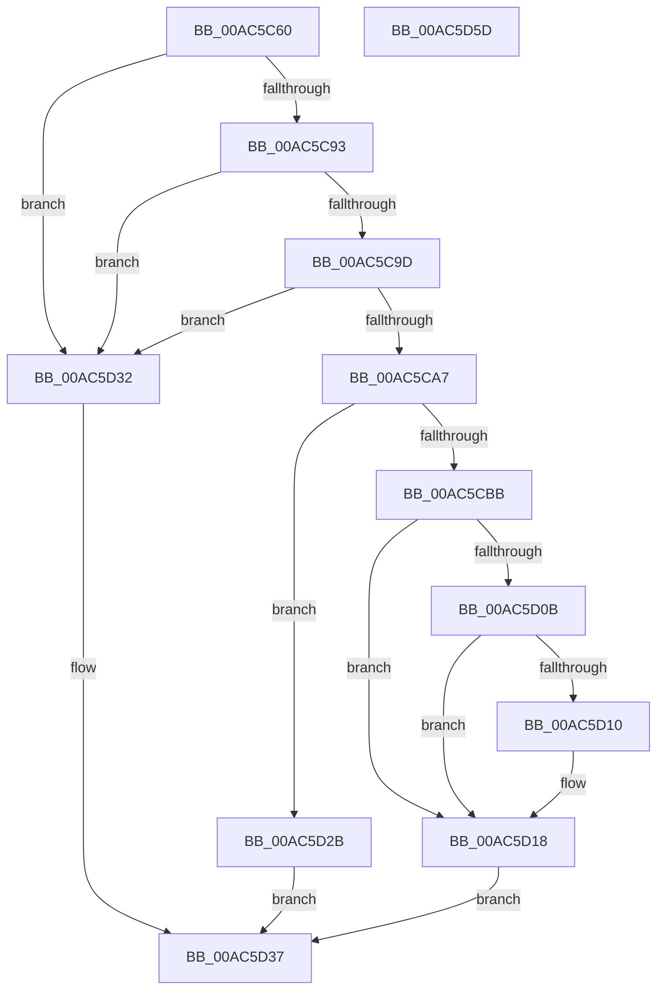

# IoOpenDeviceInterfaceRegistryKey

- RVA: `0x00AC5C60`–`0x00AC5D5E` (길이 `254` bytes)
- VA: `0x0000000140AC5C60`
- 실행 섹션: `PAGE`
- PDB 이름 있음: `예`; PDB Function 태그: `아니요`
- unwind 정보 RVA: `0x000BDE04`
- 디코드: `69`개 명령, `254/254` bytes 표시
- 미해석 바이트: `0` (있으면 어셈블리에 `.byte`로 보존)

> 이 문서는 커널 이미지의 기계어와 PDB 기호를 분석해 생성했습니다. 4번과 5번은 함수 원형과 자료형을 바이너리 사용 방식에서 추정한 C 해석이며 원본 소스 복구 결과는 아닙니다.

## 1. Dependencies

- 직접 호출 지점: **7**; 고유 호출 대상: **7**
- 직접 호출자로 확인된 함수: **2**
- RIP 상대 이미지 참조: **2**

### Outgoing calls
- `0x00AC5CB0` → [PnpUnicodeStringToWstr](../9D/PnpUnicodeStringToWstr_function_009D90C0.md) (function, `0x009D90C0`)
- `0x00AC5CD5` → [ExAcquireResourceExclusiveLite](../../text/21/ExAcquireResourceExclusiveLite_function_00214E20.md) (function, `0x00214E20`)
- `0x00AC5D00` → [_CmOpenDeviceInterfaceRegKey](../8F/_CmOpenDeviceInterfaceRegKey_function_008F31F4.md) (function, `0x008F31F4`)
- `0x00AC5D13` → [IopApplyMutableTagToRegistryKey](../99/IopApplyMutableTagToRegistryKey_function_00999364.md) (function, `0x00999364`)
- `0x00AC5D1F` → [ExReleaseResourceLite](../../text/25/ExReleaseResourceLite_function_0025FA10.md) (function, `0x0025FA10`)
- `0x00AC5D24` → [KeLeaveCriticalRegion](../../text/25/KeLeaveCriticalRegion_function_0025D8B0.md) (function, `0x0025D8B0`)
- `0x00AC5D3D` → [PnpUnicodeStringToWstrFree](../8F/PnpUnicodeStringToWstrFree_function_008F59F0.md) (function, `0x008F59F0`)

### Direct callers
- [DifIoOpenDeviceInterfaceRegistryKeyWrapper](../../text/62/DifIoOpenDeviceInterfaceRegistryKeyWrapper_function_0062B8D0.md) at `0x0062B9B5`
- [IoWMISuggestInstanceName](../7B/IoWMISuggestInstanceName_function_007B2520.md) at `0x007B260B`

### Static image references
- `0x00AC5CC4` → RVA `0x00F8C600` (`.data`; read)
- `0x00AC5CE3` → RVA `0x00E66398` (`.data`; read)

## 2. Other-region calls and transfers

- 다른 실행 섹션으로 향하는 call: **3**
  - `0x00AC5CD5` → [ExAcquireResourceExclusiveLite](../../text/21/ExAcquireResourceExclusiveLite_function_00214E20.md) (`PAGE` → `.text`)
  - `0x00AC5D1F` → [ExReleaseResourceLite](../../text/25/ExReleaseResourceLite_function_0025FA10.md) (`PAGE` → `.text`)
  - `0x00AC5D24` → [KeLeaveCriticalRegion](../../text/25/KeLeaveCriticalRegion_function_0025D8B0.md) (`PAGE` → `.text`)
- 별도 외부 분기/꼬리 이동을 확인하지 못했습니다.

## 3. Assembly (complete function range)

```asm
00AC5C60  48 8B C4                        mov rax, rsp
00AC5C63  48 89 58 10                     mov qword ptr [rax + 0x10], rbx
00AC5C67  48 89 68 18                     mov qword ptr [rax + 0x18], rbp
00AC5C6B  48 89 70 20                     mov qword ptr [rax + 0x20], rsi
00AC5C6F  57                              push rdi
00AC5C70  41 56                           push r14
00AC5C72  41 57                           push r15
00AC5C74  48 83 EC 40                     sub rsp, 0x40
00AC5C78  45 33 FF                        xor r15d, r15d
00AC5C7B  4D 8B F0                        mov r14, r8
00AC5C7E  4C 89 78 08                     mov qword ptr [rax + 8], r15
00AC5C82  8B EA                           mov ebp, edx
00AC5C84  48 8B D9                        mov rbx, rcx
00AC5C87  41 8B FF                        mov edi, r15d
00AC5C8A  48 85 C9                        test rcx, rcx
00AC5C8D  0F 84 9F 00 00 00               je 0x140ac5d32
00AC5C93  4C 39 79 08                     cmp qword ptr [rcx + 8], r15
00AC5C97  0F 84 95 00 00 00               je 0x140ac5d32
00AC5C9D  66 44 39 39                     cmp word ptr [rcx], r15w
00AC5CA1  0F 84 8B 00 00 00               je 0x140ac5d32
00AC5CA7  4C 8B C1                        mov r8, rcx
00AC5CAA  33 D2                           xor edx, edx
00AC5CAC  48 8D 48 08                     lea rcx, [rax + 8]
00AC5CB0  E8 0B 34 F1 FF                  call 0x1409d90c0
00AC5CB5  8B F0                           mov esi, eax
00AC5CB7  85 C0                           test eax, eax
00AC5CB9  78 70                           js 0x140ac5d2b
00AC5CBB  65 48 8B 04 25 88 01 00 00      mov rax, qword ptr gs:[0x188]
00AC5CC4  48 8D 0D 35 69 4C 00            lea rcx, [rip + 0x4c6935]
00AC5CCB  B2 01                           mov dl, 1
00AC5CCD  66 FF 88 E4 01 00 00            dec word ptr [rax + 0x1e4]
00AC5CD4  90                              nop
00AC5CD5  E8 46 F1 74 FF                  call 0x140214e20
00AC5CDA  48 8B 7C 24 60                  mov rdi, qword ptr [rsp + 0x60]
00AC5CDF  45 8D 47 32                     lea r8d, [r15 + 0x32]
00AC5CE3  48 8B 0D AE 06 3A 00            mov rcx, qword ptr [rip + 0x3a06ae]
00AC5CEA  48 8B D7                        mov rdx, rdi
00AC5CED  4C 89 7C 24 38                  mov qword ptr [rsp + 0x38], r15
00AC5CF2  4C 89 74 24 30                  mov qword ptr [rsp + 0x30], r14
00AC5CF7  C6 44 24 28 01                  mov byte ptr [rsp + 0x28], 1
00AC5CFC  89 6C 24 20                     mov dword ptr [rsp + 0x20], ebp
00AC5D00  E8 EF D4 E2 FF                  call 0x1408f31f4
00AC5D05  8B F0                           mov esi, eax
00AC5D07  85 C0                           test eax, eax
00AC5D09  78 0D                           js 0x140ac5d18
00AC5D0B  4D 85 F6                        test r14, r14
00AC5D0E  74 08                           je 0x140ac5d18
00AC5D10  49 8B 0E                        mov rcx, qword ptr [r14]
00AC5D13  E8 4C 36 ED FF                  call 0x140999364
00AC5D18  48 8D 0D E1 68 4C 00            lea rcx, [rip + 0x4c68e1]
00AC5D1F  E8 EC 9C 79 FF                  call 0x14025fa10
00AC5D24  E8 87 7B 79 FF                  call 0x14025d8b0
00AC5D29  EB 0C                           jmp 0x140ac5d37
00AC5D2B  48 8B 7C 24 60                  mov rdi, qword ptr [rsp + 0x60]
00AC5D30  EB 05                           jmp 0x140ac5d37
00AC5D32  BE 0D 00 00 C0                  mov esi, 0xc000000d
00AC5D37  48 8B D3                        mov rdx, rbx
00AC5D3A  48 8B CF                        mov rcx, rdi
00AC5D3D  E8 AE FC E2 FF                  call 0x1408f59f0
00AC5D42  48 8B 5C 24 68                  mov rbx, qword ptr [rsp + 0x68]
00AC5D47  8B C6                           mov eax, esi
00AC5D49  48 8B 74 24 78                  mov rsi, qword ptr [rsp + 0x78]
00AC5D4E  48 8B 6C 24 70                  mov rbp, qword ptr [rsp + 0x70]
00AC5D53  48 83 C4 40                     add rsp, 0x40
00AC5D57  41 5F                           pop r15
00AC5D59  41 5E                           pop r14
00AC5D5B  5F                              pop rdi
00AC5D5C  C3                              ret
00AC5D5D  CC                              int3
```

## 4. C-style interpretation (structured pseudocode)

```c
__int64 __fastcall IoOpenDeviceInterfaceRegistryKey(__int64 a1, int a2, __int64 a3)
{
    __int64 result;
    __int64 v_r15;
    __int64 v_rsp;
    unsigned __int64 v_stack_m20;
    unsigned __int64 v_stack_m28;
    unsigned __int8 v_stack_m30;
    unsigned int v_stack_m38;
    unsigned __int64 v_stack_p10;
    unsigned __int64 v_stack_p18;
    unsigned __int64 v_stack_p20;
    unsigned __int64 v_stack_p8;

    *(unsigned __int64 *)(v_rsp + 16) = v_rbx;
    *(unsigned __int64 *)(v_rsp + 24) = v_rbp;
    *(unsigned __int64 *)(v_rsp + 32) = v_rsi;
    v_rsp = (v_rsp) - (64);
    v_r15 = 0;
    *(unsigned __int64 *)(v_rsp + 8) = 0;
    if (a1 == 0) goto loc_00AC5D32;
    if ((*(unsigned __int64 *)(a1 + 8)) == 0) goto loc_00AC5D32;
    if ((*(unsigned __int16 *)(a1)) == 0) goto loc_00AC5D32;
    a2 = 0;
    result = PnpUnicodeStringToWstr(v_rsp + 8, a2, a1, a4);
    if (sign_flag) goto loc_00AC5D2B;
    result = ExAcquireResourceExclusiveLite(v_rip + 5007669, 1, a1, a4);
    v_stack_m20 = 0;
    v_stack_m28 = a3;
    v_stack_m30 = 1;
    v_stack_m38 = (unsigned int)((unsigned int)(a2));
    result = _CmOpenDeviceInterfaceRegKey(*(unsigned __int64 *)(v_rip + 3802798), v_stack_p8, v_r15 + 50, a4);
    if (sign_flag) goto loc_00AC5D18;
    if (a3 != 0) {
        a1 = *(unsigned __int64 *)(a3);
        result = IopApplyMutableTagToRegistryKey(a1, v_stack_p8, v_r15 + 50, a4);
    }
    result = ExReleaseResourceLite(v_rip + 5007585, v_stack_p8, v_r15 + 50, a4);
    result = KeLeaveCriticalRegion(v_rip + 5007585, v_stack_p8, v_r15 + 50, a4);
    goto loc_00AC5D37;
loc_00AC5D2B:
    goto loc_00AC5D37;
loc_00AC5D32:
loc_00AC5D37:
    result = PnpUnicodeStringToWstrFree(v_stack_p8, a1, v_r15 + 50, a4);
    v_rsp = (v_rsp) + (64);
    return (unsigned int)((unsigned int)((unsigned int)(0xC000000DULL)));
}
```

## 5. (Beta) C Style

```c
int64_t IoOpenDeviceInterfaceRegistryKey(int64_t Arg1, int32_t Arg2, int64_t Arg3)
{
    int64_t result;
    int64_t local_r15;
    int64_t local_rsp;
    uint64_t v_stack_m20;
    uint64_t v_stack_m28;
    uint8_t v_stack_m30;
    uint32_t v_stack_m38;
    uint64_t v_stack_p10;
    uint64_t v_stack_p18;
    uint64_t v_stack_p20;
    uint64_t v_stack_p8;

    *(uint64_t *)(local_rsp + 0x10) = local_rbx;
    *(uint64_t *)(local_rsp + 0x18) = local_rbp;
    *(uint64_t *)(local_rsp + 0x20) = local_rsi;
    local_rsp = (local_rsp) - (64);
    local_r15 = 0;
    *(uint64_t *)(local_rsp + 0x8) = 0;
    if (Arg1 == 0) goto loc_00AC5D32;
    if ((*(uint64_t *)(Arg1 + 0x8)) == 0) goto loc_00AC5D32;
    if ((*(uint16_t *)(Arg1)) == 0) goto loc_00AC5D32;
    Arg2 = 0;
    result = PnpUnicodeStringToWstr(local_rsp + 8, Arg2, Arg1, a4);
    if (sign_flag) goto loc_00AC5D2B;
    result = ExAcquireResourceExclusiveLite(v_rip + 5007669, 1, Arg1, a4);
    v_stack_m20 = 0;
    v_stack_m28 = Arg3;
    v_stack_m30 = 1;
    v_stack_m38 = (uint32_t)((uint32_t)(Arg2));
    result = _CmOpenDeviceInterfaceRegKey(*(uint64_t *)(v_rip + 0x3A06AE), v_stack_p8, local_r15 + 50, a4);
    if (sign_flag) goto loc_00AC5D18;
    if (Arg3 != 0) {
        Arg1 = *(uint64_t *)(Arg3);
        result = IopApplyMutableTagToRegistryKey(Arg1, v_stack_p8, local_r15 + 50, a4);
    }
    result = ExReleaseResourceLite(v_rip + 5007585, v_stack_p8, local_r15 + 50, a4);
    result = KeLeaveCriticalRegion(v_rip + 5007585, v_stack_p8, local_r15 + 50, a4);
    goto loc_00AC5D37;
loc_00AC5D2B:
    goto loc_00AC5D37;
loc_00AC5D32:
loc_00AC5D37:
    result = PnpUnicodeStringToWstrFree(v_stack_p8, Arg1, local_r15 + 50, a4);
    local_rsp = (local_rsp) + (64);
    return (uint32_t)((uint32_t)((uint32_t)(0xC000000DULL)));
}
```

## 6. Execution-region graph

[열기: 2D/3D 그래프와 함수 탐색 컨트롤 패널](../../../control-panel.html?section=page&rva=0x00AC5C60&view=graph)

- 2D 그래프는 위에서 아래로 흐르고, 3D 그래프는 빈 공간을 드래그해 회전합니다. Shift+드래그는 이동, 휠은 확대·축소, 함수 노드 선택은 대상 보고서 이동입니다.

### Static fallback


