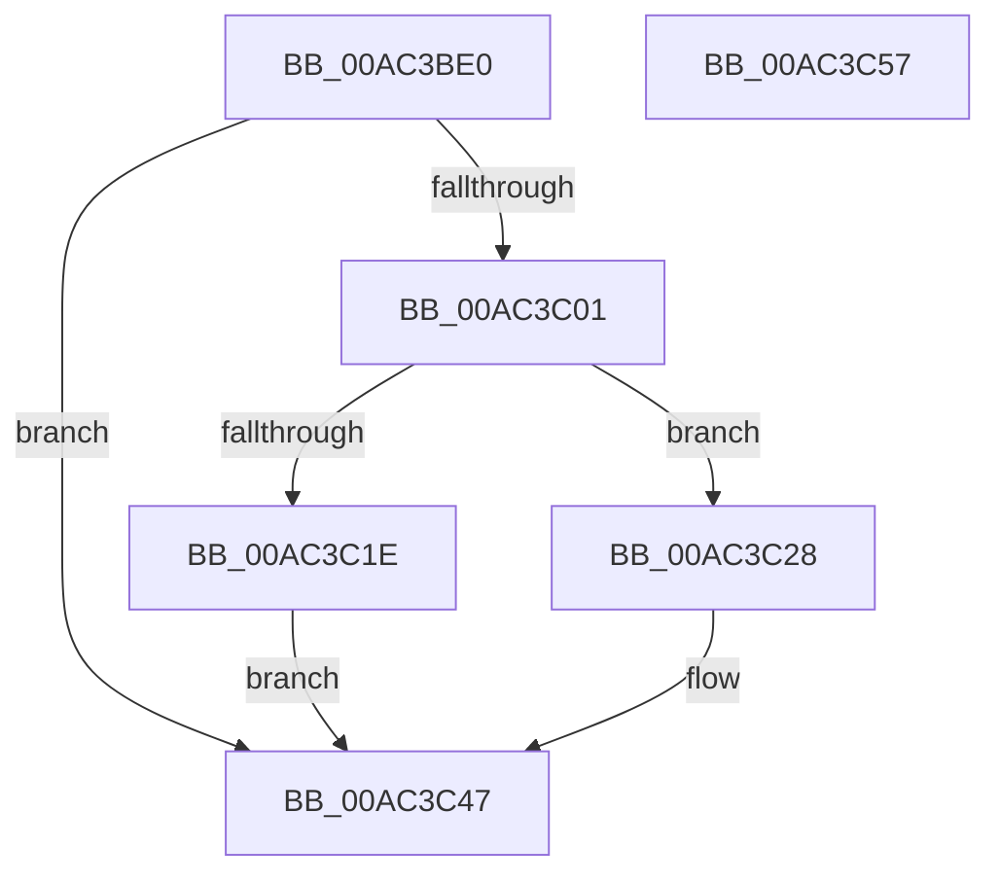

# IoRegisterBootDriverReinitialization

- RVA: `0x00AC3BE0`–`0x00AC3C58` (길이 `120` bytes)
- VA: `0x0000000140AC3BE0`
- 실행 섹션: `PAGE`
- PDB 이름 있음: `예`; PDB Function 태그: `아니요`
- unwind 정보 RVA: `0x00060BC4`
- 디코드: `32`개 명령, `120/120` bytes 표시
- 미해석 바이트: `0` (있으면 어셈블리에 `.byte`로 보존)

> 이 문서는 커널 이미지의 기계어와 PDB 기호를 분석해 생성했습니다. 4번과 5번은 함수 원형과 자료형을 바이너리 사용 방식에서 추정한 C 해석이며 원본 소스 복구 결과는 아닙니다.

## 1. Dependencies

- 직접 호출 지점: **4**; 고유 호출 대상: **4**
- 직접 호출자로 확인된 함수: **0**
- RIP 상대 이미지 참조: **2**

### Outgoing calls
- `0x00AC3C01` → [ObfReferenceObject](../../text/20/ObfReferenceObject_function_0020FA20.md) (function, `0x0020FA20`)
- `0x00AC3C14` → [ExAllocatePool2](../../poolcode/B8/ExAllocatePool2_function_00B820F0.md) (function, `0x00B820F0`)
- `0x00AC3C21` → [ObfDereferenceObject](../../text/2F/ObfDereferenceObject_function_002F9350.md) (function, `0x002F9350`)
- `0x00AC3C42` → [IopInterlockedInsertTailList](../../text/59/IopInterlockedInsertTailList_function_00597500.md) (function, `0x00597500`)

### Direct callers
- 이 함수 시작 RVA로 연결되는 직접 call은 확인되지 않았습니다. 간접 호출은 완전히 역산할 수 없습니다.

### Static image references
- `0x00AC3BEF` → RVA `0x00E66100` (`.data`; read)
- `0x00AC3C2C` → RVA `0x00F8D240` (`.data`; read)

## 2. Other-region calls and transfers

- 다른 실행 섹션으로 향하는 call: **4**
  - `0x00AC3C01` → [ObfReferenceObject](../../text/20/ObfReferenceObject_function_0020FA20.md) (`PAGE` → `.text`)
  - `0x00AC3C14` → [ExAllocatePool2](../../poolcode/B8/ExAllocatePool2_function_00B820F0.md) (`PAGE` → `POOLCODE`)
  - `0x00AC3C21` → [ObfDereferenceObject](../../text/2F/ObfDereferenceObject_function_002F9350.md) (`PAGE` → `.text`)
  - `0x00AC3C42` → [IopInterlockedInsertTailList](../../text/59/IopInterlockedInsertTailList_function_00597500.md) (`PAGE` → `.text`)
- 별도 외부 분기/꼬리 이동을 확인하지 못했습니다.

## 3. Assembly (complete function range)

```asm
00AC3BE0  48 89 5C 24 08                  mov qword ptr [rsp + 8], rbx
00AC3BE5  48 89 74 24 10                  mov qword ptr [rsp + 0x10], rsi
00AC3BEA  57                              push rdi
00AC3BEB  48 83 EC 20                     sub rsp, 0x20
00AC3BEF  80 3D 0A 25 3A 00 01            cmp byte ptr [rip + 0x3a250a], 1
00AC3BF6  49 8B F8                        mov rdi, r8
00AC3BF9  48 8B F2                        mov rsi, rdx
00AC3BFC  48 8B D9                        mov rbx, rcx
00AC3BFF  74 46                           je 0x140ac3c47
00AC3C01  E8 1A BE 74 FF                  call 0x14020fa20
00AC3C06  BA 28 00 00 00                  mov edx, 0x28
00AC3C0B  41 B8 49 6F 52 69               mov r8d, 0x69526f49
00AC3C11  8D 4A 18                        lea ecx, [rdx + 0x18]
00AC3C14  E8 D7 E4 0B 00                  call 0x140b820f0
00AC3C19  48 85 C0                        test rax, rax
00AC3C1C  75 0A                           jne 0x140ac3c28
00AC3C1E  48 8B CB                        mov rcx, rbx
00AC3C21  E8 2A 57 83 FF                  call 0x1402f9350
00AC3C26  EB 1F                           jmp 0x140ac3c47
00AC3C28  83 4B 10 20                     or dword ptr [rbx + 0x10], 0x20
00AC3C2C  48 8D 0D 0D 96 4C 00            lea rcx, [rip + 0x4c960d]
00AC3C33  48 8B D0                        mov rdx, rax
00AC3C36  48 89 58 10                     mov qword ptr [rax + 0x10], rbx
00AC3C3A  48 89 70 18                     mov qword ptr [rax + 0x18], rsi
00AC3C3E  48 89 78 20                     mov qword ptr [rax + 0x20], rdi
00AC3C42  E8 B9 38 AD FF                  call 0x140597500
00AC3C47  48 8B 5C 24 30                  mov rbx, qword ptr [rsp + 0x30]
00AC3C4C  48 8B 74 24 38                  mov rsi, qword ptr [rsp + 0x38]
00AC3C51  48 83 C4 20                     add rsp, 0x20
00AC3C55  5F                              pop rdi
00AC3C56  C3                              ret
00AC3C57  CC                              int3
```

## 4. C-style interpretation (structured pseudocode)

```c
__int64 __fastcall IoRegisterBootDriverReinitialization(__int64 a1, __int64 a2, __int64 a3)
{
    __int64 result;
    __int64 v_rsp;
    unsigned __int64 v_stack_p10;
    unsigned __int64 v_stack_p8;

    v_stack_p8 = v_rbx;
    v_stack_p10 = v_rsi;
    v_rsp = (v_rsp) - (32);
    if ((*(unsigned __int8 *)(v_rip + 3810570)) == 1) goto loc_00AC3C47;
    result = ObfReferenceObject(a1, a2, a3, a4);
    result = ExAllocatePool2(40 + 24, 40, (unsigned int)(0x69526F49ULL), a4);
    if (result != 0) goto loc_00AC3C28;
    result = ObfDereferenceObject(a1, 40, (unsigned int)(0x69526F49ULL), a4);
    goto loc_00AC3C47;
loc_00AC3C28:
    *(unsigned __int64 *)(result + 16) = a1;
    *(unsigned __int64 *)(result + 24) = a2;
    *(unsigned __int64 *)(result + 32) = a3;
    result = IopInterlockedInsertTailList(v_rip + 5019149, result, (unsigned int)(0x69526F49ULL), a4);
loc_00AC3C47:
    v_rsp = (v_rsp) + (32);
    return result;
}
```

## 5. (Beta) C Style

```c
int64_t IoRegisterBootDriverReinitialization(void *Arg1, int64_t Arg2, int64_t Arg3)
{
    uint8_t *arg1 = (uint8_t *)Arg1;

    int64_t result;
    int64_t local_rsp;
    uint64_t v_stack_p10;
    uint64_t v_stack_p8;

    v_stack_p8 = local_rbx;
    v_stack_p10 = local_rsi;
    local_rsp = (local_rsp) - (32);
    if ((*(uint8_t *)(v_rip + 0x3A250A)) == 1) goto loc_00AC3C47;
    result = ObfReferenceObject(Arg1, Arg2, Arg3, a4);
    result = ExAllocatePool2(40 + 24, 40, (uint32_t)(0x69526F49ULL), a4);
    if (result != 0) goto loc_00AC3C28;
    result = ObfDereferenceObject(Arg1, 40, (uint32_t)(0x69526F49ULL), a4);
    goto loc_00AC3C47;
loc_00AC3C28:
    *(void **)(result + 0x10) = Arg1;
    *(uint64_t *)(result + 0x18) = Arg2;
    *(uint64_t *)(result + 0x20) = Arg3;
    result = IopInterlockedInsertTailList(v_rip + 5019149, result, (uint32_t)(0x69526F49ULL), a4);
loc_00AC3C47:
    local_rsp = (local_rsp) + (32);
    return result;
}
```

### 관측된 메모리 오프셋

구조체 형식이 확인되지 않은 접근은 인자 기준의 오프셋으로만 기록했습니다.

| 기준 인자 | 오프셋 표현 | 폭 (bit) | 접근 |
|---|---:|---:|---|
| `Arg1` | `+ 0x10` | `32` | `R/W` |

## 6. Execution-region graph

[열기: 2D/3D 그래프와 함수 탐색 컨트롤 패널](../../../control-panel.html?section=page&rva=0x00AC3BE0&view=graph)

- 2D 그래프는 위에서 아래로 흐르고, 3D 그래프는 빈 공간을 드래그해 회전합니다. Shift+드래그는 이동, 휠은 확대·축소, 함수 노드 선택은 대상 보고서 이동입니다.

### Static fallback


