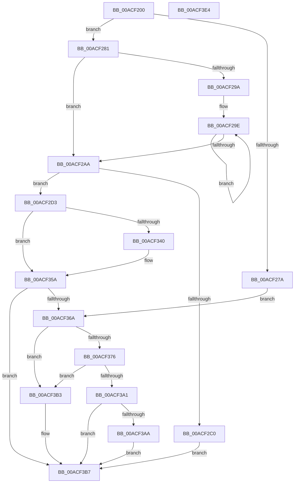

# IoVerifyVolume

- RVA: `0x00ACF200`–`0x00ACF3E5` (길이 `485` bytes)
- VA: `0x0000000140ACF200`
- 실행 섹션: `PAGE`
- PDB 이름 있음: `예`; PDB Function 태그: `아니요`
- unwind 정보 RVA: `0x000BE868`
- 디코드: `135`개 명령, `485/485` bytes 표시
- 미해석 바이트: `0` (있으면 어셈블리에 `.byte`로 보존)

> 이 문서는 커널 이미지의 기계어와 PDB 기호를 분석해 생성했습니다. 4번과 5번은 함수 원형과 자료형을 바이너리 사용 방식에서 추정한 C 해석이며 원본 소스 복구 결과는 아닙니다.

## 1. Dependencies

- 직접 호출 지점: **15**; 고유 호출 대상: **13**
- 직접 호출자로 확인된 함수: **0**
- RIP 상대 이미지 참조: **0**

### Outgoing calls
- `0x00ACF261` → [KeWaitForSingleObject](../../text/20/KeWaitForSingleObject_function_0020E6B0.md) (function, `0x0020E6B0`)
- `0x00ACF271` → [IopReferenceVerifyVpb](../../text/4C/IopReferenceVerifyVpb_function_004C87B4.md) (function, `0x004C87B4`)
- `0x00ACF28A` → [KeInitializeEvent](../../text/40/KeInitializeEvent_function_0040DD10.md) (function, `0x0040DD10`)
- `0x00ACF2B3` → [IopAllocateIrpExReturn](../../text/20/IopAllocateIrpExReturn_function_00207720.md) (function, `0x00207720`)
- `0x00ACF2C4` → [IopDereferenceVpbAndFree](../../text/43/IopDereferenceVpbAndFree_function_0043F474.md) (function, `0x0043F474`)
- `0x00ACF327` → [IopQueueThreadIrp](../../text/20/IopQueueThreadIrp_function_002075C0.md) (function, `0x002075C0`)
- `0x00ACF332` → [IofCallDriver](../../text/29/IofCallDriver_function_0029B4B0.md) (function, `0x0029B4B0`)
- `0x00ACF352` → [KeWaitForSingleObject](../../text/20/KeWaitForSingleObject_function_0020E6B0.md) (function, `0x0020E6B0`)
- `0x00ACF35D` → [IopDereferenceVpbAndFree](../../text/43/IopDereferenceVpbAndFree_function_0043F474.md) (function, `0x0043F474`)
- `0x00ACF36D` → [IopCreateVpb](../71/IopCreateVpb_function_0071E298.md) (function, `0x0071E298`)
- `0x00ACF379` → [PoVolumeDevice](PoVolumeDevice_function_00AC9290.md) (function, `0x00AC9290`)
- `0x00ACF398` → [IopMountVolume](../A3/IopMountVolume_function_00A329D0.md) (function, `0x00A329D0`)
- `0x00ACF3AC` → [IopDecrementVpbRefCount](../../text/40/IopDecrementVpbRefCount_function_0040EAB0.md) (function, `0x0040EAB0`)
- `0x00ACF3BF` → [KeSetEvent](../../text/33/KeSetEvent_function_0033F310.md) (function, `0x0033F310`)
- `0x00ACF3C4` → [KeLeaveCriticalRegion](../../text/25/KeLeaveCriticalRegion_function_0025D8B0.md) (function, `0x0025D8B0`)

### Direct callers
- 이 함수 시작 RVA로 연결되는 직접 call은 확인되지 않았습니다. 간접 호출은 완전히 역산할 수 없습니다.

### Static image references
- 디코드된 RIP-relative 메모리 참조가 없습니다.

## 2. Other-region calls and transfers

- 다른 실행 섹션으로 향하는 call: **12**
  - `0x00ACF261` → [KeWaitForSingleObject](../../text/20/KeWaitForSingleObject_function_0020E6B0.md) (`PAGE` → `.text`)
  - `0x00ACF271` → [IopReferenceVerifyVpb](../../text/4C/IopReferenceVerifyVpb_function_004C87B4.md) (`PAGE` → `.text`)
  - `0x00ACF28A` → [KeInitializeEvent](../../text/40/KeInitializeEvent_function_0040DD10.md) (`PAGE` → `.text`)
  - `0x00ACF2B3` → [IopAllocateIrpExReturn](../../text/20/IopAllocateIrpExReturn_function_00207720.md) (`PAGE` → `.text`)
  - `0x00ACF2C4` → [IopDereferenceVpbAndFree](../../text/43/IopDereferenceVpbAndFree_function_0043F474.md) (`PAGE` → `.text`)
  - `0x00ACF327` → [IopQueueThreadIrp](../../text/20/IopQueueThreadIrp_function_002075C0.md) (`PAGE` → `.text`)
  - `0x00ACF332` → [IofCallDriver](../../text/29/IofCallDriver_function_0029B4B0.md) (`PAGE` → `.text`)
  - `0x00ACF352` → [KeWaitForSingleObject](../../text/20/KeWaitForSingleObject_function_0020E6B0.md) (`PAGE` → `.text`)
  - `0x00ACF35D` → [IopDereferenceVpbAndFree](../../text/43/IopDereferenceVpbAndFree_function_0043F474.md) (`PAGE` → `.text`)
  - `0x00ACF3AC` → [IopDecrementVpbRefCount](../../text/40/IopDecrementVpbRefCount_function_0040EAB0.md) (`PAGE` → `.text`)
  - `0x00ACF3BF` → [KeSetEvent](../../text/33/KeSetEvent_function_0033F310.md) (`PAGE` → `.text`)
  - `0x00ACF3C4` → [KeLeaveCriticalRegion](../../text/25/KeLeaveCriticalRegion_function_0025D8B0.md) (`PAGE` → `.text`)
- 별도 외부 분기/꼬리 이동을 확인하지 못했습니다.

## 3. Assembly (complete function range)

```asm
00ACF200  48 89 5C 24 10                  mov qword ptr [rsp + 0x10], rbx
00ACF205  48 89 74 24 20                  mov qword ptr [rsp + 0x20], rsi
00ACF20A  55                              push rbp
00ACF20B  57                              push rdi
00ACF20C  41 54                           push r12
00ACF20E  41 56                           push r14
00ACF210  41 57                           push r15
00ACF212  48 8B EC                        mov rbp, rsp
00ACF215  48 83 EC 60                     sub rsp, 0x60
00ACF219  48 83 64 24 20 00               and qword ptr [rsp + 0x20], 0
00ACF21F  4C 8D B9 18 01 00 00            lea r15, [rcx + 0x118]
00ACF226  33 C0                           xor eax, eax
00ACF228  0F 57 C0                        xorps xmm0, xmm0
00ACF22B  48 21 45 40                     and qword ptr [rbp + 0x40], rax
00ACF22F  44 8A E2                        mov r12b, dl
00ACF232  48 21 45 30                     and qword ptr [rbp + 0x30], rax
00ACF236  48 8B F9                        mov rdi, rcx
00ACF239  0F 11 45 E0                     movups xmmword ptr [rbp - 0x20], xmm0
00ACF23D  48 89 45 F0                     mov qword ptr [rbp - 0x10], rax
00ACF241  45 33 C9                        xor r9d, r9d
00ACF244  0F 11 45 D0                     movups xmmword ptr [rbp - 0x30], xmm0
00ACF248  65 48 8B 04 25 88 01 00 00      mov rax, qword ptr gs:[0x188]
00ACF251  45 33 C0                        xor r8d, r8d
00ACF254  33 D2                           xor edx, edx
00ACF256  49 8B CF                        mov rcx, r15
00ACF259  66 FF 88 E4 01 00 00            dec word ptr [rax + 0x1e4]
00ACF260  90                              nop
00ACF261  E8 4A F4 73 FF                  call 0x14020e6b0
00ACF266  4C 8D 45 40                     lea r8, [rbp + 0x40]
00ACF26A  48 8B CF                        mov rcx, rdi
00ACF26D  48 8D 55 30                     lea rdx, [rbp + 0x30]
00ACF271  E8 3E 95 9F FF                  call 0x1404c87b4
00ACF276  84 C0                           test al, al
00ACF278  75 07                           jne 0x140acf281
00ACF27A  33 DB                           xor ebx, ebx
00ACF27C  E9 E9 00 00 00                  jmp 0x140acf36a
00ACF281  45 33 C0                        xor r8d, r8d
00ACF284  48 8D 4D E0                     lea rcx, [rbp - 0x20]
00ACF288  33 D2                           xor edx, edx
00ACF28A  E8 81 EA 93 FF                  call 0x14040dd10
00ACF28F  48 8B 5D 40                     mov rbx, qword ptr [rbp + 0x40]
00ACF293  48 83 7B 18 00                  cmp qword ptr [rbx + 0x18], 0
00ACF298  74 10                           je 0x140acf2aa
00ACF29A  48 8B 43 18                     mov rax, qword ptr [rbx + 0x18]
00ACF29E  48 8B D8                        mov rbx, rax
00ACF2A1  48 8B 40 18                     mov rax, qword ptr [rax + 0x18]
00ACF2A5  48 85 C0                        test rax, rax
00ACF2A8  75 F4                           jne 0x140acf29e
00ACF2AA  8A 53 4C                        mov dl, byte ptr [rbx + 0x4c]
00ACF2AD  45 33 C0                        xor r8d, r8d
00ACF2B0  48 8B CB                        mov rcx, rbx
00ACF2B3  E8 68 84 73 FF                  call 0x140207720
00ACF2B8  48 8B F0                        mov rsi, rax
00ACF2BB  48 85 C0                        test rax, rax
00ACF2BE  75 13                           jne 0x140acf2d3
00ACF2C0  48 8B 4D 30                     mov rcx, qword ptr [rbp + 0x30]
00ACF2C4  E8 AB 01 97 FF                  call 0x14043f474
00ACF2C9  BB 9A 00 00 C0                  mov ebx, 0xc000009a
00ACF2CE  E9 E4 00 00 00                  jmp 0x140acf3b7
00ACF2D3  C7 40 10 42 00 00 00            mov dword ptr [rax + 0x10], 0x42
00ACF2DA  45 84 E4                        test r12b, r12b
00ACF2DD  C6 40 40 00                     mov byte ptr [rax + 0x40], 0
00ACF2E1  48 8B CE                        mov rcx, rsi
00ACF2E4  48 8D 45 E0                     lea rax, [rbp - 0x20]
00ACF2E8  48 89 46 50                     mov qword ptr [rsi + 0x50], rax
00ACF2EC  48 8D 45 D0                     lea rax, [rbp - 0x30]
00ACF2F0  48 89 46 48                     mov qword ptr [rsi + 0x48], rax
00ACF2F4  65 48 8B 04 25 88 01 00 00      mov rax, qword ptr gs:[0x188]
00ACF2FD  48 8B 96 B8 00 00 00            mov rdx, qword ptr [rsi + 0xb8]
00ACF304  4C 8B 75 30                     mov r14, qword ptr [rbp + 0x30]
00ACF308  48 89 86 98 00 00 00            mov qword ptr [rsi + 0x98], rax
00ACF30F  0F 95 C0                        setne al
00ACF312  88 42 BA                        mov byte ptr [rdx - 0x46], al
00ACF315  48 8B 45 40                     mov rax, qword ptr [rbp + 0x40]
00ACF319  48 89 42 C8                     mov qword ptr [rdx - 0x38], rax
00ACF31D  66 C7 42 B8 0D 02               mov word ptr [rdx - 0x48], 0x20d
00ACF323  4C 89 72 C0                     mov qword ptr [rdx - 0x40], r14
00ACF327  E8 94 82 73 FF                  call 0x1402075c0
00ACF32C  48 8B D6                        mov rdx, rsi
00ACF32F  48 8B CB                        mov rcx, rbx
00ACF332  E8 79 C1 7C FF                  call 0x14029b4b0
00ACF337  8B D8                           mov ebx, eax
00ACF339  3D 03 01 00 00                  cmp eax, 0x103
00ACF33E  75 1A                           jne 0x140acf35a
00ACF340  48 83 64 24 20 00               and qword ptr [rsp + 0x20], 0
00ACF346  48 8D 4D E0                     lea rcx, [rbp - 0x20]
00ACF34A  45 33 C9                        xor r9d, r9d
00ACF34D  45 33 C0                        xor r8d, r8d
00ACF350  33 D2                           xor edx, edx
00ACF352  E8 59 F3 73 FF                  call 0x14020e6b0
00ACF357  8B 5D D0                        mov ebx, dword ptr [rbp - 0x30]
00ACF35A  49 8B CE                        mov rcx, r14
00ACF35D  E8 12 01 97 FF                  call 0x14043f474
00ACF362  81 FB 12 00 00 C0               cmp ebx, 0xc0000012
00ACF368  75 4D                           jne 0x140acf3b7
00ACF36A  48 8B CF                        mov rcx, rdi
00ACF36D  E8 26 EF C4 FF                  call 0x14071e298
00ACF372  85 C0                           test eax, eax
00ACF374  78 3D                           js 0x140acf3b3
00ACF376  48 8B CF                        mov rcx, rdi
00ACF379  E8 12 9F FF FF                  call 0x140ac9290
00ACF37E  48 83 65 30 00                  and qword ptr [rbp + 0x30], 0
00ACF383  48 8D 45 30                     lea rax, [rbp + 0x30]
00ACF387  45 33 C9                        xor r9d, r9d
00ACF38A  48 89 44 24 20                  mov qword ptr [rsp + 0x20], rax
00ACF38F  41 B0 01                        mov r8b, 1
00ACF392  41 8A D4                        mov dl, r12b
00ACF395  48 8B CF                        mov rcx, rdi
00ACF398  E8 33 36 F6 FF                  call 0x140a329d0
00ACF39D  85 C0                           test eax, eax
00ACF39F  78 12                           js 0x140acf3b3
00ACF3A1  48 8B 4D 30                     mov rcx, qword ptr [rbp + 0x30]
00ACF3A5  48 85 C9                        test rcx, rcx
00ACF3A8  74 0D                           je 0x140acf3b7
00ACF3AA  B2 01                           mov dl, 1
00ACF3AC  E8 FF F6 93 FF                  call 0x14040eab0
00ACF3B1  EB 04                           jmp 0x140acf3b7
00ACF3B3  83 67 30 FD                     and dword ptr [rdi + 0x30], 0xfffffffd
00ACF3B7  45 33 C0                        xor r8d, r8d
00ACF3BA  33 D2                           xor edx, edx
00ACF3BC  49 8B CF                        mov rcx, r15
00ACF3BF  E8 4C FF 86 FF                  call 0x14033f310
00ACF3C4  E8 E7 E4 78 FF                  call 0x14025d8b0
00ACF3C9  4C 8D 5C 24 60                  lea r11, [rsp + 0x60]
00ACF3CE  8B C3                           mov eax, ebx
00ACF3D0  49 8B 5B 38                     mov rbx, qword ptr [r11 + 0x38]
00ACF3D4  49 8B 73 48                     mov rsi, qword ptr [r11 + 0x48]
00ACF3D8  49 8B E3                        mov rsp, r11
00ACF3DB  41 5F                           pop r15
00ACF3DD  41 5E                           pop r14
00ACF3DF  41 5C                           pop r12
00ACF3E1  5F                              pop rdi
00ACF3E2  5D                              pop rbp
00ACF3E3  C3                              ret
00ACF3E4  CC                              int3
```

## 4. C-style interpretation (structured pseudocode)

```c
__int64 __fastcall IoVerifyVolume(__int64 a1, int a2, int a3, int a4)
{
    __int64 result;
    __int64 v_rbx;
    __int64 v_rsp;
    unsigned __int64 v_stack_m28;
    unsigned __int64 v_stack_m38;
    unsigned __int64 v_stack_m48;
    unsigned __int64 v_stack_m58;
    unsigned __int64 v_stack_m68;
    unsigned __int64 v_stack_p10;
    unsigned __int64 v_stack_p18;
    unsigned __int64 v_stack_p20;
    unsigned __int64 v_stack_p8;

    v_stack_p10 = v_rbx;
    v_stack_p20 = v_rsi;
    v_rsp = (v_rsp) - (96);
    result = 0;
    v_stack_m48 = v_xmm0;
    v_stack_m38 = 0;
    a4 = 0;
    v_stack_m58 = v_xmm0;
    a3 = 0;
    a2 = 0;
    result = KeWaitForSingleObject(a1 + 280, a2, a3, a4);
    result = IopReferenceVerifyVpb(a1, v_stack_p8, v_stack_p18, a4);
    if ((unsigned __int8)(result) != 0) goto loc_00ACF281;
    v_rbx = 0;
    goto loc_00ACF36A;
loc_00ACF281:
    a3 = 0;
    a2 = 0;
    result = KeInitializeEvent(v_stack_m48, a2, a3, a4);
    if ((*(unsigned __int64 *)(v_stack_p18 + 24)) == 0) goto loc_00ACF2AA;
loc_00ACF29E:
    if (*(unsigned __int64 *)(*(unsigned __int64 *)(v_stack_p18 + 24) + 24) != 0) goto loc_00ACF29E;
loc_00ACF2AA:
    a3 = 0;
    result = IopAllocateIrpExReturn(*(unsigned __int64 *)(v_stack_p18 + 24), *(unsigned __int8 *)(*(unsigned __int64 *)(v_stack_p18 + 24) + 76), a3, a4);
    if (result != 0) goto loc_00ACF2D3;
    result = IopDereferenceVpbAndFree(v_stack_p8, *(unsigned __int8 *)(*(unsigned __int64 *)(v_stack_p18 + 24) + 76), a3, a4);
    goto loc_00ACF3B7;
loc_00ACF2D3:
    *(unsigned int *)(result + 16) = 66;
    *(unsigned __int8 *)(result + 64) = 0;
    *(unsigned __int64 *)(result + 80) = v_stack_m48;
    *(unsigned __int64 *)(result + 72) = v_stack_m58;
    *(unsigned __int64 *)(result + 152) = *(unsigned __int64 *)(gs_base + (0 + 392));
    result = ((unsigned __int8)((unsigned __int8)(a2)) != 0) ? 1 : 0;
    *(unsigned __int8 *)(*(unsigned __int64 *)(result + 184) - 70) = (unsigned __int8)(result);
    *(unsigned __int64 *)(*(unsigned __int64 *)(result + 184) - 56) = v_stack_p18;
    *(unsigned __int16 *)(*(unsigned __int64 *)(result + 184) - 72) = 525;
    *(unsigned __int64 *)(*(unsigned __int64 *)(result + 184) - 64) = v_stack_p8;
    result = IopQueueThreadIrp(result, *(unsigned __int64 *)(result + 184), a3, a4);
    result = IofCallDriver((unsigned int)(0xC000009AULL), result, a3, a4);
    v_rbx = (unsigned int)((unsigned int)(result));
    if (((unsigned int)(result)) == 259) {
        a1 = v_stack_m48;
        a4 = 0;
        a3 = 0;
        a2 = 0;
        result = KeWaitForSingleObject(a1, a2, a3, a4);
        v_rbx = v_stack_m58;
    }
    result = IopDereferenceVpbAndFree(v_stack_p8, a2, a3, a4);
    if (((unsigned int)(v_rbx)) != 0xC0000012ULL) goto loc_00ACF3B7;
loc_00ACF36A:
    result = IopCreateVpb(a1, a2, a3, a4);
    if (sign_flag) goto loc_00ACF3B3;
    result = PoVolumeDevice(a1, a2, a3, a4);
    a4 = 0;
    v_stack_m68 = v_stack_p8;
    result = IopMountVolume(a1, (unsigned __int8)((unsigned __int8)(a2)), 1, a4);
    if (sign_flag) goto loc_00ACF3B3;
    if (v_stack_p8 == 0) goto loc_00ACF3B7;
    result = IopDecrementVpbRefCount(v_stack_p8, 1, 1, a4);
    goto loc_00ACF3B7;
loc_00ACF3B3:
loc_00ACF3B7:
    a3 = 0;
    a2 = 0;
    result = KeSetEvent(a1 + 280, a2, a3, a4);
    result = KeLeaveCriticalRegion(a1 + 280, a2, a3, a4);
    return (unsigned int)((unsigned int)(v_rbx));
}
```

## 5. (Beta) C Style

```c
int64_t IoVerifyVolume(void *Arg1, int32_t Arg2, int32_t Arg3, int32_t Arg4)
{
    uint8_t *arg1 = (uint8_t *)Arg1;

    int64_t result;
    int64_t local_rbx;
    int64_t local_rsp;
    uint64_t v_stack_m28;
    uint64_t v_stack_m38;
    uint64_t v_stack_m48;
    uint64_t v_stack_m58;
    uint64_t v_stack_m68;
    uint64_t v_stack_p10;
    uint64_t v_stack_p18;
    uint64_t v_stack_p20;
    uint64_t v_stack_p8;

    v_stack_p10 = local_rbx;
    v_stack_p20 = local_rsi;
    local_rsp = (local_rsp) - (96);
    result = 0;
    v_stack_m48 = v_xmm0;
    v_stack_m38 = 0;
    Arg4 = 0;
    v_stack_m58 = v_xmm0;
    Arg3 = 0;
    Arg2 = 0;
    result = KeWaitForSingleObject(Arg1 + 280, Arg2, Arg3, Arg4);
    result = IopReferenceVerifyVpb(Arg1, v_stack_p8, v_stack_p18, Arg4);
    if ((uint8_t)(result) != 0) goto loc_00ACF281;
    local_rbx = 0;
    goto loc_00ACF36A;
loc_00ACF281:
    Arg3 = 0;
    Arg2 = 0;
    result = KeInitializeEvent(v_stack_m48, Arg2, Arg3, Arg4);
    if ((*(uint64_t *)(v_stack_p18 + 0x18)) == 0) goto loc_00ACF2AA;
loc_00ACF29E:
    if (*(uint64_t *)(*(uint64_t *)(v_stack_p18 + 0x18) + 0x18) != 0) goto loc_00ACF29E;
loc_00ACF2AA:
    Arg3 = 0;
    result = IopAllocateIrpExReturn(*(uint64_t *)(v_stack_p18 + 0x18), *(uint8_t *)(*(uint64_t *)(v_stack_p18 + 0x18) + 0x4C), Arg3, Arg4);
    if (result != 0) goto loc_00ACF2D3;
    result = IopDereferenceVpbAndFree(v_stack_p8, *(uint8_t *)(*(uint64_t *)(v_stack_p18 + 0x18) + 0x4C), Arg3, Arg4);
    goto loc_00ACF3B7;
loc_00ACF2D3:
    *(uint32_t *)(result + 0x10) = 66;
    *(uint8_t *)(result + 0x40) = 0;
    *(uint64_t *)(result + 0x50) = v_stack_m48;
    *(uint64_t *)(result + 0x48) = v_stack_m58;
    *(uint64_t *)(result + 0x98) = *(uint64_t *)(gs_base + (0 + 0x188));
    result = ((uint8_t)((uint8_t)(Arg2)) != 0) ? 1 : 0;
    *(uint8_t *)(*(uint64_t *)(result + 0xB8) - 0x46) = (uint8_t)(result);
    *(uint64_t *)(*(uint64_t *)(result + 0xB8) - 0x38) = v_stack_p18;
    *(uint16_t *)(*(uint64_t *)(result + 0xB8) - 0x48) = 525;
    *(uint64_t *)(*(uint64_t *)(result + 0xB8) - 0x40) = v_stack_p8;
    result = IopQueueThreadIrp(result, *(uint64_t *)(result + 0xB8), Arg3, Arg4);
    result = IofCallDriver((uint32_t)(0xC000009AULL), result, Arg3, Arg4);
    local_rbx = (uint32_t)((uint32_t)(result));
    if (((uint32_t)(result)) == 259) {
        Arg1 = v_stack_m48;
        Arg4 = 0;
        Arg3 = 0;
        Arg2 = 0;
        result = KeWaitForSingleObject(Arg1, Arg2, Arg3, Arg4);
        local_rbx = v_stack_m58;
    }
    result = IopDereferenceVpbAndFree(v_stack_p8, Arg2, Arg3, Arg4);
    if (((uint32_t)(local_rbx)) != 0xC0000012ULL) goto loc_00ACF3B7;
loc_00ACF36A:
    result = IopCreateVpb(Arg1, Arg2, Arg3, Arg4);
    if (sign_flag) goto loc_00ACF3B3;
    result = PoVolumeDevice(Arg1, Arg2, Arg3, Arg4);
    Arg4 = 0;
    v_stack_m68 = v_stack_p8;
    result = IopMountVolume(Arg1, (uint8_t)((uint8_t)(Arg2)), 1, Arg4);
    if (sign_flag) goto loc_00ACF3B3;
    if (v_stack_p8 == 0) goto loc_00ACF3B7;
    result = IopDecrementVpbRefCount(v_stack_p8, 1, 1, Arg4);
    goto loc_00ACF3B7;
loc_00ACF3B3:
loc_00ACF3B7:
    Arg3 = 0;
    Arg2 = 0;
    result = KeSetEvent(Arg1 + 280, Arg2, Arg3, Arg4);
    result = KeLeaveCriticalRegion(Arg1 + 280, Arg2, Arg3, Arg4);
    return (uint32_t)((uint32_t)(local_rbx));
}
```

### 관측된 메모리 오프셋

구조체 형식이 확인되지 않은 접근은 인자 기준의 오프셋으로만 기록했습니다.

| 기준 인자 | 오프셋 표현 | 폭 (bit) | 접근 |
|---|---:|---:|---|
| `Arg1` | `+ 0x30` | `32` | `R/W` |
| `Arg1` | `+ 0x118` | `64` | `R` |

## 6. Execution-region graph

[열기: 2D/3D 그래프와 함수 탐색 컨트롤 패널](../../../control-panel.html?section=page&rva=0x00ACF200&view=graph)

- 2D 그래프는 위에서 아래로 흐르고, 3D 그래프는 빈 공간을 드래그해 회전합니다. Shift+드래그는 이동, 휠은 확대·축소, 함수 노드 선택은 대상 보고서 이동입니다.

### Static fallback


