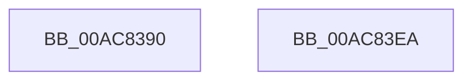

# IoWMISetNotificationCallback

- RVA: `0x00AC8390`–`0x00AC83EB` (길이 `91` bytes)
- VA: `0x0000000140AC8390`
- 실행 섹션: `PAGE`
- PDB 이름 있음: `예`; PDB Function 태그: `아니요`
- unwind 정보 RVA: `0x000794E0`
- 디코드: `25`개 명령, `91/91` bytes 표시
- 미해석 바이트: `0` (있으면 어셈블리에 `.byte`로 보존)

> 이 문서는 커널 이미지의 기계어와 PDB 기호를 분석해 생성했습니다. 4번과 5번은 함수 원형과 자료형을 바이너리 사용 방식에서 추정한 C 해석이며 원본 소스 복구 결과는 아닙니다.

## 1. Dependencies

- 직접 호출 지점: **2**; 고유 호출 대상: **2**
- 직접 호출자로 확인된 함수: **0**
- RIP 상대 이미지 참조: **1**

### Outgoing calls
- `0x00AC83BD` → [KeWaitForSingleObject](../../text/20/KeWaitForSingleObject_function_0020E6B0.md) (function, `0x0020E6B0`)
- `0x00AC83D3` → [KeReleaseMutex](../../text/39/KeReleaseMutex_function_00396810.md) (function, `0x00396810`)

### Direct callers
- 이 함수 시작 RVA로 연결되는 직접 call은 확인되지 않았습니다. 간접 호출은 완전히 역산할 수 없습니다.

### Static image references
- `0x00AC83B1` → RVA `0x00EFFA60` (`.data`; read)

## 2. Other-region calls and transfers

- 다른 실행 섹션으로 향하는 call: **2**
  - `0x00AC83BD` → [KeWaitForSingleObject](../../text/20/KeWaitForSingleObject_function_0020E6B0.md) (`PAGE` → `.text`)
  - `0x00AC83D3` → [KeReleaseMutex](../../text/39/KeReleaseMutex_function_00396810.md) (`PAGE` → `.text`)
- 별도 외부 분기/꼬리 이동을 확인하지 못했습니다.

## 3. Assembly (complete function range)

```asm
00AC8390  48 89 5C 24 08                  mov qword ptr [rsp + 8], rbx
00AC8395  48 89 74 24 10                  mov qword ptr [rsp + 0x10], rsi
00AC839A  57                              push rdi
00AC839B  48 83 EC 30                     sub rsp, 0x30
00AC839F  48 83 64 24 20 00               and qword ptr [rsp + 0x20], 0
00AC83A5  49 8B F0                        mov rsi, r8
00AC83A8  48 8B DA                        mov rbx, rdx
00AC83AB  48 8B F9                        mov rdi, rcx
00AC83AE  45 33 C0                        xor r8d, r8d
00AC83B1  48 8D 0D A8 76 43 00            lea rcx, [rip + 0x4376a8]
00AC83B8  33 D2                           xor edx, edx
00AC83BA  45 33 C9                        xor r9d, r9d
00AC83BD  E8 EE 62 74 FF                  call 0x14020e6b0
00AC83C2  33 D2                           xor edx, edx
00AC83C4  48 89 5F 48                     mov qword ptr [rdi + 0x48], rbx
00AC83C8  48 8D 0D 91 76 43 00            lea rcx, [rip + 0x437691]
00AC83CF  48 89 77 50                     mov qword ptr [rdi + 0x50], rsi
00AC83D3  E8 38 E4 8C FF                  call 0x140396810
00AC83D8  48 8B 5C 24 40                  mov rbx, qword ptr [rsp + 0x40]
00AC83DD  33 C0                           xor eax, eax
00AC83DF  48 8B 74 24 48                  mov rsi, qword ptr [rsp + 0x48]
00AC83E4  48 83 C4 30                     add rsp, 0x30
00AC83E8  5F                              pop rdi
00AC83E9  C3                              ret
00AC83EA  CC                              int3
```

## 4. C-style interpretation (structured pseudocode)

```c
__int64 __fastcall IoWMISetNotificationCallback(__int64 a1, __int64 a2, __int64 a3, int a4)
{
    __int64 result;
    __int64 v_rsp;
    unsigned __int64 v_stack_m18;
    unsigned __int64 v_stack_p10;
    unsigned __int64 v_stack_p8;

    v_stack_p8 = v_rbx;
    v_stack_p10 = v_rsi;
    v_rsp = (v_rsp) - (48);
    a3 = 0;
    a2 = 0;
    a4 = 0;
    result = KeWaitForSingleObject(v_rip + 4421288, a2, a3, a4);
    a2 = 0;
    *(unsigned __int64 *)(a1 + 72) = 0;
    *(unsigned __int64 *)(a1 + 80) = 0;
    result = KeReleaseMutex(v_rip + 4421265, a2, a3, a4);
    result = 0;
    v_rsp = (v_rsp) + (48);
    return result;
}
```

## 5. (Beta) C Style

```c
int64_t IoWMISetNotificationCallback(void *Arg1, int64_t Arg2, int64_t Arg3, int32_t Arg4)
{
    uint8_t *arg1 = (uint8_t *)Arg1;

    int64_t result;
    int64_t local_rsp;
    uint64_t v_stack_m18;
    uint64_t v_stack_p10;
    uint64_t v_stack_p8;

    v_stack_p8 = local_rbx;
    v_stack_p10 = local_rsi;
    local_rsp = (local_rsp) - (48);
    Arg3 = 0;
    Arg2 = 0;
    Arg4 = 0;
    result = KeWaitForSingleObject(v_rip + 4421288, Arg2, Arg3, Arg4);
    Arg2 = 0;
    *(uint64_t *)(arg1 + 0x48) = 0;
    *(uint64_t *)(arg1 + 0x50) = 0;
    result = KeReleaseMutex(v_rip + 4421265, Arg2, Arg3, Arg4);
    result = 0;
    local_rsp = (local_rsp) + (48);
    return result;
}
```

### 관측된 메모리 오프셋

구조체 형식이 확인되지 않은 접근은 인자 기준의 오프셋으로만 기록했습니다.

| 기준 인자 | 오프셋 표현 | 폭 (bit) | 접근 |
|---|---:|---:|---|
| `Arg1` | `+ 0x48` | `64` | `W` |
| `Arg1` | `+ 0x50` | `64` | `W` |

## 6. Execution-region graph

[열기: 2D/3D 그래프와 함수 탐색 컨트롤 패널](../../../control-panel.html?section=page&rva=0x00AC8390&view=graph)

- 2D 그래프는 위에서 아래로 흐르고, 3D 그래프는 빈 공간을 드래그해 회전합니다. Shift+드래그는 이동, 휠은 확대·축소, 함수 노드 선택은 대상 보고서 이동입니다.

### Static fallback


