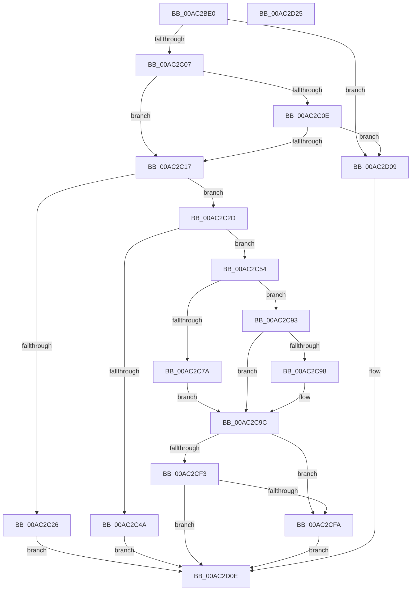

# IopAllocatePassiveInterruptBlock

- RVA: `0x00AC2BE0`–`0x00AC2D26` (길이 `326` bytes)
- VA: `0x0000000140AC2BE0`
- 실행 섹션: `PAGE`
- PDB 이름 있음: `예`; PDB Function 태그: `아니요`
- unwind 정보 RVA: `0x0006C8E8`
- 디코드: `89`개 명령, `326/326` bytes 표시
- 미해석 바이트: `0` (있으면 어셈블리에 `.byte`로 보존)

> 이 문서는 커널 이미지의 기계어와 PDB 기호를 분석해 생성했습니다. 4번과 5번은 함수 원형과 자료형을 바이너리 사용 방식에서 추정한 C 해석이며 원본 소스 복구 결과는 아닙니다.

## 1. Dependencies

- 직접 호출 지점: **7**; 고유 호출 대상: **7**
- 직접 호출자로 확인된 함수: **1**
- RIP 상대 이미지 참조: **3**

### Outgoing calls
- `0x00AC2C1C` → [IopFindPassiveInterruptBlock](../../text/45/IopFindPassiveInterruptBlock_function_0045F4BC.md) (function, `0x0045F4BC`)
- `0x00AC2C3D` → [ExAllocatePool2](../../poolcode/B8/ExAllocatePool2_function_00B820F0.md) (function, `0x00B820F0`)
- `0x00AC2C89` → [guard_dispatch_icall](../../text/6B/guard_dispatch_icall_function_006BAAD0.md) (function, `0x006BAAD0`)
- `0x00AC2CAB` → [KeInitializeEvent](../../text/40/KeInitializeEvent_function_0040DD10.md) (function, `0x0040DD10`)
- `0x00AC2CBE` → [KeInitializeDpc](../../text/45/KeInitializeDpc_function_0045BBD0.md) (function, `0x0045BBD0`)
- `0x00AC2CE8` → [IopInsertPassiveInterruptBlock](../../text/45/IopInsertPassiveInterruptBlock_function_0045F310.md) (function, `0x0045F310`)
- `0x00AC2D02` → [ExFreePoolWithTag](../../poolcode/B8/ExFreePoolWithTag_function_00B82870.md) (function, `0x00B82870`)

### Direct callers
- [IopConnectInterrupt](../90/IopConnectInterrupt_function_00900B40.md) at `0x00900FD2`

### Static image references
- `0x00AC2C82` → RVA `0x00E009E0` (`.data`; read)
- `0x00AC2CB7` → RVA `0x00469D40` (`IopPassiveInterruptDpc`; read)
- `0x00AC2CC8` → RVA `0x0045F3A0` (`IopPassiveInterruptWorker`; read)

## 2. Other-region calls and transfers

- 다른 실행 섹션으로 향하는 call: **7**
  - `0x00AC2C1C` → [IopFindPassiveInterruptBlock](../../text/45/IopFindPassiveInterruptBlock_function_0045F4BC.md) (`PAGE` → `.text`)
  - `0x00AC2C3D` → [ExAllocatePool2](../../poolcode/B8/ExAllocatePool2_function_00B820F0.md) (`PAGE` → `POOLCODE`)
  - `0x00AC2C89` → [guard_dispatch_icall](../../text/6B/guard_dispatch_icall_function_006BAAD0.md) (`PAGE` → `.text`)
  - `0x00AC2CAB` → [KeInitializeEvent](../../text/40/KeInitializeEvent_function_0040DD10.md) (`PAGE` → `.text`)
  - `0x00AC2CBE` → [KeInitializeDpc](../../text/45/KeInitializeDpc_function_0045BBD0.md) (`PAGE` → `.text`)
  - `0x00AC2CE8` → [IopInsertPassiveInterruptBlock](../../text/45/IopInsertPassiveInterruptBlock_function_0045F310.md) (`PAGE` → `.text`)
  - `0x00AC2D02` → [ExFreePoolWithTag](../../poolcode/B8/ExFreePoolWithTag_function_00B82870.md) (`PAGE` → `POOLCODE`)
- 별도 외부 분기/꼬리 이동을 확인하지 못했습니다.

## 3. Assembly (complete function range)

```asm
00AC2BE0  48 8B C4                        mov rax, rsp
00AC2BE3  48 89 58 10                     mov qword ptr [rax + 0x10], rbx
00AC2BE7  48 89 68 18                     mov qword ptr [rax + 0x18], rbp
00AC2BEB  48 89 70 20                     mov qword ptr [rax + 0x20], rsi
00AC2BEF  57                              push rdi
00AC2BF0  48 83 EC 20                     sub rsp, 0x20
00AC2BF4  83 39 01                        cmp dword ptr [rcx], 1
00AC2BF7  48 8B EA                        mov rbp, rdx
00AC2BFA  48 8B F9                        mov rdi, rcx
00AC2BFD  C6 40 08 00                     mov byte ptr [rax + 8], 0
00AC2C01  0F 85 02 01 00 00               jne 0x140ac2d09
00AC2C07  8B 41 08                        mov eax, dword ptr [rcx + 8]
00AC2C0A  85 C0                           test eax, eax
00AC2C0C  74 09                           je 0x140ac2c17
00AC2C0E  83 F8 03                        cmp eax, 3
00AC2C11  0F 85 F2 00 00 00               jne 0x140ac2d09
00AC2C17  8B 71 0C                        mov esi, dword ptr [rcx + 0xc]
00AC2C1A  8B CE                           mov ecx, esi
00AC2C1C  E8 9B C8 99 FF                  call 0x14045f4bc
00AC2C21  48 85 C0                        test rax, rax
00AC2C24  74 07                           je 0x140ac2c2d
00AC2C26  33 FF                           xor edi, edi
00AC2C28  E9 E1 00 00 00                  jmp 0x140ac2d0e
00AC2C2D  BA C8 00 00 00                  mov edx, 0xc8
00AC2C32  B9 40 00 00 00                  mov ecx, 0x40
00AC2C37  41 B8 4B 70 69 62               mov r8d, 0x6269704b
00AC2C3D  E8 AE F4 0B 00                  call 0x140b820f0
00AC2C42  48 8B D8                        mov rbx, rax
00AC2C45  48 85 C0                        test rax, rax
00AC2C48  75 0A                           jne 0x140ac2c54
00AC2C4A  BF 9A 00 00 C0                  mov edi, 0xc000009a
00AC2C4F  E9 BA 00 00 00                  jmp 0x140ac2d0e
00AC2C54  48 89 58 08                     mov qword ptr [rax + 8], rbx
00AC2C58  48 89 18                        mov qword ptr [rax], rbx
00AC2C5B  8B 47 08                        mov eax, dword ptr [rdi + 8]
00AC2C5E  89 43 10                        mov dword ptr [rbx + 0x10], eax
00AC2C61  89 73 14                        mov dword ptr [rbx + 0x14], esi
00AC2C64  8B 47 18                        mov eax, dword ptr [rdi + 0x18]
00AC2C67  89 43 20                        mov dword ptr [rbx + 0x20], eax
00AC2C6A  0F 10 45 00                     movups xmm0, xmmword ptr [rbp]
00AC2C6E  F3 0F 7F 43 28                  movdqu xmmword ptr [rbx + 0x28], xmm0
00AC2C73  8B 47 08                        mov eax, dword ptr [rdi + 8]
00AC2C76  85 C0                           test eax, eax
00AC2C78  75 19                           jne 0x140ac2c93
00AC2C7A  8B 57 40                        mov edx, dword ptr [rdi + 0x40]
00AC2C7D  33 C9                           xor ecx, ecx
00AC2C7F  89 53 18                        mov dword ptr [rbx + 0x18], edx
00AC2C82  48 8B 05 57 DD 33 00            mov rax, qword ptr [rip + 0x33dd57]
00AC2C89  E8 42 7E BF FF                  call 0x1406baad0
00AC2C8E  88 43 1C                        mov byte ptr [rbx + 0x1c], al
00AC2C91  EB 09                           jmp 0x140ac2c9c
00AC2C93  83 F8 03                        cmp eax, 3
00AC2C96  75 04                           jne 0x140ac2c9c
00AC2C98  C6 43 1C 00                     mov byte ptr [rbx + 0x1c], 0
00AC2C9C  48 8D 8B A8 00 00 00            lea rcx, [rbx + 0xa8]
00AC2CA3  41 B0 01                        mov r8b, 1
00AC2CA6  BA 01 00 00 00                  mov edx, 1
00AC2CAB  E8 60 B0 94 FF                  call 0x14040dd10
00AC2CB0  48 8D 4B 68                     lea rcx, [rbx + 0x68]
00AC2CB4  4C 8B C3                        mov r8, rbx
00AC2CB7  48 8D 15 82 70 9A FF            lea rdx, [rip - 0x658f7e]
00AC2CBE  E8 0D 8F 99 FF                  call 0x14045bbd0
00AC2CC3  48 83 63 38 00                  and qword ptr [rbx + 0x38], 0
00AC2CC8  48 8D 05 D1 C6 99 FF            lea rax, [rip - 0x66392f]
00AC2CCF  48 83 63 48 00                  and qword ptr [rbx + 0x48], 0
00AC2CD4  48 8D 54 24 30                  lea rdx, [rsp + 0x30]
00AC2CD9  48 89 43 58                     mov qword ptr [rbx + 0x58], rax
00AC2CDD  48 8B CB                        mov rcx, rbx
00AC2CE0  48 89 5B 60                     mov qword ptr [rbx + 0x60], rbx
00AC2CE4  C6 43 69 02                     mov byte ptr [rbx + 0x69], 2
00AC2CE8  E8 23 C6 99 FF                  call 0x14045f310
00AC2CED  8B F8                           mov edi, eax
00AC2CEF  85 C0                           test eax, eax
00AC2CF1  78 07                           js 0x140ac2cfa
00AC2CF3  80 7C 24 30 00                  cmp byte ptr [rsp + 0x30], 0
00AC2CF8  75 14                           jne 0x140ac2d0e
00AC2CFA  BA 4B 70 69 62                  mov edx, 0x6269704b
00AC2CFF  48 8B CB                        mov rcx, rbx
00AC2D02  E8 69 FB 0B 00                  call 0x140b82870
00AC2D07  EB 05                           jmp 0x140ac2d0e
00AC2D09  BF EF 00 00 C0                  mov edi, 0xc00000ef
00AC2D0E  48 8B 5C 24 38                  mov rbx, qword ptr [rsp + 0x38]
00AC2D13  8B C7                           mov eax, edi
00AC2D15  48 8B 6C 24 40                  mov rbp, qword ptr [rsp + 0x40]
00AC2D1A  48 8B 74 24 48                  mov rsi, qword ptr [rsp + 0x48]
00AC2D1F  48 83 C4 20                     add rsp, 0x20
00AC2D23  5F                              pop rdi
00AC2D24  C3                              ret
00AC2D25  CC                              int3
```

## 4. C-style interpretation (structured pseudocode)

```c
__int64 __fastcall IopAllocatePassiveInterruptBlock(__int64 a1, __int64 a2)
{
    __int64 result;
    __int64 v_rdi;
    __int64 v_rsp;
    unsigned __int64 v_stack_p10;
    unsigned __int64 v_stack_p18;
    unsigned __int64 v_stack_p20;
    unsigned __int64 v_stack_p8;

    *(unsigned __int64 *)(v_rsp + 16) = v_rbx;
    *(unsigned __int64 *)(v_rsp + 24) = v_rbp;
    *(unsigned __int64 *)(v_rsp + 32) = v_rsi;
    v_rsp = (v_rsp) - (32);
    *(unsigned __int8 *)(v_rsp + 8) = 0;
    if ((*(unsigned int *)(a1)) != 1) goto loc_00AC2D09;
    if ((unsigned int)((unsigned int)(*(unsigned int *)(a1 + 8))) == 0) goto loc_00AC2C17;
    if (((unsigned int)((unsigned int)(*(unsigned int *)(a1 + 8)))) != 3) goto loc_00AC2D09;
loc_00AC2C17:
    result = IopFindPassiveInterruptBlock((unsigned int)((unsigned int)((unsigned int)(*(unsigned int *)(a1 + 12)))), a2, a3, a4);
    if (result == 0) goto loc_00AC2C2D;
    v_rdi = 0;
    goto loc_00AC2D0E;
loc_00AC2C2D:
    result = ExAllocatePool2(64, 200, (unsigned int)(0x6269704BULL), a4);
    if (result != 0) goto loc_00AC2C54;
    goto loc_00AC2D0E;
loc_00AC2C54:
    *(unsigned __int64 *)(result + 8) = result;
    *(unsigned __int64 *)(result) = result;
    *(unsigned int *)(result + 16) = (unsigned int)((unsigned int)(*(unsigned int *)((unsigned int)(0xC000009AULL) + 8)));
    *(unsigned int *)(result + 20) = (unsigned int)((unsigned int)(*(unsigned int *)(a1 + 12)));
    *(unsigned int *)(result + 32) = (unsigned int)((unsigned int)(*(unsigned int *)((unsigned int)(0xC000009AULL) + 24)));
    *(unsigned __int64 *)(result + 40) = v_xmm0;
    if ((unsigned int)((unsigned int)(*(unsigned int *)((unsigned int)(0xC000009AULL) + 8))) != 0) goto loc_00AC2C93;
    a1 = 0;
    *(unsigned int *)(result + 24) = (unsigned int)((unsigned int)(*(unsigned int *)((unsigned int)(0xC000009AULL) + 64)));
    result = guard_dispatch_icall(a1, (unsigned int)(*(unsigned int *)((unsigned int)(0xC000009AULL) + 64)), (unsigned int)(0x6269704BULL), a4);
    *(unsigned __int8 *)(result + 28) = (unsigned __int8)(result);
    goto loc_00AC2C9C;
loc_00AC2C93:
    if (((unsigned int)(result)) == 3) {
        *(unsigned __int8 *)(result + 28) = 0;
    }
    result = KeInitializeEvent(result + 168, 1, 1, a4);
    result = KeInitializeDpc(result + 104, v_rip - 6655870, result, a4);
    *(unsigned __int64 *)(result + 88) = v_rip - 6699311;
    *(unsigned __int64 *)(result + 96) = result;
    *(unsigned __int8 *)(result + 105) = 2;
    result = IopInsertPassiveInterruptBlock(result, v_stack_p8, result, a4);
    if (sign_flag) goto loc_00AC2CFA;
    if (v_stack_p8 != 0) goto loc_00AC2D0E;
loc_00AC2CFA:
    result = ExFreePoolWithTag(result, (unsigned int)(0x6269704BULL), result, a4);
    goto loc_00AC2D0E;
loc_00AC2D09:
loc_00AC2D0E:
    v_rsp = (v_rsp) + (32);
    return (unsigned int)((unsigned int)((unsigned int)(0xC00000EFULL)));
}
```

## 5. (Beta) C Style

```c
int64_t IopAllocatePassiveInterruptBlock(void *Arg1, void *Arg2)
{
    uint8_t *arg1 = (uint8_t *)Arg1;
    uint8_t *arg2 = (uint8_t *)Arg2;

    int64_t result;
    int64_t local_rdi;
    int64_t local_rsp;
    uint64_t v_stack_p10;
    uint64_t v_stack_p18;
    uint64_t v_stack_p20;
    uint64_t v_stack_p8;

    *(uint64_t *)(local_rsp + 0x10) = local_rbx;
    *(uint64_t *)(local_rsp + 0x18) = local_rbp;
    *(uint64_t *)(local_rsp + 0x20) = local_rsi;
    local_rsp = (local_rsp) - (32);
    *(uint8_t *)(local_rsp + 0x8) = 0;
    if ((*(uint32_t *)(arg1)) != 1) goto loc_00AC2D09;
    if ((uint32_t)((uint32_t)(*(uint32_t *)(arg1 + 0x8))) == 0) goto loc_00AC2C17;
    if (((uint32_t)((uint32_t)(*(uint32_t *)(arg1 + 0x8)))) != 3) goto loc_00AC2D09;
loc_00AC2C17:
    result = IopFindPassiveInterruptBlock((uint32_t)((uint32_t)((uint32_t)(*(uint32_t *)(arg1 + 0xC)))), Arg2, a3, a4);
    if (result == 0) goto loc_00AC2C2D;
    local_rdi = 0;
    goto loc_00AC2D0E;
loc_00AC2C2D:
    result = ExAllocatePool2(64, 200, (uint32_t)(0x6269704BULL), a4);
    if (result != 0) goto loc_00AC2C54;
    goto loc_00AC2D0E;
loc_00AC2C54:
    *(uint64_t *)(result + 0x8) = result;
    *(uint64_t *)(result) = result;
    *(uint32_t *)(result + 0x10) = (uint32_t)((uint32_t)(*(uint32_t *)((uint32_t)(0xC000009AULL) + 0x8)));
    *(uint32_t *)(result + 0x14) = (uint32_t)((uint32_t)(*(uint32_t *)(arg1 + 0xC)));
    *(uint32_t *)(result + 0x20) = (uint32_t)((uint32_t)(*(uint32_t *)((uint32_t)(0xC000009AULL) + 0x18)));
    *(uint64_t *)(result + 0x28) = v_xmm0;
    if ((uint32_t)((uint32_t)(*(uint32_t *)((uint32_t)(0xC000009AULL) + 0x8))) != 0) goto loc_00AC2C93;
    Arg1 = 0;
    *(uint32_t *)(result + 0x18) = (uint32_t)((uint32_t)(*(uint32_t *)((uint32_t)(0xC000009AULL) + 0x40)));
    result = guard_dispatch_icall(Arg1, (uint32_t)(*(uint32_t *)((uint32_t)(0xC000009AULL) + 0x40)), (uint32_t)(0x6269704BULL), a4);
    *(uint8_t *)(result + 0x1C) = (uint8_t)(result);
    goto loc_00AC2C9C;
loc_00AC2C93:
    if (((uint32_t)(result)) == 3) {
        *(uint8_t *)(result + 0x1C) = 0;
    }
    result = KeInitializeEvent(result + 168, 1, 1, a4);
    result = KeInitializeDpc(result + 104, v_rip - 6655870, result, a4);
    *(uint64_t *)(result + 0x58) = v_rip - 6699311;
    *(uint64_t *)(result + 0x60) = result;
    *(uint8_t *)(result + 0x69) = 2;
    result = IopInsertPassiveInterruptBlock(result, v_stack_p8, result, a4);
    if (sign_flag) goto loc_00AC2CFA;
    if (v_stack_p8 != 0) goto loc_00AC2D0E;
loc_00AC2CFA:
    result = ExFreePoolWithTag(result, (uint32_t)(0x6269704BULL), result, a4);
    goto loc_00AC2D0E;
loc_00AC2D09:
loc_00AC2D0E:
    local_rsp = (local_rsp) + (32);
    return (uint32_t)((uint32_t)((uint32_t)(0xC00000EFULL)));
}
```

### 관측된 메모리 오프셋

구조체 형식이 확인되지 않은 접근은 인자 기준의 오프셋으로만 기록했습니다.

| 기준 인자 | 오프셋 표현 | 폭 (bit) | 접근 |
|---|---:|---:|---|
| `Arg1` | `+ 0x0` | `32` | `R` |
| `Arg1` | `+ 0x8` | `32` | `R` |
| `Arg1` | `+ 0xC` | `32` | `R` |
| `Arg1` | `+ 0x18` | `32` | `R` |
| `Arg1` | `+ 0x40` | `32` | `R` |
| `Arg2` | `+ 0x0` | `128` | `R` |

## 6. Execution-region graph

[열기: 2D/3D 그래프와 함수 탐색 컨트롤 패널](../../../control-panel.html?section=page&rva=0x00AC2BE0&view=graph)

- 2D 그래프는 위에서 아래로 흐르고, 3D 그래프는 빈 공간을 드래그해 회전합니다. Shift+드래그는 이동, 휠은 확대·축소, 함수 노드 선택은 대상 보고서 이동입니다.

### Static fallback


