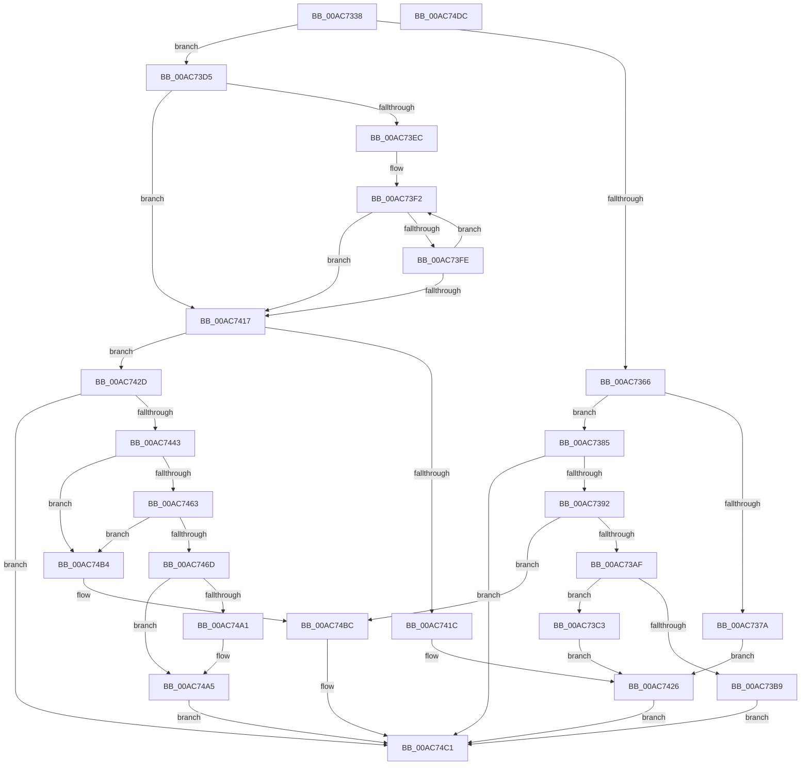

# IopFindLegacyDeviceNode

- RVA: `0x00AC7338`–`0x00AC74DD` (길이 `421` bytes)
- VA: `0x0000000140AC7338`
- 실행 섹션: `PAGE`
- PDB 이름 있음: `예`; PDB Function 태그: `아니요`
- unwind 정보 RVA: `0x000BD20C`
- 디코드: `115`개 명령, `421/421` bytes 표시
- 미해석 바이트: `0` (있으면 어셈블리에 `.byte`로 보존)

> 이 문서는 커널 이미지의 기계어와 PDB 기호를 분석해 생성했습니다. 4번과 5번은 함수 원형과 자료형을 바이너리 사용 방식에서 추정한 C 해석이며 원본 소스 복구 결과는 아닙니다.

## 1. Dependencies

- 직접 호출 지점: **8**; 고유 호출 대상: **6**
- 직접 호출자로 확인된 함수: **1**
- RIP 상대 이미지 참조: **2**

### Outgoing calls
- `0x00AC739A` → [PipAllocateDeviceNode](../A9/PipAllocateDeviceNode_function_00A9C8F8.md) (function, `0x00A9C8F8`)
- `0x00AC73B9` → [IopDestroyDeviceNode](../A0/IopDestroyDeviceNode_function_00A06A3C.md) (function, `0x00A06A3C`)
- `0x00AC73C8` → [PipSetDevNodeFlags](../8F/PipSetDevNodeFlags_function_008FC048.md) (function, `0x008FC048`)
- `0x00AC7438` → [IopCreateRootEnumeratedDeviceObject](../73/IopCreateRootEnumeratedDeviceObject_function_00737D1C.md) (function, `0x00737D1C`)
- `0x00AC7455` → [PipAllocateDeviceNode](../A9/PipAllocateDeviceNode_function_00A9C8F8.md) (function, `0x00A9C8F8`)
- `0x00AC7479` → [PipSetDevNodeFlags](../8F/PipSetDevNodeFlags_function_008FC048.md) (function, `0x008FC048`)
- `0x00AC7486` → [PipSetDevNodeState](../../text/47/PipSetDevNodeState_function_00470708.md) (function, `0x00470708`)
- `0x00AC74B7` → [IoDeleteDevice](../../text/26/IoDeleteDevice_function_0026FE90.md) (function, `0x0026FE90`)

### Direct callers
- [IopLegacyResourceAllocation](../A0/IopLegacyResourceAllocation_function_00A07224.md) at `0x00A07299`

### Static image references
- `0x00AC73D5` → RVA `0x00F8C140` (`.data`; read)
- `0x00AC74A5` → RVA `0x00F8C140` (`.data`; write)

## 2. Other-region calls and transfers

- 다른 실행 섹션으로 향하는 call: **2**
  - `0x00AC7486` → [PipSetDevNodeState](../../text/47/PipSetDevNodeState_function_00470708.md) (`PAGE` → `.text`)
  - `0x00AC74B7` → [IoDeleteDevice](../../text/26/IoDeleteDevice_function_0026FE90.md) (`PAGE` → `.text`)
- 별도 외부 분기/꼬리 이동을 확인하지 못했습니다.

## 3. Assembly (complete function range)

```asm
00AC7338  4C 8B DC                        mov r11, rsp
00AC733B  49 89 5B 08                     mov qword ptr [r11 + 8], rbx
00AC733F  49 89 6B 18                     mov qword ptr [r11 + 0x18], rbp
00AC7343  49 89 73 20                     mov qword ptr [r11 + 0x20], rsi
00AC7347  57                              push rdi
00AC7348  41 56                           push r14
00AC734A  41 57                           push r15
00AC734C  48 83 EC 30                     sub rsp, 0x30
00AC7350  4D 8B F1                        mov r14, r9
00AC7353  4D 8B F8                        mov r15, r8
00AC7356  48 8B FA                        mov rdi, rdx
00AC7359  48 8B E9                        mov rbp, rcx
00AC735C  BB 01 00 00 C0                  mov ebx, 0xc0000001
00AC7361  48 85 D2                        test rdx, rdx
00AC7364  74 6F                           je 0x140ac73d5
00AC7366  48 8B 82 38 01 00 00            mov rax, qword ptr [rdx + 0x138]
00AC736D  48 8B 48 28                     mov rcx, qword ptr [rax + 0x28]
00AC7371  49 89 4B 10                     mov qword ptr [r11 + 0x10], rcx
00AC7375  48 85 C9                        test rcx, rcx
00AC7378  74 0B                           je 0x140ac7385
00AC737A  49 89 11                        mov qword ptr [r9], rdx
00AC737D  49 89 08                        mov qword ptr [r8], rcx
00AC7380  E9 A1 00 00 00                  jmp 0x140ac7426
00AC7385  F7 42 30 00 10 00 00            test dword ptr [rdx + 0x30], 0x1000
00AC738C  0F 85 2F 01 00 00               jne 0x140ac74c1
00AC7392  48 8D 54 24 58                  lea rdx, [rsp + 0x58]
00AC7397  48 8B CF                        mov rcx, rdi
00AC739A  E8 59 55 FD FF                  call 0x140a9c8f8
00AC739F  48 8B 74 24 58                  mov rsi, qword ptr [rsp + 0x58]
00AC73A4  8B D8                           mov ebx, eax
00AC73A6  48 85 F6                        test rsi, rsi
00AC73A9  0F 84 0D 01 00 00               je 0x140ac74bc
00AC73AF  48 8B CE                        mov rcx, rsi
00AC73B2  3D 6E 03 00 C0                  cmp eax, 0xc000036e
00AC73B7  75 0A                           jne 0x140ac73c3
00AC73B9  E8 7E F6 F3 FF                  call 0x140a06a3c
00AC73BE  E9 FE 00 00 00                  jmp 0x140ac74c1
00AC73C3  BA 00 00 02 00                  mov edx, 0x20000
00AC73C8  E8 7B 4C E3 FF                  call 0x1408fc048
00AC73CD  49 89 3E                        mov qword ptr [r14], rdi
00AC73D0  49 89 37                        mov qword ptr [r15], rsi
00AC73D3  EB 51                           jmp 0x140ac7426
00AC73D5  48 8B 0D 64 4D 4C 00            mov rcx, qword ptr [rip + 0x4c4d64]
00AC73DC  48 89 4C 24 58                  mov qword ptr [rsp + 0x58], rcx
00AC73E1  48 8B C1                        mov rax, rcx
00AC73E4  48 8B D1                        mov rdx, rcx
00AC73E7  48 85 C9                        test rcx, rcx
00AC73EA  74 2B                           je 0x140ac7417
00AC73EC  4C 8B C1                        mov r8, rcx
00AC73EF  4C 8B C9                        mov r9, rcx
00AC73F2  49 8B D1                        mov rdx, r9
00AC73F5  49 39 A8 B0 01 00 00            cmp qword ptr [r8 + 0x1b0], rbp
00AC73FC  74 19                           je 0x140ac7417
00AC73FE  48 8B 09                        mov rcx, qword ptr [rcx]
00AC7401  48 89 4C 24 58                  mov qword ptr [rsp + 0x58], rcx
00AC7406  48 8B C1                        mov rax, rcx
00AC7409  4C 8B C1                        mov r8, rcx
00AC740C  4C 8B C9                        mov r9, rcx
00AC740F  48 8B D1                        mov rdx, rcx
00AC7412  48 85 C9                        test rcx, rcx
00AC7415  75 DB                           jne 0x140ac73f2
00AC7417  48 85 C0                        test rax, rax
00AC741A  74 11                           je 0x140ac742d
00AC741C  48 8B 42 20                     mov rax, qword ptr [rdx + 0x20]
00AC7420  49 89 06                        mov qword ptr [r14], rax
00AC7423  49 89 0F                        mov qword ptr [r15], rcx
00AC7426  33 DB                           xor ebx, ebx
00AC7428  E9 94 00 00 00                  jmp 0x140ac74c1
00AC742D  48 83 64 24 20 00               and qword ptr [rsp + 0x20], 0
00AC7433  48 8D 4C 24 20                  lea rcx, [rsp + 0x20]
00AC7438  E8 DF 08 C7 FF                  call 0x140737d1c
00AC743D  8B D8                           mov ebx, eax
00AC743F  85 C0                           test eax, eax
00AC7441  78 7E                           js 0x140ac74c1
00AC7443  48 8B 74 24 20                  mov rsi, qword ptr [rsp + 0x20]
00AC7448  48 8D 54 24 58                  lea rdx, [rsp + 0x58]
00AC744D  48 8B CE                        mov rcx, rsi
00AC7450  0F BA 6E 30 0C                  bts dword ptr [rsi + 0x30], 0xc
00AC7455  E8 9E 54 FD FF                  call 0x140a9c8f8
00AC745A  8B D8                           mov ebx, eax
00AC745C  3D 6E 03 00 C0                  cmp eax, 0xc000036e
00AC7461  74 51                           je 0x140ac74b4
00AC7463  48 8B 7C 24 58                  mov rdi, qword ptr [rsp + 0x58]
00AC7468  48 85 FF                        test rdi, rdi
00AC746B  74 47                           je 0x140ac74b4
00AC746D  BA 01 00 02 00                  mov edx, 0x20001
00AC7472  48 89 6E 08                     mov qword ptr [rsi + 8], rbp
00AC7476  48 8B CF                        mov rcx, rdi
00AC7479  E8 CA 4B E3 FF                  call 0x1408fc048
00AC747E  BA 04 03 00 00                  mov edx, 0x304
00AC7483  48 8B CF                        mov rcx, rdi
00AC7486  E8 7D 92 9A FF                  call 0x140470708
00AC748B  48 8B 05 AE 4C 4C 00            mov rax, qword ptr [rip + 0x4c4cae]
00AC7492  48 89 AF B0 01 00 00            mov qword ptr [rdi + 0x1b0], rbp
00AC7499  48 89 07                        mov qword ptr [rdi], rax
00AC749C  48 85 C0                        test rax, rax
00AC749F  74 04                           je 0x140ac74a5
00AC74A1  48 89 78 08                     mov qword ptr [rax + 8], rdi
00AC74A5  48 89 3D 94 4C 4C 00            mov qword ptr [rip + 0x4c4c94], rdi
00AC74AC  49 89 36                        mov qword ptr [r14], rsi
00AC74AF  49 89 3F                        mov qword ptr [r15], rdi
00AC74B2  EB 0D                           jmp 0x140ac74c1
00AC74B4  48 8B CE                        mov rcx, rsi
00AC74B7  E8 D4 89 7A FF                  call 0x14026fe90
00AC74BC  BB 9A 00 00 C0                  mov ebx, 0xc000009a
00AC74C1  48 8B 6C 24 60                  mov rbp, qword ptr [rsp + 0x60]
00AC74C6  8B C3                           mov eax, ebx
00AC74C8  48 8B 5C 24 50                  mov rbx, qword ptr [rsp + 0x50]
00AC74CD  48 8B 74 24 68                  mov rsi, qword ptr [rsp + 0x68]
00AC74D2  48 83 C4 30                     add rsp, 0x30
00AC74D6  41 5F                           pop r15
00AC74D8  41 5E                           pop r14
00AC74DA  5F                              pop rdi
00AC74DB  C3                              ret
00AC74DC  CC                              int3
```

## 4. C-style interpretation (structured pseudocode)

```c
__int64 __fastcall IopFindLegacyDeviceNode(__int64 a1, __int64 a2, __int64 a3, __int64 a4)
{
    __int64 result;
    __int64 v_rbx;
    __int64 v_rsp;
    unsigned __int64 v_stack_m28;
    unsigned __int64 v_stack_p10;
    unsigned __int64 v_stack_p18;
    unsigned __int64 v_stack_p20;
    unsigned __int64 v_stack_p8;

    *(unsigned __int64 *)(v_rsp + 8) = v_rbx;
    *(unsigned __int64 *)(v_rsp + 24) = v_rbp;
    *(unsigned __int64 *)(v_rsp + 32) = v_rsi;
    v_rsp = (v_rsp) - (48);
    if (a2 == 0) goto loc_00AC73D5;
    *(unsigned __int64 *)(v_rsp + 16) = *(unsigned __int64 *)(*(unsigned __int64 *)(a2 + 312) + 40);
    if (*(unsigned __int64 *)(*(unsigned __int64 *)(a2 + 312) + 40) == 0) goto loc_00AC7385;
    *(unsigned __int64 *)(a4) = a2;
    *(unsigned __int64 *)(a3) = *(unsigned __int64 *)(*(unsigned __int64 *)(a2 + 312) + 40);
    goto loc_00AC7426;
loc_00AC7385:
    if (((*(unsigned int *)(a2 + 48)) & (0x1000ULL)) != 0) goto loc_00AC74C1;
    result = PipAllocateDeviceNode(a2, v_stack_p10, a3, a4);
    if (v_stack_p10 == 0) goto loc_00AC74BC;
    if (((unsigned int)(result)) != 0xC000036EULL) goto loc_00AC73C3;
    result = IopDestroyDeviceNode(v_stack_p10, v_stack_p10, a3, a4);
    goto loc_00AC74C1;
loc_00AC73C3:
    result = PipSetDevNodeFlags(v_stack_p10, (unsigned int)(0x20000ULL), a3, a4);
    *(unsigned __int64 *)(a4) = a2;
    *(unsigned __int64 *)(a3) = v_stack_p10;
    goto loc_00AC7426;
loc_00AC73D5:
    v_stack_p10 = *(unsigned __int64 *)(v_rip + 5000548);
    if (*(unsigned __int64 *)(v_rip + 5000548) == 0) goto loc_00AC7417;
loc_00AC73F2:
    if ((*(unsigned __int64 *)(*(unsigned __int64 *)(v_rip + 5000548) + 432)) == a1) goto loc_00AC7417;
    v_stack_p10 = *(unsigned __int64 *)(*(unsigned __int64 *)(v_rip + 5000548));
    if (*(unsigned __int64 *)(*(unsigned __int64 *)(v_rip + 5000548)) != 0) goto loc_00AC73F2;
loc_00AC7417:
    if (*(unsigned __int64 *)(*(unsigned __int64 *)(v_rip + 5000548)) == 0) goto loc_00AC742D;
    *(unsigned __int64 *)(a4) = *(unsigned __int64 *)(*(unsigned __int64 *)(*(unsigned __int64 *)(v_rip + 5000548)) + 32);
    *(unsigned __int64 *)(a3) = *(unsigned __int64 *)(*(unsigned __int64 *)(v_rip + 5000548));
loc_00AC7426:
    v_rbx = 0;
    goto loc_00AC74C1;
loc_00AC742D:
    result = IopCreateRootEnumeratedDeviceObject(v_stack_m28, *(unsigned __int64 *)(*(unsigned __int64 *)(v_rip + 5000548)), *(unsigned __int64 *)(*(unsigned __int64 *)(v_rip + 5000548)), *(unsigned __int64 *)(*(unsigned __int64 *)(v_rip + 5000548)));
    if (sign_flag) goto loc_00AC74C1;
    result = PipAllocateDeviceNode(v_stack_m28, v_stack_p10, *(unsigned __int64 *)(*(unsigned __int64 *)(v_rip + 5000548)), *(unsigned __int64 *)(*(unsigned __int64 *)(v_rip + 5000548)));
    if (((unsigned int)(result)) == 0xC000036EULL) goto loc_00AC74B4;
    if (v_stack_p10 == 0) goto loc_00AC74B4;
    *(unsigned __int64 *)(v_stack_m28 + 8) = a1;
    result = PipSetDevNodeFlags(v_stack_p10, (unsigned int)(0x20001ULL), *(unsigned __int64 *)(*(unsigned __int64 *)(v_rip + 5000548)), *(unsigned __int64 *)(*(unsigned __int64 *)(v_rip + 5000548)));
    result = PipSetDevNodeState(v_stack_p10, 772, *(unsigned __int64 *)(*(unsigned __int64 *)(v_rip + 5000548)), *(unsigned __int64 *)(*(unsigned __int64 *)(v_rip + 5000548)));
    *(unsigned __int64 *)(v_stack_p10 + 432) = a1;
    *(unsigned __int64 *)(v_stack_p10) = *(unsigned __int64 *)(v_rip + 5000366);
    if (*(unsigned __int64 *)(v_rip + 5000366) != 0) {
        *(unsigned __int64 *)(*(unsigned __int64 *)(v_rip + 5000366) + 8) = v_stack_p10;
    }
    *(unsigned __int64 *)(v_rip + 5000340) = v_stack_p10;
    *(unsigned __int64 *)(a4) = v_stack_m28;
    *(unsigned __int64 *)(a3) = v_stack_p10;
    goto loc_00AC74C1;
loc_00AC74B4:
    result = IoDeleteDevice(v_stack_m28, 772, *(unsigned __int64 *)(*(unsigned __int64 *)(v_rip + 5000548)), *(unsigned __int64 *)(*(unsigned __int64 *)(v_rip + 5000548)));
loc_00AC74BC:
loc_00AC74C1:
    v_rsp = (v_rsp) + (48);
    return (unsigned int)((unsigned int)((unsigned int)(0xC000009AULL)));
}
```

## 5. (Beta) C Style

```c
int64_t IopFindLegacyDeviceNode(int64_t Arg1, int64_t Arg2, void *Arg3, void *Arg4)
{
    uint8_t *arg3 = (uint8_t *)Arg3;
    uint8_t *arg4 = (uint8_t *)Arg4;

    int64_t result;
    int64_t local_rbx;
    int64_t local_rsp;
    uint64_t v_stack_m28;
    uint64_t v_stack_p10;
    uint64_t v_stack_p18;
    uint64_t v_stack_p20;
    uint64_t v_stack_p8;

    *(uint64_t *)(local_rsp + 0x8) = local_rbx;
    *(uint64_t *)(local_rsp + 0x18) = local_rbp;
    *(uint64_t *)(local_rsp + 0x20) = local_rsi;
    local_rsp = (local_rsp) - (48);
    if (Arg2 == 0) goto loc_00AC73D5;
    *(uint64_t *)(local_rsp + 0x10) = *(uint64_t *)(*(uint64_t *)(Arg2 + 0x138) + 0x28);
    if (*(uint64_t *)(*(uint64_t *)(Arg2 + 0x138) + 0x28) == 0) goto loc_00AC7385;
    *(uint64_t *)(arg4) = Arg2;
    *(uint64_t *)(arg3) = *(uint64_t *)(*(uint64_t *)(Arg2 + 0x138) + 0x28);
    goto loc_00AC7426;
loc_00AC7385:
    if (((*(uint32_t *)(Arg2 + 0x30)) & (0x1000ULL)) != 0) goto loc_00AC74C1;
    result = PipAllocateDeviceNode(Arg2, v_stack_p10, Arg3, Arg4);
    if (v_stack_p10 == 0) goto loc_00AC74BC;
    if (((uint32_t)(result)) != 0xC000036EULL) goto loc_00AC73C3;
    result = IopDestroyDeviceNode(v_stack_p10, v_stack_p10, Arg3, Arg4);
    goto loc_00AC74C1;
loc_00AC73C3:
    result = PipSetDevNodeFlags(v_stack_p10, (uint32_t)(0x20000ULL), Arg3, Arg4);
    *(uint64_t *)(arg4) = Arg2;
    *(uint64_t *)(arg3) = v_stack_p10;
    goto loc_00AC7426;
loc_00AC73D5:
    v_stack_p10 = *(uint64_t *)(v_rip + 0x4C4D64);
    if (*(uint64_t *)(v_rip + 0x4C4D64) == 0) goto loc_00AC7417;
loc_00AC73F2:
    if ((*(uint64_t *)(*(uint64_t *)(v_rip + 0x4C4D64) + 0x1B0)) == Arg1) goto loc_00AC7417;
    v_stack_p10 = *(uint64_t *)(*(uint64_t *)(v_rip + 0x4C4D64));
    if (*(uint64_t *)(*(uint64_t *)(v_rip + 0x4C4D64)) != 0) goto loc_00AC73F2;
loc_00AC7417:
    if (*(uint64_t *)(*(uint64_t *)(v_rip + 0x4C4D64)) == 0) goto loc_00AC742D;
    *(uint64_t *)(arg4) = *(uint64_t *)(*(uint64_t *)(*(uint64_t *)(v_rip + 0x4C4D64)) + 0x20);
    *(uint64_t *)(arg3) = *(uint64_t *)(*(uint64_t *)(v_rip + 0x4C4D64));
loc_00AC7426:
    local_rbx = 0;
    goto loc_00AC74C1;
loc_00AC742D:
    result = IopCreateRootEnumeratedDeviceObject(v_stack_m28, *(uint64_t *)(*(uint64_t *)(v_rip + 0x4C4D64)), *(uint64_t *)(*(uint64_t *)(v_rip + 0x4C4D64)), *(uint64_t *)(*(uint64_t *)(v_rip + 0x4C4D64)));
    if (sign_flag) goto loc_00AC74C1;
    result = PipAllocateDeviceNode(v_stack_m28, v_stack_p10, *(uint64_t *)(*(uint64_t *)(v_rip + 0x4C4D64)), *(uint64_t *)(*(uint64_t *)(v_rip + 0x4C4D64)));
    if (((uint32_t)(result)) == 0xC000036EULL) goto loc_00AC74B4;
    if (v_stack_p10 == 0) goto loc_00AC74B4;
    *(uint64_t *)(v_stack_m28 + 0x8) = Arg1;
    result = PipSetDevNodeFlags(v_stack_p10, (uint32_t)(0x20001ULL), *(uint64_t *)(*(uint64_t *)(v_rip + 0x4C4D64)), *(uint64_t *)(*(uint64_t *)(v_rip + 0x4C4D64)));
    result = PipSetDevNodeState(v_stack_p10, 772, *(uint64_t *)(*(uint64_t *)(v_rip + 0x4C4D64)), *(uint64_t *)(*(uint64_t *)(v_rip + 0x4C4D64)));
    *(uint64_t *)(v_stack_p10 + 0x1B0) = Arg1;
    *(uint64_t *)(v_stack_p10) = *(uint64_t *)(v_rip + 0x4C4CAE);
    if (*(uint64_t *)(v_rip + 0x4C4CAE) != 0) {
        *(uint64_t *)(*(uint64_t *)(v_rip + 0x4C4CAE) + 0x8) = v_stack_p10;
    }
    *(uint64_t *)(v_rip + 0x4C4C94) = v_stack_p10;
    *(uint64_t *)(arg4) = v_stack_m28;
    *(uint64_t *)(arg3) = v_stack_p10;
    goto loc_00AC74C1;
loc_00AC74B4:
    result = IoDeleteDevice(v_stack_m28, 772, *(uint64_t *)(*(uint64_t *)(v_rip + 0x4C4D64)), *(uint64_t *)(*(uint64_t *)(v_rip + 0x4C4D64)));
loc_00AC74BC:
loc_00AC74C1:
    local_rsp = (local_rsp) + (48);
    return (uint32_t)((uint32_t)((uint32_t)(0xC000009AULL)));
}
```

### 관측된 메모리 오프셋

구조체 형식이 확인되지 않은 접근은 인자 기준의 오프셋으로만 기록했습니다.

| 기준 인자 | 오프셋 표현 | 폭 (bit) | 접근 |
|---|---:|---:|---|
| `Arg3` | `+ 0x0` | `64` | `W` |
| `Arg4` | `+ 0x0` | `64` | `W` |

## 6. Execution-region graph

[열기: 2D/3D 그래프와 함수 탐색 컨트롤 패널](../../../control-panel.html?section=page&rva=0x00AC7338&view=graph)

- 2D 그래프는 위에서 아래로 흐르고, 3D 그래프는 빈 공간을 드래그해 회전합니다. Shift+드래그는 이동, 휠은 확대·축소, 함수 노드 선택은 대상 보고서 이동입니다.

### Static fallback


