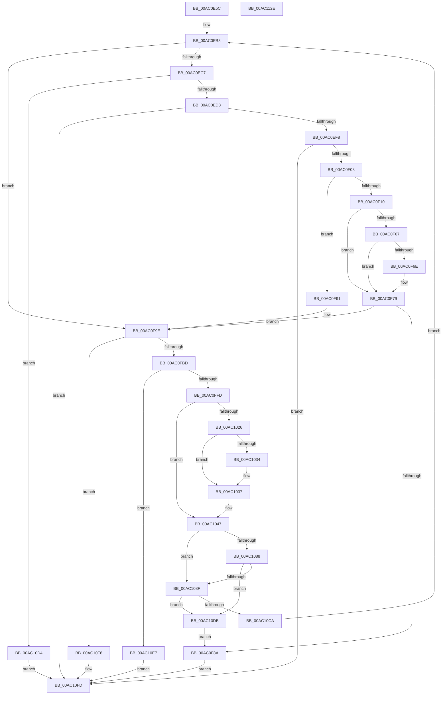

# IopSendMessageToTrackService

- RVA: `0x00AC0E5C`–`0x00AC112F` (길이 `723` bytes)
- VA: `0x0000000140AC0E5C`
- 실행 섹션: `PAGE`
- PDB 이름 있음: `예`; PDB Function 태그: `아니요`
- unwind 정보 RVA: `0x000BD95C`
- 디코드: `171`개 명령, `723/723` bytes 표시
- 미해석 바이트: `0` (있으면 어셈블리에 `.byte`로 보존)

> 이 문서는 커널 이미지의 기계어와 PDB 기호를 분석해 생성했습니다. 4번과 5번은 함수 원형과 자료형을 바이너리 사용 방식에서 추정한 C 해석이며 원본 소스 복구 결과는 아닙니다.

## 1. Dependencies

- 직접 호출 지점: **14**; 고유 호출 대상: **10**
- 직접 호출자로 확인된 함수: **1**
- RIP 상대 이미지 참조: **12**

### Outgoing calls
- `0x00AC0EE8` → [KeWaitForSingleObject](../../text/20/KeWaitForSingleObject_function_0020E6B0.md) (function, `0x0020E6B0`)
- `0x00AC0F33` → [KeResetEvent](../../text/24/KeResetEvent_function_00248350.md) (function, `0x00248350`)
- `0x00AC0F40` → [ExQueueWorkItem](../../text/2F/ExQueueWorkItem_function_002F9520.md) (function, `0x002F9520`)
- `0x00AC0F59` → [KeWaitForSingleObject](../../text/20/KeWaitForSingleObject_function_0020E6B0.md) (function, `0x0020E6B0`)
- `0x00AC0F81` → [KeSetEvent](../../text/33/KeSetEvent_function_0033F310.md) (function, `0x0033F310`)
- `0x00AC0F99` → [KeSetEvent](../../text/33/KeSetEvent_function_0033F310.md) (function, `0x0033F310`)
- `0x00AC0FAC` → [ExAllocatePool2](../../poolcode/B8/ExAllocatePool2_function_00B820F0.md) (function, `0x00B820F0`)
- `0x00AC1042` → [memcpy](../../text/6C/memcpy_function_006C6840.md) (function, `0x006C6840`)
- `0x00AC107A` → [LpcSendWaitReceivePort](../92/LpcSendWaitReceivePort_function_00921F50.md) (function, `0x00921F50`)
- `0x00AC109F` → [KeWaitForSingleObject](../../text/20/KeWaitForSingleObject_function_0020E6B0.md) (function, `0x0020E6B0`)
- `0x00AC10AD` → [ObfDereferenceObject](../../text/2F/ObfDereferenceObject_function_002F9350.md) (function, `0x002F9350`)
- `0x00AC10C1` → [KeSetEvent](../../text/33/KeSetEvent_function_0033F310.md) (function, `0x0033F310`)
- `0x00AC10EC` → [ExFreePoolWithTag](../../poolcode/B8/ExFreePoolWithTag_function_00B82870.md) (function, `0x00B82870`)
- `0x00AC1108` → [_security_check_cookie](../../text/6A/_security_check_cookie_function_006AC640.md) (function, `0x006AC640`)

### Direct callers
- [IopTrackLink](../A3/IopTrackLink_function_00A36764.md) at `0x00A36BBB`
- [IopTrackLink](../A3/IopTrackLink_function_00A36764.md) at `0x00A36CF9`

### Static image references
- `0x00AC0E7B` → RVA `0x00E0A740` (`.data`; read)
- `0x00AC0E96` → RVA `0x00F8D680` (`.data`; read)
- `0x00AC0EB3` → RVA `0x00F8D6A0` (`.data`; read)
- `0x00AC0EBA` → RVA `0x00FD9C50` (`PAGEDATA`; read)
- `0x00AC0EC7` → RVA `0x00FD9F88` (`PAGEDATA`; read)
- `0x00AC0F10` → RVA `0x0071B050` (`IopConnectLinkTrackingPort`; read)
- `0x00AC0F17` → RVA `0x00F8D6B8` (`.data`; write)
- `0x00AC0F1E` → RVA `0x00F8D6C0` (`.data`; read)
- `0x00AC0F25` → RVA `0x00F8D6B0` (`.data`; write)
- `0x00AC0F2C` → RVA `0x00F8D6A0` (`.data`; write)
- `0x00AC0F6E` → RVA `0x00F8D6D8` (`.data`; read)
- `0x00AC10B5` → RVA `0x00FD9C50` (`PAGEDATA`; write)

## 2. Other-region calls and transfers

- 다른 실행 섹션으로 향하는 call: **13**
  - `0x00AC0EE8` → [KeWaitForSingleObject](../../text/20/KeWaitForSingleObject_function_0020E6B0.md) (`PAGE` → `.text`)
  - `0x00AC0F33` → [KeResetEvent](../../text/24/KeResetEvent_function_00248350.md) (`PAGE` → `.text`)
  - `0x00AC0F40` → [ExQueueWorkItem](../../text/2F/ExQueueWorkItem_function_002F9520.md) (`PAGE` → `.text`)
  - `0x00AC0F59` → [KeWaitForSingleObject](../../text/20/KeWaitForSingleObject_function_0020E6B0.md) (`PAGE` → `.text`)
  - `0x00AC0F81` → [KeSetEvent](../../text/33/KeSetEvent_function_0033F310.md) (`PAGE` → `.text`)
  - `0x00AC0F99` → [KeSetEvent](../../text/33/KeSetEvent_function_0033F310.md) (`PAGE` → `.text`)
  - `0x00AC0FAC` → [ExAllocatePool2](../../poolcode/B8/ExAllocatePool2_function_00B820F0.md) (`PAGE` → `POOLCODE`)
  - `0x00AC1042` → [memcpy](../../text/6C/memcpy_function_006C6840.md) (`PAGE` → `.text`)
  - `0x00AC109F` → [KeWaitForSingleObject](../../text/20/KeWaitForSingleObject_function_0020E6B0.md) (`PAGE` → `.text`)
  - `0x00AC10AD` → [ObfDereferenceObject](../../text/2F/ObfDereferenceObject_function_002F9350.md) (`PAGE` → `.text`)
  - `0x00AC10C1` → [KeSetEvent](../../text/33/KeSetEvent_function_0033F310.md) (`PAGE` → `.text`)
  - `0x00AC10EC` → [ExFreePoolWithTag](../../poolcode/B8/ExFreePoolWithTag_function_00B82870.md) (`PAGE` → `POOLCODE`)
  - `0x00AC1108` → [_security_check_cookie](../../text/6A/_security_check_cookie_function_006AC640.md) (`PAGE` → `.text`)
- 별도 외부 분기/꼬리 이동을 확인하지 못했습니다.

## 3. Assembly (complete function range)

```asm
00AC0E5C  48 89 5C 24 08                  mov qword ptr [rsp + 8], rbx
00AC0E61  48 89 6C 24 10                  mov qword ptr [rsp + 0x10], rbp
00AC0E66  48 89 74 24 20                  mov qword ptr [rsp + 0x20], rsi
00AC0E6B  57                              push rdi
00AC0E6C  41 54                           push r12
00AC0E6E  41 55                           push r13
00AC0E70  41 56                           push r14
00AC0E72  41 57                           push r15
00AC0E74  48 81 EC 50 01 00 00            sub rsp, 0x150
00AC0E7B  48 8B 05 BE 98 34 00            mov rax, qword ptr [rip + 0x3498be]
00AC0E82  48 33 C4                        xor rax, rsp
00AC0E85  48 89 84 24 40 01 00 00         mov qword ptr [rsp + 0x140], rax
00AC0E8D  65 48 8B 04 25 88 01 00 00      mov rax, qword ptr gs:[0x188]
00AC0E96  4C 8D 2D E3 C7 4C 00            lea r13, [rip + 0x4cc7e3]
00AC0E9D  45 33 E4                        xor r12d, r12d
00AC0EA0  49 8B F8                        mov rdi, r8
00AC0EA3  4C 8B F2                        mov r14, rdx
00AC0EA6  4C 8B F9                        mov r15, rcx
00AC0EA9  41 8B EC                        mov ebp, r12d
00AC0EAC  40 8A B0 32 02 00 00            mov sil, byte ptr [rax + 0x232]
00AC0EB3  48 8D 1D E6 C7 4C 00            lea rbx, [rip + 0x4cc7e6]
00AC0EBA  4C 39 25 8F 8D 51 00            cmp qword ptr [rip + 0x518d8f], r12
00AC0EC1  0F 85 D7 00 00 00               jne 0x140ac0f9e
00AC0EC7  48 8B 05 BA 90 51 00            mov rax, qword ptr [rip + 0x5190ba]
00AC0ECE  44 39 60 04                     cmp dword ptr [rax + 4], r12d
00AC0ED2  0F 84 FC 01 00 00               je 0x140ac10d4
00AC0ED8  45 33 C9                        xor r9d, r9d
00AC0EDB  4C 89 64 24 20                  mov qword ptr [rsp + 0x20], r12
00AC0EE0  44 8A C6                        mov r8b, sil
00AC0EE3  33 D2                           xor edx, edx
00AC0EE5  49 8B CD                        mov rcx, r13
00AC0EE8  E8 C3 D7 74 FF                  call 0x14020e6b0
00AC0EED  3D C0 00 00 00                  cmp eax, 0xc0
00AC0EF2  0F 84 05 02 00 00               je 0x140ac10fd
00AC0EF8  3D 01 01 00 00                  cmp eax, 0x101
00AC0EFD  0F 84 FA 01 00 00               je 0x140ac10fd
00AC0F03  4C 39 25 46 8D 51 00            cmp qword ptr [rip + 0x518d46], r12
00AC0F0A  0F 85 81 00 00 00               jne 0x140ac0f91
00AC0F10  48 8D 05 39 A1 C5 FF            lea rax, [rip - 0x3a5ec7]
00AC0F17  48 89 1D 9A C7 4C 00            mov qword ptr [rip + 0x4cc79a], rbx
00AC0F1E  48 8D 0D 9B C7 4C 00            lea rcx, [rip + 0x4cc79b]
00AC0F25  48 89 05 84 C7 4C 00            mov qword ptr [rip + 0x4cc784], rax
00AC0F2C  4C 89 25 6D C7 4C 00            mov qword ptr [rip + 0x4cc76d], r12
00AC0F33  E8 18 74 78 FF                  call 0x140248350
00AC0F38  BA 01 00 00 00                  mov edx, 1
00AC0F3D  48 8B CB                        mov rcx, rbx
00AC0F40  E8 DB 85 83 FF                  call 0x1402f9520
00AC0F45  45 33 C9                        xor r9d, r9d
00AC0F48  4C 89 64 24 20                  mov qword ptr [rsp + 0x20], r12
00AC0F4D  44 8A C6                        mov r8b, sil
00AC0F50  48 8D 0D 69 C7 4C 00            lea rcx, [rip + 0x4cc769]
00AC0F57  33 D2                           xor edx, edx
00AC0F59  E8 52 D7 74 FF                  call 0x14020e6b0
00AC0F5E  8B D8                           mov ebx, eax
00AC0F60  3D C0 00 00 00                  cmp eax, 0xc0
00AC0F65  74 12                           je 0x140ac0f79
00AC0F67  3D 01 01 00 00                  cmp eax, 0x101
00AC0F6C  74 0B                           je 0x140ac0f79
00AC0F6E  8B 0D 64 C7 4C 00               mov ecx, dword ptr [rip + 0x4cc764]
00AC0F74  85 C9                           test ecx, ecx
00AC0F76  0F 48 D9                        cmovs ebx, ecx
00AC0F79  45 33 C0                        xor r8d, r8d
00AC0F7C  33 D2                           xor edx, edx
00AC0F7E  49 8B CD                        mov rcx, r13
00AC0F81  E8 8A E3 87 FF                  call 0x14033f310
00AC0F86  85 DB                           test ebx, ebx
00AC0F88  74 14                           je 0x140ac0f9e
00AC0F8A  8B C3                           mov eax, ebx
00AC0F8C  E9 6C 01 00 00                  jmp 0x140ac10fd
00AC0F91  45 33 C0                        xor r8d, r8d
00AC0F94  33 D2                           xor edx, edx
00AC0F96  49 8B CD                        mov rcx, r13
00AC0F99  E8 72 E3 87 FF                  call 0x14033f310
00AC0F9E  BA B8 00 00 00                  mov edx, 0xb8
00AC0FA3  41 B8 49 6F 20 20               mov r8d, 0x20206f49
00AC0FA9  8D 4A 48                        lea ecx, [rdx + 0x48]
00AC0FAC  E8 3F 11 0C 00                  call 0x140b820f0
00AC0FB1  48 8B D8                        mov rbx, rax
00AC0FB4  48 85 C0                        test rax, rax
00AC0FB7  0F 84 3B 01 00 00               je 0x140ac10f8
00AC0FBD  4C 89 60 28                     mov qword ptr [rax + 0x28], r12
00AC0FC1  41 0F 10 07                     movups xmm0, xmmword ptr [r15]
00AC0FC5  0F 11 40 30                     movups xmmword ptr [rax + 0x30], xmm0
00AC0FC9  41 8B 4F 10                     mov ecx, dword ptr [r15 + 0x10]
00AC0FCD  89 48 40                        mov dword ptr [rax + 0x40], ecx
00AC0FD0  41 0F 28 06                     movaps xmm0, xmmword ptr [r14]
00AC0FD4  0F 11 40 44                     movups xmmword ptr [rax + 0x44], xmm0
00AC0FD8  41 0F 28 4E 10                  movaps xmm1, xmmword ptr [r14 + 0x10]
00AC0FDD  0F 11 48 54                     movups xmmword ptr [rax + 0x54], xmm1
00AC0FE1  41 0F 28 46 20                  movaps xmm0, xmmword ptr [r14 + 0x20]
00AC0FE6  0F 11 40 64                     movups xmmword ptr [rax + 0x64], xmm0
00AC0FEA  41 0F 28 4E 30                  movaps xmm1, xmmword ptr [r14 + 0x30]
00AC0FEF  0F 11 48 74                     movups xmmword ptr [rax + 0x74], xmm1
00AC0FF3  83 7F 08 24                     cmp dword ptr [rdi + 8], 0x24
00AC0FF7  0F 82 EA 00 00 00               jb 0x140ac10e7
00AC0FFD  8B 47 0C                        mov eax, dword ptr [rdi + 0xc]
00AC1000  89 83 84 00 00 00               mov dword ptr [rbx + 0x84], eax
00AC1006  0F 10 47 10                     movups xmm0, xmmword ptr [rdi + 0x10]
00AC100A  F3 0F 7F 83 88 00 00 00         movdqu xmmword ptr [rbx + 0x88], xmm0
00AC1012  0F 10 4F 20                     movups xmm1, xmmword ptr [rdi + 0x20]
00AC1016  F3 0F 7F 8B 98 00 00 00         movdqu xmmword ptr [rbx + 0x98], xmm1
00AC101E  8B 47 08                        mov eax, dword ptr [rdi + 8]
00AC1021  83 F8 24                        cmp eax, 0x24
00AC1024  76 21                           jbe 0x140ac1047
00AC1026  83 C0 DC                        add eax, -0x24
00AC1029  41 B8 10 00 00 00               mov r8d, 0x10
00AC102F  83 F8 10                        cmp eax, 0x10
00AC1032  77 03                           ja 0x140ac1037
00AC1034  44 8B C0                        mov r8d, eax
00AC1037  48 8D 57 30                     lea rdx, [rdi + 0x30]
00AC103B  48 8D 8B A8 00 00 00            lea rcx, [rbx + 0xa8]
00AC1042  E8 F9 57 C0 FF                  call 0x1406c6840
00AC1047  48 C7 03 90 00 B8 00            mov qword ptr [rbx], 0xb80090
00AC104E  48 8D 44 24 30                  lea rax, [rsp + 0x30]
00AC1053  48 8B 0D F6 8B 51 00            mov rcx, qword ptr [rip + 0x518bf6]
00AC105A  4C 8D 4C 24 40                  lea r9, [rsp + 0x40]
00AC105F  4C 89 64 24 28                  mov qword ptr [rsp + 0x28], r12
00AC1064  4C 8B C3                        mov r8, rbx
00AC1067  BA 00 00 02 00                  mov edx, 0x20000
00AC106C  48 89 44 24 20                  mov qword ptr [rsp + 0x20], rax
00AC1071  48 C7 44 24 30 00 01 00 00      mov qword ptr [rsp + 0x30], 0x100
00AC107A  E8 D1 0E E6 FF                  call 0x140921f50
00AC107F  8B D8                           mov ebx, eax
00AC1081  3D 37 00 00 C0                  cmp eax, 0xc0000037
00AC1086  74 07                           je 0x140ac108f
00AC1088  3D 03 07 00 C0                  cmp eax, 0xc0000703
00AC108D  75 4C                           jne 0x140ac10db
00AC108F  45 33 C9                        xor r9d, r9d
00AC1092  4C 89 64 24 20                  mov qword ptr [rsp + 0x20], r12
00AC1097  44 8A C6                        mov r8b, sil
00AC109A  33 D2                           xor edx, edx
00AC109C  49 8B CD                        mov rcx, r13
00AC109F  E8 0C D6 74 FF                  call 0x14020e6b0
00AC10A4  48 8B 0D A5 8B 51 00            mov rcx, qword ptr [rip + 0x518ba5]
00AC10AB  8B D8                           mov ebx, eax
00AC10AD  E8 9E 82 83 FF                  call 0x1402f9350
00AC10B2  45 33 C0                        xor r8d, r8d
00AC10B5  4C 89 25 94 8B 51 00            mov qword ptr [rip + 0x518b94], r12
00AC10BC  33 D2                           xor edx, edx
00AC10BE  49 8B CD                        mov rcx, r13
00AC10C1  E8 4A E2 87 FF                  call 0x14033f310
00AC10C6  85 ED                           test ebp, ebp
00AC10C8  75 11                           jne 0x140ac10db
00AC10CA  BD 01 00 00 00                  mov ebp, 1
00AC10CF  E9 DF FD FF FF                  jmp 0x140ac0eb3
00AC10D4  B8 9F 02 00 C0                  mov eax, 0xc000029f
00AC10D9  EB 22                           jmp 0x140ac10fd
00AC10DB  85 DB                           test ebx, ebx
00AC10DD  0F 49 5C 24 68                  cmovns ebx, dword ptr [rsp + 0x68]
00AC10E2  E9 A3 FE FF FF                  jmp 0x140ac0f8a
00AC10E7  33 D2                           xor edx, edx
00AC10E9  48 8B CB                        mov rcx, rbx
00AC10EC  E8 7F 17 0C 00                  call 0x140b82870
00AC10F1  B8 05 00 00 80                  mov eax, 0x80000005
00AC10F6  EB 05                           jmp 0x140ac10fd
00AC10F8  B8 9A 00 00 C0                  mov eax, 0xc000009a
00AC10FD  48 8B 8C 24 40 01 00 00         mov rcx, qword ptr [rsp + 0x140]
00AC1105  48 33 CC                        xor rcx, rsp
00AC1108  E8 33 B5 BE FF                  call 0x1406ac640
00AC110D  4C 8D 9C 24 50 01 00 00         lea r11, [rsp + 0x150]
00AC1115  49 8B 5B 30                     mov rbx, qword ptr [r11 + 0x30]
00AC1119  49 8B 6B 38                     mov rbp, qword ptr [r11 + 0x38]
00AC111D  49 8B 73 48                     mov rsi, qword ptr [r11 + 0x48]
00AC1121  49 8B E3                        mov rsp, r11
00AC1124  41 5F                           pop r15
00AC1126  41 5E                           pop r14
00AC1128  41 5D                           pop r13
00AC112A  41 5C                           pop r12
00AC112C  5F                              pop rdi
00AC112D  C3                              ret
00AC112E  CC                              int3
```

## 4. C-style interpretation (structured pseudocode)

```c
__int64 __fastcall IopSendMessageToTrackService(__int64 a1, __int64 a2, __int64 a3, int a4)
{
    __int64 result;
    __int64 v_r12;
    __int64 v_rbx;
    __int64 v_rsp;
    unsigned int v_stack_m110;
    unsigned __int64 v_stack_m138;
    unsigned __int64 v_stack_m148;
    unsigned __int64 v_stack_m150;
    unsigned __int64 v_stack_m158;
    unsigned __int64 v_stack_m28;
    unsigned __int64 v_stack_m38;
    unsigned __int64 v_stack_p10;
    unsigned __int64 v_stack_p20;
    unsigned __int64 v_stack_p8;

    v_stack_p8 = v_rbx;
    v_stack_p10 = v_rbp;
    v_stack_p20 = v_rsi;
    v_rsp = (v_rsp) - (336);
    result = (*(unsigned __int64 *)(v_rip + 3446974)) ^ (v_rsp);
    v_stack_m38 = result;
    v_r12 = 0;
loc_00AC0EB3:
    if ((*(unsigned __int64 *)(v_rip + 5344655)) != 0) goto loc_00AC0F9E;
    if ((*(unsigned int *)(*(unsigned __int64 *)(v_rip + 5345466) + 4)) == 0) goto loc_00AC10D4;
    a4 = 0;
    v_stack_m158 = 0;
    a2 = 0;
    result = KeWaitForSingleObject(v_rip + 5031907, a2, (unsigned __int8)(*(unsigned __int8 *)(*(unsigned __int64 *)(gs_base + (0 + 392)) + 562)), a4);
    if (((unsigned int)(result)) == 192) goto loc_00AC10FD;
    if (((unsigned int)(result)) == 257) goto loc_00AC10FD;
    if ((*(unsigned __int64 *)(v_rip + 5344582)) != 0) goto loc_00AC0F91;
    *(unsigned __int64 *)(v_rip + 5031834) = v_rip + 5031910;
    *(unsigned __int64 *)(v_rip + 5031812) = v_rip - 3825351;
    *(unsigned __int64 *)(v_rip + 5031789) = 0;
    result = KeResetEvent(v_rip + 5031835, a2, (unsigned __int8)(*(unsigned __int8 *)(*(unsigned __int64 *)(gs_base + (0 + 392)) + 562)), a4);
    result = ExQueueWorkItem(v_rip + 5031910, 1, (unsigned __int8)(*(unsigned __int8 *)(*(unsigned __int64 *)(gs_base + (0 + 392)) + 562)), a4);
    a4 = 0;
    v_stack_m158 = 0;
    a2 = 0;
    result = KeWaitForSingleObject(v_rip + 5031785, a2, (unsigned __int8)(*(unsigned __int8 *)(*(unsigned __int64 *)(gs_base + (0 + 392)) + 562)), a4);
    if (((unsigned int)(result)) == 192) goto loc_00AC0F79;
    v_rbx = (unsigned int)((unsigned int)(result));
    if (((unsigned int)(result)) != 257) {
        a1 = *(unsigned int *)(v_rip + 5031780);
        v_rbx = (unsigned int)((unsigned int)(result));
        if (sign_flag) { v_rbx = (unsigned int)(a1); }
    }
    a3 = 0;
    a2 = 0;
    result = KeSetEvent(v_rip + 5031907, a2, a3, a4);
    if ((unsigned int)(v_rbx) == 0) goto loc_00AC0F9E;
loc_00AC0F8A:
    goto loc_00AC10FD;
loc_00AC0F91:
    a3 = 0;
    a2 = 0;
    result = KeSetEvent(v_rip + 5031907, a2, a3, a4);
loc_00AC0F9E:
    result = ExAllocatePool2(184 + 72, 184, (unsigned int)(0x20206F49ULL), a4);
    if (result == 0) goto loc_00AC10F8;
    *(unsigned __int64 *)(result + 40) = 0;
    *(unsigned __int64 *)(result + 48) = v_xmm0;
    *(unsigned int *)(result + 64) = (unsigned int)((unsigned int)(*(unsigned int *)(a1 + 16)));
    *(unsigned __int64 *)(result + 68) = v_xmm0;
    *(unsigned __int64 *)(result + 84) = v_xmm1;
    *(unsigned __int64 *)(result + 100) = v_xmm0;
    *(unsigned __int64 *)(result + 116) = v_xmm1;
    if ((*(unsigned int *)(a3 + 8)) < 36) goto loc_00AC10E7;
    *(unsigned int *)(result + 132) = (unsigned int)((unsigned int)(*(unsigned int *)(a3 + 12)));
    *(unsigned __int64 *)(result + 136) = v_xmm0;
    *(unsigned __int64 *)(result + 152) = v_xmm1;
    if (((unsigned int)((unsigned int)(*(unsigned int *)(a3 + 8)))) <= 36) goto loc_00AC1047;
    result = (unsigned int)(((unsigned int)(*(unsigned int *)(a3 + 8))) + (-36));
    if (((unsigned int)(result)) <= 16) {
        a3 = (unsigned int)(result);
    }
    result = memcpy(result + 168, a3 + 48, a3, a4);
loc_00AC1047:
    *(unsigned __int64 *)(result) = 0xB80090ULL;
    v_stack_m150 = 0;
    v_stack_m158 = v_stack_m148;
    v_stack_m148 = 256;
    result = LpcSendWaitReceivePort(*(unsigned __int64 *)(v_rip + 5344246), (unsigned int)(0x20000ULL), result, v_stack_m138);
    if (((unsigned int)(result)) == 0xC0000037ULL) goto loc_00AC108F;
    if (((unsigned int)(result)) != 0xC0000703ULL) goto loc_00AC10DB;
loc_00AC108F:
    a4 = 0;
    v_stack_m158 = 0;
    a2 = 0;
    result = KeWaitForSingleObject(v_rip + 5031907, a2, (unsigned __int8)(*(unsigned __int8 *)(*(unsigned __int64 *)(gs_base + (0 + 392)) + 562)), a4);
    result = ObfDereferenceObject(*(unsigned __int64 *)(v_rip + 5344165), a2, (unsigned __int8)(*(unsigned __int8 *)(*(unsigned __int64 *)(gs_base + (0 + 392)) + 562)), a4);
    a3 = 0;
    *(unsigned __int64 *)(v_rip + 5344148) = 0;
    a2 = 0;
    result = KeSetEvent(v_rip + 5031907, a2, a3, a4);
    if (0 != 0) goto loc_00AC10DB;
    goto loc_00AC0EB3;
loc_00AC10D4:
    goto loc_00AC10FD;
loc_00AC10DB:
    v_rbx = (unsigned int)((unsigned int)(result));
    if (!sign_flag) { v_rbx = v_stack_m110; }
    goto loc_00AC0F8A;
loc_00AC10E7:
    a2 = 0;
    result = ExFreePoolWithTag(v_rbx, a2, a3, a4);
    goto loc_00AC10FD;
loc_00AC10F8:
loc_00AC10FD:
    a1 = (v_stack_m38) ^ (v_rsp);
    result = _security_check_cookie(a1, a2, a3, a4);
    return result;
}
```

## 5. (Beta) C Style

```c
int64_t IopSendMessageToTrackService(void *Arg1, void *Arg2, void *Arg3, int32_t Arg4)
{
    uint8_t *arg1 = (uint8_t *)Arg1;
    uint8_t *arg2 = (uint8_t *)Arg2;
    uint8_t *arg3 = (uint8_t *)Arg3;

    int64_t result;
    int64_t local_r12;
    int64_t local_rbx;
    int64_t local_rsp;
    uint32_t v_stack_m110;
    uint64_t v_stack_m138;
    uint64_t v_stack_m148;
    uint64_t v_stack_m150;
    uint64_t v_stack_m158;
    uint64_t v_stack_m28;
    uint64_t v_stack_m38;
    uint64_t v_stack_p10;
    uint64_t v_stack_p20;
    uint64_t v_stack_p8;

    v_stack_p8 = local_rbx;
    v_stack_p10 = local_rbp;
    v_stack_p20 = local_rsi;
    local_rsp = (local_rsp) - (336);
    result = (*(uint64_t *)(v_rip + 0x3498BE)) ^ (local_rsp);
    v_stack_m38 = result;
    local_r12 = 0;
loc_00AC0EB3:
    if ((*(uint64_t *)(v_rip + 0x518D8F)) != 0) goto loc_00AC0F9E;
    if ((*(uint32_t *)(*(uint64_t *)(v_rip + 0x5190BA) + 0x4)) == 0) goto loc_00AC10D4;
    Arg4 = 0;
    v_stack_m158 = 0;
    Arg2 = 0;
    result = KeWaitForSingleObject(v_rip + 5031907, Arg2, (uint8_t)(*(uint8_t *)(*(uint64_t *)(gs_base + (0 + 0x188)) + 0x232)), Arg4);
    if (((uint32_t)(result)) == 192) goto loc_00AC10FD;
    if (((uint32_t)(result)) == 257) goto loc_00AC10FD;
    if ((*(uint64_t *)(v_rip + 0x518D46)) != 0) goto loc_00AC0F91;
    *(uint64_t *)(v_rip + 0x4CC79A) = v_rip + 5031910;
    *(uint64_t *)(v_rip + 0x4CC784) = v_rip - 3825351;
    *(uint64_t *)(v_rip + 0x4CC76D) = 0;
    result = KeResetEvent(v_rip + 5031835, Arg2, (uint8_t)(*(uint8_t *)(*(uint64_t *)(gs_base + (0 + 0x188)) + 0x232)), Arg4);
    result = ExQueueWorkItem(v_rip + 5031910, 1, (uint8_t)(*(uint8_t *)(*(uint64_t *)(gs_base + (0 + 0x188)) + 0x232)), Arg4);
    Arg4 = 0;
    v_stack_m158 = 0;
    Arg2 = 0;
    result = KeWaitForSingleObject(v_rip + 5031785, Arg2, (uint8_t)(*(uint8_t *)(*(uint64_t *)(gs_base + (0 + 0x188)) + 0x232)), Arg4);
    if (((uint32_t)(result)) == 192) goto loc_00AC0F79;
    local_rbx = (uint32_t)((uint32_t)(result));
    if (((uint32_t)(result)) != 257) {
        Arg1 = *(uint32_t *)(v_rip + 0x4CC764);
        local_rbx = (uint32_t)((uint32_t)(result));
        if (sign_flag) { local_rbx = (uint32_t)(Arg1); }
    }
    Arg3 = 0;
    Arg2 = 0;
    result = KeSetEvent(v_rip + 5031907, Arg2, Arg3, Arg4);
    if ((uint32_t)(local_rbx) == 0) goto loc_00AC0F9E;
loc_00AC0F8A:
    goto loc_00AC10FD;
loc_00AC0F91:
    Arg3 = 0;
    Arg2 = 0;
    result = KeSetEvent(v_rip + 5031907, Arg2, Arg3, Arg4);
loc_00AC0F9E:
    result = ExAllocatePool2(184 + 72, 184, (uint32_t)(0x20206F49ULL), Arg4);
    if (result == 0) goto loc_00AC10F8;
    *(uint64_t *)(result + 0x28) = 0;
    *(uint64_t *)(result + 0x30) = v_xmm0;
    *(uint32_t *)(result + 0x40) = (uint32_t)((uint32_t)(*(uint32_t *)(arg1 + 0x10)));
    *(uint64_t *)(result + 0x44) = v_xmm0;
    *(uint64_t *)(result + 0x54) = v_xmm1;
    *(uint64_t *)(result + 0x64) = v_xmm0;
    *(uint64_t *)(result + 0x74) = v_xmm1;
    if ((*(uint32_t *)(arg3 + 0x8)) < 36) goto loc_00AC10E7;
    *(uint32_t *)(result + 0x84) = (uint32_t)((uint32_t)(*(uint32_t *)(arg3 + 0xC)));
    *(uint64_t *)(result + 0x88) = v_xmm0;
    *(uint64_t *)(result + 0x98) = v_xmm1;
    if (((uint32_t)((uint32_t)(*(uint32_t *)(arg3 + 0x8)))) <= 36) goto loc_00AC1047;
    result = (uint32_t)(((uint32_t)(*(uint32_t *)(arg3 + 0x8))) + (-36));
    if (((uint32_t)(result)) <= 16) {
        Arg3 = (uint32_t)(result);
    }
    result = memcpy(result + 168, Arg3 + 48, Arg3, Arg4);
loc_00AC1047:
    *(uint64_t *)(result) = 0xB80090ULL;
    v_stack_m150 = 0;
    v_stack_m158 = v_stack_m148;
    v_stack_m148 = 256;
    result = LpcSendWaitReceivePort(*(uint64_t *)(v_rip + 0x518BF6), (uint32_t)(0x20000ULL), result, v_stack_m138);
    if (((uint32_t)(result)) == 0xC0000037ULL) goto loc_00AC108F;
    if (((uint32_t)(result)) != 0xC0000703ULL) goto loc_00AC10DB;
loc_00AC108F:
    Arg4 = 0;
    v_stack_m158 = 0;
    Arg2 = 0;
    result = KeWaitForSingleObject(v_rip + 5031907, Arg2, (uint8_t)(*(uint8_t *)(*(uint64_t *)(gs_base + (0 + 0x188)) + 0x232)), Arg4);
    result = ObfDereferenceObject(*(uint64_t *)(v_rip + 0x518BA5), Arg2, (uint8_t)(*(uint8_t *)(*(uint64_t *)(gs_base + (0 + 0x188)) + 0x232)), Arg4);
    Arg3 = 0;
    *(uint64_t *)(v_rip + 0x518B94) = 0;
    Arg2 = 0;
    result = KeSetEvent(v_rip + 5031907, Arg2, Arg3, Arg4);
    if (0 != 0) goto loc_00AC10DB;
    goto loc_00AC0EB3;
loc_00AC10D4:
    goto loc_00AC10FD;
loc_00AC10DB:
    local_rbx = (uint32_t)((uint32_t)(result));
    if (!sign_flag) { local_rbx = v_stack_m110; }
    goto loc_00AC0F8A;
loc_00AC10E7:
    Arg2 = 0;
    result = ExFreePoolWithTag(local_rbx, Arg2, Arg3, Arg4);
    goto loc_00AC10FD;
loc_00AC10F8:
loc_00AC10FD:
    Arg1 = (v_stack_m38) ^ (local_rsp);
    result = _security_check_cookie(Arg1, Arg2, Arg3, Arg4);
    return result;
}
```

### 관측된 메모리 오프셋

구조체 형식이 확인되지 않은 접근은 인자 기준의 오프셋으로만 기록했습니다.

| 기준 인자 | 오프셋 표현 | 폭 (bit) | 접근 |
|---|---:|---:|---|
| `Arg1` | `+ 0x0` | `128` | `R` |
| `Arg1` | `+ 0x10` | `32` | `R` |
| `Arg2` | `+ 0x0` | `128` | `R` |
| `Arg2` | `+ 0x10` | `128` | `R` |
| `Arg2` | `+ 0x20` | `128` | `R` |
| `Arg2` | `+ 0x30` | `128` | `R` |
| `Arg3` | `+ 0x8` | `32` | `R` |
| `Arg3` | `+ 0xC` | `32` | `R` |
| `Arg3` | `+ 0x10` | `128` | `R` |
| `Arg3` | `+ 0x20` | `128` | `R` |
| `Arg3` | `+ 0x30` | `64` | `R` |

## 6. Execution-region graph

[열기: 2D/3D 그래프와 함수 탐색 컨트롤 패널](../../../control-panel.html?section=page&rva=0x00AC0E5C&view=graph)

- 2D 그래프는 위에서 아래로 흐르고, 3D 그래프는 빈 공간을 드래그해 회전합니다. Shift+드래그는 이동, 휠은 확대·축소, 함수 노드 선택은 대상 보고서 이동입니다.

### Static fallback


