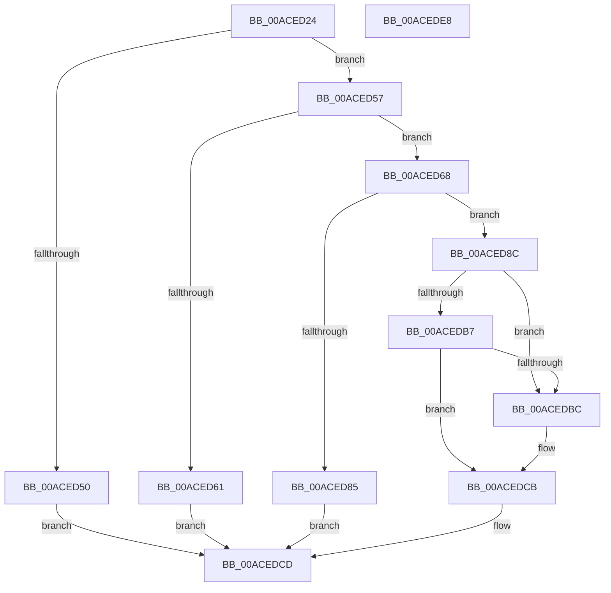

# KeEnableProfiling

- RVA: `0x00ACED24`–`0x00ACEDE9` (길이 `197` bytes)
- VA: `0x0000000140ACED24`
- 실행 섹션: `PAGE`
- PDB 이름 있음: `예`; PDB Function 태그: `아니요`
- unwind 정보 RVA: `0x0005E6B4`
- 디코드: `54`개 명령, `197/197` bytes 표시
- 미해석 바이트: `0` (있으면 어셈블리에 `.byte`로 보존)

> 이 문서는 커널 이미지의 기계어와 PDB 기호를 분석해 생성했습니다. 4번과 5번은 함수 원형과 자료형을 바이너리 사용 방식에서 추정한 C 해석이며 원본 소스 복구 결과는 아닙니다.

## 1. Dependencies

- 직접 호출 지점: **3**; 고유 호출 대상: **3**
- 직접 호출자로 확인된 함수: **1**
- RIP 상대 이미지 참조: **0**

### Outgoing calls
- `0x00ACED78` → [ExAllocatePool2](../../poolcode/B8/ExAllocatePool2_function_00B820F0.md) (function, `0x00B820F0`)
- `0x00ACEDA8` → [KeUpdateTotalCyclesCurrentThread](../../text/3F/KeUpdateTotalCyclesCurrentThread_function_003FA2B0.md) (function, `0x003FA2B0`)
- `0x00ACEDC1` → [KiBeginCounterAccumulation](../../text/49/KiBeginCounterAccumulation_function_0049D3F0.md) (function, `0x0049D3F0`)

### Direct callers
- [sub_00B1B2E4](../B1/Unknown_function_00B1B2E4.md) at `0x00B1B3C3`

### Static image references
- 디코드된 RIP-relative 메모리 참조가 없습니다.

## 2. Other-region calls and transfers

- 다른 실행 섹션으로 향하는 call: **3**
  - `0x00ACED78` → [ExAllocatePool2](../../poolcode/B8/ExAllocatePool2_function_00B820F0.md) (`PAGE` → `POOLCODE`)
  - `0x00ACEDA8` → [KeUpdateTotalCyclesCurrentThread](../../text/3F/KeUpdateTotalCyclesCurrentThread_function_003FA2B0.md) (`PAGE` → `.text`)
  - `0x00ACEDC1` → [KiBeginCounterAccumulation](../../text/49/KiBeginCounterAccumulation_function_0049D3F0.md) (`PAGE` → `.text`)
- 별도 외부 분기/꼬리 이동을 확인하지 못했습니다.

## 3. Assembly (complete function range)

```asm
00ACED24  48 8B C4                        mov rax, rsp
00ACED27  48 89 58 08                     mov qword ptr [rax + 8], rbx
00ACED2B  48 89 68 10                     mov qword ptr [rax + 0x10], rbp
00ACED2F  48 89 70 18                     mov qword ptr [rax + 0x18], rsi
00ACED33  48 89 78 20                     mov qword ptr [rax + 0x20], rdi
00ACED37  41 56                           push r14
00ACED39  48 83 EC 20                     sub rsp, 0x20
00ACED3D  4D 8B F1                        mov r14, r9
00ACED40  49 8B F0                        mov rsi, r8
00ACED43  8B EA                           mov ebp, edx
00ACED45  48 8B D9                        mov rbx, rcx
00ACED48  F7 C2 FE FF FF FF               test edx, 0xfffffffe
00ACED4E  74 07                           je 0x140aced57
00ACED50  B8 0D 00 00 C0                  mov eax, 0xc000000d
00ACED55  EB 76                           jmp 0x140acedcd
00ACED57  48 83 B9 68 01 00 00 00         cmp qword ptr [rcx + 0x168], 0
00ACED5F  74 07                           je 0x140aced68
00ACED61  B8 03 03 00 C0                  mov eax, 0xc0000303
00ACED66  EB 65                           jmp 0x140acedcd
00ACED68  BA A8 01 00 00                  mov edx, 0x1a8
00ACED6D  B9 41 00 00 00                  mov ecx, 0x41
00ACED72  41 B8 50 72 6F 66               mov r8d, 0x666f7250
00ACED78  E8 73 33 0B 00                  call 0x140b820f0
00ACED7D  48 8B F8                        mov rdi, rax
00ACED80  48 85 C0                        test rax, rax
00ACED83  75 07                           jne 0x140aced8c
00ACED85  B8 17 00 00 C0                  mov eax, 0xc0000017
00ACED8A  EB 41                           jmp 0x140acedcd
00ACED8C  4C 89 70 08                     mov qword ptr [rax + 8], r14
00ACED90  33 D2                           xor edx, edx
00ACED92  89 68 10                        mov dword ptr [rax + 0x10], ebp
00ACED95  48 8B CB                        mov rcx, rbx
00ACED98  48 89 70 20                     mov qword ptr [rax + 0x20], rsi
00ACED9C  48 89 BB 68 01 00 00            mov qword ptr [rbx + 0x168], rdi
00ACEDA3  F0 0F BA 2B 10                  lock bts dword ptr [rbx], 0x10
00ACEDA8  E8 03 B5 92 FF                  call 0x1403fa2b0
00ACEDAD  48 89 47 18                     mov qword ptr [rdi + 0x18], rax
00ACEDB1  40 F6 C5 01                     test bpl, 1
00ACEDB5  75 05                           jne 0x140acedbc
00ACEDB7  48 85 F6                        test rsi, rsi
00ACEDBA  74 0F                           je 0x140acedcb
00ACEDBC  33 D2                           xor edx, edx
00ACEDBE  48 8B CB                        mov rcx, rbx
00ACEDC1  E8 2A E6 9C FF                  call 0x14049d3f0
00ACEDC6  F0 0F BA 2B 11                  lock bts dword ptr [rbx], 0x11
00ACEDCB  33 C0                           xor eax, eax
00ACEDCD  48 8B 5C 24 30                  mov rbx, qword ptr [rsp + 0x30]
00ACEDD2  48 8B 6C 24 38                  mov rbp, qword ptr [rsp + 0x38]
00ACEDD7  48 8B 74 24 40                  mov rsi, qword ptr [rsp + 0x40]
00ACEDDC  48 8B 7C 24 48                  mov rdi, qword ptr [rsp + 0x48]
00ACEDE1  48 83 C4 20                     add rsp, 0x20
00ACEDE5  41 5E                           pop r14
00ACEDE7  C3                              ret
00ACEDE8  CC                              int3
```

## 4. C-style interpretation (structured pseudocode)

```c
__int64 __fastcall KeEnableProfiling(__int64 a1, int a2, __int64 a3, __int64 a4)
{
    __int64 result;
    __int64 v_rsp;
    unsigned __int64 v_stack_p10;
    unsigned __int64 v_stack_p18;
    unsigned __int64 v_stack_p20;
    unsigned __int64 v_stack_p8;

    *(unsigned __int64 *)(v_rsp + 8) = v_rbx;
    *(unsigned __int64 *)(v_rsp + 16) = v_rbp;
    *(unsigned __int64 *)(v_rsp + 24) = v_rsi;
    *(unsigned __int64 *)(v_rsp + 32) = v_rdi;
    v_rsp = (v_rsp) - (32);
    if (((a2) & (0xFFFFFFFEULL)) == 0) goto loc_00ACED57;
    goto loc_00ACEDCD;
loc_00ACED57:
    if ((*(unsigned __int64 *)(a1 + 360)) == 0) goto loc_00ACED68;
    goto loc_00ACEDCD;
loc_00ACED68:
    result = ExAllocatePool2(65, 424, (unsigned int)(0x666F7250ULL), a4);
    if (result != 0) goto loc_00ACED8C;
    goto loc_00ACEDCD;
loc_00ACED8C:
    *(unsigned __int64 *)((unsigned int)(0xC0000017ULL) + 8) = a4;
    a2 = 0;
    *(unsigned int *)((unsigned int)(0xC0000017ULL) + 16) = (unsigned int)((unsigned int)(a2));
    *(unsigned __int64 *)((unsigned int)(0xC0000017ULL) + 32) = a3;
    *(unsigned __int64 *)(a1 + 360) = result;
    result = KeUpdateTotalCyclesCurrentThread(a1, a2, (unsigned int)(0x666F7250ULL), a4);
    *(unsigned __int64 *)(result + 24) = result;
    if ((((unsigned __int8)((unsigned int)(a2))) & (1)) != 0) goto loc_00ACEDBC;
    if (a3 != 0) {
        a2 = 0;
        a1 = a1;
        result = KiBeginCounterAccumulation(a1, a2, (unsigned int)(0x666F7250ULL), a4);
    }
    result = 0;
loc_00ACEDCD:
    v_rsp = (v_rsp) + (32);
    return result;
}
```

## 5. (Beta) C Style

```c
int64_t KeEnableProfiling(void *Arg1, int32_t Arg2, int64_t Arg3, int64_t Arg4)
{
    uint8_t *arg1 = (uint8_t *)Arg1;

    int64_t result;
    int64_t local_rsp;
    uint64_t v_stack_p10;
    uint64_t v_stack_p18;
    uint64_t v_stack_p20;
    uint64_t v_stack_p8;

    *(uint64_t *)(local_rsp + 0x8) = local_rbx;
    *(uint64_t *)(local_rsp + 0x10) = local_rbp;
    *(uint64_t *)(local_rsp + 0x18) = local_rsi;
    *(uint64_t *)(local_rsp + 0x20) = local_rdi;
    local_rsp = (local_rsp) - (32);
    if (((Arg2) & (0xFFFFFFFEULL)) == 0) goto loc_00ACED57;
    goto loc_00ACEDCD;
loc_00ACED57:
    if ((*(uint64_t *)(arg1 + 0x168)) == 0) goto loc_00ACED68;
    goto loc_00ACEDCD;
loc_00ACED68:
    result = ExAllocatePool2(65, 424, (uint32_t)(0x666F7250ULL), Arg4);
    if (result != 0) goto loc_00ACED8C;
    goto loc_00ACEDCD;
loc_00ACED8C:
    *(uint64_t *)((uint32_t)(0xC0000017ULL) + 0x8) = Arg4;
    Arg2 = 0;
    *(uint32_t *)((uint32_t)(0xC0000017ULL) + 0x10) = (uint32_t)((uint32_t)(Arg2));
    *(uint64_t *)((uint32_t)(0xC0000017ULL) + 0x20) = Arg3;
    *(uint64_t *)(arg1 + 0x168) = result;
    result = KeUpdateTotalCyclesCurrentThread(Arg1, Arg2, (uint32_t)(0x666F7250ULL), Arg4);
    *(uint64_t *)(result + 0x18) = result;
    if ((((uint8_t)((uint32_t)(Arg2))) & (1)) != 0) goto loc_00ACEDBC;
    if (Arg3 != 0) {
        Arg2 = 0;
        Arg1 = Arg1;
        result = KiBeginCounterAccumulation(Arg1, Arg2, (uint32_t)(0x666F7250ULL), Arg4);
    }
    result = 0;
loc_00ACEDCD:
    local_rsp = (local_rsp) + (32);
    return result;
}
```

### 관측된 메모리 오프셋

구조체 형식이 확인되지 않은 접근은 인자 기준의 오프셋으로만 기록했습니다.

| 기준 인자 | 오프셋 표현 | 폭 (bit) | 접근 |
|---|---:|---:|---|
| `Arg1` | `+ 0x0` | `32` | `R/W` |
| `Arg1` | `+ 0x168` | `64` | `R` |
| `Arg1` | `+ 0x168` | `64` | `W` |

## 6. Execution-region graph

[열기: 2D/3D 그래프와 함수 탐색 컨트롤 패널](../../../control-panel.html?section=page&rva=0x00ACED24&view=graph)

- 2D 그래프는 위에서 아래로 흐르고, 3D 그래프는 빈 공간을 드래그해 회전합니다. Shift+드래그는 이동, 휠은 확대·축소, 함수 노드 선택은 대상 보고서 이동입니다.

### Static fallback


