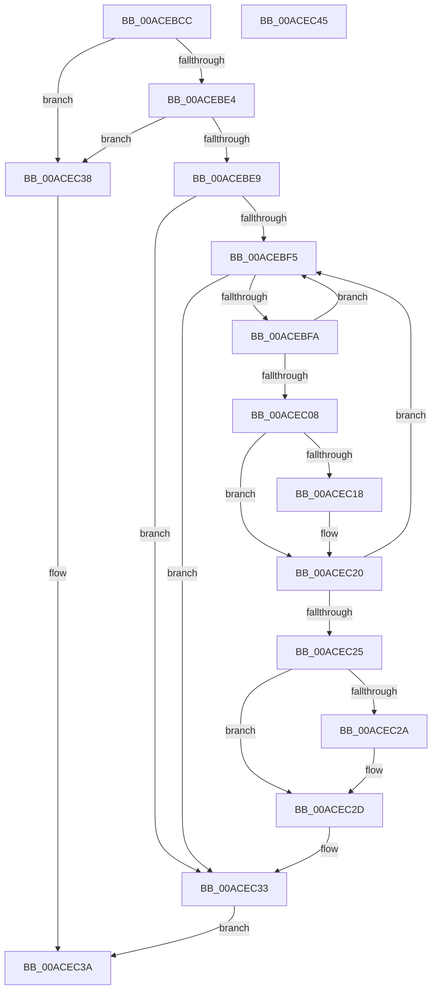

# KsepIsShimRegistered

- RVA: `0x00ACEBCC`–`0x00ACEC46` (길이 `122` bytes)
- VA: `0x0000000140ACEBCC`
- 실행 섹션: `PAGE`
- PDB 이름 있음: `예`; PDB Function 태그: `아니요`
- unwind 정보 RVA: `0x000950EC`
- 디코드: `40`개 명령, `122/122` bytes 표시
- 미해석 바이트: `0` (있으면 어셈블리에 `.byte`로 보존)

> 이 문서는 커널 이미지의 기계어와 PDB 기호를 분석해 생성했습니다. 4번과 5번은 함수 원형과 자료형을 바이너리 사용 방식에서 추정한 C 해석이며 원본 소스 복구 결과는 아닙니다.

## 1. Dependencies

- 직접 호출 지점: **0**; 고유 호출 대상: **0**
- 직접 호출자로 확인된 함수: **3**
- RIP 상대 이미지 참조: **0**

### Outgoing calls
- 직접 디코드된 call 명령이 없습니다.

### Direct callers
- [KseRegisterShimEx](../74/KseRegisterShimEx_function_007494D0.md) at `0x0074963C`
- [KseUnregisterShim](../74/KseUnregisterShim_function_00749800.md) at `0x007498AD`
- [KsepResolveApplicableShimsForDriver](../74/KsepResolveApplicableShimsForDriver_function_0074A168.md) at `0x0074A1FF`
- [KsepResolveApplicableShimsForDriver](../74/KsepResolveApplicableShimsForDriver_function_0074A168.md) at `0x0074A371`

### Static image references
- 디코드된 RIP-relative 메모리 참조가 없습니다.

## 2. Other-region calls and transfers

- 다른 실행 섹션으로 향하는 call: **0**
- 별도 외부 분기/꼬리 이동을 확인하지 못했습니다.

## 3. Assembly (complete function range)

```asm
00ACEBCC  48 89 5C 24 08                  mov qword ptr [rsp + 8], rbx
00ACEBD1  48 89 7C 24 10                  mov qword ptr [rsp + 0x10], rdi
00ACEBD6  45 33 C0                        xor r8d, r8d
00ACEBD9  4D 8B D9                        mov r11, r9
00ACEBDC  48 8B DA                        mov rbx, rdx
00ACEBDF  48 85 D2                        test rdx, rdx
00ACEBE2  74 54                           je 0x140acec38
00ACEBE4  48 85 C9                        test rcx, rcx
00ACEBE7  74 4F                           je 0x140acec38
00ACEBE9  4C 8D 51 10                     lea r10, [rcx + 0x10]
00ACEBED  49 8B 0A                        mov rcx, qword ptr [r10]
00ACEBF0  49 3B CA                        cmp rcx, r10
00ACEBF3  74 3E                           je 0x140acec33
00ACEBF5  49 3B CA                        cmp rcx, r10
00ACEBF8  74 39                           je 0x140acec33
00ACEBFA  4C 8B C9                        mov r9, rcx
00ACEBFD  48 8B 09                        mov rcx, qword ptr [rcx]
00ACEC00  41 8B 41 1C                     mov eax, dword ptr [r9 + 0x1c]
00ACEC04  A8 04                           test al, 4
00ACEC06  75 ED                           jne 0x140acebf5
00ACEC08  49 8B 41 10                     mov rax, qword ptr [r9 + 0x10]
00ACEC0C  48 8B 78 08                     mov rdi, qword ptr [rax + 8]
00ACEC10  48 8B 17                        mov rdx, qword ptr [rdi]
00ACEC13  48 2B 13                        sub rdx, qword ptr [rbx]
00ACEC16  75 08                           jne 0x140acec20
00ACEC18  48 8B 57 08                     mov rdx, qword ptr [rdi + 8]
00ACEC1C  48 2B 53 08                     sub rdx, qword ptr [rbx + 8]
00ACEC20  48 85 D2                        test rdx, rdx
00ACEC23  75 D0                           jne 0x140acebf5
00ACEC25  4D 85 DB                        test r11, r11
00ACEC28  74 03                           je 0x140acec2d
00ACEC2A  4D 89 0B                        mov qword ptr [r11], r9
00ACEC2D  41 B8 01 00 00 00               mov r8d, 1
00ACEC33  41 8B C0                        mov eax, r8d
00ACEC36  EB 02                           jmp 0x140acec3a
00ACEC38  33 C0                           xor eax, eax
00ACEC3A  48 8B 5C 24 08                  mov rbx, qword ptr [rsp + 8]
00ACEC3F  48 8B 7C 24 10                  mov rdi, qword ptr [rsp + 0x10]
00ACEC44  C3                              ret
00ACEC45  CC                              int3
```

## 4. C-style interpretation (structured pseudocode)

```c
__int64 __fastcall KsepIsShimRegistered(__int64 a1, __int64 a2, int a3, __int64 a4)
{
    __int64 result;
    unsigned __int64 v_stack_p10;
    unsigned __int64 v_stack_p8;

    v_stack_p8 = v_rbx;
    v_stack_p10 = v_rdi;
    a3 = 0;
    if (a2 == 0) goto loc_00ACEC38;
    if (a1 == 0) goto loc_00ACEC38;
    if ((*(unsigned __int64 *)(a1 + 16)) == (a1 + 16)) goto loc_00ACEC33;
loc_00ACEBF5:
    if ((*(unsigned __int64 *)(a1 + 16)) == (a1 + 16)) goto loc_00ACEC33;
    if ((((unsigned __int8)((unsigned int)(*(unsigned int *)(*(unsigned __int64 *)(a1 + 16) + 28)))) & (4)) != 0) goto loc_00ACEBF5;
    a2 = (*(unsigned __int64 *)(*(unsigned __int64 *)(*(unsigned __int64 *)(*(unsigned __int64 *)(a1 + 16) + 16) + 8))) - (*(unsigned __int64 *)(a2));
    if (!(condition_is_not_equal)) {
        a2 = *(unsigned __int64 *)(*(unsigned __int64 *)(*(unsigned __int64 *)(*(unsigned __int64 *)(a1 + 16) + 16) + 8) + 8);
        a2 = (a2) - (*(unsigned __int64 *)(a2 + 8));
    }
    if (a2 != 0) goto loc_00ACEBF5;
    if (a4 != 0) {
        *(unsigned __int64 *)(a4) = *(unsigned __int64 *)(a1 + 16);
    }
loc_00ACEC33:
    goto loc_00ACEC3A;
loc_00ACEC38:
    result = 0;
loc_00ACEC3A:
    return result;
}
```

## 5. (Beta) C Style

```c
int64_t KsepIsShimRegistered(int64_t Arg1, void *Arg2, int32_t Arg3, int64_t Arg4)
{
    uint8_t *arg2 = (uint8_t *)Arg2;

    int64_t result;
    uint64_t v_stack_p10;
    uint64_t v_stack_p8;

    v_stack_p8 = local_rbx;
    v_stack_p10 = local_rdi;
    Arg3 = 0;
    if (Arg2 == NULL) goto loc_00ACEC38;
    if (Arg1 == 0) goto loc_00ACEC38;
    if ((*(uint64_t *)(Arg1 + 0x10)) == (Arg1 + 16)) goto loc_00ACEC33;
loc_00ACEBF5:
    if ((*(uint64_t *)(Arg1 + 0x10)) == (Arg1 + 16)) goto loc_00ACEC33;
    if ((((uint8_t)((uint32_t)(*(uint32_t *)(*(uint64_t *)(Arg1 + 0x10) + 0x1C)))) & (4)) != 0) goto loc_00ACEBF5;
    Arg2 = (*(uint64_t *)(*(uint64_t *)(*(uint64_t *)(*(uint64_t *)(Arg1 + 0x10) + 0x10) + 0x8))) - (*(uint64_t *)(arg2));
    if (!(condition_is_not_equal)) {
        Arg2 = *(uint64_t *)(*(uint64_t *)(*(uint64_t *)(*(uint64_t *)(Arg1 + 0x10) + 0x10) + 0x8) + 0x8);
        Arg2 = (Arg2) - (*(uint64_t *)(arg2 + 0x8));
    }
    if (Arg2 != NULL) goto loc_00ACEBF5;
    if (Arg4 != 0) {
        *(uint64_t *)(Arg4) = *(uint64_t *)(Arg1 + 0x10);
    }
loc_00ACEC33:
    goto loc_00ACEC3A;
loc_00ACEC38:
    result = 0;
loc_00ACEC3A:
    return result;
}
```

### 관측된 메모리 오프셋

구조체 형식이 확인되지 않은 접근은 인자 기준의 오프셋으로만 기록했습니다.

| 기준 인자 | 오프셋 표현 | 폭 (bit) | 접근 |
|---|---:|---:|---|
| `Arg2` | `+ 0x0` | `64` | `R` |
| `Arg2` | `+ 0x8` | `64` | `R` |

## 6. Execution-region graph

[열기: 2D/3D 그래프와 함수 탐색 컨트롤 패널](../../../control-panel.html?section=page&rva=0x00ACEBCC&view=graph)

- 2D 그래프는 위에서 아래로 흐르고, 3D 그래프는 빈 공간을 드래그해 회전합니다. Shift+드래그는 이동, 휠은 확대·축소, 함수 노드 선택은 대상 보고서 이동입니다.

### Static fallback


