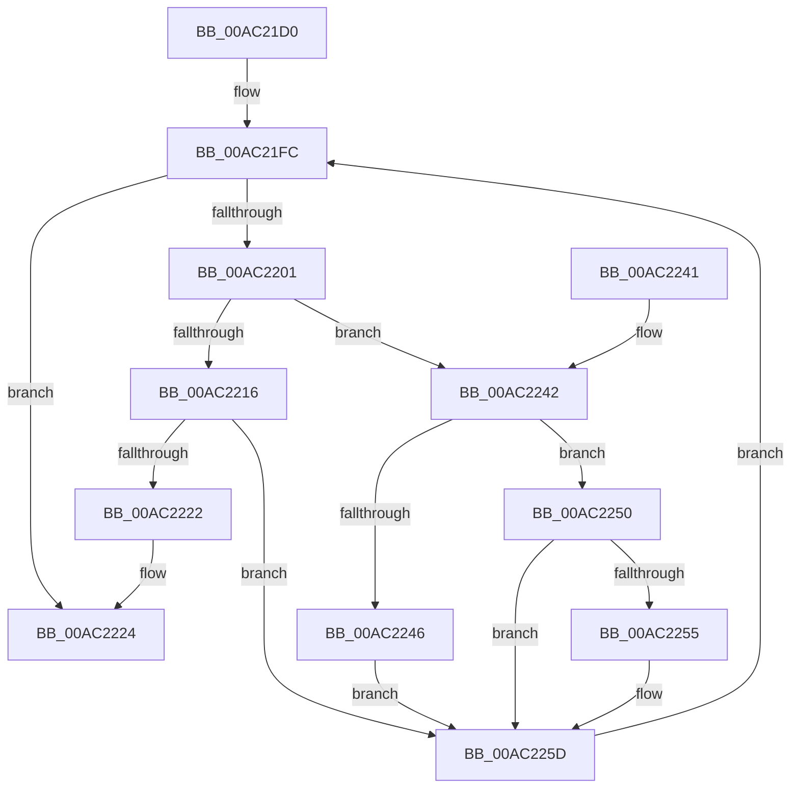

# MiActOnMirrorBitmap

- RVA: `0x00AC21D0`–`0x00AC2261` (길이 `145` bytes)
- VA: `0x0000000140AC21D0`
- 실행 섹션: `PAGE`
- PDB 이름 있음: `예`; PDB Function 태그: `아니요`
- unwind 정보 RVA: `0x000BDBD8`
- 디코드: `46`개 명령, `145/145` bytes 표시
- 미해석 바이트: `0` (있으면 어셈블리에 `.byte`로 보존)

> 이 문서는 커널 이미지의 기계어와 PDB 기호를 분석해 생성했습니다. 4번과 5번은 함수 원형과 자료형을 바이너리 사용 방식에서 추정한 C 해석이며 원본 소스 복구 결과는 아닙니다.

## 1. Dependencies

- 직접 호출 지점: **3**; 고유 호출 대상: **3**
- 직접 호출자로 확인된 함수: **3**
- RIP 상대 이미지 참조: **1**

### Outgoing calls
- `0x00AC2219` → [MiSplitMirrorBitMap](../7F/MiSplitMirrorBitMap_function_007FCAE8.md) (function, `0x007FCAE8`)
- `0x00AC2249` → [RtlSetBitsEx](../../text/3B/RtlSetBitsEx_function_003B6570.md) (function, `0x003B6570`)
- `0x00AC2258` → [RtlClearBitsEx](../../text/29/RtlClearBitsEx_function_00297740.md) (function, `0x00297740`)

### Direct callers
- [MiUpdateMirrorBitmaps](../AD/MiUpdateMirrorBitmaps_function_00ADA220.md) at `0x00ADA26B`
- [MmDuplicateMemory](../../pagelk/B7/MmDuplicateMemory_function_00B74158.md) at `0x00B74306`
- [MmDuplicateMemory](../../pagelk/B7/MmDuplicateMemory_function_00B74158.md) at `0x00B743C0`
- [MiMirrorBrownPhase](../../pagelk/B7/MiMirrorBrownPhase_function_00B7C6B4.md) at `0x00B7C736`

### Static image references
- `0x00AC21E9` → RVA `0x00FC6B88` (`ALMOSTRO`; read)

## 2. Other-region calls and transfers

- 다른 실행 섹션으로 향하는 call: **2**
  - `0x00AC2249` → [RtlSetBitsEx](../../text/3B/RtlSetBitsEx_function_003B6570.md) (`PAGE` → `.text`)
  - `0x00AC2258` → [RtlClearBitsEx](../../text/29/RtlClearBitsEx_function_00297740.md) (`PAGE` → `.text`)
- 별도 외부 분기/꼬리 이동을 확인하지 못했습니다.

## 3. Assembly (complete function range)

```asm
00AC21D0  48 8B C4                        mov rax, rsp
00AC21D3  48 89 58 08                     mov qword ptr [rax + 8], rbx
00AC21D7  48 89 68 10                     mov qword ptr [rax + 0x10], rbp
00AC21DB  48 89 70 18                     mov qword ptr [rax + 0x18], rsi
00AC21DF  48 89 78 20                     mov qword ptr [rax + 0x20], rdi
00AC21E3  41 56                           push r14
00AC21E5  48 83 EC 20                     sub rsp, 0x20
00AC21E9  4C 8B 35 98 49 50 00            mov r14, qword ptr [rip + 0x504998]
00AC21F0  8B F2                           mov esi, edx
00AC21F2  48 8B E9                        mov rbp, rcx
00AC21F5  BB 01 00 00 00                  mov ebx, 1
00AC21FA  33 FF                           xor edi, edi
00AC21FC  41 3B 3E                        cmp edi, dword ptr [r14]
00AC21FF  73 23                           jae 0x140ac2224
00AC2201  8B C7                           mov eax, edi
00AC2203  48 03 C3                        add rax, rbx
00AC2206  48 03 C0                        add rax, rax
00AC2209  4D 8B 44 C6 08                  mov r8, qword ptr [r14 + rax*8 + 8]
00AC220E  49 8B 14 C6                     mov rdx, qword ptr [r14 + rax*8]
00AC2212  85 F6                           test esi, esi
00AC2214  75 2C                           jne 0x140ac2242
00AC2216  48 8B CD                        mov rcx, rbp
00AC2219  E8 CA A8 D3 FF                  call 0x1407fcae8
00AC221E  85 C0                           test eax, eax
00AC2220  75 3B                           jne 0x140ac225d
00AC2222  33 DB                           xor ebx, ebx
00AC2224  48 8B 6C 24 38                  mov rbp, qword ptr [rsp + 0x38]
00AC2229  8B C3                           mov eax, ebx
00AC222B  48 8B 5C 24 30                  mov rbx, qword ptr [rsp + 0x30]
00AC2230  48 8B 74 24 40                  mov rsi, qword ptr [rsp + 0x40]
00AC2235  48 8B 7C 24 48                  mov rdi, qword ptr [rsp + 0x48]
00AC223A  48 83 C4 20                     add rsp, 0x20
00AC223E  41 5E                           pop r14
00AC2240  C3                              ret
00AC2241  CC                              int3
00AC2242  3B F3                           cmp esi, ebx
00AC2244  75 0A                           jne 0x140ac2250
00AC2246  48 8B CD                        mov rcx, rbp
00AC2249  E8 22 43 8F FF                  call 0x1403b6570
00AC224E  EB 0D                           jmp 0x140ac225d
00AC2250  83 FE 02                        cmp esi, 2
00AC2253  75 08                           jne 0x140ac225d
00AC2255  48 8B CD                        mov rcx, rbp
00AC2258  E8 E3 54 7D FF                  call 0x140297740
00AC225D  03 FB                           add edi, ebx
00AC225F  EB 9B                           jmp 0x140ac21fc
```

## 4. C-style interpretation (structured pseudocode)

```c
__int64 __fastcall MiActOnMirrorBitmap(__int64 a1, int a2)
{
    __int64 result;
    __int64 v_rbx;
    __int64 v_rdi;
    __int64 v_rsp;
    unsigned __int64 v_stack_p10;
    unsigned __int64 v_stack_p18;
    unsigned __int64 v_stack_p20;
    unsigned __int64 v_stack_p8;

    *(unsigned __int64 *)(v_rsp + 8) = v_rbx;
    *(unsigned __int64 *)(v_rsp + 16) = v_rbp;
    *(unsigned __int64 *)(v_rsp + 24) = v_rsi;
    *(unsigned __int64 *)(v_rsp + 32) = v_rdi;
    v_rsp = (v_rsp) - (32);
    v_rdi = 0;
loc_00AC21FC:
    if (0 >= (*(unsigned int *)(*(unsigned __int64 *)(v_rip + 5261720)))) goto loc_00AC2224;
    result = (0) + (1);
    result = (result) + (result);
    if ((unsigned int)((unsigned int)(a2)) != 0) goto loc_00AC2242;
    result = MiSplitMirrorBitMap(a1, *(unsigned __int64 *)(*(unsigned __int64 *)(v_rip + 5261720) + result * 8), *(unsigned __int64 *)(*(unsigned __int64 *)(v_rip + 5261720) + result * 8 + 8), a4);
    if ((unsigned int)(result) != 0) goto loc_00AC225D;
    v_rbx = 0;
loc_00AC2224:
    v_rsp = (v_rsp) + (32);
    return 0;
loc_00AC2242:
    if (((unsigned int)(v_stack_p18)) != ((unsigned int)(v_stack_p8))) goto loc_00AC2250;
    result = RtlSetBitsEx(v_stack_p10, *(unsigned __int64 *)(*(unsigned __int64 *)(v_rip + 5261720) + result * 8), *(unsigned __int64 *)(*(unsigned __int64 *)(v_rip + 5261720) + result * 8 + 8), a4);
    goto loc_00AC225D;
loc_00AC2250:
    if (((unsigned int)(v_stack_p18)) == 2) {
        a1 = v_stack_p10;
        result = RtlClearBitsEx(a1, *(unsigned __int64 *)(*(unsigned __int64 *)(v_rip + 5261720) + result * 8), *(unsigned __int64 *)(*(unsigned __int64 *)(v_rip + 5261720) + result * 8 + 8), a4);
    }
    v_rdi = (unsigned int)((v_stack_p20) + ((unsigned int)(v_stack_p8)));
    goto loc_00AC21FC;
}
```

## 5. (Beta) C Style

```c
int64_t MiActOnMirrorBitmap(int64_t Arg1, int32_t Arg2)
{
    int64_t result;
    int64_t local_rbx;
    int64_t local_rdi;
    int64_t local_rsp;
    uint64_t v_stack_p10;
    uint64_t v_stack_p18;
    uint64_t v_stack_p20;
    uint64_t v_stack_p8;

    *(uint64_t *)(local_rsp + 0x8) = local_rbx;
    *(uint64_t *)(local_rsp + 0x10) = local_rbp;
    *(uint64_t *)(local_rsp + 0x18) = local_rsi;
    *(uint64_t *)(local_rsp + 0x20) = local_rdi;
    local_rsp = (local_rsp) - (32);
    local_rdi = 0;
loc_00AC21FC:
    if (0 >= (*(uint32_t *)(*(uint64_t *)(v_rip + 0x504998)))) goto loc_00AC2224;
    result = (0) + (1);
    result = (result) + (result);
    if ((uint32_t)((uint32_t)(Arg2)) != 0) goto loc_00AC2242;
    result = MiSplitMirrorBitMap(Arg1, *(uint64_t *)(*(uint64_t *)(v_rip + 0x504998) + result * 8), *(uint64_t *)(*(uint64_t *)(v_rip + 0x504998) + result * 8 + 0x8), a4);
    if ((uint32_t)(result) != 0) goto loc_00AC225D;
    local_rbx = 0;
loc_00AC2224:
    local_rsp = (local_rsp) + (32);
    return 0;
loc_00AC2242:
    if (((uint32_t)(v_stack_p18)) != ((uint32_t)(v_stack_p8))) goto loc_00AC2250;
    result = RtlSetBitsEx(v_stack_p10, *(uint64_t *)(*(uint64_t *)(v_rip + 0x504998) + result * 8), *(uint64_t *)(*(uint64_t *)(v_rip + 0x504998) + result * 8 + 0x8), a4);
    goto loc_00AC225D;
loc_00AC2250:
    if (((uint32_t)(v_stack_p18)) == 2) {
        Arg1 = v_stack_p10;
        result = RtlClearBitsEx(Arg1, *(uint64_t *)(*(uint64_t *)(v_rip + 0x504998) + result * 8), *(uint64_t *)(*(uint64_t *)(v_rip + 0x504998) + result * 8 + 0x8), a4);
    }
    local_rdi = (uint32_t)((v_stack_p20) + ((uint32_t)(v_stack_p8)));
    goto loc_00AC21FC;
}
```

## 6. Execution-region graph

[열기: 2D/3D 그래프와 함수 탐색 컨트롤 패널](../../../control-panel.html?section=page&rva=0x00AC21D0&view=graph)

- 2D 그래프는 위에서 아래로 흐르고, 3D 그래프는 빈 공간을 드래그해 회전합니다. Shift+드래그는 이동, 휠은 확대·축소, 함수 노드 선택은 대상 보고서 이동입니다.

### Static fallback


