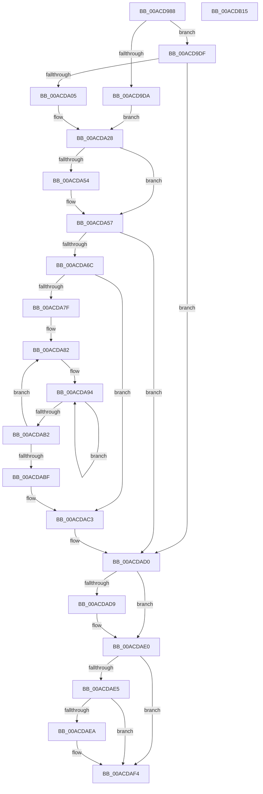

# MiAllocateUserPhysicalRanges

- RVA: `0x00ACD988`–`0x00ACDB16` (길이 `398` bytes)
- VA: `0x0000000140ACD988`
- 실행 섹션: `PAGE`
- PDB 이름 있음: `예`; PDB Function 태그: `아니요`
- unwind 정보 RVA: `0x000BE68C`
- 디코드: `119`개 명령, `398/398` bytes 표시
- 미해석 바이트: `0` (있으면 어셈블리에 `.byte`로 보존)

> 이 문서는 커널 이미지의 기계어와 PDB 기호를 분석해 생성했습니다. 4번과 5번은 함수 원형과 자료형을 바이너리 사용 방식에서 추정한 C 해석이며 원본 소스 복구 결과는 아닙니다.

## 1. Dependencies

- 직접 호출 지점: **4**; 고유 호출 대상: **3**
- 직접 호출자로 확인된 함수: **1**
- RIP 상대 이미지 참조: **0**

### Outgoing calls
- `0x00ACD9F2` → [MiAllocatePool](../../text/35/MiAllocatePool_function_0035B540.md) (function, `0x0035B540`)
- `0x00ACDA61` → [MmAllocateMemoryRanges](../7F/MmAllocateMemoryRanges_function_007FC0C0.md) (function, `0x007FC0C0`)
- `0x00ACDADB` → [ExFreePoolWithTag](../../poolcode/B8/ExFreePoolWithTag_function_00B82870.md) (function, `0x00B82870`)
- `0x00ACDAEF` → [ExFreePoolWithTag](../../poolcode/B8/ExFreePoolWithTag_function_00B82870.md) (function, `0x00B82870`)

### Direct callers
- [MiAllocateUserPhysicalPages](../80/MiAllocateUserPhysicalPages_function_00809828.md) at `0x00809EF3`

### Static image references
- 디코드된 RIP-relative 메모리 참조가 없습니다.

## 2. Other-region calls and transfers

- 다른 실행 섹션으로 향하는 call: **3**
  - `0x00ACD9F2` → [MiAllocatePool](../../text/35/MiAllocatePool_function_0035B540.md) (`PAGE` → `.text`)
  - `0x00ACDADB` → [ExFreePoolWithTag](../../poolcode/B8/ExFreePoolWithTag_function_00B82870.md) (`PAGE` → `POOLCODE`)
  - `0x00ACDAEF` → [ExFreePoolWithTag](../../poolcode/B8/ExFreePoolWithTag_function_00B82870.md) (`PAGE` → `POOLCODE`)
- 별도 외부 분기/꼬리 이동을 확인하지 못했습니다.

## 3. Assembly (complete function range)

```asm
00ACD988  48 89 5C 24 08                  mov qword ptr [rsp + 8], rbx
00ACD98D  48 89 74 24 10                  mov qword ptr [rsp + 0x10], rsi
00ACD992  48 89 7C 24 18                  mov qword ptr [rsp + 0x18], rdi
00ACD997  55                              push rbp
00ACD998  41 54                           push r12
00ACD99A  41 55                           push r13
00ACD99C  41 56                           push r14
00ACD99E  41 57                           push r15
00ACD9A0  48 8B EC                        mov rbp, rsp
00ACD9A3  48 83 EC 60                     sub rsp, 0x60
00ACD9A7  4C 8B 7D 50                     mov r15, qword ptr [rbp + 0x50]
00ACD9AB  0F 57 C0                        xorps xmm0, xmm0
00ACD9AE  48 8B F2                        mov rsi, rdx
00ACD9B1  33 C0                           xor eax, eax
00ACD9B3  33 D2                           xor edx, edx
00ACD9B5  48 C1 EE 12                     shr rsi, 0x12
00ACD9B9  48 89 45 F0                     mov qword ptr [rbp - 0x10], rax
00ACD9BD  45 8B E1                        mov r12d, r9d
00ACD9C0  41 8B D8                        mov ebx, r8d
00ACD9C3  4C 8B E9                        mov r13, rcx
00ACD9C6  44 8B F2                        mov r14d, edx
00ACD9C9  0F 11 45 C0                     movups xmmword ptr [rbp - 0x40], xmm0
00ACD9CD  0F 11 45 D0                     movups xmmword ptr [rbp - 0x30], xmm0
00ACD9D1  0F 11 45 E0                     movups xmmword ptr [rbp - 0x20], xmm0
00ACD9D5  4D 85 FF                        test r15, r15
00ACD9D8  74 05                           je 0x140acd9df
00ACD9DA  49 8B FF                        mov rdi, r15
00ACD9DD  EB 49                           jmp 0x140acda28
00ACD9DF  48 8D 14 F5 30 00 00 00         lea rdx, [rsi*8 + 0x30]
00ACD9E7  B9 40 00 00 00                  mov ecx, 0x40
00ACD9EC  41 B8 4D 6D 50 72               mov r8d, 0x72506d4d
00ACD9F2  E8 49 DB 88 FF                  call 0x14035b540
00ACD9F7  33 D2                           xor edx, edx
00ACD9F9  48 8B F8                        mov rdi, rax
00ACD9FC  48 85 C0                        test rax, rax
00ACD9FF  0F 84 CB 00 00 00               je 0x140acdad0
00ACDA05  48 89 10                        mov qword ptr [rax], rdx
00ACDA08  8D 46 06                        lea eax, [rsi + 6]
00ACDA0B  66 C1 E0 03                     shl ax, 3
00ACDA0F  66 89 47 08                     mov word ptr [rdi + 8], ax
00ACDA13  48 8B C6                        mov rax, rsi
00ACDA16  48 C1 E0 0C                     shl rax, 0xc
00ACDA1A  89 47 28                        mov dword ptr [rdi + 0x28], eax
00ACDA1D  66 89 57 0A                     mov word ptr [rdi + 0xa], dx
00ACDA21  48 89 57 20                     mov qword ptr [rdi + 0x20], rdx
00ACDA25  89 57 2C                        mov dword ptr [rdi + 0x2c], edx
00ACDA28  8B 4D C4                        mov ecx, dword ptr [rbp - 0x3c]
00ACDA2B  49 8B 85 B8 00 00 00            mov rax, qword ptr [r13 + 0xb8]
00ACDA32  83 C9 01                        or ecx, 1
00ACDA35  C7 45 C0 01 00 00 00            mov dword ptr [rbp - 0x40], 1
00ACDA3C  48 C7 45 D8 00 00 00 40         mov qword ptr [rbp - 0x28], 0x40000000
00ACDA44  48 89 45 C8                     mov qword ptr [rbp - 0x38], rax
00ACDA48  89 5D E0                        mov dword ptr [rbp - 0x20], ebx
00ACDA4B  48 89 75 D0                     mov qword ptr [rbp - 0x30], rsi
00ACDA4F  45 85 E4                        test r12d, r12d
00ACDA52  75 03                           jne 0x140acda57
00ACDA54  83 C9 02                        or ecx, 2
00ACDA57  83 C9 04                        or ecx, 4
00ACDA5A  89 4D C4                        mov dword ptr [rbp - 0x3c], ecx
00ACDA5D  48 8D 4D C0                     lea rcx, [rbp - 0x40]
00ACDA61  E8 5A E6 D2 FF                  call 0x1407fc0c0
00ACDA66  33 D2                           xor edx, edx
00ACDA68  85 C0                           test eax, eax
00ACDA6A  78 64                           js 0x140acdad0
00ACDA6C  4C 8D 57 30                     lea r10, [rdi + 0x30]
00ACDA70  4C 8B 45 F0                     mov r8, qword ptr [rbp - 0x10]
00ACDA74  8B CA                           mov ecx, edx
00ACDA76  44 8B CA                        mov r9d, edx
00ACDA79  48 39 55 E8                     cmp qword ptr [rbp - 0x18], rdx
00ACDA7D  76 44                           jbe 0x140acdac3
00ACDA7F  45 33 FF                        xor r15d, r15d
00ACDA82  49 8B 00                        mov rax, qword ptr [r8]
00ACDA85  33 D2                           xor edx, edx
00ACDA87  48 F7 75 D8                     div qword ptr [rbp - 0x28]
00ACDA8B  4D 8B DF                        mov r11, r15
00ACDA8E  48 FF C2                        inc rdx
00ACDA91  48 03 CA                        add rcx, rdx
00ACDA94  49 8B 00                        mov rax, qword ptr [r8]
00ACDA97  48 C1 E8 0C                     shr rax, 0xc
00ACDA9B  49 03 C3                        add rax, r11
00ACDA9E  49 81 C3 00 00 04 00            add r11, 0x40000
00ACDAA5  49 89 02                        mov qword ptr [r10], rax
00ACDAA8  49 83 C2 08                     add r10, 8
00ACDAAC  48 83 EA 01                     sub rdx, 1
00ACDAB0  75 E2                           jne 0x140acda94
00ACDAB2  49 83 C0 08                     add r8, 8
00ACDAB6  49 FF C1                        inc r9
00ACDAB9  4C 3B 4D E8                     cmp r9, qword ptr [rbp - 0x18]
00ACDABD  72 C3                           jb 0x140acda82
00ACDABF  4C 8B 7D 50                     mov r15, qword ptr [rbp + 0x50]
00ACDAC3  48 C1 E1 0C                     shl rcx, 0xc
00ACDAC7  4C 8B F7                        mov r14, rdi
00ACDACA  89 4F 28                        mov dword ptr [rdi + 0x28], ecx
00ACDACD  48 8B FA                        mov rdi, rdx
00ACDAD0  48 8B 4D F0                     mov rcx, qword ptr [rbp - 0x10]
00ACDAD4  48 85 C9                        test rcx, rcx
00ACDAD7  74 07                           je 0x140acdae0
00ACDAD9  33 D2                           xor edx, edx
00ACDADB  E8 90 4D 0B 00                  call 0x140b82870
00ACDAE0  48 85 FF                        test rdi, rdi
00ACDAE3  74 0F                           je 0x140acdaf4
00ACDAE5  49 3B FF                        cmp rdi, r15
00ACDAE8  74 0A                           je 0x140acdaf4
00ACDAEA  33 D2                           xor edx, edx
00ACDAEC  48 8B CF                        mov rcx, rdi
00ACDAEF  E8 7C 4D 0B 00                  call 0x140b82870
00ACDAF4  4C 8D 5C 24 60                  lea r11, [rsp + 0x60]
00ACDAF9  49 8B C6                        mov rax, r14
00ACDAFC  49 8B 5B 30                     mov rbx, qword ptr [r11 + 0x30]
00ACDB00  49 8B 73 38                     mov rsi, qword ptr [r11 + 0x38]
00ACDB04  49 8B 7B 40                     mov rdi, qword ptr [r11 + 0x40]
00ACDB08  49 8B E3                        mov rsp, r11
00ACDB0B  41 5F                           pop r15
00ACDB0D  41 5E                           pop r14
00ACDB0F  41 5D                           pop r13
00ACDB11  41 5C                           pop r12
00ACDB13  5D                              pop rbp
00ACDB14  C3                              ret
00ACDB15  CC                              int3
```

## 4. C-style interpretation (structured pseudocode)

```c
__int64 __fastcall MiAllocateUserPhysicalRanges(__int64 a1, __int64 a2, int a3, int a4, __int64 a5)
{
    __int64 result;
    __int64 v_r10;
    __int64 v_r11;
    __int64 v_r15;
    __int64 v_rsi;
    __int64 v_rsp;
    unsigned __int64 v_stack_m28;
    unsigned __int64 v_stack_m38;
    unsigned __int64 v_stack_m40;
    unsigned __int64 v_stack_m48;
    unsigned __int64 v_stack_m50;
    unsigned __int64 v_stack_m58;
    unsigned __int64 v_stack_m60;
    unsigned int v_stack_m64;
    unsigned __int64 v_stack_m68;
    unsigned __int64 v_stack_p10;
    unsigned __int64 v_stack_p18;
    unsigned __int64 v_stack_p8;

    v_stack_p8 = v_rbx;
    v_stack_p10 = v_rsi;
    v_stack_p18 = v_rdi;
    v_rsp = (v_rsp) - (96);
    result = 0;
    a2 = 0;
    v_rsi = (a2) >> (18);
    v_stack_m38 = 0;
    v_stack_m68 = v_xmm0;
    v_stack_m58 = v_xmm0;
    v_stack_m48 = v_xmm0;
    if (a5 == 0) goto loc_00ACD9DF;
    goto loc_00ACDA28;
loc_00ACD9DF:
    result = MiAllocatePool(64, v_rsi * 8 + 48, (unsigned int)(0x72506D4DULL), a4);
    a2 = 0;
    if (result == 0) goto loc_00ACDAD0;
    *(unsigned __int64 *)(result) = 0;
    result = (unsigned __int16)((v_rsi + 6) << (3));
    *(unsigned __int16 *)(result + 8) = (unsigned __int16)(result);
    result = (v_rsi) << (12);
    *(unsigned int *)(result + 40) = (unsigned int)(result);
    *(unsigned __int16 *)(result + 10) = 0;
    *(unsigned __int64 *)(result + 32) = 0;
    *(unsigned int *)(result + 44) = 0;
loc_00ACDA28:
    a1 = (unsigned int)(((unsigned int)(v_stack_m64)) | (1));
    v_stack_m68 = 1;
    v_stack_m50 = 0x40000000ULL;
    v_stack_m60 = *(unsigned __int64 *)(a1 + 184);
    v_stack_m48 = (unsigned int)((unsigned int)(a3));
    v_stack_m58 = v_rsi;
    if ((unsigned int)((unsigned int)(a4)) == 0) {
        a1 = (unsigned int)((a1) | (2));
    }
    a1 = (unsigned int)((a1) | (4));
    v_stack_m64 = (unsigned int)(a1);
    result = MmAllocateMemoryRanges(v_stack_m68, a2, (unsigned int)(0x72506D4DULL), a4);
    a2 = 0;
    if (sign_flag) goto loc_00ACDAD0;
    if (v_stack_m40 <= 0) goto loc_00ACDAC3;
    v_r15 = 0;
loc_00ACDA82:
    a2 = 0;
    a2 = (a2) + 1;
    a1 = (0) + (a2);
loc_00ACDA94:
    result = (*(unsigned __int64 *)(v_stack_m38)) >> (12);
    result = (result) + (0);
    v_r11 = (0) + (0x40000ULL);
    *(unsigned __int64 *)(result + 48) = result;
    v_r10 = (result + 48) + (8);
    a2 = (a2) - (1);
    if (condition_is_not_equal) goto loc_00ACDA94;
    a3 = (v_stack_m38) + (8);
    a4 = (0) + 1;
    if (a4 < v_stack_m40) goto loc_00ACDA82;
loc_00ACDAC3:
    a1 = (a1) << (12);
    *(unsigned int *)(result + 40) = (unsigned int)(a1);
loc_00ACDAD0:
    if (v_stack_m38 != 0) {
        a2 = 0;
        result = ExFreePoolWithTag(v_stack_m38, a2, a3, a4);
    }
    if (0 == 0) goto loc_00ACDAF4;
    if (0 != a5) {
        a2 = 0;
        a1 = 0;
        result = ExFreePoolWithTag(a1, a2, a3, a4);
    }
    return result;
}
```

## 5. (Beta) C Style

```c
int64_t MiAllocateUserPhysicalRanges(void *Arg1, int64_t Arg2, int32_t Arg3, int32_t Arg4, int64_t Arg5)
{
    uint8_t *arg1 = (uint8_t *)Arg1;

    int64_t result;
    int64_t local_r10;
    int64_t local_r11;
    int64_t local_r15;
    int64_t local_rsi;
    int64_t local_rsp;
    uint64_t v_stack_m28;
    uint64_t v_stack_m38;
    uint64_t v_stack_m40;
    uint64_t v_stack_m48;
    uint64_t v_stack_m50;
    uint64_t v_stack_m58;
    uint64_t v_stack_m60;
    uint32_t v_stack_m64;
    uint64_t v_stack_m68;
    uint64_t v_stack_p10;
    uint64_t v_stack_p18;
    uint64_t v_stack_p8;

    v_stack_p8 = local_rbx;
    v_stack_p10 = local_rsi;
    v_stack_p18 = local_rdi;
    local_rsp = (local_rsp) - (96);
    result = 0;
    Arg2 = 0;
    local_rsi = (Arg2) >> (18);
    v_stack_m38 = 0;
    v_stack_m68 = v_xmm0;
    v_stack_m58 = v_xmm0;
    v_stack_m48 = v_xmm0;
    if (Arg5 == 0) goto loc_00ACD9DF;
    goto loc_00ACDA28;
loc_00ACD9DF:
    result = MiAllocatePool(64, local_rsi * 8 + 48, (uint32_t)(0x72506D4DULL), Arg4);
    Arg2 = 0;
    if (result == 0) goto loc_00ACDAD0;
    *(uint64_t *)(result) = 0;
    result = (uint16_t)((local_rsi + 6) << (3));
    *(uint16_t *)(result + 0x8) = (uint16_t)(result);
    result = (local_rsi) << (12);
    *(uint32_t *)(result + 0x28) = (uint32_t)(result);
    *(uint16_t *)(result + 0xA) = 0;
    *(uint64_t *)(result + 0x20) = 0;
    *(uint32_t *)(result + 0x2C) = 0;
loc_00ACDA28:
    Arg1 = (uint32_t)(((uint32_t)(v_stack_m64)) | (1));
    v_stack_m68 = 1;
    v_stack_m50 = 0x40000000ULL;
    v_stack_m60 = *(uint64_t *)(arg1 + 0xB8);
    v_stack_m48 = (uint32_t)((uint32_t)(Arg3));
    v_stack_m58 = local_rsi;
    if ((uint32_t)((uint32_t)(Arg4)) == 0) {
        Arg1 = (uint32_t)((Arg1) | (2));
    }
    Arg1 = (uint32_t)((Arg1) | (4));
    v_stack_m64 = (uint32_t)(Arg1);
    result = MmAllocateMemoryRanges(v_stack_m68, Arg2, (uint32_t)(0x72506D4DULL), Arg4);
    Arg2 = 0;
    if (sign_flag) goto loc_00ACDAD0;
    if (v_stack_m40 <= 0) goto loc_00ACDAC3;
    local_r15 = 0;
loc_00ACDA82:
    Arg2 = 0;
    Arg2 = (Arg2) + 1;
    Arg1 = (0) + (Arg2);
loc_00ACDA94:
    result = (*(uint64_t *)(v_stack_m38)) >> (12);
    result = (result) + (0);
    local_r11 = (0) + (0x40000ULL);
    *(uint64_t *)(result + 0x30) = result;
    local_r10 = (result + 48) + (8);
    Arg2 = (Arg2) - (1);
    if (condition_is_not_equal) goto loc_00ACDA94;
    Arg3 = (v_stack_m38) + (8);
    Arg4 = (0) + 1;
    if (Arg4 < v_stack_m40) goto loc_00ACDA82;
loc_00ACDAC3:
    Arg1 = (Arg1) << (12);
    *(uint32_t *)(result + 0x28) = (uint32_t)(Arg1);
loc_00ACDAD0:
    if (v_stack_m38 != 0) {
        Arg2 = 0;
        result = ExFreePoolWithTag(v_stack_m38, Arg2, Arg3, Arg4);
    }
    if (0 == 0) goto loc_00ACDAF4;
    if (0 != Arg5) {
        Arg2 = 0;
        Arg1 = 0;
        result = ExFreePoolWithTag(Arg1, Arg2, Arg3, Arg4);
    }
    return result;
}
```

### 관측된 메모리 오프셋

구조체 형식이 확인되지 않은 접근은 인자 기준의 오프셋으로만 기록했습니다.

| 기준 인자 | 오프셋 표현 | 폭 (bit) | 접근 |
|---|---:|---:|---|
| `Arg1` | `+ 0xB8` | `64` | `R` |

## 6. Execution-region graph

[열기: 2D/3D 그래프와 함수 탐색 컨트롤 패널](../../../control-panel.html?section=page&rva=0x00ACD988&view=graph)

- 2D 그래프는 위에서 아래로 흐르고, 3D 그래프는 빈 공간을 드래그해 회전합니다. Shift+드래그는 이동, 휠은 확대·축소, 함수 노드 선택은 대상 보고서 이동입니다.

### Static fallback


