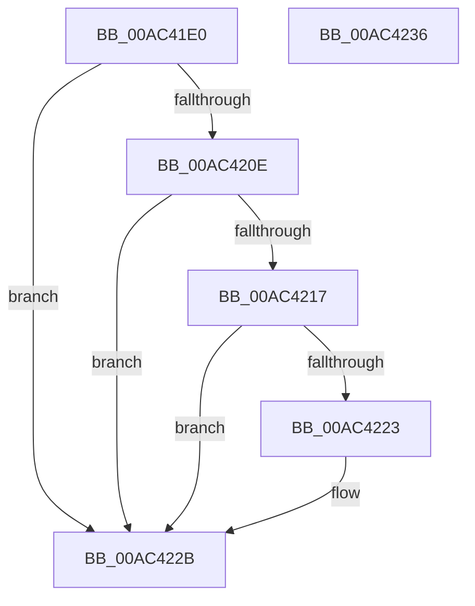

# MiCommitRequestFailed

- RVA: `0x00AC41E0`–`0x00AC4237` (길이 `87` bytes)
- VA: `0x0000000140AC41E0`
- 실행 섹션: `PAGE`
- PDB 이름 있음: `예`; PDB Function 태그: `아니요`
- unwind 정보 RVA: `0x0005CAAC`
- 디코드: `22`개 명령, `87/87` bytes 표시
- 미해석 바이트: `0` (있으면 어셈블리에 `.byte`로 보존)

> 이 문서는 커널 이미지의 기계어와 PDB 기호를 분석해 생성했습니다. 4번과 5번은 함수 원형과 자료형을 바이너리 사용 방식에서 추정한 C 해석이며 원본 소스 복구 결과는 아닙니다.

## 1. Dependencies

- 직접 호출 지점: **2**; 고유 호출 대상: **2**
- 직접 호출자로 확인된 함수: **1**
- RIP 상대 이미지 참조: **0**

### Outgoing calls
- `0x00AC41FC` → [MiLogCommitRequestFailed](MiLogCommitRequestFailed_function_00AC4240.md) (function, `0x00AC4240`)
- `0x00AC4226` → [KeRequestTerminationProcess](../74/KeRequestTerminationProcess_function_00745D38.md) (function, `0x00745D38`)

### Direct callers
- [MiChargeFullProcessCommitment](../88/MiChargeFullProcessCommitment_function_00887630.md) at `0x00887737`

### Static image references
- 디코드된 RIP-relative 메모리 참조가 없습니다.

## 2. Other-region calls and transfers

- 다른 실행 섹션으로 향하는 call: **0**
- 별도 외부 분기/꼬리 이동을 확인하지 못했습니다.

## 3. Assembly (complete function range)

```asm
00AC41E0  48 89 5C 24 08                  mov qword ptr [rsp + 8], rbx
00AC41E5  57                              push rdi
00AC41E6  48 83 EC 20                     sub rsp, 0x20
00AC41EA  65 48 8B 1C 25 88 01 00 00      mov rbx, qword ptr gs:[0x188]
00AC41F3  49 8B D0                        mov rdx, r8
00AC41F6  45 8B C1                        mov r8d, r9d
00AC41F9  48 8B F9                        mov rdi, rcx
00AC41FC  E8 3F 00 00 00                  call 0x140ac4240
00AC4201  BA 01 00 00 00                  mov edx, 1
00AC4206  38 93 4A 02 00 00               cmp byte ptr [rbx + 0x24a], dl
00AC420C  74 1D                           je 0x140ac422b
00AC420E  F7 43 74 00 04 00 00            test dword ptr [rbx + 0x74], 0x400
00AC4215  75 14                           jne 0x140ac422b
00AC4217  F7 87 F4 01 00 00 00 01 00 00   test dword ptr [rdi + 0x1f4], 0x100
00AC4221  74 08                           je 0x140ac422b
00AC4223  48 8B CB                        mov rcx, rbx
00AC4226  E8 0D 1B C8 FF                  call 0x140745d38
00AC422B  48 8B 5C 24 30                  mov rbx, qword ptr [rsp + 0x30]
00AC4230  48 83 C4 20                     add rsp, 0x20
00AC4234  5F                              pop rdi
00AC4235  C3                              ret
00AC4236  CC                              int3
```

## 4. C-style interpretation (structured pseudocode)

```c
__int64 __fastcall MiCommitRequestFailed(__int64 a1, __int64 a2, __int64 a3, int a4)
{
    __int64 result;
    __int64 v_rsp;
    unsigned __int64 v_stack_p8;

    v_stack_p8 = v_rbx;
    v_rsp = (v_rsp) - (32);
    result = MiLogCommitRequestFailed(a1, a3, (unsigned int)(a4), a4);
    if ((*(unsigned __int8 *)(*(unsigned __int64 *)(gs_base + (0 + 392)) + 586)) == 1) goto loc_00AC422B;
    if (((*(unsigned int *)(*(unsigned __int64 *)(gs_base + (0 + 392)) + 116)) & (0x400ULL)) != 0) goto loc_00AC422B;
    if (((*(unsigned int *)(a1 + 500)) & (256)) != 0) {
        a1 = *(unsigned __int64 *)(gs_base + (0 + 392));
        result = KeRequestTerminationProcess(a1, 1, (unsigned int)(a4), a4);
    }
    v_rsp = (v_rsp) + (32);
    return result;
}
```

## 5. (Beta) C Style

```c
int64_t MiCommitRequestFailed(void *Arg1, int64_t Arg2, int64_t Arg3, int32_t Arg4)
{
    uint8_t *arg1 = (uint8_t *)Arg1;

    int64_t result;
    int64_t local_rsp;
    uint64_t v_stack_p8;

    v_stack_p8 = local_rbx;
    local_rsp = (local_rsp) - (32);
    result = MiLogCommitRequestFailed(Arg1, Arg3, (uint32_t)(Arg4), Arg4);
    if ((*(uint8_t *)(*(uint64_t *)(gs_base + (0 + 0x188)) + 0x24A)) == 1) goto loc_00AC422B;
    if (((*(uint32_t *)(*(uint64_t *)(gs_base + (0 + 0x188)) + 0x74)) & (0x400ULL)) != 0) goto loc_00AC422B;
    if (((*(uint32_t *)(arg1 + 0x1F4)) & (256)) != 0) {
        Arg1 = *(uint64_t *)(gs_base + (0 + 0x188));
        result = KeRequestTerminationProcess(Arg1, 1, (uint32_t)(Arg4), Arg4);
    }
    local_rsp = (local_rsp) + (32);
    return result;
}
```

### 관측된 메모리 오프셋

구조체 형식이 확인되지 않은 접근은 인자 기준의 오프셋으로만 기록했습니다.

| 기준 인자 | 오프셋 표현 | 폭 (bit) | 접근 |
|---|---:|---:|---|
| `Arg1` | `+ 0x1F4` | `32` | `R` |

## 6. Execution-region graph

[열기: 2D/3D 그래프와 함수 탐색 컨트롤 패널](../../../control-panel.html?section=page&rva=0x00AC41E0&view=graph)

- 2D 그래프는 위에서 아래로 흐르고, 3D 그래프는 빈 공간을 드래그해 회전합니다. Shift+드래그는 이동, 휠은 확대·축소, 함수 노드 선택은 대상 보고서 이동입니다.

### Static fallback


