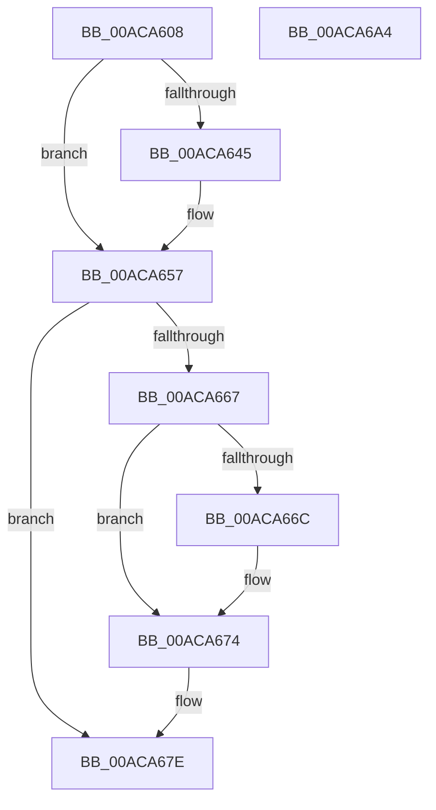

# MiDeleteVadHotPatchState

- RVA: `0x00ACA608`–`0x00ACA6A5` (길이 `157` bytes)
- VA: `0x0000000140ACA608`
- 실행 섹션: `PAGE`
- PDB 이름 있음: `예`; PDB Function 태그: `아니요`
- unwind 정보 RVA: `0x0005E6B4`
- 디코드: `44`개 명령, `157/157` bytes 표시
- 미해석 바이트: `0` (있으면 어셈블리에 `.byte`로 보존)

> 이 문서는 커널 이미지의 기계어와 PDB 기호를 분석해 생성했습니다. 4번과 5번은 함수 원형과 자료형을 바이너리 사용 방식에서 추정한 C 해석이며 원본 소스 복구 결과는 아닙니다.

## 1. Dependencies

- 직접 호출 지점: **5**; 고유 호출 대상: **5**
- 직접 호출자로 확인된 함수: **1**
- RIP 상대 이미지 참조: **0**

### Outgoing calls
- `0x00ACA632` → [MiGetVadWakeList](../../text/43/MiGetVadWakeList_function_00431134.md) (function, `0x00431134`)
- `0x00ACA65D` → [MiUnlockVad](../../text/2A/MiUnlockVad_function_002A59C8.md) (function, `0x002A59C8`)
- `0x00ACA66F` → [MiDeleteHotPatchEntry](../80/MiDeleteHotPatchEntry_function_008033C0.md) (function, `0x008033C0`)
- `0x00ACA679` → [ExFreePoolWithTag](../../poolcode/B8/ExFreePoolWithTag_function_00B82870.md) (function, `0x00B82870`)
- `0x00ACA684` → [MiLockVad](../../text/29/MiLockVad_function_00295810.md) (function, `0x00295810`)

### Direct callers
- [MiFinishVadDeletion](../../text/43/MiFinishVadDeletion_function_00430ED0.md) at `0x0043109D`

### Static image references
- 디코드된 RIP-relative 메모리 참조가 없습니다.

## 2. Other-region calls and transfers

- 다른 실행 섹션으로 향하는 call: **4**
  - `0x00ACA632` → [MiGetVadWakeList](../../text/43/MiGetVadWakeList_function_00431134.md) (`PAGE` → `.text`)
  - `0x00ACA65D` → [MiUnlockVad](../../text/2A/MiUnlockVad_function_002A59C8.md) (`PAGE` → `.text`)
  - `0x00ACA679` → [ExFreePoolWithTag](../../poolcode/B8/ExFreePoolWithTag_function_00B82870.md) (`PAGE` → `POOLCODE`)
  - `0x00ACA684` → [MiLockVad](../../text/29/MiLockVad_function_00295810.md) (`PAGE` → `.text`)
- 별도 외부 분기/꼬리 이동을 확인하지 못했습니다.

## 3. Assembly (complete function range)

```asm
00ACA608  48 8B C4                        mov rax, rsp
00ACA60B  48 89 58 08                     mov qword ptr [rax + 8], rbx
00ACA60F  48 89 68 10                     mov qword ptr [rax + 0x10], rbp
00ACA613  48 89 70 18                     mov qword ptr [rax + 0x18], rsi
00ACA617  48 89 78 20                     mov qword ptr [rax + 0x20], rdi
00ACA61B  41 56                           push r14
00ACA61D  48 83 EC 20                     sub rsp, 0x20
00ACA621  65 48 8B 2C 25 88 01 00 00      mov rbp, qword ptr gs:[0x188]
00ACA62A  BA 00 02 00 00                  mov edx, 0x200
00ACA62F  48 8B F1                        mov rsi, rcx
00ACA632  E8 FD 6A 96 FF                  call 0x140431134
00ACA637  45 33 F6                        xor r14d, r14d
00ACA63A  48 8B F8                        mov rdi, rax
00ACA63D  41 8B DE                        mov ebx, r14d
00ACA640  48 85 C0                        test rax, rax
00ACA643  74 12                           je 0x140aca657
00ACA645  48 8B 58 08                     mov rbx, qword ptr [rax + 8]
00ACA649  83 4B 44 02                     or dword ptr [rbx + 0x44], 2
00ACA64D  8B 4B 44                        mov ecx, dword ptr [rbx + 0x44]
00ACA650  F6 C1 01                        test cl, 1
00ACA653  49 0F 45 DE                     cmovne rbx, r14
00ACA657  48 8B D6                        mov rdx, rsi
00ACA65A  48 8B CD                        mov rcx, rbp
00ACA65D  E8 66 B3 7D FF                  call 0x1402a59c8
00ACA662  48 85 FF                        test rdi, rdi
00ACA665  74 17                           je 0x140aca67e
00ACA667  48 85 DB                        test rbx, rbx
00ACA66A  74 08                           je 0x140aca674
00ACA66C  48 8B CB                        mov rcx, rbx
00ACA66F  E8 4C 8D D3 FF                  call 0x1408033c0
00ACA674  33 D2                           xor edx, edx
00ACA676  48 8B CF                        mov rcx, rdi
00ACA679  E8 F2 81 0B 00                  call 0x140b82870
00ACA67E  48 8B D6                        mov rdx, rsi
00ACA681  48 8B CD                        mov rcx, rbp
00ACA684  E8 87 B1 7C FF                  call 0x140295810
00ACA689  48 8B 5C 24 30                  mov rbx, qword ptr [rsp + 0x30]
00ACA68E  48 8B 6C 24 38                  mov rbp, qword ptr [rsp + 0x38]
00ACA693  48 8B 74 24 40                  mov rsi, qword ptr [rsp + 0x40]
00ACA698  48 8B 7C 24 48                  mov rdi, qword ptr [rsp + 0x48]
00ACA69D  48 83 C4 20                     add rsp, 0x20
00ACA6A1  41 5E                           pop r14
00ACA6A3  C3                              ret
00ACA6A4  CC                              int3
```

## 4. C-style interpretation (structured pseudocode)

```c
__int64 __fastcall MiDeleteVadHotPatchState(__int64 a1)
{
    __int64 result;
    __int64 v_r14;
    __int64 v_rbx;
    __int64 v_rsp;
    unsigned __int64 v_stack_p10;
    unsigned __int64 v_stack_p18;
    unsigned __int64 v_stack_p20;
    unsigned __int64 v_stack_p8;

    *(unsigned __int64 *)(v_rsp + 8) = v_rbx;
    *(unsigned __int64 *)(v_rsp + 16) = v_rbp;
    *(unsigned __int64 *)(v_rsp + 24) = v_rsi;
    *(unsigned __int64 *)(v_rsp + 32) = v_rdi;
    v_rsp = (v_rsp) - (32);
    result = MiGetVadWakeList(a1, 512, a3, a4);
    v_r14 = 0;
    v_rbx = 0;
    if (result != 0) {
        v_rbx = *(unsigned __int64 *)(result + 8);
        a1 = *(unsigned int *)(v_rbx + 68);
        if ((((unsigned __int8)(a1)) & (1)) != 0) { v_rbx = 0; }
    }
    result = MiUnlockVad(*(unsigned __int64 *)(gs_base + (0 + 392)), a1, a3, a4);
    if (result == 0) goto loc_00ACA67E;
    if (v_rbx != 0) {
        a1 = v_rbx;
        result = MiDeleteHotPatchEntry(a1, a1, a3, a4);
    }
    a2 = 0;
    result = ExFreePoolWithTag(result, a2, a3, a4);
loc_00ACA67E:
    result = MiLockVad(*(unsigned __int64 *)(gs_base + (0 + 392)), a1, a3, a4);
    v_rsp = (v_rsp) + (32);
    return result;
}
```

## 5. (Beta) C Style

```c
int64_t MiDeleteVadHotPatchState(int64_t Arg1)
{
    int64_t result;
    int64_t local_r14;
    int64_t local_rbx;
    int64_t local_rsp;
    uint64_t v_stack_p10;
    uint64_t v_stack_p18;
    uint64_t v_stack_p20;
    uint64_t v_stack_p8;

    *(uint64_t *)(local_rsp + 0x8) = local_rbx;
    *(uint64_t *)(local_rsp + 0x10) = local_rbp;
    *(uint64_t *)(local_rsp + 0x18) = local_rsi;
    *(uint64_t *)(local_rsp + 0x20) = local_rdi;
    local_rsp = (local_rsp) - (32);
    result = MiGetVadWakeList(Arg1, 512, a3, a4);
    local_r14 = 0;
    local_rbx = 0;
    if (result != 0) {
        local_rbx = *(uint64_t *)(result + 0x8);
        Arg1 = *(uint32_t *)(local_rbx + 0x44);
        if ((((uint8_t)(Arg1)) & (1)) != 0) { local_rbx = 0; }
    }
    result = MiUnlockVad(*(uint64_t *)(gs_base + (0 + 0x188)), Arg1, a3, a4);
    if (result == 0) goto loc_00ACA67E;
    if (local_rbx != 0) {
        Arg1 = local_rbx;
        result = MiDeleteHotPatchEntry(Arg1, Arg1, a3, a4);
    }
    a2 = 0;
    result = ExFreePoolWithTag(result, a2, a3, a4);
loc_00ACA67E:
    result = MiLockVad(*(uint64_t *)(gs_base + (0 + 0x188)), Arg1, a3, a4);
    local_rsp = (local_rsp) + (32);
    return result;
}
```

## 6. Execution-region graph

[열기: 2D/3D 그래프와 함수 탐색 컨트롤 패널](../../../control-panel.html?section=page&rva=0x00ACA608&view=graph)

- 2D 그래프는 위에서 아래로 흐르고, 3D 그래프는 빈 공간을 드래그해 회전합니다. Shift+드래그는 이동, 휠은 확대·축소, 함수 노드 선택은 대상 보고서 이동입니다.

### Static fallback


