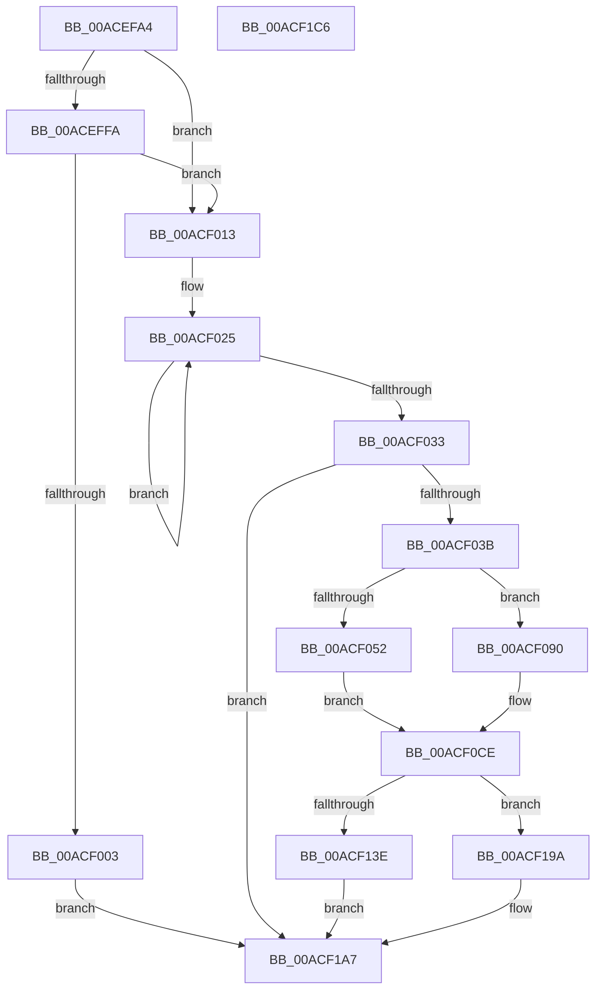

# MiForceCrashForInvalidAccess

- RVA: `0x00ACEFA4`–`0x00ACF1C7` (길이 `547` bytes)
- VA: `0x0000000140ACEFA4`
- 실행 섹션: `PAGE`
- PDB 이름 있음: `예`; PDB Function 태그: `아니요`
- unwind 정보 RVA: `0x000BE84C`
- 디코드: `129`개 명령, `547/547` bytes 표시
- 미해석 바이트: `0` (있으면 어셈블리에 `.byte`로 보존)

> 이 문서는 커널 이미지의 기계어와 PDB 기호를 분석해 생성했습니다. 4번과 5번은 함수 원형과 자료형을 바이너리 사용 방식에서 추정한 C 해석이며 원본 소스 복구 결과는 아닙니다.

## 1. Dependencies

- 직접 호출 지점: **15**; 고유 호출 대상: **13**
- 직접 호출자로 확인된 함수: **1**
- RIP 상대 이미지 참조: **2**

### Outgoing calls
- `0x00ACF009` → [KeRequestTerminationProcess](../74/KeRequestTerminationProcess_function_00745D38.md) (function, `0x00745D38`)
- `0x00ACF03E` → [IoThreadToProcess](../../text/44/IoThreadToProcess_function_00448540.md) (function, `0x00448540`)
- `0x00ACF05E` → [memset](../../text/6C/memset_function_006C6C40.md) (function, `0x006C6C40`)
- `0x00ACF074` → [PsGetProcessId](../../text/43/PsGetProcessId_function_0043D910.md) (function, `0x0043D910`)
- `0x00ACF089` → [DbgkQueueUserExceptionReport](../71/DbgkQueueUserExceptionReport_function_00710B04.md) (function, `0x00710B04`)
- `0x00ACF093` → [PsGetProcessId](../../text/43/PsGetProcessId_function_0043D910.md) (function, `0x0043D910`)
- `0x00ACF0C9` → [DbgkWerCaptureLiveKernelDump](DbgkWerCaptureLiveKernelDump_function_00AC1E90.md) (function, `0x00AC1E90`)
- `0x00ACF0D3` → [PsFreezeProcess](../AA/PsFreezeProcess_function_00AA6D04.md) (function, `0x00AA6D04`)
- `0x00ACF135` → [ZwCreateThreadEx](../../text/6A/ZwCreateThreadEx_function_006AE9F0.md) (function, `0x006AE9F0`)
- `0x00ACF16F` → [ObpReferenceObjectByHandleWithTag](../86/ObpReferenceObjectByHandleWithTag_function_00869650.md) (function, `0x00869650`)
- `0x00ACF17D` → [KeRequestTerminationProcess](../74/KeRequestTerminationProcess_function_00745D38.md) (function, `0x00745D38`)
- `0x00ACF188` → [ObCloseHandle](../8A/ObCloseHandle_function_008A1870.md) (function, `0x008A1870`)
- `0x00ACF193` → [ObfDereferenceObjectWithTag](../../text/2F/ObfDereferenceObjectWithTag_function_002F78E0.md) (function, `0x002F78E0`)
- `0x00ACF1A2` → [PsTerminateProcess](../90/PsTerminateProcess_function_00904C64.md) (function, `0x00904C64`)
- `0x00ACF1AA` → [KeLeaveCriticalRegionThread](../../text/25/KeLeaveCriticalRegionThread_function_0025EFF0.md) (function, `0x0025EFF0`)

### Direct callers
- [MiKernelWriteToExecutableMemory](../../text/36/MiKernelWriteToExecutableMemory_function_00368F18.md) at `0x00368F8C`

### Static image references
- `0x00ACF09C` → RVA `0x00B09D90` (` ?? ::NNGAKEGL::`string'`; read)
- `0x00ACF13E` → RVA `0x00FC6AC8` (`ALMOSTRO`; read)

## 2. Other-region calls and transfers

- 다른 실행 섹션으로 향하는 call: **7**
  - `0x00ACF03E` → [IoThreadToProcess](../../text/44/IoThreadToProcess_function_00448540.md) (`PAGE` → `.text`)
  - `0x00ACF05E` → [memset](../../text/6C/memset_function_006C6C40.md) (`PAGE` → `.text`)
  - `0x00ACF074` → [PsGetProcessId](../../text/43/PsGetProcessId_function_0043D910.md) (`PAGE` → `.text`)
  - `0x00ACF093` → [PsGetProcessId](../../text/43/PsGetProcessId_function_0043D910.md) (`PAGE` → `.text`)
  - `0x00ACF135` → [ZwCreateThreadEx](../../text/6A/ZwCreateThreadEx_function_006AE9F0.md) (`PAGE` → `.text`)
  - `0x00ACF193` → [ObfDereferenceObjectWithTag](../../text/2F/ObfDereferenceObjectWithTag_function_002F78E0.md) (`PAGE` → `.text`)
  - `0x00ACF1AA` → [KeLeaveCriticalRegionThread](../../text/25/KeLeaveCriticalRegionThread_function_0025EFF0.md) (`PAGE` → `.text`)
- 별도 외부 분기/꼬리 이동을 확인하지 못했습니다.

## 3. Assembly (complete function range)

```asm
00ACEFA4  48 89 5C 24 08                  mov qword ptr [rsp + 8], rbx
00ACEFA9  55                              push rbp
00ACEFAA  56                              push rsi
00ACEFAB  57                              push rdi
00ACEFAC  41 54                           push r12
00ACEFAE  41 56                           push r14
00ACEFB0  48 8D 6C 24 D0                  lea rbp, [rsp - 0x30]
00ACEFB5  48 81 EC 30 01 00 00            sub rsp, 0x130
00ACEFBC  33 C0                           xor eax, eax
00ACEFBE  33 F6                           xor esi, esi
00ACEFC0  48 89 75 70                     mov qword ptr [rbp + 0x70], rsi
00ACEFC4  0F 57 C0                        xorps xmm0, xmm0
00ACEFC7  0F 11 44 24 60                  movups xmmword ptr [rsp + 0x60], xmm0
00ACEFCC  48 89 45 80                     mov qword ptr [rbp - 0x80], rax
00ACEFD0  49 83 CC FF                     or r12, 0xffffffffffffffff
00ACEFD4  0F 11 44 24 70                  movups xmmword ptr [rsp + 0x70], xmm0
00ACEFD9  89 45 88                        mov dword ptr [rbp - 0x78], eax
00ACEFDC  48 8B F9                        mov rdi, rcx
00ACEFDF  65 48 8B 1C 25 88 01 00 00      mov rbx, qword ptr gs:[0x188]
00ACEFE8  66 44 01 A3 E4 01 00 00         add word ptr [rbx + 0x1e4], r12w
00ACEFF0  90                              nop
00ACEFF1  80 BB 4A 02 00 00 01            cmp byte ptr [rbx + 0x24a], 1
00ACEFF8  74 19                           je 0x140acf013
00ACEFFA  F7 43 74 00 04 00 00            test dword ptr [rbx + 0x74], 0x400
00ACF001  75 10                           jne 0x140acf013
00ACF003  8D 56 02                        lea edx, [rsi + 2]
00ACF006  48 8B CB                        mov rcx, rbx
00ACF009  E8 2A 6D C7 FF                  call 0x140745d38
00ACF00E  E9 94 01 00 00                  jmp 0x140acf1a7
00ACF013  0F 0D 89 F0 01 00 00            prefetchw byte ptr [rcx + 0x1f0]
00ACF01A  8B 81 F0 01 00 00               mov eax, dword ptr [rcx + 0x1f0]
00ACF020  BA 00 00 00 04                  mov edx, 0x4000000
00ACF025  8B C8                           mov ecx, eax
00ACF027  0B CA                           or ecx, edx
00ACF029  F0 0F B1 8F F0 01 00 00         lock cmpxchg dword ptr [rdi + 0x1f0], ecx
00ACF031  75 F2                           jne 0x140acf025
00ACF033  85 C2                           test edx, eax
00ACF035  0F 85 6C 01 00 00               jne 0x140acf1a7
00ACF03B  48 8B CB                        mov rcx, rbx
00ACF03E  E8 FD 94 97 FF                  call 0x140448540
00ACF043  41 BE 00 10 00 00               mov r14d, 0x1000
00ACF049  44 85 B0 FC 05 00 00            test dword ptr [rax + 0x5fc], r14d
00ACF050  75 3E                           jne 0x140acf090
00ACF052  33 D2                           xor edx, edx
00ACF054  48 8D 4D 90                     lea rcx, [rbp - 0x70]
00ACF058  41 B8 98 00 00 00               mov r8d, 0x98
00ACF05E  E8 DD 7B BF FF                  call 0x1406c6c40
00ACF063  48 8B CF                        mov rcx, rdi
00ACF066  C7 45 90 26 07 00 C0            mov dword ptr [rbp - 0x70], 0xc0000726
00ACF06D  C7 45 A8 01 00 00 00            mov dword ptr [rbp - 0x58], 1
00ACF074  E8 97 E8 96 FF                  call 0x14043d910
00ACF079  4C 8D 45 90                     lea r8, [rbp - 0x70]
00ACF07D  48 89 45 B0                     mov qword ptr [rbp - 0x50], rax
00ACF081  BA 0E 00 00 00                  mov edx, 0xe
00ACF086  48 8B CB                        mov rcx, rbx
00ACF089  E8 76 1A C4 FF                  call 0x140710b04
00ACF08E  EB 3E                           jmp 0x140acf0ce
00ACF090  48 8B CF                        mov rcx, rdi
00ACF093  E8 78 E8 96 FF                  call 0x14043d910
00ACF098  89 74 24 40                     mov dword ptr [rsp + 0x40], esi
00ACF09C  48 8D 0D ED AC 03 00            lea rcx, [rip + 0x3aced]
00ACF0A3  48 89 74 24 38                  mov qword ptr [rsp + 0x38], rsi
00ACF0A8  BA 1A 00 00 00                  mov edx, 0x1a
00ACF0AD  48 89 74 24 30                  mov qword ptr [rsp + 0x30], rsi
00ACF0B2  49 C7 C1 26 07 00 C0            mov r9, 0xffffffffc0000726
00ACF0B9  48 89 74 24 28                  mov qword ptr [rsp + 0x28], rsi
00ACF0BE  41 B8 80 15 00 00               mov r8d, 0x1580
00ACF0C4  48 89 44 24 20                  mov qword ptr [rsp + 0x20], rax
00ACF0C9  E8 C2 2D FF FF                  call 0x140ac1e90
00ACF0CE  33 D2                           xor edx, edx
00ACF0D0  48 8B CF                        mov rcx, rdi
00ACF0D3  E8 2C 7C FD FF                  call 0x140aa6d04
00ACF0D8  48 89 74 24 50                  mov qword ptr [rsp + 0x50], rsi
00ACF0DD  4C 8D 44 24 60                  lea r8, [rsp + 0x60]
00ACF0E2  4C 89 74 24 48                  mov qword ptr [rsp + 0x48], r14
00ACF0E7  48 8D 4D 70                     lea rcx, [rbp + 0x70]
00ACF0EB  4C 89 74 24 40                  mov qword ptr [rsp + 0x40], r14
00ACF0F0  0F 57 C0                        xorps xmm0, xmm0
00ACF0F3  48 89 74 24 38                  mov qword ptr [rsp + 0x38], rsi
00ACF0F8  41 BE FF FF 1F 00               mov r14d, 0x1fffff
00ACF0FE  C7 44 24 30 01 00 00 00         mov dword ptr [rsp + 0x30], 1
00ACF106  41 8B D6                        mov edx, r14d
00ACF109  48 89 74 24 28                  mov qword ptr [rsp + 0x28], rsi
00ACF10E  4D 8B CC                        mov r9, r12
00ACF111  48 89 74 24 20                  mov qword ptr [rsp + 0x20], rsi
00ACF116  C7 44 24 60 30 00 00 00         mov dword ptr [rsp + 0x60], 0x30
00ACF11E  48 89 74 24 68                  mov qword ptr [rsp + 0x68], rsi
00ACF123  C7 44 24 78 00 02 00 00         mov dword ptr [rsp + 0x78], 0x200
00ACF12B  48 89 74 24 70                  mov qword ptr [rsp + 0x70], rsi
00ACF130  F3 0F 7F 45 80                  movdqu xmmword ptr [rbp - 0x80], xmm0
00ACF135  E8 B6 F8 BD FF                  call 0x1406ae9f0
00ACF13A  85 C0                           test eax, eax
00ACF13C  78 5C                           js 0x140acf19a
00ACF13E  4C 8B 05 83 79 4F 00            mov r8, qword ptr [rip + 0x4f7983]
00ACF145  48 8D 45 78                     lea rax, [rbp + 0x78]
00ACF149  48 8B 4D 70                     mov rcx, qword ptr [rbp + 0x70]
00ACF14D  BF 4D 6D 50 72                  mov edi, 0x72506d4d
00ACF152  48 89 74 24 38                  mov qword ptr [rsp + 0x38], rsi
00ACF157  45 33 C9                        xor r9d, r9d
00ACF15A  48 89 74 24 30                  mov qword ptr [rsp + 0x30], rsi
00ACF15F  41 8B D6                        mov edx, r14d
00ACF162  48 89 44 24 28                  mov qword ptr [rsp + 0x28], rax
00ACF167  89 7C 24 20                     mov dword ptr [rsp + 0x20], edi
00ACF16B  48 89 75 78                     mov qword ptr [rbp + 0x78], rsi
00ACF16F  E8 DC A4 D9 FF                  call 0x140869650
00ACF174  48 8B 4D 78                     mov rcx, qword ptr [rbp + 0x78]
00ACF178  BA 03 00 00 00                  mov edx, 3
00ACF17D  E8 B6 6B C7 FF                  call 0x140745d38
00ACF182  48 8B 4D 70                     mov rcx, qword ptr [rbp + 0x70]
00ACF186  33 D2                           xor edx, edx
00ACF188  E8 E3 26 DD FF                  call 0x1408a1870
00ACF18D  48 8B 4D 78                     mov rcx, qword ptr [rbp + 0x78]
00ACF191  8B D7                           mov edx, edi
00ACF193  E8 48 87 82 FF                  call 0x1402f78e0
00ACF198  EB 0D                           jmp 0x140acf1a7
00ACF19A  BA 25 07 00 C0                  mov edx, 0xc0000725
00ACF19F  48 8B CF                        mov rcx, rdi
00ACF1A2  E8 BD 5A E3 FF                  call 0x140904c64
00ACF1A7  48 8B CB                        mov rcx, rbx
00ACF1AA  E8 41 FE 78 FF                  call 0x14025eff0
00ACF1AF  48 8B 9C 24 60 01 00 00         mov rbx, qword ptr [rsp + 0x160]
00ACF1B7  48 81 C4 30 01 00 00            add rsp, 0x130
00ACF1BE  41 5E                           pop r14
00ACF1C0  41 5C                           pop r12
00ACF1C2  5F                              pop rdi
00ACF1C3  5E                              pop rsi
00ACF1C4  5D                              pop rbp
00ACF1C5  C3                              ret
00ACF1C6  CC                              int3
```

## 4. C-style interpretation (structured pseudocode)

```c
__int64 __fastcall MiForceCrashForInvalidAccess(__int64 a1)
{
    __int64 result;
    __int64 v_r12;
    __int64 v_rsi;
    __int64 v_rsp;
    unsigned __int64 v_stack_m108;
    unsigned __int64 v_stack_m110;
    unsigned int v_stack_m118;
    unsigned __int64 v_stack_m120;
    unsigned __int64 v_stack_m128;
    unsigned __int64 v_stack_m130;
    unsigned __int64 v_stack_m138;
    unsigned __int64 v_stack_m58;
    unsigned __int64 v_stack_mA8;
    unsigned int v_stack_mB0;
    unsigned __int64 v_stack_mC8;
    unsigned int v_stack_mD0;
    unsigned __int64 v_stack_mD8;
    unsigned int v_stack_mE0;
    unsigned __int64 v_stack_mE8;
    unsigned __int64 v_stack_mF0;
    unsigned __int64 v_stack_mF8;
    unsigned __int64 v_stack_p18;
    unsigned __int64 v_stack_p20;
    unsigned __int64 v_stack_p8;

    v_stack_p8 = v_rbx;
    v_rsp = (v_rsp) - (304);
    result = 0;
    v_rsi = 0;
    v_stack_p18 = 0;
    v_stack_mF8 = v_xmm0;
    v_stack_mD8 = 0;
    v_r12 = (v_r12) | (-1);
    v_stack_mE8 = v_xmm0;
    v_stack_mD0 = 0;
    if ((*(unsigned __int8 *)(*(unsigned __int64 *)(gs_base + (0 + 392)) + 586)) == 1) goto loc_00ACF013;
    if (((*(unsigned int *)(*(unsigned __int64 *)(gs_base + (0 + 392)) + 116)) & (0x400ULL)) != 0) goto loc_00ACF013;
    result = KeRequestTerminationProcess(*(unsigned __int64 *)(gs_base + (0 + 392)), v_rsi + 2, a3, a4);
    goto loc_00ACF1A7;
loc_00ACF013:
loc_00ACF025:
    a1 = (unsigned int)(((unsigned int)((unsigned int)((unsigned int)(*(unsigned int *)(*(unsigned __int64 *)(gs_base + (0 + 392)) + 496))))) | ((unsigned int)((unsigned int)(0x4000000ULL))));
    if (condition_is_not_equal) goto loc_00ACF025;
    if ((((unsigned int)((unsigned int)(0x4000000ULL))) & ((unsigned int)((unsigned int)(*(unsigned int *)(*(unsigned __int64 *)(gs_base + (0 + 392)) + 496))))) != 0) goto loc_00ACF1A7;
    result = IoThreadToProcess(*(unsigned __int64 *)(gs_base + (0 + 392)), (unsigned int)(0x4000000ULL), a3, a4);
    if (((*(unsigned int *)(result + 1532)) & ((unsigned int)((unsigned int)(0x1000ULL)))) != 0) goto loc_00ACF090;
    a2 = 0;
    result = memset(v_stack_mC8, a2, 152, a4);
    v_stack_mC8 = 0xC0000726ULL;
    v_stack_mB0 = 1;
    result = PsGetProcessId(a1, a2, 152, a4);
    v_stack_mA8 = result;
    result = DbgkQueueUserExceptionReport(*(unsigned __int64 *)(gs_base + (0 + 392)), 14, v_stack_mC8, a4);
    goto loc_00ACF0CE;
loc_00ACF090:
    result = PsGetProcessId(a1, 14, v_stack_mC8, a4);
    v_stack_m118 = 0;
    v_stack_m120 = 0;
    v_stack_m128 = 0;
    v_stack_m130 = 0;
    v_stack_m138 = result;
    result = DbgkWerCaptureLiveKernelDump(v_rip + 240877, 26, (unsigned int)(0x1580ULL), 0xFFFFFFFFC0000726ULL);
loc_00ACF0CE:
    a2 = 0;
    result = PsFreezeProcess(a1, a2, (unsigned int)(0x1580ULL), 0xFFFFFFFFC0000726ULL);
    v_stack_m108 = 0;
    v_stack_m110 = (unsigned int)(0x1000ULL);
    v_stack_m118 = (unsigned int)(0x1000ULL);
    v_stack_m120 = 0;
    v_stack_m128 = 1;
    v_stack_m130 = 0;
    v_stack_m138 = 0;
    v_stack_mF8 = 48;
    v_stack_mF0 = 0;
    v_stack_mE0 = 512;
    v_stack_mE8 = 0;
    v_stack_mD8 = v_xmm0;
    result = ZwCreateThreadEx(v_stack_p18, (unsigned int)((unsigned int)((unsigned int)(0x1FFFFFULL))), v_stack_mF8, v_r12);
    if (sign_flag) goto loc_00ACF19A;
    v_stack_m120 = 0;
    a4 = 0;
    v_stack_m128 = 0;
    v_stack_m130 = v_stack_p20;
    v_stack_m138 = (unsigned int)((unsigned int)(0x72506D4DULL));
    v_stack_p20 = 0;
    result = ObpReferenceObjectByHandleWithTag(v_stack_p18, (unsigned int)((unsigned int)((unsigned int)(0x1FFFFFULL))), *(unsigned __int64 *)(v_rip + 5208451), a4);
    result = KeRequestTerminationProcess(v_stack_p20, 3, *(unsigned __int64 *)(v_rip + 5208451), a4);
    a2 = 0;
    result = ObCloseHandle(v_stack_p18, a2, *(unsigned __int64 *)(v_rip + 5208451), a4);
    result = ObfDereferenceObjectWithTag(v_stack_p20, (unsigned int)((unsigned int)((unsigned int)(0x72506D4DULL))), *(unsigned __int64 *)(v_rip + 5208451), a4);
    goto loc_00ACF1A7;
loc_00ACF19A:
    result = PsTerminateProcess((unsigned int)(0x72506D4DULL), (unsigned int)(0xC0000725ULL), *(unsigned __int64 *)(v_rip + 5208451), a4);
loc_00ACF1A7:
    result = KeLeaveCriticalRegionThread(*(unsigned __int64 *)(gs_base + (0 + 392)), (unsigned int)(0xC0000725ULL), *(unsigned __int64 *)(v_rip + 5208451), a4);
    v_rsp = (v_rsp) + (304);
    return result;
}
```

## 5. (Beta) C Style

```c
int64_t MiForceCrashForInvalidAccess(void *Arg1)
{
    uint8_t *arg1 = (uint8_t *)Arg1;

    int64_t result;
    int64_t local_r12;
    int64_t local_rsi;
    int64_t local_rsp;
    uint64_t v_stack_m108;
    uint64_t v_stack_m110;
    uint32_t v_stack_m118;
    uint64_t v_stack_m120;
    uint64_t v_stack_m128;
    uint64_t v_stack_m130;
    uint64_t v_stack_m138;
    uint64_t v_stack_m58;
    uint64_t v_stack_mA8;
    uint32_t v_stack_mB0;
    uint64_t v_stack_mC8;
    uint32_t v_stack_mD0;
    uint64_t v_stack_mD8;
    uint32_t v_stack_mE0;
    uint64_t v_stack_mE8;
    uint64_t v_stack_mF0;
    uint64_t v_stack_mF8;
    uint64_t v_stack_p18;
    uint64_t v_stack_p20;
    uint64_t v_stack_p8;

    v_stack_p8 = local_rbx;
    local_rsp = (local_rsp) - (304);
    result = 0;
    local_rsi = 0;
    v_stack_p18 = 0;
    v_stack_mF8 = v_xmm0;
    v_stack_mD8 = 0;
    local_r12 = (local_r12) | (-1);
    v_stack_mE8 = v_xmm0;
    v_stack_mD0 = 0;
    if ((*(uint8_t *)(*(uint64_t *)(gs_base + (0 + 0x188)) + 0x24A)) == 1) goto loc_00ACF013;
    if (((*(uint32_t *)(*(uint64_t *)(gs_base + (0 + 0x188)) + 0x74)) & (0x400ULL)) != 0) goto loc_00ACF013;
    result = KeRequestTerminationProcess(*(uint64_t *)(gs_base + (0 + 0x188)), local_rsi + 2, a3, a4);
    goto loc_00ACF1A7;
loc_00ACF013:
loc_00ACF025:
    Arg1 = (uint32_t)(((uint32_t)((uint32_t)((uint32_t)(*(uint32_t *)(*(uint64_t *)(gs_base + (0 + 0x188)) + 0x1F0))))) | ((uint32_t)((uint32_t)(0x4000000ULL))));
    if (condition_is_not_equal) goto loc_00ACF025;
    if ((((uint32_t)((uint32_t)(0x4000000ULL))) & ((uint32_t)((uint32_t)(*(uint32_t *)(*(uint64_t *)(gs_base + (0 + 0x188)) + 0x1F0))))) != 0) goto loc_00ACF1A7;
    result = IoThreadToProcess(*(uint64_t *)(gs_base + (0 + 0x188)), (uint32_t)(0x4000000ULL), a3, a4);
    if (((*(uint32_t *)(result + 0x5FC)) & ((uint32_t)((uint32_t)(0x1000ULL)))) != 0) goto loc_00ACF090;
    a2 = 0;
    result = memset(v_stack_mC8, a2, 152, a4);
    v_stack_mC8 = 0xC0000726ULL;
    v_stack_mB0 = 1;
    result = PsGetProcessId(Arg1, a2, 152, a4);
    v_stack_mA8 = result;
    result = DbgkQueueUserExceptionReport(*(uint64_t *)(gs_base + (0 + 0x188)), 14, v_stack_mC8, a4);
    goto loc_00ACF0CE;
loc_00ACF090:
    result = PsGetProcessId(Arg1, 14, v_stack_mC8, a4);
    v_stack_m118 = 0;
    v_stack_m120 = 0;
    v_stack_m128 = 0;
    v_stack_m130 = 0;
    v_stack_m138 = result;
    result = DbgkWerCaptureLiveKernelDump(v_rip + 240877, 26, (uint32_t)(0x1580ULL), 0xFFFFFFFFC0000726ULL);
loc_00ACF0CE:
    a2 = 0;
    result = PsFreezeProcess(Arg1, a2, (uint32_t)(0x1580ULL), 0xFFFFFFFFC0000726ULL);
    v_stack_m108 = 0;
    v_stack_m110 = (uint32_t)(0x1000ULL);
    v_stack_m118 = (uint32_t)(0x1000ULL);
    v_stack_m120 = 0;
    v_stack_m128 = 1;
    v_stack_m130 = 0;
    v_stack_m138 = 0;
    v_stack_mF8 = 48;
    v_stack_mF0 = 0;
    v_stack_mE0 = 512;
    v_stack_mE8 = 0;
    v_stack_mD8 = v_xmm0;
    result = ZwCreateThreadEx(v_stack_p18, (uint32_t)((uint32_t)((uint32_t)(0x1FFFFFULL))), v_stack_mF8, local_r12);
    if (sign_flag) goto loc_00ACF19A;
    v_stack_m120 = 0;
    a4 = 0;
    v_stack_m128 = 0;
    v_stack_m130 = v_stack_p20;
    v_stack_m138 = (uint32_t)((uint32_t)(0x72506D4DULL));
    v_stack_p20 = 0;
    result = ObpReferenceObjectByHandleWithTag(v_stack_p18, (uint32_t)((uint32_t)((uint32_t)(0x1FFFFFULL))), *(uint64_t *)(v_rip + 0x4F7983), a4);
    result = KeRequestTerminationProcess(v_stack_p20, 3, *(uint64_t *)(v_rip + 0x4F7983), a4);
    a2 = 0;
    result = ObCloseHandle(v_stack_p18, a2, *(uint64_t *)(v_rip + 0x4F7983), a4);
    result = ObfDereferenceObjectWithTag(v_stack_p20, (uint32_t)((uint32_t)((uint32_t)(0x72506D4DULL))), *(uint64_t *)(v_rip + 0x4F7983), a4);
    goto loc_00ACF1A7;
loc_00ACF19A:
    result = PsTerminateProcess((uint32_t)(0x72506D4DULL), (uint32_t)(0xC0000725ULL), *(uint64_t *)(v_rip + 0x4F7983), a4);
loc_00ACF1A7:
    result = KeLeaveCriticalRegionThread(*(uint64_t *)(gs_base + (0 + 0x188)), (uint32_t)(0xC0000725ULL), *(uint64_t *)(v_rip + 0x4F7983), a4);
    local_rsp = (local_rsp) + (304);
    return result;
}
```

### 관측된 메모리 오프셋

구조체 형식이 확인되지 않은 접근은 인자 기준의 오프셋으로만 기록했습니다.

| 기준 인자 | 오프셋 표현 | 폭 (bit) | 접근 |
|---|---:|---:|---|
| `Arg1` | `+ 0x1F0` | `8` | `R` |
| `Arg1` | `+ 0x1F0` | `32` | `R` |

## 6. Execution-region graph

[열기: 2D/3D 그래프와 함수 탐색 컨트롤 패널](../../../control-panel.html?section=page&rva=0x00ACEFA4&view=graph)

- 2D 그래프는 위에서 아래로 흐르고, 3D 그래프는 빈 공간을 드래그해 회전합니다. Shift+드래그는 이동, 휠은 확대·축소, 함수 노드 선택은 대상 보고서 이동입니다.

### Static fallback


