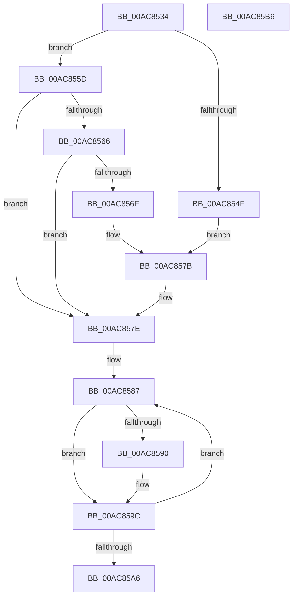

# MiFreeForkMaps

- RVA: `0x00AC8534`–`0x00AC85B7` (길이 `131` bytes)
- VA: `0x0000000140AC8534`
- 실행 섹션: `PAGE`
- PDB 이름 있음: `예`; PDB Function 태그: `아니요`
- unwind 정보 RVA: `0x0005FD94`
- 디코드: `36`개 명령, `131/131` bytes 표시
- 미해석 바이트: `0` (있으면 어셈블리에 `.byte`로 보존)

> 이 문서는 커널 이미지의 기계어와 PDB 기호를 분석해 생성했습니다. 4번과 5번은 함수 원형과 자료형을 바이너리 사용 방식에서 추정한 C 해석이며 원본 소스 복구 결과는 아닙니다.

## 1. Dependencies

- 직접 호출 지점: **3**; 고유 호출 대상: **2**
- 직접 호출자로 확인된 함수: **1**
- RIP 상대 이미지 참조: **1**

### Outgoing calls
- `0x00AC854F` → [MiGetPteAddress](../../text/43/MiGetPteAddress_function_0043E130.md) (function, `0x0043E130`)
- `0x00AC8576` → [MiGetPteAddress](../../text/43/MiGetPteAddress_function_0043E130.md) (function, `0x0043E130`)
- `0x00AC8593` → [MiFinishLastForkPageTable](../../text/4B/MiFinishLastForkPageTable_function_004B2AD4.md) (function, `0x004B2AD4`)

### Direct callers
- [MiCloneVads](../../text/22/MiCloneVads_function_0022DC1C.md) at `0x0022E17B`

### Static image references
- `0x00AC8554` → RVA `0x00010880` (`.rdata`; read)

## 2. Other-region calls and transfers

- 다른 실행 섹션으로 향하는 call: **3**
  - `0x00AC854F` → [MiGetPteAddress](../../text/43/MiGetPteAddress_function_0043E130.md) (`PAGE` → `.text`)
  - `0x00AC8576` → [MiGetPteAddress](../../text/43/MiGetPteAddress_function_0043E130.md) (`PAGE` → `.text`)
  - `0x00AC8593` → [MiFinishLastForkPageTable](../../text/4B/MiFinishLastForkPageTable_function_004B2AD4.md) (`PAGE` → `.text`)
- 별도 외부 분기/꼬리 이동을 확인하지 못했습니다.

## 3. Assembly (complete function range)

```asm
00AC8534  48 89 5C 24 10                  mov qword ptr [rsp + 0x10], rbx
00AC8539  48 89 74 24 18                  mov qword ptr [rsp + 0x18], rsi
00AC853E  57                              push rdi
00AC853F  48 83 EC 20                     sub rsp, 0x20
00AC8543  48 8B D9                        mov rbx, rcx
00AC8546  48 8B 49 38                     mov rcx, qword ptr [rcx + 0x38]
00AC854A  48 85 C9                        test rcx, rcx
00AC854D  74 0E                           je 0x140ac855d
00AC854F  E8 DC 5B 97 FF                  call 0x14043e130
00AC8554  48 8B 15 25 83 54 FF            mov rdx, qword ptr [rip - 0xab7cdb]
00AC855B  EB 1E                           jmp 0x140ac857b
00AC855D  80 BB C0 00 00 00 00            cmp byte ptr [rbx + 0xc0], 0
00AC8564  74 18                           je 0x140ac857e
00AC8566  48 8B 4B 20                     mov rcx, qword ptr [rbx + 0x20]
00AC856A  48 85 C9                        test rcx, rcx
00AC856D  74 0F                           je 0x140ac857e
00AC856F  48 8B 15 0A 83 54 FF            mov rdx, qword ptr [rip - 0xab7cf6]
00AC8576  E8 B5 5B 97 FF                  call 0x14043e130
00AC857B  48 89 10                        mov qword ptr [rax], rdx
00AC857E  48 8D 7B 08                     lea rdi, [rbx + 8]
00AC8582  BE 03 00 00 00                  mov esi, 3
00AC8587  48 8B 17                        mov rdx, qword ptr [rdi]
00AC858A  48 83 FA FF                     cmp rdx, -1
00AC858E  74 0C                           je 0x140ac859c
00AC8590  48 8B 0B                        mov rcx, qword ptr [rbx]
00AC8593  E8 3C A5 9E FF                  call 0x1404b2ad4
00AC8598  48 83 0F FF                     or qword ptr [rdi], 0xffffffffffffffff
00AC859C  48 83 C7 08                     add rdi, 8
00AC85A0  48 83 EE 01                     sub rsi, 1
00AC85A4  75 E1                           jne 0x140ac8587
00AC85A6  48 8B 5C 24 38                  mov rbx, qword ptr [rsp + 0x38]
00AC85AB  48 8B 74 24 40                  mov rsi, qword ptr [rsp + 0x40]
00AC85B0  48 83 C4 20                     add rsp, 0x20
00AC85B4  5F                              pop rdi
00AC85B5  C3                              ret
00AC85B6  CC                              int3
```

## 4. C-style interpretation (structured pseudocode)

```c
__int64 __fastcall MiFreeForkMaps(__int64 a1)
{
    __int64 result;
    __int64 v_rdi;
    __int64 v_rsi;
    __int64 v_rsp;
    unsigned __int64 v_stack_p10;
    unsigned __int64 v_stack_p18;

    v_stack_p10 = v_rbx;
    v_stack_p18 = v_rsi;
    v_rsp = (v_rsp) - (32);
    if (*(unsigned __int64 *)(a1 + 56) == 0) goto loc_00AC855D;
    result = MiGetPteAddress(*(unsigned __int64 *)(a1 + 56), a2, a3, a4);
    goto loc_00AC857B;
loc_00AC855D:
    if ((*(unsigned __int8 *)(a1 + 192)) == 0) goto loc_00AC857E;
    if (*(unsigned __int64 *)(a1 + 32) == 0) goto loc_00AC857E;
    result = MiGetPteAddress(*(unsigned __int64 *)(a1 + 32), *(unsigned __int64 *)(v_rip - 11238646), a3, a4);
loc_00AC857B:
    *(unsigned __int64 *)(result) = *(unsigned __int64 *)(v_rip - 11238646);
loc_00AC857E:
loc_00AC8587:
    if ((*(unsigned __int64 *)(a1 + 8)) != -1) {
        a1 = *(unsigned __int64 *)(a1);
        result = MiFinishLastForkPageTable(a1, *(unsigned __int64 *)(a1 + 8), a3, a4);
    }
    v_rdi = (a1 + 8) + (8);
    v_rsi = (3) - (1);
    if (condition_is_not_equal) goto loc_00AC8587;
    v_rsp = (v_rsp) + (32);
    return result;
}
```

## 5. (Beta) C Style

```c
int64_t MiFreeForkMaps(void *Arg1)
{
    uint8_t *arg1 = (uint8_t *)Arg1;

    int64_t result;
    int64_t local_rdi;
    int64_t local_rsi;
    int64_t local_rsp;
    uint64_t v_stack_p10;
    uint64_t v_stack_p18;

    v_stack_p10 = local_rbx;
    v_stack_p18 = local_rsi;
    local_rsp = (local_rsp) - (32);
    if (*(uint64_t *)(arg1 + 0x38) == 0) goto loc_00AC855D;
    result = MiGetPteAddress(*(uint64_t *)(arg1 + 0x38), a2, a3, a4);
    goto loc_00AC857B;
loc_00AC855D:
    if ((*(uint8_t *)(arg1 + 0xC0)) == 0) goto loc_00AC857E;
    if (*(uint64_t *)(arg1 + 0x20) == 0) goto loc_00AC857E;
    result = MiGetPteAddress(*(uint64_t *)(arg1 + 0x20), *(uint64_t *)(v_rip - 0xAB7CF6), a3, a4);
loc_00AC857B:
    *(uint64_t *)(result) = *(uint64_t *)(v_rip - 0xAB7CF6);
loc_00AC857E:
loc_00AC8587:
    if ((*(uint64_t *)(arg1 + 0x8)) != -1) {
        Arg1 = *(uint64_t *)(arg1);
        result = MiFinishLastForkPageTable(Arg1, *(uint64_t *)(arg1 + 0x8), a3, a4);
    }
    local_rdi = (Arg1 + 8) + (8);
    local_rsi = (3) - (1);
    if (condition_is_not_equal) goto loc_00AC8587;
    local_rsp = (local_rsp) + (32);
    return result;
}
```

### 관측된 메모리 오프셋

구조체 형식이 확인되지 않은 접근은 인자 기준의 오프셋으로만 기록했습니다.

| 기준 인자 | 오프셋 표현 | 폭 (bit) | 접근 |
|---|---:|---:|---|
| `Arg1` | `+ 0x0` | `64` | `R` |
| `Arg1` | `+ 0x0` | `64` | `R/W` |
| `Arg1` | `+ 0x8` | `64` | `R` |
| `Arg1` | `+ 0x20` | `64` | `R` |
| `Arg1` | `+ 0x38` | `64` | `R` |
| `Arg1` | `+ 0xC0` | `8` | `R` |

## 6. Execution-region graph

[열기: 2D/3D 그래프와 함수 탐색 컨트롤 패널](../../../control-panel.html?section=page&rva=0x00AC8534&view=graph)

- 2D 그래프는 위에서 아래로 흐르고, 3D 그래프는 빈 공간을 드래그해 회전합니다. Shift+드래그는 이동, 휠은 확대·축소, 함수 노드 선택은 대상 보고서 이동입니다.

### Static fallback


